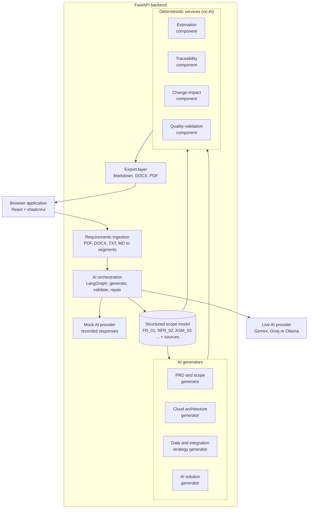
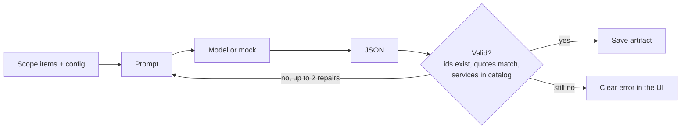

# Architecture

One browser app, one API. The AI writes text and suggestions. Plain Python does the
numbers, the checks and the change tracking. Everything is tied together by one
reviewed scope model.

## How the parts work together

| Part | Job | Code |
|---|---|---|
| Browser application | Six workspaces, from requirements to export | `frontend/src` |
| Requirements ingestion | Turns text and files into numbered segments with exact offsets | `backend/app/ingestion` |
| AI orchestration | Runs one stage at a time: generate, validate, repair | `backend/app/ai` |
| Mock AI provider | Replays recorded answers so everything runs with no key | `backend/app/ai/mock_provider.py` |
| Structured scope model | Every requirement, assumption and question with id, origin and source quote | `backend/app/domain`, `backend/app/scope` |
| PRD and scope generator | PRD and capabilities, each tied to requirement ids | `backend/app/generation` |
| Cloud architecture generator | Components mapped to real AWS, Azure or Google Cloud services | `backend/app/generation`, `backend/seeds/catalogs` |
| Data and integration strategy generator | Data domains, integrations and flows | `backend/app/generation` |
| AI solution generator | AI use cases, frameworks, responsible-AI notes | `backend/app/generation` |
| Estimation component | Effort, timeline and ROM from visible rules | `backend/app/estimation` |
| Traceability component | Which id is used where, plus coverage | `backend/app/traceability` |
| Change-impact component | Affected and unaffected outputs after a change | `backend/app/change_impact` |
| Quality-validation component | 16 checks before export | `backend/app/quality` |
| Export layer | One document model, three file formats | `backend/app/package` |

## Request flow for one AI stage

## Data storage

SQLite file under `backend/data/`. Uploaded files are not kept, only their extracted
text. Deleting a session deletes all of its data. API keys live only in `backend/.env`.
