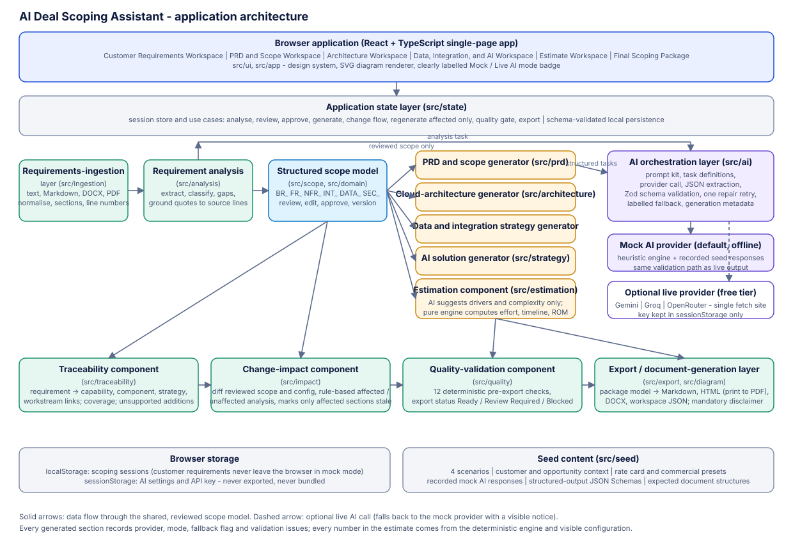

# AI Deal Scoping Assistant

A browser-based solution-consulting workspace that turns unstructured customer requirements (RFPs, discovery notes, emails) into a **structured, traceable and reviewable solution-scoping package**: a reviewed scope model, a PRD and functional scope, a cloud-specific architecture (AWS, Microsoft Azure or Google Cloud), a data / integration / AI strategy, a transparent effort-timeline-ROM estimate, change-impact analysis, a pre-export quality gate and an exportable package.

It is deliberately **not** a prompt-to-document tool. Every deliverable is generated from one shared, human-reviewed scope model; every statement carries the requirement IDs that justify it; every number in the estimate is produced by a deterministic, visible calculation.

- **Runs fully offline in a clearly labelled Mock AI mode** - no key, no `.env`, no paid service.
- Optional live AI through a free-tier provider (Google Gemini, Groq or OpenRouter), configured in the UI.
- Client-only React + TypeScript single-page app. Customer data never leaves the browser in mock mode.

**Demo video:** https://youtu.be/kqTnc74y-Jg (3.5 minutes, captioned) - the walkthrough follows the [demo script](#demo-script) at the end of this document and was recorded from this build.



**Where each specification constraint is enforced and tested:** [docs/constraint-evidence.md](docs/constraint-evidence.md).

## Contents

- [Reviewers start here](#reviewers-start-here)
- [Requirement coverage map](#requirement-coverage-map)
- [1. How to run the application locally](#1-how-to-run-the-application-locally)
- [2. How to configure an optional AI provider](#2-how-to-configure-an-optional-ai-provider)
- [3. How mock AI mode works](#3-how-mock-ai-mode-works)
- [4. How customer requirements are processed](#4-how-customer-requirements-are-processed)
- [5. How the scope model is produced and reviewed](#5-how-the-scope-model-is-produced-and-reviewed)
- [6. How source traceability is maintained](#6-how-source-traceability-is-maintained)
- [7. How the PRD and architecture are generated](#7-how-the-prd-and-architecture-are-generated)
- [8. How data, integration, and AI recommendations are produced](#8-how-data-integration-and-ai-recommendations-are-produced)
- [9. How effort and timeline are estimated](#9-how-effort-and-timeline-are-estimated)
- [10. How ROM commercials are calculated](#10-how-rom-commercials-are-calculated)
- [11. How change-impact analysis works](#11-how-change-impact-analysis-works)
- [12. How consistency and coverage are checked](#12-how-consistency-and-coverage-are-checked)
- [13. How customer data is stored or protected](#13-how-customer-data-is-stored-or-protected)
- [14. Architecture, assumptions, and known limitations](#14-architecture-assumptions-and-known-limitations)
- [Sample output](#sample-output)
- [Seed content](#seed-content)
- [Automated tests](#automated-tests)
- [Project structure](#project-structure)
- [Demo script](#demo-script)

## Reviewers start here

Prerequisites: Node.js 22.13 or newer (Node 24 also works) and npm. Nothing else.

```bash
npm ci
npm run dev
```

Open the URL Vite prints (normally `http://localhost:5173`). The header shows a persistent **Mock AI mode** badge - no key is needed for anything below.

| Step | What to do | What you should see |
| --- | --- | --- |
| 1 | On the welcome screen choose the sample scenario **ClaimsDesk Modernization** | The **Customer Requirements Workspace** opens with the customer context, the RFP text and a normalized preview with section headings and line numbers |
| 2 | Click **Run AI-assisted requirement analysis** | A structured scope model: `BR_`, `FR_`, `NFR_`, `INT_`, `DATA_`, `SEC_` items plus personas, existing systems, technology preferences, constraints, dependencies, risks, missing information, assumptions and clarification questions |
| 3 | Click any source reference | The originating customer text is highlighted in the source panel; each item is labelled customer-stated, AI-inferred or assumed |
| 4 | Edit a priority, answer a clarification question, then **Approve all pending** and **Approve the scope model** | Downstream generation unlocks only after approval |
| 5 | **PRD and Scope Workspace** - **Generate the PRD** | 14-section PRD, capability cards with included requirement IDs, recommended enhancements tagged as AI recommendations, and a requirement-by-capability coverage matrix |
| 6 | **Architecture Workspace** - pick AWS / Azure / Google Cloud or let the assistant recommend, then **Design the solution** | Architecture diagram plus component cards mapping each logical component to a platform service with supported requirement IDs, rationale, trade-offs, dependencies and security considerations |
| 7 | **Data, Integration, and AI Workspace** - **Plan the data flow** and **Select the AI approach** | Data domains and ten strategy topics, integration inventory with auth / error handling / retry / monitoring, data-flow diagram, AI use cases, the AI vs deterministic vs human-decision table and framework recommendations with rationale |
| 8 | **Estimate Workspace** - **Estimate the delivery** | Phases, workstreams, drivers, role allocation, effort / timeline / ROM ranges, confidence with limitations, missing inputs, and the step-by-step calculation for every workstream |
| 9 | Change the contingency or a day rate | ROM recalculates immediately; the change is logged with affected and unaffected areas |
| 10 | **Final Scoping Package - Change Impact** tab: change "Expected user volume" or the cloud platform, **Preview impact**, **Apply change**, then **Regenerate affected sections** | Only affected sections become stale and are regenerated; reviewed, unaffected sections are preserved |
| 11 | **Quality Gate** tab - **Run the pre-export quality check** | Twelve checks, the summary tiles from the specification and an export status (Ready / Review Required / Blocked) |
| 12 | **Package Preview and Export** tab - export Markdown, HTML (print to PDF), DOCX or workspace JSON | The integrated package with all sections and the mandatory planning-aid statement at the top and bottom |

To see the behaviour with incomplete input, load **Member Experience Modernisation (Early Discovery)**: the assistant raises gaps and questions instead of inventing facts, and the estimate reports Low confidence with the missing inputs and the workstreams they affect.

Verification commands (each block is self-contained):

```bash
npm ci
npm run verify
```

`npm run verify` runs the type check, ESLint, the full Vitest suite (1,890 tests) and the production build.

## Requirement coverage map

| Specification requirement | Where in the UI | Source | Tests |
| --- | --- | --- | --- |
| Enter / paste / upload requirements (TXT, MD, DOCX, PDF) | Customer Requirements Workspace - step 1 | `src/ingestion`, `src/ui/requirements` | `src/ingestion/*.test.ts` |
| Identify the 15 information categories with traceable IDs | Customer Requirements Workspace - step 2 | `src/analysis`, `src/domain/scope.ts`, `src/domain/ids.ts` | `src/analysis/*.test.ts` |
| Source text, provenance (customer-stated / AI-inferred / assumed), related dependencies and questions | Scope table, source panel | `src/analysis/grounding.ts` | `src/analysis/grounding.test.ts` |
| Review, edit and approve the scope before generation | Steps 2-4 of the requirements workspace | `src/scope`, `src/state` | `src/scope/*.test.ts`, `src/state/**/*.test.ts` |
| PRD with all listed sections; capabilities, modules, workstreams, delivery packages | PRD and Scope Workspace | `src/prd` | `src/prd/*.test.ts` |
| Separate requested scope, AI interpretation, recommended enhancements, assumptions, out-of-scope | Content label badges everywhere | `src/domain/common.ts`, `src/prd` | `src/prd/*.test.ts` |
| Coverage view, uncovered requirements, unsupported scope additions | PRD workspace "Requirement Coverage", Final Scoping Package "Requirement Coverage" | `src/traceability` | `src/traceability/*.test.ts` |
| Cloud-specific architecture, selection or recommendation, diagram, component attributes | Architecture Workspace | `src/architecture`, `src/diagram`, `src/ui/diagram` | `src/architecture/*.test.ts`, `src/diagram/*.test.ts` |
| Data strategy, integration architecture, AI solution approach, framework rationale | Data, Integration, and AI Workspace | `src/strategy` | `src/strategy/*.test.ts` |
| Effort, timeline, ROM from visible factors; confidence; missing inputs | Estimate Workspace | `src/estimation` | `src/estimation/**/*.test.ts` |
| Historical Topcoder data shown separately as context only | Estimate Workspace - "Historical Topcoder projects (context only)" | `src/seed/historicalProjects.ts`, `src/estimation/historical.ts` | `src/estimation/historical.test.ts` |
| Change-impact handling with affected and unaffected outputs | Final Scoping Package - "Change Impact" | `src/impact`, `src/state/useCases/changeFlow.ts` | `src/impact/*.test.ts`, `src/test/pipeline.e2e.test.ts` |
| Pre-export quality gate | Final Scoping Package - "Quality Gate" | `src/quality` | `src/quality/**/*.test.ts` |
| Integrated package, preview, export, mandatory statement | Final Scoping Package - "Package Preview and Export" | `src/export`, `src/domain/package.ts` | `src/export/**/*.test.ts` |
| Mock AI mode for the full seeded experience | Header badge, AI settings dialog | `src/ai/providers/mockProvider.ts`, `src/seed` | `src/test/pipeline.e2e.test.ts` |
| Structured AI-output validation | Generation metadata line under every section | `src/ai/orchestrator.ts`, `src/domain/*` Zod schemas | `src/ai/orchestrator.test.ts` |

## 1. How to run the application locally

```bash
npm ci
npm run dev
```

Then open the printed local URL. Other scripts (each works on a fresh clone after `npm ci`):

| Command | Purpose |
| --- | --- |
| `npm run dev` | Vite dev server |
| `npm run build` | Type check and production build into `dist/` |
| `npm run preview` | Serve the production build locally |
| `npm test` | Run the Vitest suite once |
| `npm run lint` | ESLint, including the secure-coding rules described in section 14 |
| `npm run typecheck` | TypeScript in strict mode |
| `npm run verify` | typecheck + lint + test + build |

There is no backend, database, Docker file or environment file. All dependencies are pinned to exact versions.

## 2. How to configure an optional AI provider

Live AI is optional and never required for review.

1. Click the **AI settings** button (gear icon) in the header.
2. Switch the mode from **Mock AI** to **Live AI** and choose a provider.
3. Paste an API key, keep or type a model id, and click **Test connection**.

| Provider | Endpoint (fixed in code) | Default model | Notes |
| --- | --- | --- | --- |
| Google Gemini | OpenAI-compatible endpoint of the Generative Language API | `gemini-2.5-flash` | Free tier available in Google AI Studio |
| Groq | `api.groq.com` OpenAI-compatible chat completions | `llama-3.3-70b-versatile` | Free tier with rate limits |
| OpenRouter | `openrouter.ai` chat completions | `meta-llama/llama-3.3-70b-instruct:free` | Models with the `:free` suffix cost nothing |

Free-tier model line-ups change often, so the model field accepts any model id. All three providers speak the same OpenAI-compatible protocol, which keeps the live adapter to a single request function (`src/ai/providers/liveProvider.ts`) with fixed, non-editable endpoints.

In live mode every stage sends a prompt that contains the **reviewed scope model** (not just the raw text), the relevant configuration, the grounding rules and the JSON Schema of the expected output. The response is parsed, validated with the same Zod schema used for mock output and then checked semantically (unknown requirement IDs are removed, services that do not belong to the selected cloud are corrected and flagged). One corrective retry is attempted on invalid output. If the call still fails (authentication, rate limit, network, timeout, invalid response) the stage falls back to the mock generator **with a visible warning** and the section is stamped "fallback" in the UI and in the export - failures are never reported as success.

Verification status: the live adapter is covered by unit tests with a stubbed `fetch` (request shape, error mapping, retry and fallback). No paid or personal key was used while building this submission; the reviewed path is mock mode, as the challenge allows.

## 3. How mock AI mode works

Mock mode is the default and is always labelled: a persistent header badge, a generation line under every generated section, and the AI mode stamped into every export.

The mock provider implements the same `AiProvider` interface as the live one and returns **raw JSON text**, so mock output travels through exactly the same pipeline as live output: JSON extraction, Zod schema validation, semantic validation, generation metadata.

- **Requirement analysis.** For an unmodified seeded scenario the provider returns the recorded analysis stored in `src/seed/mockResponses/*.analysis.json` (the challenge forum confirmed that mock mode may fully support the four seeded scenarios). The recordings only contain verbatim customer quotes; section and line references are computed at run time by the grounding validator, so traceability is real, not pre-baked. For **any other text** - pasted, uploaded or an edited seed - a deterministic heuristic analysis engine (`src/analysis`) segments the text, classifies statements, derives priorities, infers personas, dependencies and risks, and runs a critical-information checklist that produces gaps, assumptions and clarification questions. For best quality on your own documents use a live provider; the generation line always says which path produced the result.
- **All downstream stages** (PRD, architecture, data and integration, AI approach, estimate inputs, impact explanation, executive summary) are produced by rule-based planners that read the **current reviewed scope model and configuration**. Editing a requirement, switching the cloud or excluding scope therefore changes the mock output exactly as it would in live mode.
- Mock output is deterministic: the same input always yields the same deliverables (asserted by the end-to-end tests).

## 4. How customer requirements are processed

1. **Input.** Paste plain text, Markdown, RFP content or notes, and / or upload `.txt`, `.md`, `.docx` or `.pdf` files (5 MB limit per file). DOCX files are read by a small zero-dependency ZIP and XML reader; PDF text is extracted with `pdfjs-dist`, loaded only when a PDF is uploaded. Uploaded text is appended under an "Uploaded document" heading.
2. **Validation.** Empty, too short (under 80 characters), oversized (over 200,000 characters) or letter-free input is rejected with an inline message before any analysis runs.
3. **Normalization** (`src/ingestion`). Line endings, control and zero-width characters, tabs and excess blank lines are cleaned. Headings are detected (Markdown `#`, numbered headings, short ALL-CAPS lines, `Label:` lines) and every line receives a stable number and a section id. The **Normalized content preview** shows exactly what the analysis sees.
4. **Analysis** (`src/analysis`). The AI task returns draft scope items; the pipeline then normalizes IDs, grounds every quote against the normalized document, tags items with deterministic signals (for example `integration:crm`, `ai:rag`, `nfr:availability`) and builds the scope model. A statement that rules AI out ("AI must not be used for claim decisions") raises no `ai:*` signal, so it never turns into an AI use case or AI effort.

## 5. How the scope model is produced and reviewed

The scope model (`src/domain/scope.ts`) is one list of typed items. Requirement kinds use the structured prefixes `BR_`, `FR_`, `NFR_`, `INT_`, `DATA_`, `SEC_`; context kinds use `PER_`, `SYS_`, `TECH_`, `CON_`, `DEP_`, `RSK_`, `GAP_`, `ASM_` and `Q_`. Each item holds its ID, type, title, description, priority, source reference, provenance (customer-stated, AI-inferred or assumed), related IDs (dependencies, assumptions, open questions), the estimation inputs a gap or question leaves unknown, and its review state.

Review happens in the Customer Requirements Workspace: filter by group, provenance, priority or review state; edit text, priority and provenance; include or exclude an item from scope; approve or reject; add items; answer questions, validate assumptions and close gaps. Every content edit increments the scope version. **Approve the scope model** records the approved version; any later edit makes the model "not approved" again until it is re-approved. All downstream stages are gated on an approved scope and read only active, in-scope items (`src/scope`).

## 6. How source traceability is maintained

- Every customer-stated item must quote the customer. The grounding validator (`src/analysis/grounding.ts`) locates each quote in the normalized document - exact match, then whitespace- and case-insensitive match, then token overlap above a documented threshold - and fills in the section title and line range. Clicking a source reference highlights those lines.
- A claim that cannot be located is **downgraded** from customer-stated to AI-inferred, marked unverified and reported as a validation issue. The model cannot present an invention as customer wording.
- Downstream, every capability, journey, architecture component, data domain, data topic, integration, AI use case, framework recommendation and estimate workstream carries the scope IDs that justify it. `src/traceability` turns these into requirement-to-output links, the coverage matrix and the list of unsupported additions (elements that cite nothing, or cite IDs that are not in the reviewed scope).
- IDs are shown as chips throughout the UI; clicking one opens that requirement in the requirements workspace. The export carries the same links in two complementary views: the requirement-side coverage matrix ("Requirement coverage") and the output-side list of every generated element with the requirements it cites ("Traceability information"), next to the source reference of every requirement. Every missing-information item (`GAP_xx`) and clarification question cited anywhere is defined in "Open questions".
- The recorded analyses of the seeded scenarios are checked for completeness: a test fails if any numbered customer statement (`FR7.`, `NFR4.`, `CON2.` ...) of a seed document is not quoted by a scope item, so the 100% coverage figure is measured against every numbered customer statement (unnumbered discovery notes are covered by the reviewer during scope review), and the coverage section warns when open questions or gaps mean the scope itself is still incomplete.

## 7. How the PRD and architecture are generated

**PRD and functional scope** (`src/prd`). Narrative parts (overview, business problem, journeys, capabilities, recommended enhancements, out-of-scope) come from the AI task. Requirement-listing sections (functional, non-functional, integrations, dependencies, assumptions, risks, open questions, traceability) are **projected deterministically from the reviewed scope model**, so they can never drift from it. Capabilities group requirements through a signal-driven catalog; nothing is dropped silently - requirements without a matching signal land in a core-platform capability. Persona journeys follow the functional requirements that link to or open with the persona, in the customer's order, citing the capabilities that deliver each step; when no requirement names a persona the journey is inferred from the highest-priority functional capabilities and says so. Each capability is labelled customer-requested, AI interpretation or assumption to confirm from the provenance of what it cites; recommended enhancements are kept in a separate, clearly tagged list; delivery packages propose an engagement model and Topcoder challenge types.

**Cloud solution architecture** (`src/architecture`). A data-driven service catalog maps about forty logical components to the concrete AWS, Azure and Google Cloud services across all fourteen architecture areas. A transparent, additive scoring model recommends a platform (technology preferences, AI-provider preference, compliance and workload signals), with every point tied to a scope item; the user can accept it or choose a platform. Components are selected from scope signals by one rule table; a component that nothing in the reviewed scope justifies is omitted rather than invented. Validation replaces or flags services that belong to another cloud, removes unknown IDs and flags unjustified components. The diagram is built from the same component and flow data (`src/diagram` lays it out once for both the on-screen SVG and the exported SVG / Mermaid text).

## 8. How data, integration, and AI recommendations are produced

`src/strategy` reads the reviewed scope, the configuration **and the generated architecture components**, so every service it names is the one already selected for the chosen cloud - switching the platform changes the strategy text.

- **Data strategy:** data domains derived from data, functional and integration items (sources, ownership, classification) plus the ten topics of the specification: ownership, ingestion, transactional storage, analytical storage, data quality, metadata and governance, retention, privacy and security, reporting and analytics, backup and recovery.
- **Integration architecture:** one specification per integration item and per referenced existing system - internal or external, direction, pattern (API, event, batch, file), protocol, authentication, error handling, retry behaviour, monitoring, data synchronization, implementing components, complexity, and API readiness (unknown when a related gap is open). Flows feed the data and integration diagram.
- **AI solution approach:** when the scope contains no AI need the output says so and lists deterministic processing only. Otherwise each use case is named after the functional requirements it delivers (items that merely mention the AI feature are cited as shaping it) and gets a pattern, model or provider options honouring the AI-provider preference, retrieval, orchestration, evaluation, safety, privacy, human review and monitoring. An explicit table separates **AI functions, deterministic rules and mandatory human decisions**. Framework recommendations (for example LangGraph, Vercel AI SDK, Mastra, Semantic Kernel, Spring AI, managed cloud AI services or custom orchestration) are chosen by rules and each carries a solution-specific rationale, the requirement IDs behind it and the alternatives considered.

## 9. How effort and timeline are estimated

The AI (or the mock planner) only proposes **inputs**: workstreams, drivers, a complexity per driver with a rationale, skills, risks, dependencies, assumptions and exclusions. Its schema has no field for days, weeks or money, and the validator rejects text that smuggles such figures in. All numbers come from the pure function `calculateEstimate` (`src/estimation/engine`):

1. Driver effort = person-days for its driver type and complexity from the editable base-effort table (a reviewer can override any complexity; overrides are tagged "user-set").
2. Workstream base effort = sum of its drivers, adjusted by the productivity factor and, for infrastructure drivers only, the extra-environment uplift.
3. Discovery and Architecture, Testing and Hardening, and Deployment and Handover are sized as configured percentages of build effort.
4. Confidence per workstream starts High and is reduced, with a written limitation, by open critical gaps or questions that affect it, missing configuration values and very high complexity. Overall confidence is weighted by effort and also drops to Low when a calculation is blocked or four or more distinct inputs are missing.
5. Ranges come from the configured spread for the confidence level; effort is rounded to whole days.
6. Timeline = effort divided by team capacity (team size x working days per week); build phases run concurrently, testing overlaps the end of build, weeks are rounded up; a configured deadline produces a feasibility assessment. When the reviewed scope states a delivery deadline ("target of 46 weeks from contract signature", "go live within nine months") and the deadline field is empty, the workspace offers it as a one-click suggestion that names the source item; it is never applied silently, and an empty field stays a missing input.

The Estimate Workspace shows the fifteen documented calculation rules (`CR_01` - `CR_15`), the exact configuration snapshot used and a line-by-line calculation for every workstream and phase. **Missing inputs** (expected users, environments, deadline, regions, integration readiness, data volume, compliance scope, AI data availability) are listed with their effect - confidence reduced or calculation blocked - the workstreams they affect, the related gap or question IDs and how to resolve them. Historical Topcoder project references are displayed in a separate, clearly labelled panel and are never read by the engine (a test asserts this).

## 10. How ROM commercials are calculated

1. Each workstream's likely effort is split across roles by the configured role mix of its driver types (largest-remainder rounding to tenths of a day, so role days always sum to the workstream).
2. Role cost = role days x the role's day rate from the editable rate card; workstream cost = sum of role costs.
3. Subtotal range = cost scaled by the same effort range; contingency = subtotal x contingency %; **ROM = subtotal + contingency**, rounded to the configured rounding unit (1,000 by default) to avoid unsupported precision.
4. Currency is a label for the entered rates; no FX conversion is performed. Four commercial presets (standard blended USD, European EUR, crowd-assisted Topcoder delivery, nearshore blended USD) are included as examples.
5. If a role with allocated effort has **no rate**, its cost is blocked - never defaulted - and the subtotal, contingency and ROM are shown as blocked together with the affected workstreams.

Changing a rate, the contingency, the currency, the productivity factor, team size or a driver complexity recalculates immediately without an AI call, and the change is logged in the change-impact log.

## 11. How change-impact analysis works

Once any deliverable exists, every edit to the reviewed scope or configuration goes through the change flow (`src/state/useCases/changeFlow.ts`, `src/impact`):

1. `describeChanges(before, after)` diffs the two session snapshots into readable change descriptors (cloud platform, expected users, deadline, environments, regions, AI-provider preference, requirement priority or text, security requirement, scope inclusion or exclusion, assumption, resolved question, rate card, contingency, currency, productivity, driver or integration complexity).
2. `analyzeImpact` is **rule-based and explainable**: a declarative rule table per change kind is refined with the session's real trace links. For a requirement change it collects the capabilities, journeys, components, data and integration elements, AI use cases and estimate drivers that cite the item (and, one hop further, drivers that cite those elements). Sections with no citing element are reported as unaffected, with the reason.
3. The report lists **Affected areas** (section, area, element IDs, reason, action: regenerate or recalculate) and **Unaffected areas**; a plain-language explanation is added by the AI task (or the mock writer) and may only describe those lists.
4. `applyImpactReport` marks only the stages that own affected sections as stale, with reasons. Unaffected stages are returned by reference, so reviewed content is provably untouched (asserted with identity checks in the tests). Pure commercial changes are recalculated on the spot.
5. **Regenerate affected sections** re-runs only stale stages, in dependency order. The "Change Impact" tab also offers **Preview impact** before applying, and keeps a change log that is included in the export.

## 12. How consistency and coverage are checked

`src/traceability` computes requirement coverage (overall and high-priority), uncovered requirements and unsupported additions. `src/quality` runs twelve deterministic checks before export:

1. Coverage of high-priority requirements
2. Uncovered requirements
3. Unsupported scope additions and recommendations
4. Architecture components without requirement justification
5. Integrations missing from the delivery plan
6. AI use cases missing evaluation, privacy, safety, or human-review considerations
7. Missing estimation inputs
8. Unresolved clarification questions
9. Conflicting cloud selections or technologies (selected platform vs generated platform, services from another cloud's catalog, stated technology preferences)
10. Estimate or commercial inconsistencies (totals vs workstreams, ROM vs subtotal + contingency, currency, configuration changed since calculation)
11. Assumptions requiring human validation
12. Stale or missing sections

Each check reports pass, warn or fail with findings that link to the items involved. The summary shows requirement coverage, uncovered requirements, unresolved questions, unsupported recommendations, estimate confidence and the **export status**: Blocked (any failure), Review Required (any warning) or Ready. Export stays possible as a draft, but the status and every finding are written into the package so it cannot be mistaken for a clean one.

## 13. How customer data is stored or protected

- The application is a static single-page app with **no backend**. Sessions (customer context, requirements text, scope model, deliverables, change log) are stored only in the browser's `localStorage` under one key.
- In mock mode **no network request is made at all**. In live mode the text needed for a stage is sent only to the provider you configured, over HTTPS, and nowhere else. There is no analytics or telemetry.
- The API key lives in `sessionStorage` for the current tab only. It is never written to `localStorage`, never part of a session, never exported (tests assert the key cannot appear in a serialized workspace) and never logged. Provider endpoints are fixed constants; there is no user-editable URL.
- Everything read from storage or from an imported workspace file is validated with Zod schemas; unknown keys are stripped. Computed data (estimate results, quality reports) is never trusted from storage - it is recomputed on load.
- All generated text is rendered through React (escaped); exports escape every value through one markup builder. No `eval`, no dynamic HTML injection.
- The production build ships a **Content-Security-Policy** (`vite.config.ts`): scripts, styles and workers only from the app itself, `connect-src` limited to the app and the three fixed provider hosts, `object-src 'none'`, `form-action 'none'`. Even an injected script could not load, or send the key or customer text anywhere else.
- **Sessions** dialog: export a workspace file, import one, delete a session or **Delete all sessions** (which also clears the AI settings held for the tab).

Multi-session persistence is optional per the challenge forum; it is provided as a convenience and never required for the single-session flow.

## 14. Architecture, assumptions, and known limitations

**Architecture.** See the diagram at the top. Pure TypeScript engine modules (no React) sit behind a thin state layer; the UI changes state only through `useActions()`, reads it through selectors, and calls pure engine helpers (for example the diagram builders and the platform recommender) only to render what it displays. Every AI stage follows one shape: stage entry builds a typed context from the reviewed scope - `runTask` asks the provider - output is validated by schema and semantics - the domain object plus generation metadata is stored. Planners, catalogs and rule tables are data-driven, so there is one implementation per rule and no per-cloud code.

**Secure-coding conventions enforced by ESLint:** no dynamic property access (`Map`, `switch`, `Array.prototype.at` instead), no `Math.random`, no dynamic `RegExp`, no raw HTML injection, no `console.log`, file / function size and complexity limits. The submission tree was scanned before packaging with the same tool families the challenge reviewers use:

```bash
semgrep --config=r/all --json --quiet .          # result: 0 ERROR, 0 WARNING
trivy fs --scanners vuln,secret,misconfig,license .   # result: 0 findings
```

No `nosemgrep`, `eslint-disable` or `@ts-ignore` suppression is used anywhere in the code base.

**Assumptions and interpretations**

- The forum confirmed that multi-session persistence is optional and that mock mode may fully support only the four seeded scenarios; this submission additionally analyses custom text in mock mode with a deterministic heuristic engine and labels which path was used.
- Rates, base-effort values and presets are illustrative planning values, fully editable, and echoed in every export.
- "Historical Topcoder project data" is illustrative seed data shown as context only.
- PDF export is provided through the print-ready HTML export and the browser's "Save as PDF".

**Known limitations**

- The heuristic analysis of custom text in mock mode is keyword and pattern based; it is intentionally conservative (it raises gaps and assumptions rather than guessing) and is strongest on English text. Non-Latin text is processed without errors but classified less precisely.
- Scanned PDFs without a text layer cannot be read (no OCR); the upload reports this clearly.
- Live providers are called directly from the browser, so the key is visible to the local browser session by design; use a free-tier key. A server-side proxy would hide the key but would add a backend to install, run and secure for what is an optional mode; the static app keeps the mandatory mock mode dependency-free, and the Content-Security-Policy above limits where a key could ever be sent.
- Persistence is per browser profile; use workspace export / import to move a session.
- Requirements the customer states as out of scope or deferred (for example "out of scope for this phase") start **out of scope**: they are listed, quoted, under the PRD's out-of-scope items and left out of capabilities, architecture, coverage and the estimate. A reviewer can put any of them back in scope in the requirements workspace.
- Requirements that match no functional capability (most non-functional and compliance items) are grouped under "Core Platform Services" and remain individually traced in the coverage view.
- The architecture diagram groups external systems by shared requirement signals; the integration architecture table is the authoritative mapping of each integration to its system. Components are proposed from requirement signals, so reuse of an existing customer platform (for example an SMS or identity provider) should be confirmed in detailed design.
- Configured target regions drive infrastructure sizing in the estimate; the architecture and data narratives do not name hosting regions. If a change shifts the recommended cloud in "recommend" mode, regenerate Data & Integration, AI Solution and Estimate; the quality gate flags any mismatch it can see.
- In live mode the executive summary and change-impact explanation are model prose, shown as generated and labelled; the estimate's deterministic figures are authoritative. Avoid editing other workspaces while a live generation is running.

## Sample output

`samples/` contains the full scoping package generated in mock mode for each of the four seeded scenarios (Markdown), plus the ClaimsDesk package as print-ready HTML and DOCX, and `app-modernization-claims-portal.change-impact.md`: the change log of that package after three typical changes (expected users, contingency, a requirement priority) showing what was marked for regeneration or recalculation and what was confirmed unaffected. They are not hand-edited: `src/test/samples.test.ts` regenerates every Markdown and HTML sample through the real pipeline and compares it byte for byte (Vitest file snapshots), so `npm test` fails if a sample is stale. Refresh them with `npx vitest run src/test/samples.test.ts -u`.

## Seed content

| Item | Location |
| --- | --- |
| Four sample customer requirement documents with customer and opportunity context | `src/seed/scenarios/` - ClaimsDesk Modernization (application modernization), Unified Supply Chain Analytics (data and integration heavy), Clinical Intake and Patient Support Assistant (AI-enabled), Member Experience Modernisation - Early Discovery (important missing information) |
| Configurable estimation assumptions, example role-based rates | `src/seed/estimationDefaults.ts` |
| Example commercial configurations | `src/seed/commercialPresets.ts` |
| Mock AI responses | `src/seed/mockResponses/*.analysis.json` |
| Expected structured-output schemas (JSON Schema generated from the Zod schemas; a test keeps them in sync) | `src/seed/schemas/*.schema.json` |
| Expected document structures (PRD sections, architecture areas, data topics, package sections) | `src/seed/documentStructures.ts` |
| Illustrative historical project references (sample data, shown as context only) | `src/seed/historicalProjects.ts` |

## Automated tests

```bash
npm ci
npm test
```

1,890 tests in 230 files, co-located with the code. Areas named in the challenge and where they are covered:

| Area | Tests |
| --- | --- |
| Structured AI-output validation | `src/ai/orchestrator.test.ts`, `src/ai/jsonExtraction.test.ts`, stage and validation tests in each feature folder |
| Requirement traceability | `src/analysis/grounding.test.ts`, `src/traceability/*.test.ts` |
| Requirement-coverage checks | `src/traceability/*.test.ts`, `src/quality/**/*.test.ts` |
| Unsupported-recommendation detection | `src/traceability/*.test.ts`, `src/prd/validate.test.ts`, `src/strategy/*.test.ts` |
| Effort calculation | `src/estimation/engine/calculateEstimate.test.ts`, `timeline.test.ts`, `roles.test.ts` |
| ROM commercial calculation, rate and contingency changes | `src/estimation/engine/calculateEstimate.test.ts` |
| Missing estimation inputs | `src/estimation/missingInputs.test.ts`, `calculateEstimate.test.ts` |
| Change-impact identification | `src/impact/*.test.ts`, `src/state/useCases/*.test.ts` |
| Cross-document consistency checks | `src/quality/**/*.test.ts` |
| Full pipeline on all four seeds in mock mode (traceability, cloud-specific services, reconciled totals, quality gate, export, determinism, change impact) | `src/test/pipeline.e2e.test.ts` |

## Project structure

```
src/
  domain/        shared types, Zod schemas and the text helpers every layer uses (scope, PRD, architecture, strategy, estimate, impact, quality, package)
  ingestion/     document-ingestion layer: normalization, validation, TXT / MD / DOCX / PDF readers
  ai/            AI orchestration, prompt kit, live provider, mock AI provider, settings
  analysis/      requirement analysis: signals, heuristic engine, grounding, ID normalization
  scope/         scope-model management: edit, review, approve, selectors
  prd/           PRD and scope generation
  architecture/  cloud service catalog, platform recommender, architecture generation, diagram model
  strategy/      data and integration planning, AI solution planning
  estimation/    estimate-input planner and the deterministic estimation engine
  traceability/  traceability management and coverage
  impact/        change-impact analysis
  quality/       quality validation (pre-export gate)
  export/        package builder and Markdown / HTML / DOCX / JSON document export
  diagram/       diagram layout, SVG and Mermaid output
  markup/        escaping markup builder used by the exporters
  seed/          scenarios, commercial configuration, mock AI responses, schemas
  state/         application state, use cases, validated persistence
  ui/            design system, shell and the six workspaces
  app/           application wiring
  styles/        design tokens and component styles
  test/          end-to-end pipeline test and the sample-package snapshot test
docs/architecture.svg   submission architecture diagram
```

## Demo script

A 3 to 5 minute walkthrough that covers the fifteen points requested by the challenge, all in mock mode:

1. `npm ci && npm run dev`; point out the **Mock AI mode** badge (0:00 - 0:20).
2. Load **ClaimsDesk Modernization**; show customer context, the pasted RFP and the normalized preview; mention upload (0:20 - 0:40).
3. Run the analysis; show IDs, provenance badges and click a source reference to highlight the customer text (0:40 - 1:10).
4. Open "Clarify missing information": answer a question, show assumptions and gaps (1:10 - 1:30).
5. Edit a priority, approve all pending, approve the scope model (1:30 - 1:45).
6. Generate the PRD; show labels, capability cards and the coverage matrix (1:45 - 2:10).
7. Architecture: show the recommendation scoring, design the solution, open a component card and the diagram (2:10 - 2:40).
8. Data, integration and AI: integration inventory, AI vs deterministic vs human table, framework rationale (2:40 - 3:05).
9. Estimate: workstream calculation steps, rate card, missing inputs, change the contingency and watch ROM recalculate (3:05 - 3:40).
10. Final package: preview the impact of changing expected users, apply, regenerate affected sections only (3:40 - 4:10).
11. Run the quality gate, review findings, export Markdown and DOCX, open the exported file and show the mandatory statement (4:10 - 4:45).
12. Load the missing-information scenario briefly to show Low confidence and raised questions (4:45 - 5:00).
