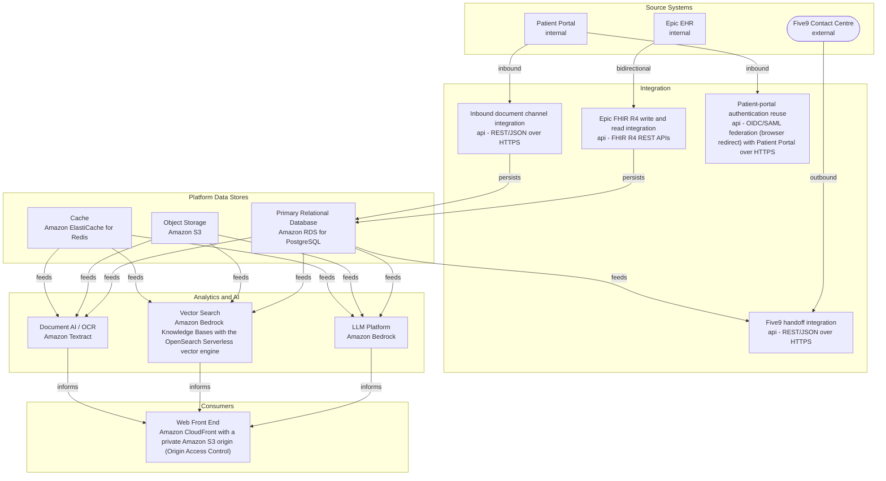

# Clinical Intake and Patient Support Assistant - Integrated Scoping Package

*Harborview Health Network*

**Generated:** 2026-09-19 00:00 UTC · **AI mode:** Mock AI mode · **Export status:** Review Required

> This document is an AI-assisted internal planning output based on customer requirements and stated assumptions. It requires review and validation by qualified sales, architecture, delivery, security, and commercial stakeholders. It is not a final quote, contractual commitment, or delivery guarantee.

## Table of contents

- [Executive summary](#executive-summary)
- [Customer objectives](#customer-objectives)
- [Requirement summary](#requirement-summary)
- [PRD](#prd)
- [Functional scope](#functional-scope)
- [Solution architecture](#solution-architecture)
- [Architecture diagram](#architecture-diagram)
- [Data strategy](#data-strategy)
- [Integration architecture](#integration-architecture)
- [AI solution approach](#ai-solution-approach)
- [Recommended technologies and frameworks](#recommended-technologies-and-frameworks)
- [Delivery phases and workstreams](#delivery-phases-and-workstreams)
- [Effort and timeline estimate](#effort-and-timeline-estimate)
- [ROM commercials](#rom-commercials)
- [Assumptions](#assumptions)
- [Risks](#risks)
- [Dependencies](#dependencies)
- [Open questions](#open-questions)
- [Requirement coverage](#requirement-coverage)
- [Traceability information](#traceability-information)
- [Quality review](#quality-review)
- [Change log](#change-log)

## Executive summary

This scoping package covers Harborview Health Network's Clinical Intake and Patient Support Assistant, grounded in 4 business objectives, 10 functional requirements and 6 non-functional requirements reviewed from the customer's own requirements text, alongside 4 integrations and 6 security or compliance requirements that shape the proposed solution.

Cloud platform: Amazon Web Services (AWS); Requirement coverage: 100%; Effort estimate: 486 to 753 person-days (likely 573); Timeline: 17 to 25 weeks; ROM commercial range: 455,000 USD to 706,000 USD (likely 538,000 USD); Estimate confidence: Medium; Open questions: 3. 3 clarification questions remain open and should be resolved before this package is finalised. This summary and the estimates that follow are an AI-assisted planning output and require review and validation by qualified sales, architecture, delivery, security and commercial stakeholders before being shared with Harborview Health Network.

## Customer objectives

| ID | Business objective | Priority | Source reference |
| --- | --- | --- | --- |
| BR_01 | Cut document-keying time by 50%: Reduce the time medical records clerks spend keying referral and prior-authorisation documents into Epic by at least 50%. | High | 3. Business Requirements - lines 21-21 |
| BR_02 | Reduce routine front-desk call volume: Reduce routine front-desk call volume by giving patients a self-service way to get appointment-prep and billing answers. | High | 3. Business Requirements - lines 22-22 |
| BR_03 | Faster document-to-chart visibility: Reduce the average time from document receipt to the document being visible in a patient's Epic chart. | Medium | 3. Business Requirements - lines 23-23 |
| BR_04 | Clinical decisions stay with licensed staff: Every clinical or coverage decision remains with a licensed staff member; the assistant never makes an autonomous clinical or eligibility determination. | High | 3. Business Requirements - lines 24-24 |

## Requirement summary

### Counts by requirement type

| Category | Count |
| --- | --- |
| Business objective | 4 |
| Functional requirement | 10 |
| Non-functional requirement | 6 |
| Integration | 4 |
| Data requirement | 5 |
| Security and compliance | 6 |

### Counts by priority

| Category | Count |
| --- | --- |
| High | 32 |
| Medium | 3 |

### Counts by provenance (all in-scope items)

| Category | Count |
| --- | --- |
| Customer-stated | 47 |
| AI-inferred | 11 |
| Assumed | 2 |

### Reviewed requirements

| ID | Type | Priority | Provenance | Source reference | Related IDs |
| --- | --- | --- | --- | --- | --- |
| BR_01 | Business objective | High | Customer-stated | 3. Business Requirements - lines 21-21 | None cited |
| BR_02 | Business objective | High | Customer-stated | 3. Business Requirements - lines 22-22 | None cited |
| BR_03 | Business objective | Medium | Customer-stated | 3. Business Requirements - lines 23-23 | None cited |
| BR_04 | Business objective | High | Customer-stated | 3. Business Requirements - lines 24-24 | None cited |
| FR_01 | Functional requirement | High | Customer-stated | 4. Functional Requirements - lines 29-29 | SYS_04 |
| FR_02 | Functional requirement | High | Customer-stated | 4. Functional Requirements - lines 30-30 | None cited |
| FR_03 | Functional requirement | High | Customer-stated | 4. Functional Requirements - lines 31-31 | PER_01 |
| FR_04 | Functional requirement | High | Customer-stated | 4. Functional Requirements - lines 32-32 | SYS_01, GAP_01 |
| FR_05 | Functional requirement | High | Customer-stated | 4. Functional Requirements - lines 33-33 | PER_02 |
| FR_06 | Functional requirement | High | Customer-stated | 4. Functional Requirements - lines 34-34 | DATA_02 |
| FR_07 | Functional requirement | High | Customer-stated | 4. Functional Requirements - lines 35-35 | PER_02 |
| FR_08 | Functional requirement | High | Customer-stated | 4. Functional Requirements - lines 37-37 | None cited |
| FR_09 | Functional requirement | High | Customer-stated | 4. Functional Requirements - lines 36-36 | PER_02, SYS_05 |
| FR_10 | Functional requirement | Medium | Customer-stated | 4. Functional Requirements - lines 38-38 | PER_01 |
| NFR_01 | Non-functional requirement | High | Customer-stated | 5. Non-Functional Requirements - lines 42-42 | None cited |
| NFR_02 | Non-functional requirement | High | Customer-stated | 5. Non-Functional Requirements - lines 43-43 | None cited |
| NFR_03 | Non-functional requirement | High | Customer-stated | 5. Non-Functional Requirements - lines 44-44 | None cited |
| NFR_04 | Non-functional requirement | High | Customer-stated | 5. Non-Functional Requirements - lines 46-46 | None cited |
| NFR_05 | Non-functional requirement | High | Customer-stated | 5. Non-Functional Requirements - lines 47-47 | None cited |
| NFR_06 | Non-functional requirement | High | Customer-stated | 5. Non-Functional Requirements - lines 45-45 | None cited |
| INT_01 | Integration | High | Customer-stated | 6. Integration Requirements - lines 51-51 | SYS_01, GAP_01 |
| INT_02 | Integration | High | Customer-stated | 6. Integration Requirements - lines 52-52 | None cited |
| INT_03 | Integration | Medium | Customer-stated | 6. Integration Requirements - lines 53-53 | SYS_02 |
| INT_04 | Integration | High | Customer-stated | 6. Integration Requirements - lines 54-54 | SYS_05 |
| DATA_01 | Data requirement | High | Customer-stated | 7. Data Requirements - lines 59-59 | SEC_01 |
| DATA_02 | Data requirement | High | Customer-stated | 7. Data Requirements - lines 60-60 | None cited |
| DATA_03 | Data requirement | High | Customer-stated | 7. Data Requirements - lines 61-61 | None cited |
| DATA_04 | Data requirement | High | Customer-stated | 7. Data Requirements - lines 62-62 | None cited |
| DATA_05 | Data requirement | High | Customer-stated | 7. Data Requirements - lines 63-63 | None cited |
| SEC_01 | Security and compliance | High | Customer-stated | 8. Security and Compliance - lines 67-67 | DEP_01, ASM_01 |
| SEC_02 | Security and compliance | High | Customer-stated | 8. Security and Compliance - lines 68-68 | None cited |
| SEC_03 | Security and compliance | High | Customer-stated | 8. Security and Compliance - lines 69-69 | None cited |
| SEC_04 | Security and compliance | High | Customer-stated | 8. Security and Compliance - lines 70-70 | None cited |
| SEC_05 | Security and compliance | High | Customer-stated | 8. Security and Compliance - lines 71-71 | None cited |
| SEC_06 | Security and compliance | High | Customer-stated | 8. Security and Compliance - lines 72-72 | PER_02 |

### Context and constraints

| ID | Type | Title: description | Provenance | Source reference |
| --- | --- | --- | --- | --- |
| PER_01 | Persona | Medical Records Clerk: One of eleven staff who manually read and key referral and prior-authorisation documents into Epic today, and who will review extracted data. | AI-inferred | 1. Background - lines 7-7 |
| PER_02 | Persona | Patient: Calls or messages the clinic with appointment-prep, billing and insurance questions and will interact with the support assistant. | AI-inferred | 1. Background - lines 6-6 |
| SYS_01 | Existing system | Epic EHR: The electronic health record system of record across all six clinics and the referral centre, exposed through Epic's FHIR R4 API. | Customer-stated | 2. Current Systems Landscape - lines 13-13 |
| SYS_02 | Existing system | Five9 Contact Centre: The current cloud contact-centre product front-desk staff use for the 12,000 monthly patient calls. | Customer-stated | 2. Current Systems Landscape - lines 16-16 |
| SYS_03 | Existing system | CareEverywhere Health Information Exchange: A regional health information exchange used ad hoc by physicians to pull outside records, not integrated into the intake workflow today. | Customer-stated | 2. Current Systems Landscape - lines 17-17 |
| SYS_04 | Existing system | Manual Document Scanning Process: Incoming documents are currently scanned into a shared network drive and manually filed by the medical records team before being keyed into Epic. | Customer-stated | 2. Current Systems Landscape - lines 15-15 |
| SYS_05 | Existing system | Patient Portal: The clinic's existing patient-facing portal, used today for patient login and document upload, that the assistant must also be reachable through. | Customer-stated | 4. Functional Requirements - lines 36-36 |
| TECH_01 | Technology preference | AWS as target cloud platform: The infrastructure team runs existing workloads on Amazon Web Services and prefers the new platform to run on AWS. | Customer-stated | 9. Technology Preferences - lines 76-76 |
| TECH_02 | Technology preference | Managed AI/ML service for extraction and assistant: Open to a managed AI/ML service for document extraction and the assistant, as long as it meets HIPAA and data-handling requirements. | Customer-stated | 9. Technology Preferences - lines 77-77 |
| TECH_03 | Technology preference | Python skill alignment for handover: The two in-house developers have Python experience and would like to maintain integration code after handover. | Customer-stated | 9. Technology Preferences - lines 78-78 |
| CON_01 | Delivery constraint | 24-week phased rollout starting with intake: A phased rollout starts with document intake within 24 weeks of contract signature, with the patient-support assistant following in a second phase. | Customer-stated | 10. Delivery Constraints and Timeline - lines 82-82 |
| CON_02 | Delivery constraint | Compliance sign-off before any patient-facing pilot: The compliance officer must approve the assistant's response content and escalation rules before any patient-facing pilot begins. | Customer-stated | 10. Delivery Constraints and Timeline - lines 84-84 |
| CON_03 | Delivery constraint | Fallback to today's manual process during rollout: The medical records team can fall back to today's manual process at any time during the initial rollout if extraction quality is not yet trusted. | Customer-stated | 10. Delivery Constraints and Timeline - lines 83-83 |
| CON_04 | Delivery constraint | Limited subject-matter-expert availability during build: Clinical and administrative staff can provide at most one subject-matter expert two days a week during the build; the delivery partner is expected to own the technical build. | Customer-stated | 10. Delivery Constraints and Timeline - lines 85-85 |
| DEP_01 | Dependency | Business associate agreement execution: A signed business associate agreement with the chosen AI provider must be reviewed and executed before any pilot can begin. | AI-inferred | 11. Discovery Call Notes - 2026-09-02 - lines 91-91 |

## PRD

- **Generated by:** Mock AI (deterministic, offline)
- **Mode:** Mock AI (deterministic, offline)
- **Fallback used:** No
- **Generated at:** 2026-09-19 00:00 UTC

Document: Clinical Intake and Patient Support Assistant - Product Requirements Document

#### Product or solution overview

Harborview Health Network needs a HIPAA-compliant clinical-document intake pipeline and a retrieval-grounded patient-support assistant on AWS, integrated with Epic via FHIR R4, serving roughly 1,200 staff and 85,000 monthly patient encounters with a 24-week phased rollout; Epic sandbox write access and the assistant's deployment form remain open. (Refs: BR_01, BR_02, BR_03, BR_04; AI interpretation)

Clinical Intake and Patient Support Assistant serves 4 business objectives set by Harborview Health Network (BR_01, BR_02, BR_03 and BR_04); each is detailed under Business objectives. (Refs: BR_01, BR_02, BR_03, BR_04; Customer-requested)

The solution is organised into 6 capability areas (Application Experience, Platform Foundation, Data Platform, Systems Integration, AI Capabilities and Security and Compliance) and connects to Epic EHR (SYS_01), Five9 Contact Centre (SYS_02), CareEverywhere Health Information Exchange (SYS_03) and Patient Portal (SYS_05). (Refs: SYS_01, SYS_02, SYS_03, SYS_05; AI interpretation)

#### Business problem

Today Harborview Health Network relies on Manual Document Scanning Process: Incoming documents are currently scanned into a shared network drive and manually filed by the medical records team before being keyed into Epic. (Refs: SYS_04; Customer-requested)

Until this is addressed, Harborview Health Network cannot achieve "Cut document-keying time by 50%" (BR_01), "Reduce routine front-desk call volume" (BR_02), "Faster document-to-chart visibility" (BR_03) and "Clinical decisions stay with licensed staff" (BR_04). (Refs: BR_01, BR_02, BR_03, BR_04; Customer-requested)

#### Business objectives

BR_01 - Cut document-keying time by 50%: Reduce the time medical records clerks spend keying referral and prior-authorisation documents into Epic by at least 50%. (Refs: BR_01; Customer-requested)

BR_02 - Reduce routine front-desk call volume: Reduce routine front-desk call volume by giving patients a self-service way to get appointment-prep and billing answers. (Refs: BR_02; Customer-requested)

BR_03 - Faster document-to-chart visibility: Reduce the average time from document receipt to the document being visible in a patient's Epic chart. (Refs: BR_03; Customer-requested)

BR_04 - Clinical decisions stay with licensed staff: Every clinical or coverage decision remains with a licensed staff member; the assistant never makes an autonomous clinical or eligibility determination. (Refs: BR_04; Customer-requested)

#### Target users and personas

PER_01 - Medical Records Clerk: One of eleven staff who manually read and key referral and prior-authorisation documents into Epic today, and who will review extracted data. (Refs: PER_01; AI interpretation)

PER_02 - Patient: Calls or messages the clinic with appointment-prep, billing and insurance questions and will interact with the support assistant. (Refs: PER_02; AI interpretation)

#### User journeys or key workflows

Medical Records Clerk journey: Step 1: Present each extracted document to a medical records clerk for review and correction before anything is written to Epic (FR_03; delivered by CAP_01). Step 2: Medical records clerks see a queue of documents awaiting review, prioritised by how long they have been waiting (FR_08; delivered by CAP_04). Step 3: Documents where extraction confidence is low are flagged so medical records clerks review those first (FR_10; delivered by CAP_11). (Refs: FR_03, FR_08, FR_10; AI interpretation)

Patient journey: Step 1: The patient-support assistant answers common questions about appointment preparation, clinic locations, hours and accepted insurance plans (FR_05; delivered by CAP_10). Step 2: The assistant recognises when a question requires clinical judgement or involves symptoms and hands off to a human staff member (FR_07; delivered by CAP_04). Step 3: The patient-support assistant is available through the existing patient portal and, where feasible, as a widget on the public website (FR_09; delivered by CAP_03, CAP_10). (Refs: FR_05, FR_07, FR_09; AI interpretation)

#### Functional requirements

DATA_01 - Protected health information handling: All patient documents and extracted fields are protected health information and must be handled under HIPAA policies at every stage. (Refs: DATA_01; Customer-requested)

DATA_02 - Approved-content-only assistant knowledge base: The assistant's knowledge base is built only from clinic-approved policy, FAQ and appointment-prep documents, refreshed whenever those documents change. (Refs: DATA_02; Customer-requested)

DATA_03 - Six-year document and conversation retention: Extracted document data and assistant conversation logs must be retained for at least six years to satisfy state medical-records requirements. (Refs: DATA_03; Customer-requested)

DATA_04 - Conversation-log governance for model training: Conversation logs are reviewable by compliance staff but must not be used to retrain or fine-tune any model without a separate, explicit approval process. (Refs: DATA_04; Customer-requested)

DATA_05 - Separated encryption for documents and sessions: Document images and extracted text must be encrypted at rest, separate from the assistant's conversational session data. (Refs: DATA_05; Customer-requested)

FR_01 - Multi-channel document intake: Accept incoming referral letters, prior-authorisation forms and lab results from fax, secure email and patient-portal upload. (Refs: FR_01; Customer-requested)

FR_02 - Structured field extraction: Extract structured fields from each document, including patient identifiers, referring provider, requested service and supporting clinical notes. (Refs: FR_02; Customer-requested)

FR_03 - Mandatory clerk review before write-back: Present each extracted document to a medical records clerk for review and correction before anything is written to Epic. (Refs: FR_03; Customer-requested)

FR_04 - Approved-document write-back to Epic: Write approved documents back to the correct patient chart in Epic through the FHIR R4 API, tagged with the extracting user and timestamp. (Refs: FR_04; Customer-requested)

FR_05 - Patient-support assistant Q&A: The patient-support assistant answers common questions about appointment preparation, clinic locations, hours and accepted insurance plans. (Refs: FR_05; Customer-requested)

FR_06 - Assistant answers grounded in approved policy content: The assistant retrieves answers from approved clinic policy and FAQ documents rather than generating unsourced medical guidance. (Refs: FR_06; Customer-requested)

FR_07 - Escalation for clinical-judgement questions: The assistant recognises when a question requires clinical judgement or involves symptoms and hands off to a human staff member. (Refs: FR_07; Customer-requested)

FR_08 - Prioritised clerk review queue: Medical records clerks see a queue of documents awaiting review, prioritised by how long they have been waiting. (Refs: FR_08; Customer-requested)

FR_09 - Assistant availability through the patient portal and public website: The patient-support assistant is available through the existing patient portal and, where feasible, as a widget on the public website. (Refs: FR_09; Customer-requested)

FR_10 - Low-confidence extraction flagging for clerk review: Documents where extraction confidence is low are flagged so medical records clerks review those first. (Refs: FR_10; Customer-requested)

#### Non-functional requirements

NFR_01 - 85,000 patient encounters per month at scale: Process at least 85,000 patient encounters worth of associated documents per month without a growing backlog. (Refs: NFR_01; Customer-requested)

NFR_02 - 5-minute extraction turnaround: Document extraction results must be available to a reviewing clerk within 5 minutes of document receipt for 95% of documents. (Refs: NFR_02; Customer-requested)

NFR_03 - 1,200 staff plus 85,000 monthly conversations: Support approximately 1,200 clinical and administrative staff users plus patient-facing assistant traffic estimated at 85,000 conversations per month. (Refs: NFR_03; Customer-requested)

NFR_04 - 99.5% availability during clinic hours: Maintain 99.5% availability during clinic operating hours, 7am to 8pm Pacific, seven days a week. (Refs: NFR_04; Customer-requested)

NFR_05 - Traceable extraction and assistant answers: Every assistant answer and every extracted field must be traceable back to the source document or policy document it came from. (Refs: NFR_05; Customer-requested)

NFR_06 - 4-second assistant response time: The patient-support assistant must respond to a typical question within 4 seconds. (Refs: NFR_06; Customer-requested)

SEC_01 - HIPAA compliance with a signed BAA: Comply with HIPAA, including a signed business associate agreement with any AI provider or subprocessor involved. (Refs: SEC_01; Customer-requested)

SEC_02 - PHI encryption in transit and at rest: Encrypt all protected health information in transit and at rest using current industry-standard algorithms. (Refs: SEC_02; Customer-requested)

SEC_03 - Role-based review-queue access: Access to the document-review queue is role-based and limited to authorised medical records staff, with supervisor audit visibility. (Refs: SEC_03; Customer-requested)

SEC_04 - MFA for review-queue access: Enforce multi-factor authentication for all staff accessing the intake review queue or extracted patient data. (Refs: SEC_04; Customer-requested)

SEC_05 - HIPAA security risk assessment before go-live: Undergo a HIPAA security risk assessment before go-live. (Refs: SEC_05; Customer-requested)

SEC_06 - No cross-patient information disclosure on misroute: The patient-support assistant must never display another patient's information, even if a conversation is misrouted. (Refs: SEC_06; Customer-requested)

#### Integrations

INT_01 - Epic FHIR R4 write and read integration: Integrate with Epic through the FHIR R4 API to write structured document data and retrieve patient context. (Refs: INT_01; Customer-requested)

INT_02 - Inbound document channel integration: Accept inbound documents from the existing fax gateway, secure email inbox and patient-portal upload mechanism. (Refs: INT_02; Customer-requested)

INT_03 - Five9 handoff integration: The patient-support assistant integrates with Five9 so a handed-off conversation routes to an available front-desk agent with context preserved. (Refs: INT_03; Customer-requested)

INT_04 - Patient-portal authentication reuse: Authenticate patients through the existing patient-portal login rather than introducing a separate identity system. (Refs: INT_04; Customer-requested)

#### Dependencies

DEP_01 - Business associate agreement execution: A signed business associate agreement with the chosen AI provider must be reviewed and executed before any pilot can begin. (Refs: DEP_01; AI interpretation)

#### Assumptions

ASM_01 - AI provider must support a HIPAA BAA: Assumed the selected AI/ML provider can execute a HIPAA business associate agreement; providers unable to sign a BAA are out of consideration. (Refs: ASM_01; Assumption to confirm)

ASM_02 - Policy documents are reusable for a knowledge base: Assumed the clinic's existing policy, FAQ and appointment-prep documents are already in a reusable digital format suitable for a knowledge base. (Refs: ASM_02; Assumption to confirm)

#### Risks

RSK_01 - Extraction-accuracy risk across document sources: Documents arrive by fax, secure email and portal upload with varying quality, creating a risk of inconsistent extraction accuracy across sources. (Refs: RSK_01; AI interpretation)

RSK_02 - Spanish-language coverage gap at launch: About 18% of patients prefer Spanish, but Spanish-language conversations are not committed to for the initial assistant phase, risking uneven adoption. (Refs: RSK_02; AI interpretation)

#### Out-of-scope items

BR_05 - Behavioural-health screening (future candidate): excluded from this engagement because the customer states "BR5. The solution could eventually extend to behavioural-health intake screening, though that is out of scope for this initial phase." (Refs: BR_05; Out of scope)

INT_05 - CareEverywhere query integration (later phase): excluded from this engagement because the customer states "INT5. The solution should be able to query the regional CareEverywhere health information exchange in a later phase, but that integration is not required for go-live." (Refs: INT_05; Out of scope)

Detailed visual design, branding and content authoring beyond what is described in the reviewed scope are out of scope for this PRD and are addressed during design execution. (Refs: None cited; Assumption to confirm)

Production data-migration volumes, historical backfill and legacy data cleansing beyond the reviewed data requirements remain out of scope until the customer confirms them. (Refs: DATA_01, DATA_02, DATA_03, DATA_04, DATA_05; Assumption to confirm)

Decommissioning of the existing systems referenced in the scope model is out of scope; this engagement covers integration with those systems, not their retirement. (Refs: SYS_01, SYS_02, SYS_03, SYS_04, SYS_05; Assumption to confirm)

#### Open questions

Q_01 - Does the Epic FHIR R4 sandbox support writing referral data?: Confirm whether the Epic FHIR R4 sandbox supports writing structured referral data or is currently read-only for patient context. (Refs: Q_01; AI interpretation)

Q_02 - Should the assistant be standalone or embedded in the portal?: Confirm whether the patient-support assistant should ship as a standalone application or be embedded in the existing patient portal. (Refs: Q_02; AI interpretation)

Q_03 - Confirm the target phase for the CareEverywhere integration: The customer says the CareEverywhere integration is not required for go-live; confirm which later phase should deliver it so it can be planned and estimated then. (Refs: Q_03; AI interpretation)

#### Requirement traceability

BR_01 - Cut document-keying time by 50% is covered by CAP_01. (Refs: BR_01, CAP_01; Customer-requested)

BR_02 - Reduce routine front-desk call volume is covered by CAP_03. (Refs: BR_02, CAP_03; Customer-requested)

BR_03 - Faster document-to-chart visibility is covered by CAP_01. (Refs: BR_03, CAP_01; Customer-requested)

BR_04 - Clinical decisions stay with licensed staff is covered by CAP_10. (Refs: BR_04, CAP_10; Customer-requested)

FR_01 - Multi-channel document intake is covered by CAP_01, CAP_02. (Refs: FR_01, CAP_01, CAP_02; Customer-requested)

FR_02 - Structured field extraction is covered by CAP_11. (Refs: FR_02, CAP_11; Customer-requested)

FR_03 - Mandatory clerk review before write-back is covered by CAP_01. (Refs: FR_03, CAP_01; Customer-requested)

FR_04 - Approved-document write-back to Epic is covered by CAP_01, CAP_04. (Refs: FR_04, CAP_01, CAP_04; Customer-requested)

FR_05 - Patient-support assistant Q&A is covered by CAP_10. (Refs: FR_05, CAP_10; Customer-requested)

FR_06 - Assistant answers grounded in approved policy content is covered by CAP_04, CAP_10. (Refs: FR_06, CAP_04, CAP_10; Customer-requested)

FR_07 - Escalation for clinical-judgement questions is covered by CAP_04. (Refs: FR_07, CAP_04; Customer-requested)

FR_08 - Prioritised clerk review queue is covered by CAP_04. (Refs: FR_08, CAP_04; Customer-requested)

FR_09 - Assistant availability through the patient portal and public website is covered by CAP_03, CAP_10. (Refs: FR_09, CAP_03, CAP_10; Customer-requested)

FR_10 - Low-confidence extraction flagging for clerk review is covered by CAP_11. (Refs: FR_10, CAP_11; Customer-requested)

NFR_01 - 85,000 patient encounters per month at scale is covered by CAP_05. (Refs: NFR_01, CAP_05; Customer-requested)

NFR_02 - 5-minute extraction turnaround is covered by CAP_05. (Refs: NFR_02, CAP_05; Customer-requested)

NFR_03 - 1,200 staff plus 85,000 monthly conversations is covered by CAP_05. (Refs: NFR_03, CAP_05; Customer-requested)

NFR_04 - 99.5% availability during clinic hours is covered by CAP_05. (Refs: NFR_04, CAP_05; Customer-requested)

NFR_05 - Traceable extraction and assistant answers is covered by CAP_05. (Refs: NFR_05, CAP_05; Customer-requested)

NFR_06 - 4-second assistant response time is covered by CAP_05. (Refs: NFR_06, CAP_05; Customer-requested)

INT_01 - Epic FHIR R4 write and read integration is covered by CAP_09. (Refs: INT_01, CAP_09; Customer-requested)

INT_02 - Inbound document channel integration is covered by CAP_05. (Refs: INT_02, CAP_05; Customer-requested)

INT_03 - Five9 handoff integration is covered by CAP_05. (Refs: INT_03, CAP_05; Customer-requested)

INT_04 - Patient-portal authentication reuse is covered by CAP_05. (Refs: INT_04, CAP_05; Customer-requested)

DATA_01 - Protected health information handling is covered by CAP_07, CAP_08. (Refs: DATA_01, CAP_07, CAP_08; Customer-requested)

DATA_02 - Approved-content-only assistant knowledge base is covered by CAP_07. (Refs: DATA_02, CAP_07; Customer-requested)

DATA_03 - Six-year document and conversation retention is covered by CAP_06, CAP_07. (Refs: DATA_03, CAP_06, CAP_07; Customer-requested)

DATA_04 - Conversation-log governance for model training is covered by CAP_05. (Refs: DATA_04, CAP_05; Customer-requested)

DATA_05 - Separated encryption for documents and sessions is covered by CAP_07. (Refs: DATA_05, CAP_07; Customer-requested)

SEC_01 - HIPAA compliance with a signed BAA is covered by CAP_05. (Refs: SEC_01, CAP_05; Customer-requested)

SEC_02 - PHI encryption in transit and at rest is covered by CAP_12. (Refs: SEC_02, CAP_12; Customer-requested)

SEC_03 - Role-based review-queue access is covered by CAP_14. (Refs: SEC_03, CAP_14; Customer-requested)

SEC_04 - MFA for review-queue access is covered by CAP_13. (Refs: SEC_04, CAP_13; Customer-requested)

SEC_05 - HIPAA security risk assessment before go-live is covered by CAP_05. (Refs: SEC_05, CAP_05; Customer-requested)

SEC_06 - No cross-patient information disclosure on misroute is covered by CAP_05. (Refs: SEC_06, CAP_05; Customer-requested)

## Functional scope

- **Generated by:** Mock AI (deterministic, offline)
- **Mode:** Mock AI (deterministic, offline)
- **Fallback used:** No
- **Generated at:** 2026-09-19 00:00 UTC

### Capabilities

| Capability | Included requirements | Scope | Priority | Dependencies | Label |
| --- | --- | --- | --- | --- | --- |
| Document Management | BR_01, BR_03, FR_01, FR_03, FR_04 | Provide document management covering upload, storage, retrieval and lifecycle control for the files the solution manages. It delivers: BR_01 (Cut document-keying time by 50%), BR_03 (Faster document-to-chart visibility), FR_01 (Multi-channel document intake), FR_03 (Mandatory clerk review before write-back), FR_04 (Approved-document write-back to Epic). It connects to Manual Document Scanning Process, Patient Portal. | High | Manual Document Scanning Process, Epic EHR | Customer-requested |
| Forms and Data Capture | FR_01 | Provide forms and structured data capture so users can submit the information the process requires with built-in validation. It delivers: FR_01 (Multi-channel document intake). It connects to CareEverywhere Health Information Exchange. | High | Manual Document Scanning Process | Customer-requested |
| Self-Service Portal | BR_02, FR_09 | Provide a self-service portal that gives users a single place to manage their account, requests and records. It delivers: BR_02 (Reduce routine front-desk call volume), FR_09 (Assistant availability through the patient portal and public website). It connects to Patient Portal. | High | Patient Portal | Customer-requested |
| Workflow and Approvals | FR_04, FR_06, FR_07, FR_08 | Provide workflow and approvals so multi-step processes route to the right approver with a visible status at every stage. It delivers: FR_04 (Approved-document write-back to Epic), FR_06 (Assistant answers grounded in approved policy content), FR_07 (Escalation for clinical-judgement questions), FR_08 (Prioritised clerk review queue). It connects to CareEverywhere Health Information Exchange. | High | Epic EHR | Customer-requested |
| Core Platform Services | NFR_01, NFR_02, NFR_03, NFR_04, NFR_05, NFR_06, INT_02, INT_03, INT_04, DATA_04, SEC_01, SEC_05, SEC_06 | Provide the cross-cutting platform services - configuration, environment setup, logging and shared infrastructure - that every capability in this scope depends on. It delivers: NFR_01 (85,000 patient encounters per month at scale), NFR_02 (5-minute extraction turnaround), NFR_03 (1,200 staff plus 85,000 monthly conversations), NFR_04 (99.5% availability during clinic hours), NFR_05 (Traceable extraction and assistant answers), NFR_06 (4-second assistant response time), INT_02 (Inbound document channel integration), INT_03 (Five9 handoff integration), INT_04 (Patient-portal authentication reuse), DATA_04 (Conversation-log governance for model training), SEC_01 (HIPAA compliance with a signed BAA), SEC_05 (HIPAA security risk assessment before go-live), SEC_06 (No cross-patient information disclosure on misroute). | High | Five9 Contact Centre, Patient Portal, Business associate agreement execution | Assumption to confirm |
| Data Retention and Archival | DATA_03 | Apply retention and archival rules so data is kept only as long as policy and regulation require. It delivers: DATA_03 (Six-year document and conversation retention). | High | None | Customer-requested |
| Document and Content Data Management | DATA_01, DATA_02, DATA_03, DATA_05 | Manage documents and unstructured content as first-class data, indexed so it can be searched, retrieved and governed. It delivers: DATA_01 (Protected health information handling), DATA_02 (Approved-content-only assistant knowledge base), DATA_03 (Six-year document and conversation retention), DATA_05 (Separated encryption for documents and sessions). It connects to Manual Document Scanning Process, Patient Portal. | High | None | Customer-requested |
| Personal Data Protection | DATA_01 | Classify and protect the personal or sensitive data the solution collects, with access limited to what each role needs. It delivers: DATA_01 (Protected health information handling). It connects to CareEverywhere Health Information Exchange. | High | None | Customer-requested |
| Clinical System Integration (HL7/FHIR) | INT_01 | Integrate with the clinical system over HL7/FHIR so patient and encounter data is exchanged in a standards-based, auditable format. It delivers: INT_01 (Epic FHIR R4 write and read integration). It connects to Epic EHR. | High | Epic EHR | Customer-requested |
| AI Conversational Assistant | BR_04, FR_05, FR_06, FR_09 | Deliver a conversational AI assistant that answers user questions in natural language, grounded in the platform's own content. It delivers: BR_04 (Clinical decisions stay with licensed staff), FR_05 (Patient-support assistant Q&A), FR_06 (Assistant answers grounded in approved policy content), FR_09 (Assistant availability through the patient portal and public website). It connects to Patient Portal. | High | Patient Portal | Customer-requested |
| AI Document Extraction | FR_02, FR_10 | Deliver AI-based document extraction so structured data is pulled from unstructured documents without manual re-keying. It delivers: FR_02 (Structured field extraction), FR_10 (Low-confidence extraction flagging for clerk review). | High | None | Customer-requested |
| Data Encryption | SEC_02 | Implement encryption at rest and in transit for the data classes the reviewed scope identifies as sensitive. It delivers: SEC_02 (PHI encryption in transit and at rest). | High | None | Customer-requested |
| Multi-Factor Authentication | SEC_04 | Implement multi-factor authentication so a compromised password alone cannot grant access to the platform. It delivers: SEC_04 (MFA for review-queue access). | High | None | Customer-requested |
| Role-Based Access Control | SEC_03 | Implement role-based access control so each user's permissions match their responsibilities and nothing more. It delivers: SEC_03 (Role-based review-queue access). | High | None | Customer-requested |

### Recommended enhancements (AI recommendation)

| Capability | Included requirements | Scope | Priority | Dependencies | Label |
| --- | --- | --- | --- | --- | --- |
| AI Answer Quality Feedback Loop | BR_04, FR_05, FR_06, FR_07, FR_09, NFR_03, NFR_05, NFR_06, INT_03, INT_04, DATA_02, DATA_03, DATA_05, SEC_06 | Capture a thumbs-up/down and free-text rating on every AI-generated answer and route low-confidence responses to human review, closing the loop for the AI use cases in BR_04, FR_05, FR_06, FR_07, FR_09, NFR_03, NFR_05, NFR_06, INT_03, INT_04, DATA_02, DATA_03, DATA_05, SEC_06. | Medium | None | AI recommendation |
| Observability and Operations Dashboard | BR_03, FR_09, NFR_01, NFR_04, NFR_06 | Stand up centralised logging, metrics and alerting so the availability, performance and scale targets in BR_03, FR_09, NFR_01, NFR_04, NFR_06 are continuously measurable rather than assumed at go-live. | Medium | None | AI recommendation |
| Security and Compliance Hardening Review | BR_01, FR_01, DATA_01, DATA_05, SEC_01, SEC_02, SEC_03, SEC_04, SEC_05 | Commission an independent penetration test and compliance review of the controls implemented for BR_01, FR_01, DATA_01, DATA_05, SEC_01, SEC_02, SEC_03, SEC_04, SEC_05 before production release. | Medium | None | AI recommendation |
| Data Quality and Governance Program | BR_01, BR_03, FR_01, FR_02, FR_03, FR_04, FR_06, FR_08, FR_10, NFR_01, NFR_02, NFR_05, INT_01, INT_02, DATA_01, DATA_02, DATA_03, DATA_05, SEC_02, SEC_03, SEC_04 | Define data-quality rules, named ownership and a reconciliation cadence for the data domains in BR_01, BR_03, FR_01, FR_02, FR_03, FR_04, FR_06, FR_08, FR_10, NFR_01, NFR_02, NFR_05, INT_01, INT_02, DATA_01, DATA_02, DATA_03, DATA_05, SEC_02, SEC_03, SEC_04 so downstream reporting stays trustworthy. | Medium | None | AI recommendation |

### Modules

| Module | Capabilities | Requirements |
| --- | --- | --- |
| AI Capabilities | CAP_10, CAP_11 | BR_04, FR_05, FR_06, FR_09, FR_02, FR_10 |
| Application Experience | CAP_01, CAP_02, CAP_03, CAP_04 | BR_01, BR_03, FR_01, FR_03, FR_04, BR_02, FR_09, FR_06, FR_07, FR_08 |
| Data Platform | CAP_06, CAP_07, CAP_08 | DATA_03, DATA_01, DATA_02, DATA_05 |
| Platform Foundation | CAP_05 | NFR_01, NFR_02, NFR_03, NFR_04, NFR_05, NFR_06, INT_02, INT_03, INT_04, DATA_04, SEC_01, SEC_05, SEC_06 |
| Security and Compliance | CAP_12, CAP_13, CAP_14 | SEC_02, SEC_04, SEC_03 |
| Systems Integration | CAP_09 | INT_01 |

### Workstreams

| Workstream | Capabilities | Requirements |
| --- | --- | --- |
| AI and Machine Learning | CAP_10, CAP_11 | BR_04, FR_05, FR_06, FR_09, FR_02, FR_10 |
| Core Platform Services | CAP_05 | NFR_01, NFR_02, NFR_03, NFR_04, NFR_05, NFR_06, INT_02, INT_03, INT_04, DATA_04, SEC_01, SEC_05, SEC_06 |
| Core Product Experience | CAP_01, CAP_02, CAP_03, CAP_04 | BR_01, BR_03, FR_01, FR_03, FR_04, BR_02, FR_09, FR_06, FR_07, FR_08 |
| Data Management | CAP_06, CAP_07, CAP_08 | DATA_03, DATA_01, DATA_02, DATA_05 |
| Integration Layer | CAP_09 | INT_01 |
| Security Controls | CAP_12, CAP_13, CAP_14 | SEC_02, SEC_04, SEC_03 |

### Delivery packages

| Delivery package | Capabilities | Suggested engagement model | Suggested challenge types |
| --- | --- | --- | --- |
| Package 1 - Foundation | CAP_01, CAP_02, CAP_03, CAP_04, CAP_05 | Topcoder challenge series | Design challenge, Development challenge series, QA / bug hunt |
| Package 2 - Data and Integration | CAP_06, CAP_07, CAP_08, CAP_09 | Topcoder challenge series | Development challenge series, QA / bug hunt |
| Package 3 - AI Capabilities | CAP_10, CAP_11 | Blended (dedicated team plus challenges) | Data science challenge, QA / bug hunt |
| Package 4 - Security and Compliance | CAP_12, CAP_13, CAP_14 | Topcoder challenge series | Development challenge series, QA / bug hunt |

### Out of scope

| Item | Refs | Label |
| --- | --- | --- |
| BR_05 - Behavioural-health screening (future candidate): excluded from this engagement because the customer states "BR5. The solution could eventually extend to behavioural-health intake screening, though that is out of scope for this initial phase." | BR_05 | Out of scope |
| INT_05 - CareEverywhere query integration (later phase): excluded from this engagement because the customer states "INT5. The solution should be able to query the regional CareEverywhere health information exchange in a later phase, but that integration is not required for go-live." | INT_05 | Out of scope |
| Detailed visual design, branding and content authoring beyond what is described in the reviewed scope are out of scope for this PRD and are addressed during design execution. | None cited | Assumption to confirm |
| Production data-migration volumes, historical backfill and legacy data cleansing beyond the reviewed data requirements remain out of scope until the customer confirms them. | DATA_01, DATA_02, DATA_03, DATA_04, DATA_05 | Assumption to confirm |
| Decommissioning of the existing systems referenced in the scope model is out of scope; this engagement covers integration with those systems, not their retirement. | SYS_01, SYS_02, SYS_03, SYS_04, SYS_05 | Assumption to confirm |

## Solution architecture

- **Generated by:** Mock AI (deterministic, offline)
- **Mode:** Mock AI (deterministic, offline)
- **Fallback used:** No
- **Generated at:** 2026-09-19 00:00 UTC

- **Cloud platform:** Amazon Web Services (AWS)
- **Selection:** User-selected

The proposed solution architecture targets Amazon Web Services (AWS) and is composed of 25 components covering 14 functional capabilities. It spans the full reviewed scope; see each component’s own rationale below for its specific citations. (Refs: NFR_06, NFR_01, SEC_03, SEC_02, SEC_04, FR_09; AI interpretation)

### Platform recommendation scores

| Platform | Score | Reasons |
| --- | --- | --- |
| Amazon Web Services (AWS) | 30 | +30 TECH_01 states a direct preference for Amazon Web Services (AWS), mentions Amazon, and mentions an existing AWS footprint. (TECH_01); +0 Compliance/residency needs (DATA_01, SEC_01, SEC_02, SEC_05, TECH_02, ASM_01) are supported by regional data centres on all three platforms and do not change the recommendation. (DATA_01, SEC_01, SEC_02, SEC_05, TECH_02, ASM_01) |
| Microsoft Azure | 0 | No scoring signals found. |
| Google Cloud Platform (GCP) | 0 | No scoring signals found. |

Amazon Web Services (AWS) is recommended based on the reviewed scope and configuration. Key factors: TECH_01 states a direct preference for Amazon Web Services (AWS), mentions Amazon, and mentions an existing AWS footprint. This is an AI-generated recommendation and should be validated by a solution architect before it is treated as final.

### Architecture components

| Component | Service | Requirements / assumptions | Purpose | Rationale | Trade-offs | Dependencies | Security considerations |
| --- | --- | --- | --- | --- | --- | --- | --- |
| Web Front End | Amazon CloudFront with a private Amazon S3 origin (Origin Access Control) | NFR_06 | Serves the customer-facing web experience and delivers static assets close to users. | Amazon CloudFront with a private Amazon S3 origin (Origin Access Control) serves the web experience with edge caching, TLS termination and low first-byte latency worldwide. It addresses NFR_06. | Edge caching improves latency but requires explicit cache-invalidation on release. A globally distributed edge adds a small recurring data-transfer cost versus single-region hosting. | API Layer, Customer Identity and Access Management | Enforce HTTPS-only delivery and a strict Content-Security-Policy at the edge. Restrict direct access to origin storage so all traffic is served through the CDN. |
| API Layer | Amazon API Gateway | NFR_01, NFR_06, SEC_03 | Exposes the solution's functional capabilities as versioned, governed APIs for the front end and integrations. | Amazon API Gateway centralizes authentication, throttling and request validation ahead of the application compute runtime. It addresses NFR_01, NFR_06 and SEC_03. | A managed gateway adds a small per-request latency and cost overhead versus calling services directly. API versioning policy must be agreed early to avoid breaking existing client integrations. | Application Compute Runtime, Customer Identity and Access Management | Apply request-rate throttling and payload-size limits to reduce abuse and denial-of-service exposure. Validate and authorize every request against the identity provider before it reaches the runtime. |
| Application Compute Runtime | Amazon ECS on AWS Fargate | NFR_01, NFR_06 | Hosts the backend business logic that implements the reviewed functional requirements. | Amazon ECS on AWS Fargate runs the backend services with managed autoscaling so capacity tracks real traffic without manual intervention. It addresses NFR_01 and NFR_06. | Container-based hosting requires a build/release pipeline for every deployable service. Autoscaling limits must be tuned against real traffic before go-live to avoid cost or latency surprises. | Primary Relational Database, Monitoring | Run containers with least-privilege service identities and no long-lived static credentials. Scan container images for known vulnerabilities before each release. |
| Primary Relational Database | Amazon RDS for PostgreSQL | NFR_01, NFR_06, SEC_02 | Stores the core transactional data the application reads and writes. | Amazon RDS for PostgreSQL provides managed relational storage with automated backups, patching and encryption at rest. It addresses NFR_01, NFR_06 and SEC_02. | A managed relational engine caps vertical scale; very high write throughput may need read replicas or partitioning later. Schema migrations must be coordinated with application deployments to avoid downtime. | Backup, Key Management | Encrypt data at rest and in transit, and restrict network access to the application tier only. Apply least-privilege database roles per service rather than a single shared credential. |
| Customer Identity and Access Management | Amazon Cognito | SEC_03, SEC_04 | Handles registration, sign-in, session management and multi-factor authentication for end users. | Amazon Cognito provides managed sign-up, sign-in, SSO federation and MFA so authentication is never implemented by hand. It addresses SEC_03 and SEC_04. | A managed identity provider constrains custom sign-in UX to its supported customization hooks. Federating with an external identity provider (SSO) adds a dependency on that provider’s availability. | Secrets Manager | Enforce MFA for privileged accounts and require strong password/session policies for all users. Log every authentication and authorization decision for audit purposes. |
| Monitoring | Amazon CloudWatch | FR_09, NFR_04, SEC_03, DATA_01, SEC_01, SEC_02, SEC_05, TECH_02 | Tracks infrastructure and application health so incidents are detected before customers report them. | Amazon CloudWatch aggregates metrics and dashboards with alerting thresholds tied to the availability and performance targets. It addresses FR_09, NFR_04, SEC_03, DATA_01, SEC_01, SEC_02, SEC_05 and TECH_02. | Alert thresholds must be tuned to avoid both alert fatigue and missed incidents. Detailed metric retention adds a recurring storage cost proportional to system scale. | Centralized Logging, Application Compute Runtime | Restrict dashboard and alert access to operations and engineering roles only. |
| Centralized Logging | Amazon CloudWatch Logs | SEC_03 | Centralizes application and infrastructure logs for troubleshooting and audit. | Amazon CloudWatch Logs aggregates structured logs from every service with a defined, policy-driven retention period. It addresses SEC_03. | Centralized log retention has a direct storage cost that scales with request volume. Log content must be scrubbed of personal or sensitive data before it is retained. | Monitoring | Redact personal or sensitive data from log payloads before they are written. Restrict log access to authorized operations staff and retain an access audit trail. |
| CI/CD Pipeline | AWS CodePipeline with AWS CodeBuild | TECH_01, TECH_02, TECH_03, CON_01, CON_02, CON_03, CON_04 | Automates build, test and release of every service into each environment. | AWS CodePipeline with AWS CodeBuild runs the build/test/release pipeline consistently across development, test and production. It addresses TECH_01, TECH_02, TECH_03, CON_01, CON_02, CON_03 and CON_04. | A fully automated pipeline needs an initial investment in test coverage to be trustworthy for production releases. | Infrastructure as Code | Require code review and passing automated security scans before a release can be promoted. Keep deployment credentials scoped to the pipeline identity, never to individual engineers. |
| Infrastructure as Code | AWS CloudFormation | TECH_01, TECH_02, TECH_03, CON_01, CON_02, CON_03, CON_04 | Defines every environment declaratively so dev/test/prod stay reproducible and auditable. | AWS CloudFormation provisions and updates cloud resources declaratively, so environment drift is detected instead of accumulating silently. It addresses TECH_01, TECH_02, TECH_03, CON_01, CON_02, CON_03 and CON_04. | Declarative provisioning has a learning curve for teams used to manual console changes. | CI/CD Pipeline | Store infrastructure state and variables in a controlled, access-audited location, never in source control in plain text. |
| Secrets Manager | AWS Secrets Manager | DATA_05, SEC_02, INT_01, INT_02, INT_03, INT_04 | Stores and rotates credentials, API keys and connection strings used by every service. | AWS Secrets Manager centralizes credential storage with automatic rotation and fine-grained access policies. It addresses DATA_05, SEC_02, INT_01, INT_02, INT_03 and INT_04. | Every service must be updated to fetch secrets at runtime rather than reading them from local configuration. | Key Management, Epic EHR, Manual Document Scanning Process, Patient Portal, CareEverywhere Health Information Exchange | Grant read access to a secret only to the specific service identities that need it. Rotate credentials on a defined schedule and immediately after any suspected exposure. |
| Key Management | AWS KMS | SEC_02 | Manages the encryption keys that protect data at rest across storage and database services. | AWS KMS issues and rotates encryption keys with a full audit trail of every key-use event. It addresses SEC_02. | Customer-managed keys add operational responsibility for key rotation and recovery policy. | None | Rotate keys on a defined schedule and restrict key administration to a small, audited group. |
| Backup | AWS Backup | NFR_04 | Protects stored data with policy-driven, regularly tested backups. | AWS Backup takes policy-driven, encrypted backups on a defined schedule with a tested restore procedure. It addresses NFR_04. | Backup retention has a direct storage cost that scales with data volume and retention period. | Primary Relational Database | Encrypt backups at rest and test restores on a regular schedule, not only after an incident. |
| Network Protection | Amazon VPC with AWS PrivateLink | BR_01, FR_01, DATA_01, DATA_05, SEC_01, SEC_02, SEC_03, SEC_04, SEC_05, TECH_02 | Isolates backend services on a private network so they are not directly reachable from the public internet. | Amazon VPC with AWS PrivateLink keeps service-to-service traffic off the public internet and restricts inbound access to approved paths only. It addresses BR_01, FR_01, DATA_01, DATA_05, SEC_01, SEC_02, SEC_03, SEC_04, SEC_05 and TECH_02. | Private networking adds configuration overhead when a new service or integration needs external connectivity. | None | Default to deny-all network rules and open only the specific paths a service requires. Log and periodically review network access-control changes. |
| WAF / DDoS Protection | AWS WAF with AWS Shield | BR_01, FR_01, DATA_01, DATA_05, SEC_01, SEC_02, SEC_03, SEC_04, SEC_05, TECH_02 | Filters malicious inbound traffic and absorbs volumetric attacks at the edge, in front of the public entry point. | AWS WAF with AWS Shield inspects inbound requests against managed and custom rule sets and mitigates volumetric attacks before they reach the application. It addresses BR_01, FR_01, DATA_01, DATA_05, SEC_01, SEC_02, SEC_03, SEC_04, SEC_05 and TECH_02. | Rule tuning is required to avoid false positives blocking legitimate traffic. | None | Enable managed rule sets for common web exploits and review blocked-request logs regularly. Alert on traffic patterns consistent with a volumetric or application-layer attack. |
| Integration API Management | Amazon API Gateway | INT_01 | Publishes governed, versioned endpoints for partner and internal system integrations, separate from the product’s own front-end API. | Amazon API Gateway exposes integration endpoints with independent throttling, auth and monitoring from the customer-facing API. It addresses INT_01. | Running a second managed API surface adds a small recurring cost versus reusing the front-end API layer. | Integration Service, Epic EHR, Manual Document Scanning Process, Patient Portal, CareEverywhere Health Information Exchange | Require mutual authentication (API key or mTLS) for every partner system calling this surface. |
| Integration Service | Amazon AppFlow | INT_01 | Coordinates data exchange with the external systems identified in the reviewed scope. | Amazon AppFlow provides managed connectors, retry and error-handling policy for each external-system integration. It addresses INT_01. | Each new external system requires its own connector configuration, credential and monitoring setup. | Message Queue, Epic EHR, Manual Document Scanning Process, Patient Portal, CareEverywhere Health Information Exchange | Store integration credentials in the secrets manager and scope them per external system. |
| Message Queue | Amazon SQS | INT_01 | Decouples integration producers and consumers so a slow or unavailable external system does not block the application. | Amazon SQS buffers integration messages with dead-letter handling so failed deliveries are retried rather than lost. It addresses INT_01. | Asynchronous delivery means consumers must tolerate eventual, not immediate, consistency. | Epic EHR, Manual Document Scanning Process, Patient Portal, CareEverywhere Health Information Exchange | Encrypt messages in transit and at rest, and restrict queue access to the integration service identity. |
| Object Storage | Amazon S3 | BR_01, BR_03, FR_01, FR_02, FR_03, FR_04, FR_06, FR_08, FR_10, NFR_01, NFR_02, NFR_05, INT_01, INT_02, DATA_01, DATA_02, DATA_03, DATA_05, SEC_03, TECH_02 | Stores documents and other unstructured content referenced by the application. | Amazon S3 stores unstructured content durably with lifecycle policies and encryption at rest. It addresses BR_01, BR_03, FR_01, FR_02, FR_03, FR_04, FR_06, FR_08, FR_10, NFR_01, NFR_02, NFR_05, INT_01, INT_02, DATA_01, DATA_02, DATA_03, DATA_05, SEC_03 and TECH_02. | Large unstructured content volumes need an explicit lifecycle/retention policy to control storage cost. | Key Management, Epic EHR, Manual Document Scanning Process, Patient Portal, CareEverywhere Health Information Exchange | Generate time-limited access URLs rather than exposing storage buckets/containers directly. |
| LLM Platform | Amazon Bedrock | BR_04, FR_02, FR_05, FR_06, FR_07, FR_09, FR_10, NFR_02, NFR_03, NFR_05, NFR_06, INT_03, INT_04, DATA_02, DATA_03, DATA_05, SEC_06, TECH_01, TECH_02 | Provides managed access to foundation models for the AI use cases identified in the reviewed scope. | Amazon Bedrock gives managed, guardrailed access to foundation models so AI functionality is not built on an unmanaged model endpoint. It addresses BR_04, FR_02, FR_05, FR_06, FR_07, FR_09, FR_10, NFR_02, NFR_03, NFR_05, NFR_06, INT_03, INT_04, DATA_02, DATA_03, DATA_05, SEC_06, TECH_01 and TECH_02. | Model responses are probabilistic; outputs affecting decisions need a human-review step (see AI solution approach). | Secrets Manager, Patient Portal | Apply content-safety guardrails and never send unmasked personal data in a prompt without a documented basis. |
| Vector Search | Amazon Bedrock Knowledge Bases with the OpenSearch Serverless vector engine | DATA_02 | Retrieves the most relevant grounding content for retrieval-augmented AI responses. | Amazon Bedrock Knowledge Bases with the OpenSearch Serverless vector engine indexes content as embeddings so the AI assistant retrieves grounded context instead of relying on model memory alone. It addresses DATA_02. | Retrieval quality depends on how the source content is chunked and kept up to date; this needs an ongoing content-ops process. | LLM Platform, Object Storage | Enforce the same access controls on retrieved content as on the source documents, so retrieval cannot bypass permissions. |
| Document AI / OCR | Amazon Textract | FR_02, FR_10, NFR_02, NFR_05, TECH_02 | Extracts structured text and data from scanned or unstructured source documents. | Amazon Textract extracts structured text, tables and key-value pairs from source documents before they are indexed or processed. It addresses FR_02, FR_10, NFR_02, NFR_05 and TECH_02. | Extraction accuracy varies with source document quality and may need a human-review step for low-confidence results. | Object Storage | Route extracted personal data through the same encryption and access controls as the rest of the data estate. |
| High Availability & Autoscaling | Application Load Balancer with Amazon ECS Service Auto Scaling across Availability Zones | NFR_04 | Distributes traffic and compute capacity across multiple availability zones to sustain the required uptime. | Application Load Balancer with Amazon ECS Service Auto Scaling across Availability Zones spreads compute across multiple availability zones with automatic failover and load-based scaling. It addresses NFR_04. | Multi-AZ deployment increases baseline infrastructure cost versus a single-instance deployment. | Application Compute Runtime | Ensure failover paths are exercised in a game-day/DR test, not only documented. |
| Disaster Recovery / Multi-Region | Amazon RDS cross-Region read replica with AWS Backup cross-Region copy | NFR_04 | Provides a cross-region recovery path so the service can be restored after a regional outage. | Amazon RDS cross-Region read replica with AWS Backup cross-Region copy replicates critical data and configuration to a secondary region with a documented recovery time/point objective. It addresses NFR_04. | A warm or hot standby region roughly doubles the infrastructure cost of the protected components. | Backup, Primary Relational Database | Keep the secondary region’s access controls and encryption configuration in parity with primary. |
| Cache | Amazon ElastiCache for Redis | BR_03, NFR_01, NFR_06 | Reduces database load and read latency for frequently accessed data under high concurrent usage. | Amazon ElastiCache for Redis serves hot read paths from memory so the relational database is not the scaling bottleneck under peak load. It addresses BR_03, NFR_01 and NFR_06. | Cached data can briefly go stale after a write; time-to-live and invalidation rules must be defined per data type. | Primary Relational Database | Encrypt cache traffic and avoid caching personal data beyond the minimum required time-to-live. |
| Workflow Orchestration | AWS Step Functions | FR_04, FR_06, FR_07, FR_08, DATA_02, DATA_04, SEC_03, SEC_04 | Coordinates multi-step approval and workflow processes that span several services. | AWS Step Functions tracks each workflow step’s state durably so a partially completed process can resume after a failure. It addresses FR_04, FR_06, FR_07, FR_08, DATA_02, DATA_04, SEC_03 and SEC_04. | Orchestrated workflows add operational complexity versus simple synchronous calls and need their own monitoring. | Application Compute Runtime | Enforce the same authorization checks at each workflow step as would apply to a direct API call. |

### Environments

| Environment | Purpose | Sizing |
| --- | --- | --- |
| Development | Feature development and integration testing for engineers before promotion. | Matches the production topology at reduced instance/node counts. |
| Test/QA | Functional, regression and non-functional test execution prior to release. | Matches the production topology at reduced instance/node counts. |
| Production | Live environment serving end users under production SLAs. | Sized for 1,200 expected users, plus the stated 85,000 patient encounters per month at scale (NFR_01), with autoscaling enabled. |

### Deployment

Releases build and deploy through AWS CodePipeline with AWS CodeBuild, with every environment (Development, Test/QA, Production) provisioned declaratively via AWS CloudFormation so drift is detected rather than accumulating. (Refs: TECH_01, TECH_02, TECH_03, CON_01, CON_02, CON_03, CON_04; AI interpretation)

Application services run as containers on Amazon ECS on AWS Fargate, promoted unchanged from test into production. (Refs: NFR_01, NFR_06; AI interpretation)

### Availability

Application Load Balancer with Amazon ECS Service Auto Scaling across Availability Zones distributes traffic and scales the application tier across multiple availability zones to meet the required uptime. (Refs: NFR_04; AI interpretation)

Amazon ElastiCache for Redis absorbs read load at peak concurrency, reducing pressure on the primary database. (Refs: BR_03, NFR_01, NFR_06; AI interpretation)

### Backup and disaster recovery

AWS Backup takes policy-driven, encrypted backups of the primary data store with periodic restore testing. (Refs: NFR_04; AI interpretation)

Amazon RDS cross-Region read replica with AWS Backup cross-Region copy provides a cross-region recovery path with a defined recovery time and recovery point objective. (Refs: NFR_04; AI interpretation)

### Security controls

Amazon Cognito enforces authentication, session management and multi-factor authentication for every end-user session. (Refs: SEC_03, SEC_04; AI interpretation)

AWS Secrets Manager centralizes credential storage and rotation so no service embeds a static secret. (Refs: DATA_05, SEC_02, INT_01, INT_02, INT_03, INT_04; AI interpretation)

AWS KMS manages encryption keys and rotation for data at rest across storage and database services. (Refs: SEC_02; AI interpretation)

Amazon VPC with AWS PrivateLink isolates backend services on a private network with default-deny inbound access. (Refs: BR_01, FR_01, DATA_01, DATA_05, SEC_01, SEC_02, SEC_03, SEC_04, SEC_05, TECH_02; AI interpretation)

AWS WAF with AWS Shield filters malicious inbound traffic and mitigates volumetric attacks at the edge, in front of the public entry point. (Refs: BR_01, FR_01, DATA_01, DATA_05, SEC_01, SEC_02, SEC_03, SEC_04, SEC_05, TECH_02; AI interpretation)

## Architecture diagram

**Amazon Web Services (AWS) Solution Architecture**

```mermaid
flowchart TB
  subgraph tier_users_channels["Users and Channels"]
    ARC_01["Web Front End<br/>Amazon CloudFront with a private Amazon S3 origin (Origin Access Control)"]
  end
  subgraph tier_edge_security["Edge and Security"]
    ARC_02["API Layer<br/>Amazon API Gateway"]
    ARC_05["Customer Identity and Access Management<br/>Amazon Cognito"]
    ARC_10["Secrets Manager<br/>AWS Secrets Manager"]
    ARC_11["Key Management<br/>AWS KMS"]
    ARC_13["Network Protection<br/>Amazon VPC with AWS PrivateLink"]
    ARC_14["WAF / DDoS Protection<br/>AWS WAF with AWS Shield"]
    ARC_15["Integration API Management<br/>Amazon API Gateway"]
  end
  subgraph tier_application["Application"]
    ARC_03["Application Compute Runtime<br/>Amazon ECS on AWS Fargate"]
  end
  subgraph tier_integration_messaging["Integration and Messaging"]
    ARC_16["Integration Service<br/>Amazon AppFlow"]
    ARC_17["Message Queue<br/>Amazon SQS"]
    ARC_25["Workflow Orchestration<br/>AWS Step Functions"]
    ext_INT_01_Epic_EHR(["Epic EHR<br/>External system"])
    ext_INT_02_Manual_Document_Scanning_Process(["Manual Document Scanning Process<br/>External system"])
    ext_INT_03_INT_04_Patient_Portal(["Patient Portal<br/>External system"])
  end
  subgraph tier_data["Data"]
    ARC_04["Primary Relational Database<br/>Amazon RDS for PostgreSQL"]
    ARC_18["Object Storage<br/>Amazon S3"]
    ARC_24["Cache<br/>Amazon ElastiCache for Redis"]
  end
  subgraph tier_ai_ml["AI and ML"]
    ARC_19["LLM Platform<br/>Amazon Bedrock"]
    ARC_20["Vector Search<br/>Amazon Bedrock Knowledge Bases with the OpenSearch Serverless vector engine"]
    ARC_21["Document AI / OCR<br/>Amazon Textract"]
  end
  subgraph tier_operations["Operations"]
    ARC_06["Monitoring<br/>Amazon CloudWatch"]
    ARC_07["Centralized Logging<br/>Amazon CloudWatch Logs"]
    ARC_08["CI/CD Pipeline<br/>AWS CodePipeline with AWS CodeBuild"]
    ARC_09["Infrastructure as Code<br/>AWS CloudFormation"]
    ARC_12["Backup<br/>AWS Backup"]
    ARC_22["High Availability & Autoscaling<br/>Application Load Balancer with Amazon ECS Service Auto Scaling across Availability Zones"]
    ARC_23["Disaster Recovery / Multi-Region<br/>Amazon RDS cross-Region read replica with AWS Backup cross-Region copy"]
  end
  ARC_01 -->|User requests| ARC_02
  ARC_02 -->|Route to business logic| ARC_03
  ARC_02 -->|Authenticate and authorize| ARC_05
  ARC_03 -->|Read/write core data| ARC_04
  ARC_03 -->|Cache reads| ARC_24
  ARC_03 -->|Store documents| ARC_18
  ARC_03 -.->|Coordinate multi-step process| ARC_25
  ARC_03 -->|Model inference| ARC_19
  ARC_19 -->|Retrieve grounding context| ARC_20
  ARC_03 -->|Extract document content| ARC_21
  ARC_02 -->|Expose integration endpoints| ARC_15
  ARC_15 -->|Route integration calls| ARC_16
  ARC_16 -.->|Queue outbound messages| ARC_17
  ARC_03 -.->|Emit metrics| ARC_06
  ARC_03 -.->|Emit logs| ARC_07
  ARC_04 ==>|Scheduled backup| ARC_12
  ARC_04 -->|Replicate for disaster recovery| ARC_23
  ARC_03 -.->|Scale under load| ARC_22
  ARC_16 -->|Synchronize Epic EHR| ext_INT_01_Epic_EHR
  ARC_16 -->|Synchronize Manual Document Scanning Process| ext_INT_02_Manual_Document_Scanning_Process
  ARC_16 -->|Synchronize Patient Portal| ext_INT_03_INT_04_Patient_Portal
```

## Data strategy

- **Generated by:** Mock AI (deterministic, offline)
- **Mode:** Mock AI (deterministic, offline)
- **Fallback used:** No
- **Generated at:** 2026-09-19 00:00 UTC

### Data domains

| ID | Domain | Description | Sources | Owner | Classification | Requirements |
| --- | --- | --- | --- | --- | --- | --- |
| DD_01 | Protected health information handling | All patient documents and extracted fields are protected health information and must be handled under HIPAA policies at every stage. | No existing system was named for this domain in the reviewed scope; treat it as captured directly by the new solution until the customer confirms an upstream source. | To be confirmed with customer | Regulated | DATA_01 |
| DD_02 | Approved-content-only assistant knowledge base | The assistant's knowledge base is built only from clinic-approved policy, FAQ and appointment-prep documents, refreshed whenever those documents change. | No existing system was named for this domain in the reviewed scope; treat it as captured directly by the new solution until the customer confirms an upstream source. | To be confirmed with customer | Internal | DATA_02 |
| DD_03 | Six-year document and conversation retention | Extracted document data and assistant conversation logs must be retained for at least six years to satisfy state medical-records requirements. | Produced by the new solution itself as it runs (for example its own conversation, audit or extraction records); no upstream system holds this data today, so it is sourced from the application rather than an existing system. | To be confirmed with customer | Internal | DATA_03 |
| DD_04 | Conversation-log governance for model training | Conversation logs are reviewable by compliance staff but must not be used to retrain or fine-tune any model without a separate, explicit approval process. | Produced by the new solution itself as it runs (for example its own conversation, audit or extraction records); no upstream system holds this data today, so it is sourced from the application rather than an existing system. | To be confirmed with customer | Internal | DATA_04 |
| DD_05 | Separated encryption for documents and sessions | Document images and extracted text must be encrypted at rest, separate from the assistant's conversational session data. | No existing system was named for this domain in the reviewed scope; treat it as captured directly by the new solution until the customer confirms an upstream source. | To be confirmed with customer | Internal | DATA_05 |

### Data topics

#### Data ownership

Ownership of Protected health information handling, Approved-content-only assistant knowledge base, Six-year document and conversation retention, Conversation-log governance for model training and Separated encryption for documents and sessions sits with the Harborview Health Network business function that originates each one; until a data steward is named per domain the assistant records the owner as "To be confirmed with customer" rather than assuming one, and access to each domain is governed through the same identity and access controls as the rest of the platform. Services: Amazon Cognito, AWS Secrets Manager, AWS KMS, Amazon VPC with AWS PrivateLink, AWS WAF with AWS Shield. Refs: DATA_01, DATA_02, DATA_03, DATA_04, DATA_05.

#### Ingestion

Data ingestion: no reviewed data item states how this data enters the platform yet; new data is captured directly by the application until an upstream feed is confirmed. Services: Amazon AppFlow, Amazon SQS, AWS Step Functions. Refs: DATA_01, DATA_02, DATA_03, DATA_04, DATA_05.

#### Transactional storage

Operational reads and writes for Protected health information handling, Approved-content-only assistant knowledge base, Six-year document and conversation retention, Conversation-log governance for model training and Separated encryption for documents and sessions are served from Amazon RDS for PostgreSQL and Amazon S3 on AWS, sized and indexed for the transactional access patterns the reviewed functional requirements describe, separate from the analytical copy used for reporting. Services: Amazon RDS for PostgreSQL, Amazon S3. Refs: DATA_01, DATA_02, DATA_03, DATA_04, DATA_05.

#### Analytical storage

Analytical storage: no reviewed requirement asks for analytical or reporting access to this data yet; no separate analytical copy is built until a reporting requirement defines one. Services: No specific services identified yet. Refs: DATA_01, DATA_02, DATA_03, DATA_04, DATA_05.

#### Data quality

Data quality: no reviewed requirement states a data-quality or reconciliation rule for this scope yet; records are still validated against their basic schema on the way in. Services: Amazon AppFlow, AWS Step Functions. Refs: DATA_01, DATA_02, DATA_03, DATA_04, DATA_05.

#### Metadata and governance

The audit trail required by SEC_03 (Role-based review-queue access) is written to the platform's audit log for governance review, though no data-domain item has been reviewed for it yet. Services: Amazon CloudWatch, Amazon CloudWatch Logs, AWS Secrets Manager, AWS KMS, Amazon VPC with AWS PrivateLink, AWS WAF with AWS Shield. Refs: DATA_01, DATA_02, DATA_03, DATA_04, DATA_05, SEC_03.

#### Retention

Six-year document and conversation retention is retained on the period the customer has stated, or, until confirmed, treated as an open assumption rather than an indefinite default, with expiry enforced through the storage service's own lifecycle rules (configured on Amazon RDS for PostgreSQL and Amazon S3 on AWS). Services: Amazon RDS for PostgreSQL, Amazon S3. Refs: DATA_01, DATA_02, DATA_03, DATA_04, DATA_05.

#### Privacy and security

Protected health information handling and Separated encryption for documents and sessions carries personal or regulated data and is encrypted at rest and in transit in line with HIPAA (DATA_01, SEC_01, SEC_02, SEC_05, TECH_02, ASM_01), with access restricted to the roles that need it (enforced through AWS Secrets Manager, AWS KMS, Amazon VPC with AWS PrivateLink and AWS WAF with AWS Shield on AWS). Services: AWS Secrets Manager, AWS KMS, Amazon VPC with AWS PrivateLink, AWS WAF with AWS Shield. Refs: DATA_01, DATA_02, DATA_03, DATA_04, DATA_05, SEC_02, SEC_04, SYS_03, GAP_03, Q_03.

#### Reporting and analytics

Reporting and analytics: no reviewed requirement asks for a report or dashboard over this data yet; nothing is exposed to a dashboard until a reporting requirement defines one. Services: No specific services identified yet. Refs: DATA_01, DATA_02, DATA_03, DATA_04, DATA_05.

#### Backup and recovery

Backups and restore are configured to meet the recovery objective FR_09 (Assistant availability through the patient portal and public website) and NFR_04 (99.5% availability during clinic hours) state, via AWS Backup and Amazon RDS cross-Region read replica with AWS Backup cross-Region copy on AWS; a restore test against that target is part of go-live sign-off. Services: AWS Backup, Amazon RDS cross-Region read replica with AWS Backup cross-Region copy. Refs: DATA_01, DATA_02, DATA_03, DATA_04, DATA_05, FR_09, NFR_04, CON_04.

## Integration architecture

- **Generated by:** Mock AI (deterministic, offline)
- **Mode:** Mock AI (deterministic, offline)
- **Fallback used:** No
- **Generated at:** 2026-09-19 00:00 UTC

### Integrations

| ID | Integration | System | Direction | Pattern | Authentication | Error handling and retry | Data synchronization | Monitoring | Complexity | Readiness | Requirements |
| --- | --- | --- | --- | --- | --- | --- | --- | --- | --- | --- | --- |
| IF_01 | Epic FHIR R4 write and read integration | Epic EHR (internal) | bidirectional | api - FHIR R4 REST APIs | Mutual TLS (mTLS) certificate authentication | Every call to Epic EHR carries an idempotency key so a retried or duplicated request is never applied twice, and a failure that exhausts its retry budget is written to a dead-letter queue rather than left half-committed. Retry: Exponential backoff starting at 1 second and doubling to a 5-attempt ceiling for calls to Epic EHR, after which the call is routed to the dead-letter queue instead of retried forever. | Epic EHR is treated as the system of record for the fields it owns; conflicting updates are resolved by last-writer-wins on the record's own timestamp, and a daily reconciliation job compares record counts between Epic EHR and the platform to surface drift instead of assuming the sync is complete. | Success/failure counts and latency for calls to Epic EHR are tracked in Amazon CloudWatch, Amazon CloudWatch Logs, with an alert routed to the delivery team when the failure rate or latency crosses its threshold. | High | Not yet confirmed | INT_01, SYS_01 |
| IF_02 | Inbound document channel integration | Patient Portal (internal) | inbound | api - REST/JSON over HTTPS | OAuth 2.0 client credentials grant | An inbound call from Patient Portal that fails validation is rejected synchronously with a clear error instead of partially accepted, so Patient Portal always knows whether its data landed. Retry: Exponential backoff starting at 1 second and doubling to a 5-attempt ceiling for calls to Patient Portal, after which the call is routed to the dead-letter queue instead of retried forever. | Patient Portal is treated as the system of record for the fields it owns; conflicting updates are resolved by last-writer-wins on the record's own timestamp, and a daily reconciliation job compares record counts between Patient Portal and the platform to surface drift instead of assuming the sync is complete. | Success/failure counts and latency for calls to Patient Portal are tracked in Amazon CloudWatch, Amazon CloudWatch Logs, with an alert routed to the delivery team when the failure rate or latency crosses its threshold. | High | Not yet confirmed | INT_02, SYS_05 |
| IF_03 | Five9 handoff integration | Five9 Contact Centre (external) | outbound | api - REST/JSON over HTTPS | OAuth 2.0 client credentials grant | A call to Five9 Contact Centre that fails is retried before the record it carries is considered sent, and a call that keeps failing is queued for manual reconciliation rather than reported as delivered. Retry: Exponential backoff starting at 1 second and doubling to a 5-attempt ceiling for calls to Five9 Contact Centre, after which the call is routed to the dead-letter queue instead of retried forever. | the platform is treated as the system of record for the fields it owns; conflicting updates are resolved by last-writer-wins on the record's own timestamp, and a daily reconciliation job compares record counts between Five9 Contact Centre and the platform to surface drift instead of assuming the sync is complete. | Success/failure counts and latency for calls to Five9 Contact Centre are tracked in Amazon CloudWatch, Amazon CloudWatch Logs, with an alert routed to the delivery team when the failure rate or latency crosses its threshold. | High | Not yet confirmed | INT_03, SYS_02 |
| IF_04 | Patient-portal authentication reuse | Patient Portal (internal) | inbound | api - OIDC/SAML federation (browser redirect) with Patient Portal over HTTPS | User-delegated OIDC/SAML federation with Patient Portal (authorization-code flow): the signed-in user's own identity is carried through, never a machine-to-machine client-credentials grant. | A federation failure or expired token sends the user back to sign in again rather than granting access; an outage at Patient Portal is surfaced as a sign-in error, never a silent retry. Retry: A failed sign-in is retried by the user through a fresh redirect to Patient Portal; the platform itself never automatically retries a failed authentication. | Patient Portal is the identity source of truth for the signed-in user during federation; the platform stores no password or long-lived credential of its own and persists nothing beyond the session created once Patient Portal confirms the user's identity. | Sign-in success/failure counts and time-to-authenticate for Patient Portal are tracked in Amazon CloudWatch, Amazon CloudWatch Logs, with an alert when the failure rate spikes so a broken federation is caught before it locks users out. | High | Not yet confirmed | INT_04, SYS_05 |

### Data flows

| From | To | Payload | Mechanism |
| --- | --- | --- | --- |
| Epic EHR | Primary Relational Database | Epic FHIR R4 write and read integration | synchronous API call (FHIR R4 REST APIs) |
| Patient Portal | Primary Relational Database | Inbound document channel integration | synchronous API call (REST/JSON over HTTPS) |
| Primary Relational Database | Five9 Contact Centre | Five9 handoff integration | synchronous API call (REST/JSON over HTTPS) |
| Patient Portal | Customer Identity and Access Management | Federated sign-in and the confirmed user identity | synchronous API call (OIDC/SAML federation (browser redirect) with Patient Portal over HTTPS) |
| Primary Relational Database | LLM Platform | Curated, deduplicated records for reporting and AI use cases | Scheduled extract/transform/load into the analytical store |

### Data and integration flow diagram

**Data and Integration Flow**

## AI solution approach

- **Generated by:** Mock AI (deterministic, offline)
- **Mode:** Mock AI (deterministic, offline)
- **Fallback used:** No
- **Generated at:** 2026-09-19 00:00 UTC

Retrieval-augmented generation (RAG) assistant: Patient-support assistant Q&A and 3 related functions: Retrieval-augmented generation (RAG) assistant delivering FR_05 (The patient-support assistant answers common questions about appointment preparation, clinic locations, hours and accepted insurance plans.); FR_06 (The assistant retrieves answers from approved clinic policy and FAQ documents rather than generating unsourced medical guidance.); FR_07 (The assistant recognises when a question requires clinical judgement or involves symptoms and hands off to a human staff member.). Also shaped by BR_04, FR_09, NFR_03, NFR_05, NFR_06, INT_03, INT_04, DATA_02, DATA_03, DATA_05, SEC_06, TECH_01, TECH_02, CON_01, CON_02, SYS_05, PER_02, RSK_02, GAP_02, ASM_02, Q_02. (Refs: BR_04, FR_05, FR_06, FR_07, FR_09, NFR_03, NFR_05, NFR_06, INT_03, INT_04, DATA_02, DATA_03, DATA_05, SEC_06, TECH_01, TECH_02, CON_01, CON_02, SYS_05, PER_02, RSK_02, GAP_02, ASM_02, Q_02; Assumption to confirm)

Document extraction pipeline with human validation: Structured field extraction and 1 related function: Document extraction pipeline with human validation delivering FR_02 (Extract structured fields from each document, including patient identifiers, referring provider, requested service and supporting clinical notes.); FR_10 (Documents where extraction confidence is low are flagged so medical records clerks review those first.). Also shaped by NFR_02, NFR_05, TECH_02, CON_03, RSK_01. (Refs: FR_02, FR_10, NFR_02, NFR_05, TECH_02, CON_03, RSK_01; AI interpretation)

### AI use cases

| ID | Use case | Description | Pattern | Model options | Complexity | Requirements |
| --- | --- | --- | --- | --- | --- | --- |
| AIUC_01 | Retrieval-augmented generation (RAG) assistant: Patient-support assistant Q&A and 3 related functions | Retrieval-augmented generation (RAG) assistant delivering FR_05 (The patient-support assistant answers common questions about appointment preparation, clinic locations, hours and accepted insurance plans.); FR_06 (The assistant retrieves answers from approved clinic policy and FAQ documents rather than generating unsourced medical guidance.); FR_07 (The assistant recognises when a question requires clinical judgement or involves symptoms and hands off to a human staff member.). Also shaped by BR_04, FR_09, NFR_03, NFR_05, NFR_06, INT_03, INT_04, DATA_02, DATA_03, DATA_05, SEC_06, TECH_01, TECH_02, CON_01, CON_02, SYS_05, PER_02, RSK_02, GAP_02, ASM_02, Q_02. | Retrieval-augmented generation (RAG) assistant | Amazon Bedrock (Anthropic Claude and Amazon Titan model families) | High | BR_04, FR_05, FR_06, FR_07, FR_09, NFR_03, NFR_05, NFR_06, INT_03, INT_04, DATA_02, DATA_03, DATA_05, SEC_06, TECH_01, TECH_02, CON_01, CON_02, SYS_05, PER_02, RSK_02, GAP_02, ASM_02, Q_02 |
| AIUC_02 | Document extraction pipeline with human validation: Structured field extraction and 1 related function | Document extraction pipeline with human validation delivering FR_02 (Extract structured fields from each document, including patient identifiers, referring provider, requested service and supporting clinical notes.); FR_10 (Documents where extraction confidence is low are flagged so medical records clerks review those first.). Also shaped by NFR_02, NFR_05, TECH_02, CON_03, RSK_01. | Document extraction pipeline with human validation | Amazon Bedrock (Anthropic Claude and Amazon Titan model families) | Medium | FR_02, FR_10, NFR_02, NFR_05, TECH_02, CON_03, RSK_01 |

#### Retrieval-augmented generation (RAG) assistant: Patient-support assistant Q&A and 3 related functions

- **Retrieval:** Answers are grounded in Harborview Health Network's own indexed content: the assistant retrieves the top-matching passages before generating a response and cites the source passage instead of answering from the model's general training data. Retrieval runs against Amazon Bedrock, Amazon Bedrock Knowledge Bases with the OpenSearch Serverless vector engine, Amazon Textract.
- **Orchestration:** A stateful workflow retrieves context, drafts an answer, checks the draft against the retrieved passages for groundedness, and only then returns it to the "Retrieval-augmented generation (RAG) assistant: Patient-support assistant Q&A and 3 related functions" user, so an ungrounded draft never reaches them.
- **Safety controls:** Prompt-injection defences separate retrieved content from the system prompt, content filters run on every response, and abnormal request volume or repeated jailbreak attempts are flagged for abuse review.
- **Human review:** The assistant answers informational questions only; any answer touching a binding decision is withheld and routed to a human, and every answer links back to its source document for verification.
- **Monitoring:** Request volume, latency, token cost, error rate and the evaluation score trend are tracked in Amazon CloudWatch, Amazon CloudWatch Logs, with an alert when the evaluation score or error rate crosses its threshold.
- **AI-specific requirements:** NFR_03 (1,200 staff plus 85,000 monthly conversations), NFR_05 (Traceable extraction and assistant answers), NFR_06 (4-second assistant response time), DATA_02 (Approved-content-only assistant knowledge base), DATA_03 (Six-year document and conversation retention), DATA_05 (Separated encryption for documents and sessions), SEC_06 (No cross-patient information disclosure on misroute)

#### Document extraction pipeline with human validation: Structured field extraction and 1 related function

- **Orchestration:** Each document is parsed and key fields are extracted with a confidence score per field; any field below the confidence threshold is routed to a reviewer queue instead of written straight through.
- **Safety controls:** Uploaded documents are scanned before processing, and the extraction prompt is isolated from any instruction-like text the document itself contains (prompt-injection defence).
- **Human review:** Every extraction below the confidence threshold, plus a sample of high-confidence extractions, is confirmed by a human before the record is written to the system of record.
- **Monitoring:** Request volume, latency, token cost, error rate and the evaluation score trend are tracked in Amazon CloudWatch, Amazon CloudWatch Logs, with an alert when the evaluation score or error rate crosses its threshold.
- **AI-specific requirements:** NFR_02 (5-minute extraction turnaround), NFR_05 (Traceable extraction and assistant answers)

### AI vs deterministic vs human-decision boundaries

| Activity | Type | Reason | Requirements |
| --- | --- | --- | --- |
| Retrieval-augmented generation (RAG) assistant: Patient-support assistant Q&A and 3 related functions | AI | Retrieval-augmented generation (RAG) assistant produces a probabilistic result best suited to unstructured input, so it is implemented as an AI function rather than a fixed rule. | BR_04, FR_05, FR_06, FR_07, FR_09, NFR_03, NFR_05, NFR_06, INT_03, INT_04, DATA_02, DATA_03, DATA_05, SEC_06, TECH_01, TECH_02, CON_01, CON_02, SYS_05, PER_02, RSK_02, GAP_02, ASM_02, Q_02 |
| Document extraction pipeline with human validation: Structured field extraction and 1 related function | AI | Document extraction pipeline with human validation produces a probabilistic result best suited to unstructured input, so it is implemented as an AI function rather than a fixed rule. | FR_02, FR_10, NFR_02, NFR_05, TECH_02, CON_03, RSK_01 |
| Multi-channel document intake | Deterministic rule or calculation | Which document goes where is decided by fixed metadata (record id, document type, retention class), not a judgement call, so intake and storage stay deterministic and fully auditable. | FR_01 |
| Approved-document write-back to Epic | Deterministic rule or calculation | Which document goes where is decided by fixed metadata (record id, document type, retention class), not a judgement call, so intake and storage stay deterministic and fully auditable. | FR_04 |
| Prioritised clerk review queue | Deterministic rule or calculation | Who a case is routed or reassigned to follows a fixed rule (role, queue, workload threshold) that must give the same answer for the same input, not a model’s best guess. | FR_08 |
| Epic FHIR R4 write and read integration | Deterministic rule or calculation | Reading from and writing to the clinical system follows the fixed resource contract (HL7/FHIR) the system exposes, leaving no ambiguity for a model to resolve. | INT_01 |
| Inbound document channel integration | Deterministic rule or calculation | Which document goes where is decided by fixed metadata (record id, document type, retention class), not a judgement call, so intake and storage stay deterministic and fully auditable. | INT_02 |
| Mandatory clerk review before write-back | Mandatory human decision | FR_03 is the customer's own requirement for a human decision: Present each extracted document to a medical records clerk for review and correction before anything is written to Epic. The application routes and records that decision; it does not make it on its own. | FR_03 |
| Sign-off on a binding decision that an assistant conversation surfaces | Mandatory human decision | The assistant answers informational questions only; any answer touching a binding decision is withheld and routed to a human, and every answer links back to its source document for verification. This sign-off is required by BR_04 (Clinical decisions stay with licensed staff). | BR_04, FR_05, FR_06, FR_07, FR_09, NFR_03, NFR_05, NFR_06, INT_03, INT_04, DATA_02, DATA_03, DATA_05, SEC_06, TECH_01, TECH_02, CON_01, CON_02, SYS_05, PER_02, RSK_02, GAP_02, ASM_02, Q_02 |
| Sign-off on confirmation of a low-confidence extracted field | Mandatory human decision | Every extraction below the confidence threshold, plus a sample of high-confidence extractions, is confirmed by a human before the record is written to the system of record. This sign-off is required by FR_10 (Low-confidence extraction flagging for clerk review). | FR_02, FR_10, NFR_02, NFR_05, TECH_02, CON_03, RSK_01 |

### Architecture pattern

Retrieval-augmented generation (RAG) assistant combined with Document extraction pipeline with human validation, orchestrated with LangGraph and served behind the platform's managed AI service.

### Prompt management

Each use case's (Retrieval-augmented generation (RAG) assistant: Patient-support assistant Q&A and 3 related functions, Document extraction pipeline with human validation: Structured field extraction and 1 related function) system and user prompts are versioned in source control next to the code that calls them, changed only through code review, and re-run against that use case's golden set in CI before the change ships; the model's JSON output is validated against a versioned JSON schema for that use case, so a malformed response is rejected rather than passed downstream.

### Evaluation approach

Retrieval-augmented generation (RAG) assistant: Patient-support assistant Q&A and 3 related functions: A golden set of representative questions with expected answers runs on every prompt or model change; groundedness (does the answer match the retrieved passage) and answer relevance are scored automatically, and the regression suite blocks release on a drop. Document extraction pipeline with human validation: Structured field extraction and 1 related function: Extraction accuracy is measured field-by-field against a labelled golden set of representative documents, and the regression suite re-runs on every model or prompt change before release.

### Responsible AI

- No reviewed requirement or customer document is used to train or fine-tune a third-party model.
- Every AI use case names the mandatory human decision it feeds and does not make alone (see AI vs deterministic vs human-decision boundaries).
- Accuracy/groundedness is measured against a golden set before release and monitored in production, not asserted once and left unchecked.
- Prompt-injection and content-safety filters run on every production request, not only in development.
- The model provider must sign a HIPAA business associate agreement (or equivalent data-processing agreement) before any pilot (SEC_01; see also DEP_01, ASM_01).
- Content sent to the model for DATA_04 is excluded from training or fine-tuning unless separately approved through the process that requirement states.

### Monitoring and feedback

Retrieval-augmented generation (RAG) assistant: Patient-support assistant Q&A and 3 related functions, Document extraction pipeline with human validation: Structured field extraction and 1 related function are monitored for request volume, latency, token cost, error rate and evaluation-score trend as described per use case; a human reviewer's correction or escalation is logged and periodically folded back into the golden set so the evaluation suite improves with production use instead of staying fixed at launch.

### Data privacy

Retrieval-augmented generation (RAG) assistant: Patient-support assistant Q&A and 3 related functions: Only the minimum personal data needed to answer is included in the prompt context, requests are processed within Portland Metro Area, Oregon, USA, and the provider's terms exclude request content from model training. Document extraction pipeline with human validation: Structured field extraction and 1 related function: Extracted personal data is limited to the fields the downstream process needs, processed within Portland Metro Area, Oregon, USA; source documents are not used to train the model. The model provider must sign a HIPAA business associate agreement (or equivalent data-processing agreement) before any pilot (SEC_01; see also DEP_01, ASM_01).

## Recommended technologies and frameworks

### Frameworks

- **Generated by:** Mock AI (deterministic, offline)
- **Mode:** Mock AI (deterministic, offline)
- **Fallback used:** No
- **Generated at:** 2026-09-19 00:00 UTC

| Framework | Category | Rationale | Requirements | Alternatives considered |
| --- | --- | --- | --- | --- |
| LangGraph | Orchestration | The reviewed AI scope (BR_04, FR_05, FR_06, FR_07, FR_09, NFR_03, NFR_05, NFR_06, INT_03, INT_04, DATA_02, DATA_03, DATA_05, SEC_06, TECH_01, TECH_02, CON_01, CON_02, SYS_05, PER_02, RSK_02, GAP_02, ASM_02, Q_02, FR_02, FR_10, NFR_02, CON_03, RSK_01) needs a stateful, multi-step workflow - retrieval/generation with a groundedness check, or several coordinated use cases - with an explicit human-in-the-loop checkpoint before a result is acted on; LangGraph models that as a graph of steps with durable state, which a single prompt call cannot provide. | BR_04, FR_05, FR_06, FR_07, FR_09, NFR_03, NFR_05, NFR_06, INT_03, INT_04, DATA_02, DATA_03, DATA_05, SEC_06, TECH_01, TECH_02, CON_01, CON_02, SYS_05, PER_02, RSK_02, GAP_02, ASM_02, Q_02, FR_02, FR_10, NFR_02, CON_03, RSK_01 | A single prompt call per request (insufficient: it cannot hold state across the retrieve/draft/check steps or pause for human review). LangChain agents without a graph (workable, but its implicit control flow is harder to audit for the required human-checkpoint than an explicit LangGraph state machine). |
| Vercel AI SDK | SDK | No .NET or Java preference is stated, so the front end streams model output using the same TypeScript stack as the rest of the application (BR_04, FR_05, FR_06, FR_07, FR_09, NFR_03, NFR_05, NFR_06, INT_03, INT_04, DATA_02, DATA_03, DATA_05, SEC_06, TECH_01, TECH_02, CON_01, CON_02, SYS_05, PER_02, RSK_02, GAP_02, ASM_02, Q_02, FR_02, FR_10, NFR_02, CON_03, RSK_01); the Vercel AI SDK's streaming hooks remove the need to hand-roll server-sent-event/token-streaming handling in the UI. | BR_04, FR_05, FR_06, FR_07, FR_09, NFR_03, NFR_05, NFR_06, INT_03, INT_04, DATA_02, DATA_03, DATA_05, SEC_06, TECH_01, TECH_02, CON_01, CON_02, SYS_05, PER_02, RSK_02, GAP_02, ASM_02, Q_02, FR_02, FR_10, NFR_02, CON_03, RSK_01 | Mastra (a comparable TypeScript agent/streaming SDK; either is suitable, Vercel AI SDK is preferred for its more direct React streaming hooks). |
| Amazon Bedrock managed AI services | Model service | Hosting the model(s) for BR_04, FR_05, FR_06, FR_07, FR_09, NFR_03, NFR_05, NFR_06, INT_03, INT_04, DATA_02, DATA_03, DATA_05, SEC_06, TECH_01, TECH_02, CON_01, CON_02, SYS_05, PER_02, RSK_02, GAP_02, ASM_02, Q_02, FR_02, FR_10, NFR_02, CON_03, RSK_01 on Amazon Bedrock, Amazon Bedrock Knowledge Bases with the OpenSearch Serverless vector engine, Amazon Textract keeps inference inside the AWS account boundary already used for the rest of the solution, avoiding a separate vendor contract, network egress path and access-control model to operate. | BR_04, FR_05, FR_06, FR_07, FR_09, NFR_03, NFR_05, NFR_06, INT_03, INT_04, DATA_02, DATA_03, DATA_05, SEC_06, TECH_01, TECH_02, CON_01, CON_02, SYS_05, PER_02, RSK_02, GAP_02, ASM_02, Q_02, FR_02, FR_10, NFR_02, CON_03, RSK_01 | A self-hosted open-weight model on Kubernetes/GPU nodes (higher operational overhead; only justified by a strict data-residency or cost-at-scale constraint the reviewed scope does not state). |

### Selected cloud services

| Service | Component | Area | Purpose |
| --- | --- | --- | --- |
| Amazon CloudFront with a private Amazon S3 origin (Origin Access Control) | Web Front End | User Apps | Serves the customer-facing web experience and delivers static assets close to users. |
| Amazon API Gateway | API Layer | Api | Exposes the solution's functional capabilities as versioned, governed APIs for the front end and integrations. |
| Amazon ECS on AWS Fargate | Application Compute Runtime | Backend | Hosts the backend business logic that implements the reviewed functional requirements. |
| Amazon RDS for PostgreSQL | Primary Relational Database | Data Storage | Stores the core transactional data the application reads and writes. |
| Amazon Cognito | Customer Identity and Access Management | Identity | Handles registration, sign-in, session management and multi-factor authentication for end users. |
| Amazon CloudWatch | Monitoring | Observability | Tracks infrastructure and application health so incidents are detected before customers report them. |
| Amazon CloudWatch Logs | Centralized Logging | Observability | Centralizes application and infrastructure logs for troubleshooting and audit. |
| AWS CodePipeline with AWS CodeBuild | CI/CD Pipeline | Deployment | Automates build, test and release of every service into each environment. |
| AWS CloudFormation | Infrastructure as Code | Environments | Defines every environment declaratively so dev/test/prod stay reproducible and auditable. |
| AWS Secrets Manager | Secrets Manager | Security | Stores and rotates credentials, API keys and connection strings used by every service. |
| AWS KMS | Key Management | Security | Manages the encryption keys that protect data at rest across storage and database services. |
| AWS Backup | Backup | Backup Dr | Protects stored data with policy-driven, regularly tested backups. |
| Amazon VPC with AWS PrivateLink | Network Protection | Security | Isolates backend services on a private network so they are not directly reachable from the public internet. |
| AWS WAF with AWS Shield | WAF / DDoS Protection | Security | Filters malicious inbound traffic and absorbs volumetric attacks at the edge, in front of the public entry point. |
| Amazon API Gateway | Integration API Management | Api | Publishes governed, versioned endpoints for partner and internal system integrations, separate from the product’s own front-end API. |
| Amazon AppFlow | Integration Service | Integration | Coordinates data exchange with the external systems identified in the reviewed scope. |
| Amazon SQS | Message Queue | Messaging | Decouples integration producers and consumers so a slow or unavailable external system does not block the application. |
| Amazon S3 | Object Storage | Data Storage | Stores documents and other unstructured content referenced by the application. |
| Amazon Bedrock | LLM Platform | Ai Ml | Provides managed access to foundation models for the AI use cases identified in the reviewed scope. |
| Amazon Bedrock Knowledge Bases with the OpenSearch Serverless vector engine | Vector Search | Ai Ml | Retrieves the most relevant grounding content for retrieval-augmented AI responses. |
| Amazon Textract | Document AI / OCR | Ai Ml | Extracts structured text and data from scanned or unstructured source documents. |
| Application Load Balancer with Amazon ECS Service Auto Scaling across Availability Zones | High Availability & Autoscaling | Availability | Distributes traffic and compute capacity across multiple availability zones to sustain the required uptime. |
| Amazon RDS cross-Region read replica with AWS Backup cross-Region copy | Disaster Recovery / Multi-Region | Backup Dr | Provides a cross-region recovery path so the service can be restored after a regional outage. |
| Amazon ElastiCache for Redis | Cache | Data Storage | Reduces database load and read latency for frequently accessed data under high concurrent usage. |
| AWS Step Functions | Workflow Orchestration | Integration | Coordinates multi-step approval and workflow processes that span several services. |

## Delivery phases and workstreams

### Delivery packages

| Delivery package | Capabilities | Suggested engagement model | Suggested challenge types |
| --- | --- | --- | --- |
| Package 1 - Foundation | CAP_01, CAP_02, CAP_03, CAP_04, CAP_05 | Topcoder challenge series | Design challenge, Development challenge series, QA / bug hunt |
| Package 2 - Data and Integration | CAP_06, CAP_07, CAP_08, CAP_09 | Topcoder challenge series | Development challenge series, QA / bug hunt |
| Package 3 - AI Capabilities | CAP_10, CAP_11 | Blended (dedicated team plus challenges) | Data science challenge, QA / bug hunt |
| Package 4 - Security and Compliance | CAP_12, CAP_13, CAP_14 | Topcoder challenge series | Development challenge series, QA / bug hunt |

### Phases and workstreams

| Phase | Workstreams | Milestone |
| --- | --- | --- |
| Discovery and Architecture | Discovery and Architecture | Solution blueprint, prioritised backlog and delivery plan approved (end of week 2) |
| Experience and Core Platform | Core Product Experience, Core Platform Services, Security Controls, Cloud Infrastructure and Hardening | Core platform and user experience feature-complete (end of week 16) - runs concurrently with the other build-phase workstreams inside the shared build window, not as a separate schedule |
| Data and Integration | System Integration, Data Platform and Migration | Integrations and data pipelines verified end to end (end of week 16) - runs concurrently with the other build-phase workstreams inside the shared build window, not as a separate schedule |
| AI Capabilities | AI Capabilities | AI capabilities meet the agreed evaluation thresholds (end of week 16) - runs concurrently with the other build-phase workstreams inside the shared build window, not as a separate schedule |
| Testing and Hardening | Testing and Hardening | Test exit: acceptance, security and performance criteria met (end of week 17) |
| Deployment and Handover | Deployment and Handover | Production go-live and handover to operations complete (end of week 19) |

## Effort and timeline estimate

- **Generated by:** Mock AI (deterministic, offline)
- **Mode:** Mock AI (deterministic, offline)
- **Fallback used:** No
- **Generated at:** 2026-09-19 00:00 UTC

- **Overall confidence:** Medium
- **Total effort:** 486 to 753 person-days (likely 573)
- **Total timeline:** 17 to 25 weeks (likely 19)

The 24-week deadline is achievable at the likely timeline of 19 weeks, but the high end of the range (25 weeks) would miss it by 1 week; protect the critical path and resolve the open inputs early. The configured team of 6 is sufficient; the smallest average team that still meets the deadline at the likely effort is 5.

### Workstreams

| ID | Workstream | Requirements | Drivers | Complexity | Effort range | Cost (likely) | Confidence | Confidence limitations |
| --- | --- | --- | --- | --- | --- | --- | --- | --- |
| WS_PH_1 | Discovery and Architecture | None cited | Sized at 12% of build days (CR_05) | High | 41 to 62 person-days (likely 48) | 41,976 USD | Medium | Sized as a percentage of build effort, so it inherits the Medium overall confidence of the build workstreams. |
| WS_01 | Core Product Experience | BR_01, BR_03, FR_01, FR_03, FR_04, BR_02, FR_09, FR_06, FR_07, FR_08 | Document Management (Very High), Forms and Data Capture (Medium), Self-Service Portal (High), Workflow and Approvals (Very High) | Very High | 102 to 156 person-days (likely 120) | 88,860 USD | Medium | Document Management (DRV_01) is rated Very High complexity, which carries inherent delivery uncertainty. Workflow and Approvals (DRV_04) is rated Very High complexity, which carries inherent delivery uncertainty. Epic sandbox write capability unconfirmed (GAP_01) is still open and relates to the requirements of this workstream. |
| WS_02 | Core Platform Services | NFR_01, NFR_02, NFR_03, NFR_04, NFR_05, NFR_06, INT_02, INT_03, INT_04, DATA_04, SEC_01, SEC_05, SEC_06 | Core Platform Services (Very High) | Very High | 34 to 52 person-days (likely 40) | 29,620 USD | Medium | Core Platform Services (DRV_05) is rated Very High complexity, which carries inherent delivery uncertainty. Business associate agreement execution (DEP_01) is an outstanding delivery dependency of this workstream; the estimate assumes it is met on schedule, and a delay would push out the dependent work. |
| WS_03 | Security Controls | SEC_02, SEC_04, SEC_03 | Data Encryption (Medium), Multi-Factor Authentication (Medium), Role-Based Access Control (Medium) | Medium | 22 to 28 person-days (likely 24) | 21,024 USD | High | None noted |
| WS_04 | Cloud Infrastructure and Hardening | FR_09, NFR_04, BR_03, NFR_01, NFR_06, NFR_02, NFR_03, NFR_05, SEC_03, SEC_02, SEC_04, DATA_05, INT_01, INT_02, INT_03, INT_04, BR_01, FR_01, DATA_01, SEC_01, SEC_05, FR_02, FR_03, FR_04, FR_06, FR_08, FR_10, DATA_02, DATA_03, BR_04, FR_05, FR_07, SEC_06, DATA_04, CON_04, TECH_01, TECH_02, TECH_03, CON_01, CON_02, CON_03 | Cloud platform foundation and environments (High), Delivery pipeline and observability (Medium), Performance and scalability hardening (High), Availability and resilience hardening (Medium), General non-functional hardening (Medium) | High | 41 to 62 person-days (likely 48) | 39,206 USD | Medium | Epic sandbox write capability unconfirmed (GAP_01) is still open and relates to the requirements of this workstream. Business associate agreement execution (DEP_01) is an outstanding delivery dependency of this workstream; the estimate assumes it is met on schedule, and a delay would push out the dependent work. |
| WS_05 | System Integration | INT_01, INT_02, INT_03, INT_04, NFR_01, NFR_06, SEC_03, SEC_04, SYS_01, SYS_05, SYS_02 | Epic FHIR R4 write and read integration (High), Inbound document channel integration (High), Five9 handoff integration (High), Patient-portal authentication reuse (High) | High | 70 to 132 person-days (likely 88) | 68,552 USD | Low | External API readiness has not been confirmed. Critical and unresolved: GAP_01 "Epic sandbox write capability unconfirmed" (tracked together with Q_01). |
| WS_06 | Data Platform and Migration | DATA_01, DATA_02, DATA_03, DATA_04, DATA_05 | Protected health information handling (Medium), Approved-content-only assistant knowledge base (Low), Six-year document and conversation retention (Low), Conversation-log governance for model training (Low), Separated encryption for documents and sessions (Low) | Low | 32 to 41 person-days (likely 36) | 29,124 USD | High | None noted |
| WS_07 | AI Capabilities | BR_04, FR_05, FR_06, FR_07, FR_09, NFR_03, NFR_05, NFR_06, INT_03, INT_04, DATA_02, DATA_03, DATA_05, SEC_06, FR_02, FR_10, NFR_02, TECH_01, TECH_02, CON_01, CON_02, SYS_05, PER_02, RSK_02, GAP_02, ASM_02, Q_02, CON_03, RSK_01 | Retrieval-augmented generation (RAG) assistant: Patient-support assistant Q&A and 3 related functions (High), Document extraction pipeline with human validation: Structured field extraction and 1 related function (Medium) | High | 41 to 62 person-days (likely 48) | 43,344 USD | Medium | Assistant deployment form undecided (GAP_02) is still open and relates to the requirements of this workstream. Should the assistant be standalone or embedded in the portal (Q_02) is still open and relates to the requirements of this workstream. |
| WS_PH_5 | Testing and Hardening | None cited | Sized at 22% of build days (CR_05) | High | 76 to 116 person-days (likely 89) | 77,848 USD | Medium | Sized as a percentage of build effort, so it inherits the Medium overall confidence of the build workstreams. |
| WS_PH_6 | Deployment and Handover | None cited | Sized at 8% of build days (CR_05) | High | 27 to 42 person-days (likely 32) | 27,984 USD | Medium | Sized as a percentage of build effort, so it inherits the Medium overall confidence of the build workstreams. |

### Driver basis

| Driver ID | Workstream | Type | Complexity | Basis | Refs |
| --- | --- | --- | --- | --- | --- |
| DRV_01 | Core Product Experience | Capability | Very High | Very High complexity: covers 5 requirements (BR_01, BR_03, FR_01, FR_03 and FR_04) at High priority, and involves demanding features (Workflow and approvals). | CAP_01, BR_01, BR_03, FR_01, FR_03, FR_04 |
| DRV_02 | Core Product Experience | Capability | Medium | Medium complexity: covers 1 requirement (FR_01) at High priority. | CAP_02, FR_01 |
| DRV_03 | Core Product Experience | Capability | High | High complexity: covers 2 requirements (BR_02 and FR_09) at High priority, and involves demanding features (Conversational assistant). | CAP_03, BR_02, FR_09 |
| DRV_04 | Core Product Experience | Capability | Very High | Very High complexity: covers 4 requirements (FR_04, FR_06, FR_07 and FR_08) at High priority, and involves demanding features (Workflow and approvals; Conversational assistant). | CAP_04, FR_04, FR_06, FR_07, FR_08 |
| DRV_05 | Core Platform Services | Capability | Very High | Very High complexity: covers 13 requirements (NFR_01, NFR_02, NFR_03, NFR_04, NFR_05, NFR_06, INT_02, INT_03, INT_04, DATA_04, SEC_01, SEC_05 and SEC_06) at High priority, and involves demanding features (Document extraction; Conversational assistant; Messaging and collaboration; Workflow and approvals). | CAP_05, NFR_01, NFR_02, NFR_03, NFR_04, NFR_05, NFR_06, INT_02, INT_03, INT_04, DATA_04, SEC_01, SEC_05, SEC_06 |
| DRV_06 | Security Controls | Security control | Medium | Medium complexity: covers 1 requirement (SEC_02) at High priority. | CAP_12, SEC_02 |
| DRV_07 | Security Controls | Security control | Medium | Medium complexity: covers 1 requirement (SEC_04) at High priority, and involves demanding features (Workflow and approvals). | CAP_13, SEC_04 |
| DRV_08 | Security Controls | Security control | Medium | Medium complexity: covers 1 requirement (SEC_03) at High priority, and involves demanding features (Workflow and approvals). | CAP_14, SEC_03 |
| DRV_09 | Cloud Infrastructure and Hardening | Infrastructure | High | High complexity: 22 architecture components on AWS, availability and disaster-recovery needs (FR_09, NFR_04 and CON_04), 1,200 expected users and a single target region (Oregon, USA). | ARC_01, ARC_02, ARC_03, ARC_04, ARC_05, ARC_09, ARC_10, ARC_11, ARC_12, ARC_13, ARC_14, ARC_15, ARC_16, ARC_17, ARC_18, ARC_19, ARC_20, ARC_21, ARC_22, ARC_23, ARC_24, ARC_25, FR_09, NFR_04, CON_04 |
| DRV_10 | Cloud Infrastructure and Hardening | Infrastructure | Medium | Medium complexity: 3 deployment and observability components (Monitoring, Centralized Logging and CI/CD Pipeline) to automate and operate on AWS. | ARC_06, ARC_07, ARC_08 |
| DRV_11 | Cloud Infrastructure and Hardening | Non-functional hardening | High | High complexity: 2 quality attributes (Performance; Scalability) required by BR_03, NFR_01 and NFR_06; raised one level because NFR_01 and NFR_06 are High priority. | BR_03, NFR_01, NFR_06 |
| DRV_12 | Cloud Infrastructure and Hardening | Non-functional hardening | Medium | Medium complexity: 1 quality attribute (Availability) required by FR_09, NFR_04 and CON_04; raised one level because FR_09 and NFR_04 are High priority. | FR_09, NFR_04, CON_04 |
| DRV_13 | Cloud Infrastructure and Hardening | Non-functional hardening | Medium | Medium complexity: 3 requirements (NFR_02, NFR_03 and NFR_05) outside the standard quality attribute groups. | NFR_02, NFR_03, NFR_05 |
| DRV_14 | System Integration | Integration | High | High complexity (from the integration strategy): bidirectional api exchange with Epic EHR (internal system) over FHIR R4 REST APIs; interface readiness is not yet confirmed. Requirements: INT_01 and SYS_01. | IF_01, INT_01, SYS_01, ARC_02, ARC_15 |
| DRV_15 | System Integration | Integration | High | High complexity (from the integration strategy): inbound api exchange with Patient Portal (internal system) over REST/JSON over HTTPS; interface readiness is not yet confirmed. Requirements: INT_02 and SYS_05. | IF_02, INT_02, SYS_05, ARC_02, ARC_15 |
| DRV_16 | System Integration | Integration | High | High complexity (from the integration strategy): outbound api exchange with Five9 Contact Centre (external system) over REST/JSON over HTTPS; interface readiness is not yet confirmed. Requirements: INT_03 and SYS_02. | IF_03, INT_03, SYS_02, ARC_02, ARC_15 |
| DRV_17 | System Integration | Integration | High | High complexity (from the integration strategy): inbound api exchange with Patient Portal (internal system) over OIDC/SAML federation (browser redirect) with Patient Portal over HTTPS; interface readiness is not yet confirmed. Requirements: INT_04 and SYS_05. | IF_04, INT_04, SYS_05, ARC_05, ARC_02, ARC_15 |
| DRV_18 | Data Platform and Migration | Data | Medium | Medium complexity: DATA_01 is limited to modelling and storing the data; raised one level because personal or sensitive data needs privacy controls. | DATA_01 |
| DRV_19 | Data Platform and Migration | Data | Low | Low complexity: DATA_02 is limited to modelling and storing the data. | DATA_02 |
| DRV_20 | Data Platform and Migration | Data | Low | Low complexity: DATA_03 is limited to modelling and storing the data. | DATA_03 |
| DRV_21 | Data Platform and Migration | Data | Low | Low complexity: DATA_04 is limited to modelling and storing the data. | DATA_04 |
| DRV_22 | Data Platform and Migration | Data | Low | Low complexity: DATA_05 is limited to modelling and storing the data. | DATA_05 |
| DRV_23 | AI Capabilities | AI use case | High | High complexity (from the AI solution approach): Retrieval-augmented generation (RAG) assistant, including retrieval over customer content, a human review step, evaluation and safety guardrails. Requirements: BR_04, FR_05, FR_06, FR_07, FR_09, NFR_03, NFR_05, NFR_06, INT_03, INT_04, DATA_02, DATA_03, DATA_05, SEC_06, TECH_01, TECH_02, CON_01, CON_02, SYS_05, PER_02, RSK_02, GAP_02, ASM_02 and Q_02. | AIUC_01, BR_04, FR_05, FR_06, FR_07, FR_09, NFR_03, NFR_05, NFR_06, INT_03, INT_04, DATA_02, DATA_03, DATA_05, SEC_06, TECH_01, TECH_02, CON_01, CON_02, SYS_05, PER_02, RSK_02, GAP_02, ASM_02, Q_02 |
| DRV_24 | AI Capabilities | AI use case | Medium | Medium complexity (from the AI solution approach): Document extraction pipeline with human validation, including a human review step, evaluation and safety guardrails. Requirements: FR_02, FR_10, NFR_02, NFR_05, TECH_02, CON_03 and RSK_01. | AIUC_02, FR_02, FR_10, NFR_02, NFR_05, TECH_02, CON_03, RSK_01 |

### Phases

| Phase | Duration | Start | Milestone |
| --- | --- | --- | --- |
| Discovery and Architecture | 2 to 3 weeks (likely 2) | Week 1 | Solution blueprint, prioritised backlog and delivery plan approved (end of week 2) |
| Experience and Core Platform | 12 to 19 weeks (likely 14) | Week 3 | Core platform and user experience feature-complete (end of week 16) - runs concurrently with the other build-phase workstreams inside the shared build window, not as a separate schedule |
| Data and Integration | 12 to 19 weeks (likely 14) | Week 3 | Integrations and data pipelines verified end to end (end of week 16) - runs concurrently with the other build-phase workstreams inside the shared build window, not as a separate schedule |
| AI Capabilities | 12 to 19 weeks (likely 14) | Week 3 | AI capabilities meet the agreed evaluation thresholds (end of week 16) - runs concurrently with the other build-phase workstreams inside the shared build window, not as a separate schedule |
| Testing and Hardening | 3 to 4 weeks (likely 3) | Week 15 | Test exit: acceptance, security and performance criteria met (end of week 17) |
| Deployment and Handover | 2 to 3 weeks (likely 2) | Week 18 | Production go-live and handover to operations complete (end of week 19) |

### Totals calculation

- Total effort = sum of workstream ranges = 486 to 753 days (likely 573) = 114.6 person-weeks at 5 days per week
- Subtotal (likely) = sum of workstream costs 467,538 USD -> rounded to 1,000 = 468,000 USD
- Contingency (likely) = 468,000 USD x 15% -> rounded = 70,000 USD
- ROM (likely) = subtotal + contingency = 538,000 USD
- ROM range = 455,000 USD to 706,000 USD (likely 538,000 USD); low and high are calculated the same way from the workstream low and high costs

### Timeline calculation

- Team capacity = 6 people x 5 working days per week = 30 person-days per week; every phase below divides its effort by this shared capacity (rule CR_12).
- Discovery and Architecture (PH_1) = Effort = WS_PH_1 = 48 days likely (range 41 to 62); Duration = 48 days / 30 person-days per week = 1.6 -> 2 weeks (rounded up); Runs from week 1 to week 2; Duration range (Medium timeline confidence -15% / +30%, rounded up) = 2 to 3 weeks
- Experience and Core Platform (PH_2) = Effort = WS_01, WS_02, WS_03 and WS_04 = 232 days likely (range 199 to 298); Build window = combined build effort 404 days / 30 person-days per week = 13.47 -> 14 weeks (rounded up); the build phases run concurrently and share the team; Runs from week 3 to week 16; Duration range (Medium timeline confidence -15% / +30%, rounded up) = 12 to 19 weeks
- Data and Integration (PH_3) = Effort = WS_05 and WS_06 = 124 days likely (range 102 to 173); Build window = combined build effort 404 days / 30 person-days per week = 13.47 -> 14 weeks (rounded up); the build phases run concurrently and share the team; Runs from week 3 to week 16; Duration range (Medium timeline confidence -15% / +30%, rounded up) = 12 to 19 weeks
- AI Capabilities (PH_4) = Effort = WS_07 = 48 days likely (range 41 to 62); Build window = combined build effort 404 days / 30 person-days per week = 13.47 -> 14 weeks (rounded up); the build phases run concurrently and share the team; Runs from week 3 to week 16; Duration range (Medium timeline confidence -15% / +30%, rounded up) = 12 to 19 weeks
- Testing and Hardening (PH_5) = Effort = WS_PH_5 = 89 days likely (range 76 to 116); Duration = 89 days / 30 person-days per week = 2.97 -> 3 weeks (rounded up); it may overlap up to 25% of the build window and always finishes with at least one week after build; Runs from week 15 to week 17; Duration range (Medium timeline confidence -15% / +30%, rounded up) = 3 to 4 weeks
- Deployment and Handover (PH_6) = Effort = WS_PH_6 = 32 days likely (range 27 to 42); Duration = 32 days / 30 person-days per week = 1.07 -> 2 weeks (rounded up); Runs from week 18 to week 19; Duration range (Medium timeline confidence -15% / +30%, rounded up) = 2 to 3 weeks
- Total timeline = the last phase's end week on that shared calendar = 17 to 25 weeks (likely 19), every phase duration rounded up to a whole week.

### Per-workstream calculation steps

#### Discovery and Architecture calculation

- Discovery and Architecture = 12% of 404 build days = 48 days (likely effort, rounded to whole days)
- Range (Medium confidence -15% / +30%) = 41 to 62 days
- Roles: Engagement Manager 14.4 d x 950 = 13,680 USD
- Roles: Solution Architect 12.0 d x 1,100 = 13,200 USD
- Roles: Business Analyst 7.2 d x 750 = 5,400 USD
- Roles: Cloud/DevOps Engineer 4.8 d x 820 = 3,936 USD
- Roles: QA Engineer 9.6 d x 600 = 5,760 USD
- Cost = sum of role costs = 41,976 USD; range -15% / +30% = 35,680 USD to 54,569 USD

#### Core Product Experience calculation

- DRV_01 Document Management: Very High capability = 40 days
- DRV_02 Forms and Data Capture: Medium capability = 15 days
- DRV_03 Self-Service Portal: High capability = 25 days
- DRV_04 Workflow and Approvals: Very High capability = 40 days
- Base effort = 40 + 15 + 25 + 40 = 120 days
- Base 120 days x productivity 1.00 = 120 days (likely effort, rounded to whole days)
- Range (Medium confidence -15% / +30%) = 102 to 156 days
- Roles: Solution Architect 6.0 d x 1,100 = 6,600 USD
- Roles: Business Analyst 6.0 d x 750 = 4,500 USD
- Roles: UX/UI Designer 12.0 d x 700 = 8,400 USD
- Roles: Frontend Engineer 42.0 d x 720 = 30,240 USD
- Roles: Backend Engineer 42.0 d x 760 = 31,920 USD
- Roles: QA Engineer 12.0 d x 600 = 7,200 USD
- Cost = sum of role costs = 88,860 USD; range -15% / +30% = 75,531 USD to 115,518 USD

#### Core Platform Services calculation

- DRV_05 Core Platform Services: Very High capability = 40 days
- Base effort = 40 days
- Base 40 days x productivity 1.00 = 40 days (likely effort, rounded to whole days)
- Range (Medium confidence -15% / +30%) = 34 to 52 days
- Roles: Solution Architect 2.0 d x 1,100 = 2,200 USD
- Roles: Business Analyst 2.0 d x 750 = 1,500 USD
- Roles: UX/UI Designer 4.0 d x 700 = 2,800 USD
- Roles: Frontend Engineer 14.0 d x 720 = 10,080 USD
- Roles: Backend Engineer 14.0 d x 760 = 10,640 USD
- Roles: QA Engineer 4.0 d x 600 = 2,400 USD
- Cost = sum of role costs = 29,620 USD; range -15% / +30% = 25,177 USD to 38,506 USD

#### Security Controls calculation

- DRV_06 Data Encryption: Medium security control = 8 days
- DRV_07 Multi-Factor Authentication: Medium security control = 8 days
- DRV_08 Role-Based Access Control: Medium security control = 8 days
- Base effort = 8 + 8 + 8 = 24 days
- Base 24 days x productivity 1.00 = 24 days (likely effort, rounded to whole days)
- Range (High confidence -10% / +15%) = 22 to 28 days
- Roles: Solution Architect 2.4 d x 1,100 = 2,640 USD
- Roles: Backend Engineer 4.8 d x 760 = 3,648 USD
- Roles: Cloud/DevOps Engineer 4.8 d x 820 = 3,936 USD
- Roles: Security Engineer 12.0 d x 900 = 10,800 USD
- Cost = sum of role costs = 21,024 USD; range -10% / +15% = 18,922 USD to 24,178 USD

#### Cloud Infrastructure and Hardening calculation

- DRV_09 Cloud platform foundation and environments: High infrastructure = 16 days
- DRV_10 Delivery pipeline and observability: Medium infrastructure = 10 days
- DRV_11 Performance and scalability hardening: High non-functional hardening = 10 days
- DRV_12 Availability and resilience hardening: Medium non-functional hardening = 6 days
- DRV_13 General non-functional hardening: Medium non-functional hardening = 6 days
- Base effort = 16 + 10 + 10 + 6 + 6 = 48 days
- Environment uplift: 26 infrastructure days x 1.00 (0 environments above the baseline of 3 x 5%) = 26 days
- Adjusted 48 days x productivity 1.00 = 48 days (likely effort, rounded to whole days)
- Range (Medium confidence -15% / +30%) = 41 to 62 days
- Roles: Solution Architect 6.1 d x 1,100 = 6,710 USD
- Roles: Backend Engineer 10.3 d x 760 = 7,828 USD
- Roles: Cloud/DevOps Engineer 22.4 d x 820 = 18,368 USD
- Roles: Security Engineer 2.6 d x 900 = 2,340 USD
- Roles: QA Engineer 6.6 d x 600 = 3,960 USD
- Cost = sum of role costs = 39,206 USD; range -15% / +30% = 33,325 USD to 50,968 USD

#### System Integration calculation

- DRV_14 Epic FHIR R4 write and read integration: High integration = 22 days
- DRV_15 Inbound document channel integration: High integration = 22 days
- DRV_16 Five9 handoff integration: High integration = 22 days
- DRV_17 Patient-portal authentication reuse: High integration = 22 days
- Base effort = 22 + 22 + 22 + 22 = 88 days
- Base 88 days x productivity 1.00 = 88 days (likely effort, rounded to whole days)
- Range (Low confidence -20% / +50%) = 70 to 132 days
- Roles: Solution Architect 8.8 d x 1,100 = 9,680 USD
- Roles: Backend Engineer 48.4 d x 760 = 36,784 USD
- Roles: Data Engineer 13.2 d x 800 = 10,560 USD
- Roles: Cloud/DevOps Engineer 4.4 d x 820 = 3,608 USD
- Roles: QA Engineer 13.2 d x 600 = 7,920 USD
- Cost = sum of role costs = 68,552 USD; range -20% / +50% = 54,842 USD to 102,828 USD

#### Data Platform and Migration calculation

- DRV_18 Protected health information handling: Medium data = 12 days
- DRV_19 Approved-content-only assistant knowledge base: Low data = 6 days
- DRV_20 Six-year document and conversation retention: Low data = 6 days
- DRV_21 Conversation-log governance for model training: Low data = 6 days
- DRV_22 Separated encryption for documents and sessions: Low data = 6 days
- Base effort = 12 + 6 + 6 + 6 + 6 = 36 days
- Base 36 days x productivity 1.00 = 36 days (likely effort, rounded to whole days)
- Range (High confidence -10% / +15%) = 32 to 41 days
- Roles: Solution Architect 3.6 d x 1,100 = 3,960 USD
- Roles: Backend Engineer 5.4 d x 760 = 4,104 USD
- Roles: Data Engineer 21.6 d x 800 = 17,280 USD
- Roles: Security Engineer 1.8 d x 900 = 1,620 USD
- Roles: QA Engineer 3.6 d x 600 = 2,160 USD
- Cost = sum of role costs = 29,124 USD; range -10% / +15% = 26,212 USD to 33,493 USD

#### AI Capabilities calculation

- DRV_23 Retrieval-augmented generation (RAG) assistant: Patient-support assistant Q&A and 3 related functions: High AI use case = 30 days
- DRV_24 Document extraction pipeline with human validation: Structured field extraction and 1 related function: Medium AI use case = 18 days
- Base effort = 30 + 18 = 48 days
- Base 48 days x productivity 1.00 = 48 days (likely effort, rounded to whole days)
- Range (Medium confidence -15% / +30%) = 41 to 62 days
- Roles: Solution Architect 4.8 d x 1,100 = 5,280 USD
- Roles: Backend Engineer 7.2 d x 760 = 5,472 USD
- Roles: Data Engineer 4.8 d x 800 = 3,840 USD
- Roles: AI/ML Engineer 26.4 d x 980 = 25,872 USD
- Roles: QA Engineer 4.8 d x 600 = 2,880 USD
- Cost = sum of role costs = 43,344 USD; range -15% / +30% = 36,842 USD to 56,347 USD

#### Testing and Hardening calculation

- Testing and Hardening = 22% of 404 build days = 89 days (likely effort, rounded to whole days)
- Range (Medium confidence -15% / +30%) = 76 to 116 days
- Roles: Engagement Manager 26.7 d x 950 = 25,365 USD
- Roles: Solution Architect 22.3 d x 1,100 = 24,530 USD
- Roles: Business Analyst 13.3 d x 750 = 9,975 USD
- Roles: Cloud/DevOps Engineer 8.9 d x 820 = 7,298 USD
- Roles: QA Engineer 17.8 d x 600 = 10,680 USD
- Cost = sum of role costs = 77,848 USD; range -15% / +30% = 66,171 USD to 101,202 USD

#### Deployment and Handover calculation

- Deployment and Handover = 8% of 404 build days = 32 days (likely effort, rounded to whole days)
- Range (Medium confidence -15% / +30%) = 27 to 42 days
- Roles: Engagement Manager 9.6 d x 950 = 9,120 USD
- Roles: Solution Architect 8.0 d x 1,100 = 8,800 USD
- Roles: Business Analyst 4.8 d x 750 = 3,600 USD
- Roles: Cloud/DevOps Engineer 3.2 d x 820 = 2,624 USD
- Roles: QA Engineer 6.4 d x 600 = 3,840 USD
- Cost = sum of role costs = 27,984 USD; range -15% / +30% = 23,786 USD to 36,379 USD

### Calculation rules

| Rule | Name | Formula | Description |
| --- | --- | --- | --- |
| CR_01 | Driver effort | driver days = baseEffort[driver type][complexity]; complexity = reviewer override ?? AI suggestion | Each scope driver is sized from the editable base-effort table. The AI only suggests the complexity level; a reviewer override replaces it and is marked user-set. A driver without a base-effort value contributes no days, is reported as a blocked scope driver and blocks the cost of its workstream and the ROM. |
| CR_02 | Workstream base effort and complexity | base days = sum(driver days); complexity = round(sum(level x driver days) / sum(driver days)), Low = 1 ... Very High = 4 | A workstream is the sum of its drivers. Its complexity is the effort-weighted average of the driver complexity levels. |
| CR_03 | Environment uplift | infrastructure days x (1 + max(0, environments - baselineEnvironments) x extraEnvironmentPct / 100) | Environments beyond the baseline add effort to infrastructure drivers only. When the number of environments is unknown, no uplift is applied, the input is listed as missing and confidence is reduced. |
| CR_04 | Productivity factor | likely days = round((non-infrastructure days + uplifted infrastructure days) x productivityFactor) | The productivity assumption scales all build effort (below 1 is faster than baseline). Likely effort is rounded to whole days. |
| CR_05 | Overhead phases | phase days = round(total likely build days x pctOfBuild / 100) | Discovery and Architecture, Testing and Hardening, and Deployment and Handover are sized as configurable percentages of the adjusted build effort and staffed with the overhead role mix. |
| CR_06 | Workstream confidence | High -> Medium (Very High driver, related open gap or question, outstanding delivery dependency, missing planning input) -> Low (critical unresolved gap or question on an affected input, or a blocked calculation) | Inputs map to workstreams by driver type: integration readiness -> integration, data volume -> data, AI data availability -> AI, expected users / environments / target regions -> infrastructure, compliance scope -> security, delivery deadline -> timeline. Every reduction is listed as a confidence limitation. Overhead phases inherit the overall confidence. |
| CR_07 | Overall confidence | Low if any calculation is blocked, Low-confidence workstreams hold >= 30% of build effort, or 4 or more distinct estimation inputs are missing; Medium if any workstream is below High or any input is missing; else High | The overall level is weighted by effort so that one small uncertain workstream does not dominate, while blocked calculations and a largely unspecified engagement always do. |
| CR_08 | Effort range | low = round(likely x (1 - lowPct / 100)); high = round(likely x (1 + highPct / 100)) | The range width comes from the confidence-spread table, so lower confidence widens the range instead of presenting unsupported precision. Totals are the sums of the workstream ranges. |
| CR_09 | Role allocation | role days = likely days x sum(driver-type days x role mix share) / sum(driver-type days), in tenths of a day (largest remainder) | Likely effort is split across roles with the role mix of each driver type, weighted by that type's days. Role days always add up exactly to the likely effort. |
| CR_10 | Workstream cost | cost = sum(role days x role day rate); range = cost x (1 - lowPct / 100) .. cost x (1 + highPct / 100) | A role with allocated days but no day rate, effort without a role mix, or a driver without base effort blocks the workstream cost and the ROM totals. No default rate is ever substituted. |
| CR_11 | ROM commercials | subtotal = roundToUnit(sum(workstream cost)); contingency = roundToUnit(subtotal x contingencyPct / 100); ROM = subtotal + contingency | Low, likely and high values are each rounded to the configured rounding unit and reported in the configured currency. |
| CR_12 | Timeline | capacity = teamSize x workingDaysPerWeek; weeks = ceil(effort / capacity); build window = ceil(sum(build phase effort) / capacity) | Discovery runs first; the build phases run concurrently and share the team; Testing and Hardening may overlap the last 25% of the build window but always keeps at least one week after it; Deployment and Handover runs last. The range applies the timeline confidence spread, rounded up to whole weeks. |
| CR_13 | Deadline assessment | compare likely and high timeline weeks with deliveryDeadlineWeeks; required team = smallest team size whose likely timeline <= deadline | When no deadline is configured the assessment says so, the deadline is listed as a missing input and timeline confidence is reduced. |
| CR_14 | Missing inputs | missing planning input -> confidence reduced; missing day rate, role mix or base effort -> calculation blocked | Each missing input names the affected workstreams or estimate components, the related scope items and how to resolve it. An input held open by a gap or question is never dropped: without a workstream of its driver type it affects the workstreams that share requirements with the open item, otherwise the overall estimate. |
| CR_15 | Historical references | not used | Illustrative historical delivery references (sample data, not actual Topcoder records) are displayed for context only and are never an input to any rule above. |

### Estimation configuration used

- **Currency:** USD
- **Contingency:** 15%
- **Productivity factor:** 1.00
- **Team size:** 6
- **Working days per week:** 5
- **Rounding unit:** 1000
- **Baseline environments:** 3
- **Extra-environment uplift:** 5%

| Driver type | Role split |
| --- | --- |
| Capability | Frontend Engineer 35%, Backend Engineer 35%, UX/UI Designer 10%, QA Engineer 10%, Business Analyst 5%, Solution Architect 5% |
| Integration | Backend Engineer 55%, Data Engineer 15%, QA Engineer 15%, Solution Architect 10%, Cloud/DevOps Engineer 5% |
| Data | Data Engineer 60%, Backend Engineer 15%, QA Engineer 10%, Solution Architect 10%, Security Engineer 5% |
| AI use case | AI/ML Engineer 55%, Backend Engineer 15%, Data Engineer 10%, QA Engineer 10%, Solution Architect 10% |
| Security control | Security Engineer 50%, Cloud/DevOps Engineer 20%, Backend Engineer 20%, Solution Architect 10% |
| Infrastructure | Cloud/DevOps Engineer 65%, Solution Architect 15%, Security Engineer 10%, Backend Engineer 10% |
| Non-functional hardening | Backend Engineer 35%, QA Engineer 30%, Cloud/DevOps Engineer 25%, Solution Architect 10% |
| Overhead phases | Engagement Manager 30%, Solution Architect 25%, QA Engineer 20%, Business Analyst 15%, Cloud/DevOps Engineer 10% |

| Driver type | Low | Medium | High | Very High |
| --- | --- | --- | --- | --- |
| Capability | 8 d | 15 d | 25 d | 40 d |
| Integration | 6 d | 12 d | 22 d | 35 d |
| Data | 6 d | 12 d | 20 d | 32 d |
| AI use case | 10 d | 18 d | 30 d | 45 d |
| Security control | 4 d | 8 d | 14 d | 22 d |
| Infrastructure | 5 d | 10 d | 16 d | 25 d |
| Non-functional hardening | 3 d | 6 d | 10 d | 16 d |

| Phase | Overhead % of build |
| --- | --- |
| Discovery and Architecture | 12% |
| Testing and Hardening | 22% |
| Deployment and Handover | 8% |

| Confidence | Variance around likely |
| --- | --- |
| High | -10% / +15% |
| Medium | -15% / +30% |
| Low | -20% / +50% |

## ROM commercials

- **Generated by:** Mock AI (deterministic, offline)
- **Mode:** Mock AI (deterministic, offline)
- **Fallback used:** No
- **Generated at:** 2026-09-19 00:00 UTC

- **Currency:** USD
- **Commercial basis:** Effort x role day rates (USD) + 15% contingency, rounded to 1,000

### Rate card

| Role | Day rate |
| --- | --- |
| Engagement Manager | 950 USD |
| Solution Architect | 1,100 USD |
| Business Analyst | 750 USD |
| UX/UI Designer | 700 USD |
| Frontend Engineer | 720 USD |
| Backend Engineer | 760 USD |
| Data Engineer | 800 USD |
| AI/ML Engineer | 980 USD |
| Cloud/DevOps Engineer | 820 USD |
| Security Engineer | 900 USD |
| QA Engineer | 600 USD |

### Role allocation

| Role | Days | Day rate | Cost |
| --- | --- | --- | --- |
| Engagement Manager | 50.7 | 950 USD | 48,165 USD |
| Solution Architect | 76.0 | 1,100 USD | 83,600 USD |
| Business Analyst | 33.3 | 750 USD | 24,975 USD |
| UX/UI Designer | 16.0 | 700 USD | 11,200 USD |
| Frontend Engineer | 56.0 | 720 USD | 40,320 USD |
| Backend Engineer | 132.1 | 760 USD | 100,396 USD |
| Data Engineer | 39.6 | 800 USD | 31,680 USD |
| AI/ML Engineer | 26.4 | 980 USD | 25,872 USD |
| Cloud/DevOps Engineer | 48.5 | 820 USD | 39,770 USD |
| Security Engineer | 16.4 | 900 USD | 14,760 USD |
| QA Engineer | 78.0 | 600 USD | 46,800 USD |

### Totals

- **Subtotal:** 396,000 USD to 614,000 USD (likely 468,000 USD)
- **Contingency:** 59,000 USD to 92,000 USD (likely 70,000 USD)
- **ROM range:** 455,000 USD to 706,000 USD (likely 538,000 USD)

## Assumptions

| ID | Text | Status | Related IDs |
| --- | --- | --- | --- |
| ASM_01 | AI provider must support a HIPAA BAA: Assumed the selected AI/ML provider can execute a HIPAA business associate agreement; providers unable to sign a BAA are out of consideration. | Needs validation | SEC_01 |
| ASM_02 | Policy documents are reusable for a knowledge base: Assumed the clinic's existing policy, FAQ and appointment-prep documents are already in a reusable digital format suitable for a knowledge base. | Needs validation | DATA_02 |
| EA_01 | The estimate is built as if ASM_01 holds as stated (still to be validated with the customer); if that turns out to be wrong, the driver(s) it affects must be re-scored on the next calculation. It is scoped against SEC_01. | Estimation note | ASM_01, SEC_01 |
| EA_02 | The estimate is built as if ASM_02 holds as stated (still to be validated with the customer); if that turns out to be wrong, the driver(s) it affects must be re-scored on the next calculation. It is scoped against DATA_02. | Estimation note | ASM_02, DATA_02 |
| EA_03 | 3 environments are provisioned, as entered in the solution configuration. | Estimation note | None |
| EA_04 | The customer provides timely access to subject-matter experts, environments and test data, and reviews deliverables within the agreed turnaround. | Estimation note | None |
| EA_05 | One blended delivery team works across the build phases concurrently; the role mix per driver type is the configured one. | Estimation note | None |
| EA_06 | The timeline assumes an average team of 6 people working 5 days per week, with the build phases running concurrently. | Estimation note | None |
| EA_07 | Costs use the configured role day rates in USD; a contingency of 15% is added to the subtotal and ROM values are rounded to the nearest 1,000. | Estimation note | None |
| EA_08 | A productivity factor of 1.00 is applied to all build effort, and up to 3 environments are covered before the 5% per-environment uplift applies. | Estimation note | None |

## Risks

| ID | Text | Status | Related IDs |
| --- | --- | --- | --- |
| RSK_01 | Extraction-accuracy risk across document sources: Documents arrive by fax, secure email and portal upload with varying quality, creating a risk of inconsistent extraction accuracy across sources. | Open | FR_02 |
| RSK_02 | Spanish-language coverage gap at launch: About 18% of patients prefer Spanish, but Spanish-language conversations are not committed to for the initial assistant phase, risking uneven adoption. | Open | FR_05 |
| ER_01 | RSK_01 is not priced as its own effort line; the estimate carries it through the workstream confidence rating instead of a dedicated cost, and the affected driver(s) must be revisited if it materialises. It is scoped against FR_02. | Estimation note | RSK_01, FR_02 |
| ER_02 | RSK_02 is not priced as its own effort line; the estimate carries it through the workstream confidence rating instead of a dedicated cost, and the affected driver(s) must be revisited if it materialises. It is scoped against FR_05. | Estimation note | RSK_02, FR_05 |
| ER_03 | Interface readiness of Epic EHR (IF_01 Epic FHIR R4 write and read integration) is not confirmed; late sandbox access or interface changes would extend the integration workstream. | Estimation note | IF_01, INT_01, SYS_01 |
| ER_04 | Interface readiness of Patient Portal (IF_02 Inbound document channel integration) is not confirmed; late sandbox access or interface changes would extend the integration workstream. | Estimation note | IF_02, INT_02, SYS_05 |
| ER_05 | Interface readiness of Five9 Contact Centre (IF_03 Five9 handoff integration) is not confirmed; late sandbox access or interface changes would extend the integration workstream. | Estimation note | IF_03, INT_03, SYS_02 |
| ER_06 | Interface readiness of Patient Portal (IF_04 Patient-portal authentication reuse) is not confirmed; late sandbox access or interface changes would extend the integration workstream. | Estimation note | IF_04, INT_04, SYS_05 |
| ER_07 | Critical open item Epic sandbox write capability unconfirmed (GAP_01) is unresolved; the estimate components it affects stay at Low confidence until it is closed. | Estimation note | GAP_01 |
| ER_08 | Critical open item Does the Epic FHIR R4 sandbox support writing referral data (Q_01) is unresolved; the estimate components it affects stay at Low confidence until it is closed. | Estimation note | Q_01 |
| ER_09 | AI output quality for Retrieval-augmented generation (RAG) assistant: Patient-support assistant Q&A and 3 related functions and Document extraction pipeline with human validation: Structured field extraction and 1 related function depends on representative customer data being available for evaluation; acceptance thresholds must be agreed before the AI build starts. | Estimation note | AIUC_01, AIUC_02 |
| ER_10 | Requirement detail that emerges during Discovery and Architecture may change driver complexity; the estimate must be recalculated after each reviewed scope change so the ROM stays aligned. | Estimation note | None |

## Dependencies

| ID | Text | Status | Related IDs |
| --- | --- | --- | --- |
| DEP_01 | Business associate agreement execution: A signed business associate agreement with the chosen AI provider must be reviewed and executed before any pilot can begin. | Outstanding | SEC_01 |
| ED_01 | DEP_01 is treated as a precondition the estimate assumes will be met on schedule, not as a costed activity; a delay pushes out the dependent work rather than adding effort, so while it is outstanding the workstreams whose requirements it relates to are held at Medium confidence at most. It is scoped against SEC_01. | Estimation note | DEP_01, SEC_01 |
| ED_02 | Access to a test instance of Epic EHR (SYS_01) and a named subject-matter expert while the related integration and data work is delivered. | Estimation note | SYS_01 |
| ED_03 | Access to a test instance of Five9 Contact Centre (SYS_02) and a named subject-matter expert while the related integration and data work is delivered. | Estimation note | SYS_02 |
| ED_04 | Access to a test instance of CareEverywhere Health Information Exchange (SYS_03) and a named subject-matter expert while the related integration and data work is delivered. | Estimation note | SYS_03 |
| ED_05 | Access to a test instance of Manual Document Scanning Process (SYS_04) and a named subject-matter expert while the related integration and data work is delivered. | Estimation note | SYS_04 |
| ED_06 | Access to a test instance of Patient Portal (SYS_05) and a named subject-matter expert while the related integration and data work is delivered. | Estimation note | SYS_05 |
| ED_07 | Customer answers to the open questions (Q_01, Q_02 and Q_03) before Discovery and Architecture completes. | Estimation note | Q_01, Q_02, Q_03 |
| ED_08 | Accounts, subscriptions and delivery-team access on AWS are provisioned by the customer before the build phases start. | Estimation note | None |

## Open questions

### Clarification questions for the customer

| ID | Text | Status | Related IDs |
| --- | --- | --- | --- |
| Q_01 | Does the Epic FHIR R4 sandbox support writing referral data?: Confirm whether the Epic FHIR R4 sandbox supports writing structured referral data or is currently read-only for patient context. | Open | GAP_01 |
| Q_02 | Should the assistant be standalone or embedded in the portal?: Confirm whether the patient-support assistant should ship as a standalone application or be embedded in the existing patient portal. | Open | GAP_02 |
| Q_03 | Confirm the target phase for the CareEverywhere integration: The customer says the CareEverywhere integration is not required for go-live; confirm which later phase should deliver it so it can be planned and estimated then. | Open | GAP_03 |

### Missing information

| ID | Missing information | Critical | Estimation inputs affected | Status | Related IDs |
| --- | --- | --- | --- | --- | --- |
| GAP_01 | Epic sandbox write capability unconfirmed: It is unclear whether the current Epic FHIR R4 sandbox supports writing structured referral data or only reading patient context. | Yes | Integration readiness | Open | INT_01, Q_01 |
| GAP_02 | Assistant deployment form undecided: No decision has been made on whether the assistant runs as a fully separate application or is embedded inside the existing patient portal. | No | None | Open | Q_02 |
| GAP_03 | Target phase for the CareEverywhere integration not set: The customer defers the CareEverywhere health information exchange integration past go-live but has not said which later phase should deliver it. | No | None | Open | INT_05, Q_03 |

## Requirement coverage

- **Overall coverage:** 100%
- **High-priority coverage:** 100%
- **Covered requirements:** 35 of 35

> **Warning - Read coverage together with the open items**
>
> Coverage is measured against the reviewed scope model. That scope still has 3 open clarification question(s) and 3 missing-information item(s) (see "Open questions"), so full coverage means every captured requirement is addressed - not that the customer need is fully defined.

### Coverage by requirement

| ID | Title | Type | Priority | Capabilities | Components | Strategy elements | Workstreams | Covered |
| --- | --- | --- | --- | --- | --- | --- | --- | --- |
| BR_01 | Cut document-keying time by 50% | Business objective | High | CAP_01, ENH_03, ENH_04 | ARC_13, ARC_14, ARC_18 | None cited | WS_01, WS_04 | Yes |
| BR_02 | Reduce routine front-desk call volume | Business objective | High | CAP_03 | None cited | None cited | WS_01 | Yes |
| BR_03 | Faster document-to-chart visibility | Business objective | Medium | CAP_01, ENH_02, ENH_04 | ARC_18, ARC_24 | None cited | WS_01, WS_04 | Yes |
| BR_04 | Clinical decisions stay with licensed staff | Business objective | High | CAP_10, ENH_01 | ARC_19 | AIUC_01, LangGraph, Vercel AI SDK, Amazon Bedrock managed AI services | WS_04, WS_07 | Yes |
| FR_01 | Multi-channel document intake | Functional requirement | High | CAP_01, CAP_02, ENH_03, ENH_04 | ARC_13, ARC_14, ARC_18 | None cited | WS_01, WS_04 | Yes |
| FR_02 | Structured field extraction | Functional requirement | High | CAP_11, ENH_04 | ARC_18, ARC_19, ARC_21 | AIUC_02, LangGraph, Vercel AI SDK, Amazon Bedrock managed AI services | WS_04, WS_07 | Yes |
| FR_03 | Mandatory clerk review before write-back | Functional requirement | High | CAP_01, ENH_04 | ARC_18 | None cited | WS_01, WS_04 | Yes |
| FR_04 | Approved-document write-back to Epic | Functional requirement | High | CAP_01, CAP_04, ENH_04 | ARC_18, ARC_25 | None cited | WS_01, WS_04 | Yes |
| FR_05 | Patient-support assistant Q&A | Functional requirement | High | CAP_10, ENH_01 | ARC_19 | AIUC_01, LangGraph, Vercel AI SDK, Amazon Bedrock managed AI services | WS_04, WS_07 | Yes |
| FR_06 | Assistant answers grounded in approved policy content | Functional requirement | High | CAP_04, CAP_10, ENH_01, ENH_04 | ARC_18, ARC_19, ARC_25 | AIUC_01, LangGraph, Vercel AI SDK, Amazon Bedrock managed AI services | WS_01, WS_04, WS_07 | Yes |
| FR_07 | Escalation for clinical-judgement questions | Functional requirement | High | CAP_04, ENH_01 | ARC_19, ARC_25 | AIUC_01, LangGraph, Vercel AI SDK, Amazon Bedrock managed AI services | WS_01, WS_04, WS_07 | Yes |
| FR_08 | Prioritised clerk review queue | Functional requirement | High | CAP_04, ENH_04 | ARC_18, ARC_25 | None cited | WS_01, WS_04 | Yes |
| FR_09 | Assistant availability through the patient portal and public website | Functional requirement | High | CAP_03, CAP_10, ENH_01, ENH_02 | ARC_06, ARC_19 | Backup and recovery, AIUC_01, LangGraph, Vercel AI SDK, Amazon Bedrock managed AI services | WS_01, WS_04, WS_07 | Yes |
| FR_10 | Low-confidence extraction flagging for clerk review | Functional requirement | Medium | CAP_11, ENH_04 | ARC_18, ARC_19, ARC_21 | AIUC_02, LangGraph, Vercel AI SDK, Amazon Bedrock managed AI services | WS_04, WS_07 | Yes |
| NFR_01 | 85,000 patient encounters per month at scale | Non-functional requirement | High | CAP_05, ENH_02, ENH_04 | ARC_02, ARC_03, ARC_04, ARC_18, ARC_24 | None cited | WS_02, WS_04, WS_05 | Yes |
| NFR_02 | 5-minute extraction turnaround | Non-functional requirement | High | CAP_05, ENH_04 | ARC_18, ARC_19, ARC_21 | AIUC_02, LangGraph, Vercel AI SDK, Amazon Bedrock managed AI services | WS_02, WS_04, WS_07 | Yes |
| NFR_03 | 1,200 staff plus 85,000 monthly conversations | Non-functional requirement | High | CAP_05, ENH_01 | ARC_19 | AIUC_01, LangGraph, Vercel AI SDK, Amazon Bedrock managed AI services | WS_02, WS_04, WS_07 | Yes |
| NFR_04 | 99.5% availability during clinic hours | Non-functional requirement | High | CAP_05, ENH_02 | ARC_06, ARC_12, ARC_22, ARC_23 | Backup and recovery | WS_02, WS_04 | Yes |
| NFR_05 | Traceable extraction and assistant answers | Non-functional requirement | High | CAP_05, ENH_01, ENH_04 | ARC_18, ARC_19, ARC_21 | AIUC_01, AIUC_02, LangGraph, Vercel AI SDK, Amazon Bedrock managed AI services | WS_02, WS_04, WS_07 | Yes |
| NFR_06 | 4-second assistant response time | Non-functional requirement | High | CAP_05, ENH_01, ENH_02 | ARC_01, ARC_02, ARC_03, ARC_04, ARC_19, ARC_24 | AIUC_01, LangGraph, Vercel AI SDK, Amazon Bedrock managed AI services | WS_02, WS_04, WS_05, WS_07 | Yes |
| INT_01 | Epic FHIR R4 write and read integration | Integration | High | CAP_09, ENH_04 | ARC_10, ARC_15, ARC_16, ARC_17, ARC_18 | IF_01 | WS_04, WS_05 | Yes |
| INT_02 | Inbound document channel integration | Integration | High | CAP_05, ENH_04 | ARC_10, ARC_18 | IF_02 | WS_02, WS_04, WS_05 | Yes |
| INT_03 | Five9 handoff integration | Integration | Medium | CAP_05, ENH_01 | ARC_10, ARC_19 | IF_03, AIUC_01, LangGraph, Vercel AI SDK, Amazon Bedrock managed AI services | WS_02, WS_04, WS_05, WS_07 | Yes |
| INT_04 | Patient-portal authentication reuse | Integration | High | CAP_05, ENH_01 | ARC_10, ARC_19 | IF_04, AIUC_01, LangGraph, Vercel AI SDK, Amazon Bedrock managed AI services | WS_02, WS_04, WS_05, WS_07 | Yes |
| DATA_01 | Protected health information handling | Data requirement | High | CAP_07, CAP_08, ENH_03, ENH_04 | ARC_06, ARC_13, ARC_14, ARC_18 | DD_01, Data ownership, Data ingestion, Transactional storage, Analytical storage, Data quality, Metadata and governance, Data retention, Privacy and security, Reporting and analytics, Backup and recovery | WS_04, WS_06 | Yes |
| DATA_02 | Approved-content-only assistant knowledge base | Data requirement | High | CAP_07, ENH_01, ENH_04 | ARC_18, ARC_19, ARC_20, ARC_25 | DD_02, Data ownership, Data ingestion, Transactional storage, Analytical storage, Data quality, Metadata and governance, Data retention, Privacy and security, Reporting and analytics, Backup and recovery, AIUC_01, LangGraph, Vercel AI SDK, Amazon Bedrock managed AI services | WS_04, WS_06, WS_07 | Yes |
| DATA_03 | Six-year document and conversation retention | Data requirement | High | CAP_06, CAP_07, ENH_01, ENH_04 | ARC_18, ARC_19 | DD_03, Data ownership, Data ingestion, Transactional storage, Analytical storage, Data quality, Metadata and governance, Data retention, Privacy and security, Reporting and analytics, Backup and recovery, AIUC_01, LangGraph, Vercel AI SDK, Amazon Bedrock managed AI services | WS_04, WS_06, WS_07 | Yes |
| DATA_04 | Conversation-log governance for model training | Data requirement | High | CAP_05 | ARC_25 | DD_04, Data ownership, Data ingestion, Transactional storage, Analytical storage, Data quality, Metadata and governance, Data retention, Privacy and security, Reporting and analytics, Backup and recovery | WS_02, WS_04, WS_06 | Yes |
| DATA_05 | Separated encryption for documents and sessions | Data requirement | High | CAP_07, ENH_01, ENH_03, ENH_04 | ARC_10, ARC_13, ARC_14, ARC_18, ARC_19 | DD_05, Data ownership, Data ingestion, Transactional storage, Analytical storage, Data quality, Metadata and governance, Data retention, Privacy and security, Reporting and analytics, Backup and recovery, AIUC_01, LangGraph, Vercel AI SDK, Amazon Bedrock managed AI services | WS_04, WS_06, WS_07 | Yes |
| SEC_01 | HIPAA compliance with a signed BAA | Security and compliance | High | CAP_05, ENH_03 | ARC_06, ARC_13, ARC_14 | None cited | WS_02, WS_04 | Yes |
| SEC_02 | PHI encryption in transit and at rest | Security and compliance | High | CAP_12, ENH_03, ENH_04 | ARC_04, ARC_06, ARC_10, ARC_11, ARC_13, ARC_14 | Privacy and security | WS_03, WS_04 | Yes |
| SEC_03 | Role-based review-queue access | Security and compliance | High | CAP_14, ENH_03, ENH_04 | ARC_02, ARC_05, ARC_06, ARC_07, ARC_13, ARC_14, ARC_18, ARC_25 | Metadata and governance | WS_03, WS_04, WS_05 | Yes |
| SEC_04 | MFA for review-queue access | Security and compliance | High | CAP_13, ENH_03, ENH_04 | ARC_05, ARC_13, ARC_14, ARC_25 | Privacy and security | WS_03, WS_04, WS_05 | Yes |
| SEC_05 | HIPAA security risk assessment before go-live | Security and compliance | High | CAP_05, ENH_03 | ARC_06, ARC_13, ARC_14 | None cited | WS_02, WS_04 | Yes |
| SEC_06 | No cross-patient information disclosure on misroute | Security and compliance | High | CAP_05, ENH_01 | ARC_19 | AIUC_01, LangGraph, Vercel AI SDK, Amazon Bedrock managed AI services | WS_02, WS_04, WS_07 | Yes |

### Uncovered requirements

- Every reviewed requirement is covered by at least one capability or architecture/strategy element.

### Unsupported scope additions

No generated element cites a missing or unapproved requirement.

## Traceability information

### Source reference per requirement

| ID | Type | Title | Source reference | Customer wording |
| --- | --- | --- | --- | --- |
| BR_01 | Business objective | Cut document-keying time by 50% | 3. Business Requirements - lines 21-21 | "BR1. The solution must reduce the time medical records clerks spend keying referral and prior-authorisation documents into Epic by at least..." |
| BR_02 | Business objective | Reduce routine front-desk call volume | 3. Business Requirements - lines 22-22 | "BR2. The solution must reduce routine front-desk call volume by giving patients a self-service way to get appointment-prep and billing..." |
| BR_03 | Business objective | Faster document-to-chart visibility | 3. Business Requirements - lines 23-23 | "BR3. The solution should reduce the average time from document receipt to the document being visible in a patient's Epic chart." |
| BR_04 | Business objective | Clinical decisions stay with licensed staff | 3. Business Requirements - lines 24-24 | "BR4. Every clinical or coverage decision must remain with a licensed staff member; the assistant must never make an autonomous clinical or..." |
| FR_01 | Functional requirement | Multi-channel document intake | 4. Functional Requirements - lines 29-29 | "FR1. The system must accept incoming referral letters, prior-authorisation forms and lab results from fax, secure email and patient-portal..." |
| FR_02 | Functional requirement | Structured field extraction | 4. Functional Requirements - lines 30-30 | "FR2. The system must extract structured fields from each document, including patient identifiers, referring provider, requested service and..." |
| FR_03 | Functional requirement | Mandatory clerk review before write-back | 4. Functional Requirements - lines 31-31 | "FR3. The system must present each extracted document to a medical records clerk for review and correction before anything is written to..." |
| FR_04 | Functional requirement | Approved-document write-back to Epic | 4. Functional Requirements - lines 32-32 | "FR4. Approved documents must be written back to the correct patient chart in Epic through the FHIR R4 API, tagged with the extracting user..." |
| FR_05 | Functional requirement | Patient-support assistant Q&A | 4. Functional Requirements - lines 33-33 | "FR5. The patient-support assistant must answer common questions about appointment preparation, clinic locations, hours and accepted..." |
| FR_06 | Functional requirement | Assistant answers grounded in approved policy content | 4. Functional Requirements - lines 34-34 | "FR6. The patient-support assistant must retrieve answers from our approved clinic policy and FAQ documents rather than generating unsourced..." |
| FR_07 | Functional requirement | Escalation for clinical-judgement questions | 4. Functional Requirements - lines 35-35 | "FR7. The patient-support assistant must recognise when a question requires clinical judgement or involves symptoms and must hand off to a..." |
| FR_08 | Functional requirement | Prioritised clerk review queue | 4. Functional Requirements - lines 37-37 | "FR9. Medical records clerks must be able to see a queue of documents awaiting review, prioritised by how long they have been waiting." |
| FR_09 | Functional requirement | Assistant availability through the patient portal and public website | 4. Functional Requirements - lines 36-36 | "FR8. The assistant must be available through our existing patient portal and, if feasible, as a widget on our public website." |
| FR_10 | Functional requirement | Low-confidence extraction flagging for clerk review | 4. Functional Requirements - lines 38-38 | "FR10. The system should flag documents where extraction confidence is low so clerks review those first." |
| NFR_01 | Non-functional requirement | 85,000 patient encounters per month at scale | 5. Non-Functional Requirements - lines 42-42 | "NFR1. The intake system must process at least 85,000 patient encounters worth of associated documents per month without a growing backlog." |
| NFR_02 | Non-functional requirement | 5-minute extraction turnaround | 5. Non-Functional Requirements - lines 43-43 | "NFR2. Document extraction results must be available to a reviewing clerk within 5 minutes of document receipt for 95% of documents." |
| NFR_03 | Non-functional requirement | 1,200 staff plus 85,000 monthly conversations | 5. Non-Functional Requirements - lines 44-44 | "NFR3. The solution must support approximately 1,200 clinical and administrative staff users plus patient-facing assistant traffic estimated..." |
| NFR_04 | Non-functional requirement | 99.5% availability during clinic hours | 5. Non-Functional Requirements - lines 46-46 | "NFR5. The system must maintain 99.5% availability during clinic operating hours, 7am to 8pm Pacific, seven days a week." |
| NFR_05 | Non-functional requirement | Traceable extraction and assistant answers | 5. Non-Functional Requirements - lines 47-47 | "NFR6. Every assistant answer and every extracted field must be traceable back to the source document or policy document it came from." |
| NFR_06 | Non-functional requirement | 4-second assistant response time | 5. Non-Functional Requirements - lines 45-45 | "NFR4. The patient-support assistant must respond to a typical question within 4 seconds." |
| INT_01 | Integration | Epic FHIR R4 write and read integration | 6. Integration Requirements - lines 51-51 | "INT1. The intake system must integrate with Epic through the FHIR R4 API to write structured document data and retrieve patient context." |
| INT_02 | Integration | Inbound document channel integration | 6. Integration Requirements - lines 52-52 | "INT2. The intake system must accept inbound documents from our existing fax gateway, secure email inbox and patient-portal upload mechanism." |
| INT_03 | Integration | Five9 handoff integration | 6. Integration Requirements - lines 53-53 | "INT3. The patient-support assistant should integrate with Five9 so a handed-off conversation can be routed to an available front-desk agent..." |
| INT_04 | Integration | Patient-portal authentication reuse | 6. Integration Requirements - lines 54-54 | "INT4. The assistant must authenticate patients through the existing patient-portal login rather than introducing a separate identity system." |
| DATA_01 | Data requirement | Protected health information handling | 7. Data Requirements - lines 59-59 | "DATA1. All patient documents and extracted fields are protected health information and must be handled under our HIPAA policies at every..." |
| DATA_02 | Data requirement | Approved-content-only assistant knowledge base | 7. Data Requirements - lines 60-60 | "DATA2. The assistant's knowledge base must be built only from clinic-approved policy, FAQ and appointment-prep documents, refreshed..." |
| DATA_03 | Data requirement | Six-year document and conversation retention | 7. Data Requirements - lines 61-61 | "DATA3. Extracted document data and assistant conversation logs must be retained for at least six years to satisfy state medical-records..." |
| DATA_04 | Data requirement | Conversation-log governance for model training | 7. Data Requirements - lines 62-62 | "DATA4. Conversation logs must be reviewable by compliance staff but must not be used to retrain or fine-tune any model without a separate,..." |
| DATA_05 | Data requirement | Separated encryption for documents and sessions | 7. Data Requirements - lines 63-63 | "DATA5. Document images and extracted text must be encrypted at rest, separate from the assistant's conversational session data." |
| SEC_01 | Security and compliance | HIPAA compliance with a signed BAA | 8. Security and Compliance - lines 67-67 | "SEC1. The solution must comply with HIPAA, including a signed business associate agreement with any AI provider or subprocessor involved." |
| SEC_02 | Security and compliance | PHI encryption in transit and at rest | 8. Security and Compliance - lines 68-68 | "SEC2. All protected health information must be encrypted in transit and at rest using current industry-standard algorithms." |
| SEC_03 | Security and compliance | Role-based review-queue access | 8. Security and Compliance - lines 69-69 | "SEC3. Access to the document-review queue must be role-based and limited to authorised medical records staff, with supervisor audit..." |
| SEC_04 | Security and compliance | MFA for review-queue access | 8. Security and Compliance - lines 70-70 | "SEC4. Multi-factor authentication must be enforced for all staff accessing the intake review queue or extracted patient data." |
| SEC_05 | Security and compliance | HIPAA security risk assessment before go-live | 8. Security and Compliance - lines 71-71 | "SEC5. The solution must undergo a HIPAA security risk assessment before go-live." |
| SEC_06 | Security and compliance | No cross-patient information disclosure on misroute | 8. Security and Compliance - lines 72-72 | "SEC6. The patient-support assistant must never display another patient's information, even if a conversation is misrouted." |

### Generated outputs and the requirements they cite

| Output type | Output ID | Output | Requirements cited |
| --- | --- | --- | --- |
| Capability | CAP_01 | Document Management | BR_01, BR_03, FR_01, FR_03, FR_04 |
| Capability | CAP_02 | Forms and Data Capture | FR_01 |
| Capability | CAP_03 | Self-Service Portal | BR_02, FR_09 |
| Capability | CAP_04 | Workflow and Approvals | FR_04, FR_06, FR_07, FR_08 |
| Capability | CAP_05 | Core Platform Services | NFR_01, NFR_02, NFR_03, NFR_04, NFR_05, NFR_06, INT_02, INT_03, INT_04, DATA_04, SEC_01, SEC_05, SEC_06 |
| Capability | CAP_06 | Data Retention and Archival | DATA_03 |
| Capability | CAP_07 | Document and Content Data Management | DATA_01, DATA_02, DATA_03, DATA_05 |
| Capability | CAP_08 | Personal Data Protection | DATA_01 |
| Capability | CAP_09 | Clinical System Integration (HL7/FHIR) | INT_01 |
| Capability | CAP_10 | AI Conversational Assistant | BR_04, FR_05, FR_06, FR_09 |
| Capability | CAP_11 | AI Document Extraction | FR_02, FR_10 |
| Capability | CAP_12 | Data Encryption | SEC_02 |
| Capability | CAP_13 | Multi-Factor Authentication | SEC_04 |
| Capability | CAP_14 | Role-Based Access Control | SEC_03 |
| Capability | ENH_01 | AI Answer Quality Feedback Loop | BR_04, FR_05, FR_06, FR_07, FR_09, NFR_03, NFR_05, NFR_06, INT_03, INT_04, DATA_02, DATA_03, DATA_05, SEC_06 |
| Capability | ENH_02 | Observability and Operations Dashboard | BR_03, FR_09, NFR_01, NFR_04, NFR_06 |
| Capability | ENH_03 | Security and Compliance Hardening Review | BR_01, FR_01, DATA_01, DATA_05, SEC_01, SEC_02, SEC_03, SEC_04, SEC_05 |
| Capability | ENH_04 | Data Quality and Governance Program | BR_01, BR_03, FR_01, FR_02, FR_03, FR_04, FR_06, FR_08, FR_10, NFR_01, NFR_02, NFR_05, INT_01, INT_02, DATA_01, DATA_02, DATA_03, DATA_05, SEC_02, SEC_03, SEC_04 |
| User journey | JNY_01 | Medical Records Clerk journey | FR_03, FR_08, FR_10 |
| User journey | JNY_02 | Patient journey | FR_05, FR_07, FR_09 |
| Architecture component | ARC_01 | Web Front End | NFR_06 |
| Architecture component | ARC_02 | API Layer | NFR_01, NFR_06, SEC_03 |
| Architecture component | ARC_03 | Application Compute Runtime | NFR_01, NFR_06 |
| Architecture component | ARC_04 | Primary Relational Database | NFR_01, NFR_06, SEC_02 |
| Architecture component | ARC_05 | Customer Identity and Access Management | SEC_03, SEC_04 |
| Architecture component | ARC_06 | Monitoring | FR_09, NFR_04, SEC_03, DATA_01, SEC_01, SEC_02, SEC_05, TECH_02 |
| Architecture component | ARC_07 | Centralized Logging | SEC_03 |
| Architecture component | ARC_08 | CI/CD Pipeline | TECH_01, TECH_02, TECH_03, CON_01, CON_02, CON_03, CON_04 |
| Architecture component | ARC_09 | Infrastructure as Code | TECH_01, TECH_02, TECH_03, CON_01, CON_02, CON_03, CON_04 |
| Architecture component | ARC_10 | Secrets Manager | DATA_05, SEC_02, INT_01, INT_02, INT_03, INT_04 |
| Architecture component | ARC_11 | Key Management | SEC_02 |
| Architecture component | ARC_12 | Backup | NFR_04 |
| Architecture component | ARC_13 | Network Protection | BR_01, FR_01, DATA_01, DATA_05, SEC_01, SEC_02, SEC_03, SEC_04, SEC_05, TECH_02 |
| Architecture component | ARC_14 | WAF / DDoS Protection | BR_01, FR_01, DATA_01, DATA_05, SEC_01, SEC_02, SEC_03, SEC_04, SEC_05, TECH_02 |
| Architecture component | ARC_15 | Integration API Management | INT_01 |
| Architecture component | ARC_16 | Integration Service | INT_01 |
| Architecture component | ARC_17 | Message Queue | INT_01 |
| Architecture component | ARC_18 | Object Storage | BR_01, BR_03, FR_01, FR_02, FR_03, FR_04, FR_06, FR_08, FR_10, NFR_01, NFR_02, NFR_05, INT_01, INT_02, DATA_01, DATA_02, DATA_03, DATA_05, SEC_03, TECH_02 |
| Architecture component | ARC_19 | LLM Platform | BR_04, FR_02, FR_05, FR_06, FR_07, FR_09, FR_10, NFR_02, NFR_03, NFR_05, NFR_06, INT_03, INT_04, DATA_02, DATA_03, DATA_05, SEC_06, TECH_01, TECH_02 |
| Architecture component | ARC_20 | Vector Search | DATA_02 |
| Architecture component | ARC_21 | Document AI / OCR | FR_02, FR_10, NFR_02, NFR_05, TECH_02 |
| Architecture component | ARC_22 | High Availability & Autoscaling | NFR_04 |
| Architecture component | ARC_23 | Disaster Recovery / Multi-Region | NFR_04 |
| Architecture component | ARC_24 | Cache | BR_03, NFR_01, NFR_06 |
| Architecture component | ARC_25 | Workflow Orchestration | FR_04, FR_06, FR_07, FR_08, DATA_02, DATA_04, SEC_03, SEC_04 |
| Data domain | DD_01 | Protected health information handling | DATA_01 |
| Data domain | DD_02 | Approved-content-only assistant knowledge base | DATA_02 |
| Data domain | DD_03 | Six-year document and conversation retention | DATA_03 |
| Data domain | DD_04 | Conversation-log governance for model training | DATA_04 |
| Data domain | DD_05 | Separated encryption for documents and sessions | DATA_05 |
| Data topic | Identified by name | Data ownership | DATA_01, DATA_02, DATA_03, DATA_04, DATA_05 |
| Data topic | Identified by name | Data ingestion | DATA_01, DATA_02, DATA_03, DATA_04, DATA_05 |
| Data topic | Identified by name | Transactional storage | DATA_01, DATA_02, DATA_03, DATA_04, DATA_05 |
| Data topic | Identified by name | Analytical storage | DATA_01, DATA_02, DATA_03, DATA_04, DATA_05 |
| Data topic | Identified by name | Data quality | DATA_01, DATA_02, DATA_03, DATA_04, DATA_05 |
| Data topic | Identified by name | Metadata and governance | DATA_01, DATA_02, DATA_03, DATA_04, DATA_05, SEC_03 |
| Data topic | Identified by name | Data retention | DATA_01, DATA_02, DATA_03, DATA_04, DATA_05 |
| Data topic | Identified by name | Privacy and security | DATA_01, DATA_02, DATA_03, DATA_04, DATA_05, SEC_02, SEC_04, SYS_03, GAP_03, Q_03 |
| Data topic | Identified by name | Reporting and analytics | DATA_01, DATA_02, DATA_03, DATA_04, DATA_05 |
| Data topic | Identified by name | Backup and recovery | DATA_01, DATA_02, DATA_03, DATA_04, DATA_05, FR_09, NFR_04, CON_04 |
| Integration | IF_01 | Epic FHIR R4 write and read integration | INT_01, SYS_01 |
| Integration | IF_02 | Inbound document channel integration | INT_02, SYS_05 |
| Integration | IF_03 | Five9 handoff integration | INT_03, SYS_02 |
| Integration | IF_04 | Patient-portal authentication reuse | INT_04, SYS_05 |
| AI use case | AIUC_01 | Retrieval-augmented generation (RAG) assistant: Patient-support assistant Q&A and 3 related functions | BR_04, FR_05, FR_06, FR_07, FR_09, NFR_03, NFR_05, NFR_06, INT_03, INT_04, DATA_02, DATA_03, DATA_05, SEC_06, TECH_01, TECH_02, CON_01, CON_02, SYS_05, PER_02, RSK_02, GAP_02, ASM_02, Q_02 |
| AI use case | AIUC_02 | Document extraction pipeline with human validation: Structured field extraction and 1 related function | FR_02, FR_10, NFR_02, NFR_05, TECH_02, CON_03, RSK_01 |
| Framework | Identified by name | LangGraph | BR_04, FR_05, FR_06, FR_07, FR_09, NFR_03, NFR_05, NFR_06, INT_03, INT_04, DATA_02, DATA_03, DATA_05, SEC_06, TECH_01, TECH_02, CON_01, CON_02, SYS_05, PER_02, RSK_02, GAP_02, ASM_02, Q_02, FR_02, FR_10, NFR_02, CON_03, RSK_01 |
| Framework | Identified by name | Vercel AI SDK | BR_04, FR_05, FR_06, FR_07, FR_09, NFR_03, NFR_05, NFR_06, INT_03, INT_04, DATA_02, DATA_03, DATA_05, SEC_06, TECH_01, TECH_02, CON_01, CON_02, SYS_05, PER_02, RSK_02, GAP_02, ASM_02, Q_02, FR_02, FR_10, NFR_02, CON_03, RSK_01 |
| Framework | Identified by name | Amazon Bedrock managed AI services | BR_04, FR_05, FR_06, FR_07, FR_09, NFR_03, NFR_05, NFR_06, INT_03, INT_04, DATA_02, DATA_03, DATA_05, SEC_06, TECH_01, TECH_02, CON_01, CON_02, SYS_05, PER_02, RSK_02, GAP_02, ASM_02, Q_02, FR_02, FR_10, NFR_02, CON_03, RSK_01 |
| Workstream | WS_01 | Core Product Experience | BR_01, BR_03, FR_01, FR_03, FR_04, BR_02, FR_09, FR_06, FR_07, FR_08 |
| Workstream | WS_02 | Core Platform Services | NFR_01, NFR_02, NFR_03, NFR_04, NFR_05, NFR_06, INT_02, INT_03, INT_04, DATA_04, SEC_01, SEC_05, SEC_06 |
| Workstream | WS_03 | Security Controls | SEC_02, SEC_04, SEC_03 |
| Workstream | WS_04 | Cloud Infrastructure and Hardening | FR_09, NFR_04, BR_03, NFR_01, NFR_06, NFR_02, NFR_03, NFR_05, SEC_03, SEC_02, SEC_04, DATA_05, INT_01, INT_02, INT_03, INT_04, BR_01, FR_01, DATA_01, SEC_01, SEC_05, FR_02, FR_03, FR_04, FR_06, FR_08, FR_10, DATA_02, DATA_03, BR_04, FR_05, FR_07, SEC_06, DATA_04, CON_04, TECH_01, TECH_02, TECH_03, CON_01, CON_02, CON_03 |
| Workstream | WS_05 | System Integration | INT_01, INT_02, INT_03, INT_04, NFR_01, NFR_06, SEC_03, SEC_04, SYS_01, SYS_05, SYS_02 |
| Workstream | WS_06 | Data Platform and Migration | DATA_01, DATA_02, DATA_03, DATA_04, DATA_05 |
| Workstream | WS_07 | AI Capabilities | BR_04, FR_05, FR_06, FR_07, FR_09, NFR_03, NFR_05, NFR_06, INT_03, INT_04, DATA_02, DATA_03, DATA_05, SEC_06, FR_02, FR_10, NFR_02, TECH_01, TECH_02, CON_01, CON_02, SYS_05, PER_02, RSK_02, GAP_02, ASM_02, Q_02, CON_03, RSK_01 |

## Quality review

- **Requirement coverage:** 100%
- **Uncovered requirements:** 0
- **Unresolved questions:** 3
- **Unsupported recommendations:** 0
- **Estimation gaps:** 1
- **Inconsistencies:** 0
- **Items needing human validation:** 2
- **Estimate confidence:** Medium
- **Export status:** Review Required

| Check | Status | Count | Findings |
| --- | --- | --- | --- |
| Coverage of high-priority requirements | Pass | 0 | No findings. |
| Uncovered requirements | Pass | 0 | No findings. |
| Unsupported scope additions | Pass | 0 | No findings. |
| Architecture components without requirement justification | Pass | 0 | No findings. |
| Integrations missing from the delivery plan | Pass | 0 | No findings. |
| AI use cases missing evaluation, privacy, safety, or human-review considerations | Pass | 0 | No findings. |
| Missing estimation inputs | Warning | 1 | Integration readiness is missing and reduces estimate confidence for WS_05. Confirm the integration readiness with the customer and resolve GAP_01 "Epic sandbox write capability unconfirmed" and Q_01 "Does the Epic FHIR R4 sandbox support writing referral data" in the scope model; confidence is restored on the next calculation. (GAP_01, Q_01) |
| Unresolved clarification questions | Warning | 3 | Critical clarification question Q_01 is unanswered: Does the Epic FHIR R4 sandbox support writing referral data? (Q_01, GAP_01), Clarification question Q_02 is unanswered: Should the assistant be standalone or embedded in the portal? (Q_02, GAP_02), Clarification question Q_03 is unanswered: Confirm the target phase for the CareEverywhere integration (Q_03, GAP_03) |
| Conflicting cloud selections or technologies | Pass | 0 | No findings. |
| Estimate or commercial inconsistencies | Pass | 0 | No findings. |
| Assumptions requiring human validation | Warning | 2 | Assumption ASM_01 "AI provider must support a HIPAA BAA" has not been validated by a qualified stakeholder. (ASM_01, SEC_01), Assumption ASM_02 "Policy documents are reusable for a knowledge base" has not been validated by a qualified stakeholder. (ASM_02, DATA_02) |
| Stale or missing sections | Pass | 0 | No findings. |

## Change log

> **Note - No changes recorded**
>
> This session still reflects the initial reviewed scope and configuration; no change has been made and re-analysed yet.

> This document is an AI-assisted internal planning output based on customer requirements and stated assumptions. It requires review and validation by qualified sales, architecture, delivery, security, and commercial stakeholders. It is not a final quote, contractual commitment, or delivery guarantee.