# ClaimsDesk Modernization Program - Integrated Scoping Package

*Meridian Assurance Group*

**Generated:** 2026-09-19 00:00 UTC · **AI mode:** Mock AI mode · **Export status:** Review Required

> This document is an AI-assisted internal planning output based on customer requirements and stated assumptions. It requires review and validation by qualified sales, architecture, delivery, security, and commercial stakeholders. It is not a final quote, contractual commitment, or delivery guarantee.

## Table of contents

- [Executive summary](#executive-summary)
- [Customer objectives](#customer-objectives)
- [Requirement summary](#requirement-summary)
- [PRD](#prd)
- [Functional scope](#functional-scope)
- [Solution architecture](#solution-architecture)
- [Architecture diagram](#architecture-diagram)
- [Data strategy](#data-strategy)
- [Integration architecture](#integration-architecture)
- [AI solution approach](#ai-solution-approach)
- [Recommended technologies and frameworks](#recommended-technologies-and-frameworks)
- [Delivery phases and workstreams](#delivery-phases-and-workstreams)
- [Effort and timeline estimate](#effort-and-timeline-estimate)
- [ROM commercials](#rom-commercials)
- [Assumptions](#assumptions)
- [Risks](#risks)
- [Dependencies](#dependencies)
- [Open questions](#open-questions)
- [Requirement coverage](#requirement-coverage)
- [Traceability information](#traceability-information)
- [Quality review](#quality-review)
- [Change log](#change-log)

## Executive summary

This scoping package covers Meridian Assurance Group's ClaimsDesk Modernization Program, grounded in 5 business objectives, 10 functional requirements and 7 non-functional requirements reviewed from the customer's own requirements text, alongside 6 integrations and 6 security or compliance requirements that shape the proposed solution.

Cloud platform: Microsoft Azure; Requirement coverage: 100%; Effort estimate: 572 to 885 person-days (likely 675); Timeline: 18 to 28 weeks; ROM commercial range: 538,000 USD to 828,000 USD (likely 634,000 USD); Estimate confidence: Medium; Open questions: 3. 3 clarification questions remain open and should be resolved before this package is finalised. This summary and the estimates that follow are an AI-assisted planning output and require review and validation by qualified sales, architecture, delivery, security and commercial stakeholders before being shared with Meridian Assurance Group.

## Customer objectives

| ID | Business objective | Priority | Source reference |
| --- | --- | --- | --- |
| BR_01 | Reduce claim-intake processing time: Reduce average claim-intake processing time from 45 minutes to under 15 minutes per first-notice-of-loss event. | High | 3. Business Requirements - lines 23-23 |
| BR_02 | Unified claim, policy and payment view for examiners: Give claims examiners a single screen showing policy, claim and payment status without switching between ClaimsDesk and Guidewire ClaimCenter. | High | 3. Business Requirements - lines 24-24 |
| BR_03 | Improve first-contact resolution for simple claims: Improve first-contact resolution for straightforward auto glass and windshield claims, reducing reliance on phone-based adjusters. | Medium | 3. Business Requirements - lines 25-25 |
| BR_04 | Enable direct agent claim submission: Support the 340 independent agents submitting new claims directly rather than routing through the call centre. | High | 3. Business Requirements - lines 26-26 |
| BR_05 | Policyholder claim-status tracker (candidate): Introduce a policyholder-facing status tracker so claimants can check progress without calling an examiner. | Low | 3. Business Requirements - lines 27-27 |

## Requirement summary

### Counts by requirement type

| Category | Count |
| --- | --- |
| Business objective | 5 |
| Functional requirement | 10 |
| Non-functional requirement | 7 |
| Integration | 6 |
| Data requirement | 5 |
| Security and compliance | 6 |

### Counts by priority

| Category | Count |
| --- | --- |
| High | 31 |
| Medium | 5 |
| Low | 3 |

### Counts by provenance (all in-scope items)

| Category | Count |
| --- | --- |
| Customer-stated | 53 |
| AI-inferred | 14 |
| Assumed | 1 |

### Reviewed requirements

| ID | Type | Priority | Provenance | Source reference | Related IDs |
| --- | --- | --- | --- | --- | --- |
| BR_01 | Business objective | High | Customer-stated | 3. Business Requirements - lines 23-23 | None cited |
| BR_02 | Business objective | High | Customer-stated | 3. Business Requirements - lines 24-24 | None cited |
| BR_03 | Business objective | Medium | Customer-stated | 3. Business Requirements - lines 25-25 | None cited |
| BR_04 | Business objective | High | Customer-stated | 3. Business Requirements - lines 26-26 | None cited |
| BR_05 | Business objective | Low | Customer-stated | 3. Business Requirements - lines 27-27 | GAP_02 |
| FR_01 | Functional requirement | High | Customer-stated | 4. Functional Requirements - lines 31-31 | SYS_01, INT_01 |
| FR_02 | Functional requirement | High | Customer-stated | 4. Functional Requirements - lines 32-32 | None cited |
| FR_03 | Functional requirement | High | Customer-stated | 4. Functional Requirements - lines 33-33 | SYS_01, SYS_02 |
| FR_04 | Functional requirement | High | Customer-stated | 4. Functional Requirements - lines 34-34 | SYS_02, INT_02, GAP_01 |
| FR_05 | Functional requirement | Medium | Customer-stated | 4. Functional Requirements - lines 35-35 | GAP_02 |
| FR_06 | Functional requirement | High | Customer-stated | 4. Functional Requirements - lines 36-36 | None cited |
| FR_07 | Functional requirement | High | Customer-stated | 4. Functional Requirements - lines 39-39 | PER_02, SEC_03 |
| FR_08 | Functional requirement | High | Customer-stated | 4. Functional Requirements - lines 37-37 | None cited |
| FR_09 | Functional requirement | Medium | Customer-stated | 4. Functional Requirements - lines 38-38 | PER_01 |
| FR_10 | Functional requirement | Low | Customer-stated | 4. Functional Requirements - lines 40-40 | PER_01, FR_01 |
| NFR_01 | Non-functional requirement | High | Customer-stated | 5. Non-Functional Requirements - lines 44-44 | None cited |
| NFR_02 | Non-functional requirement | High | Customer-stated | 5. Non-Functional Requirements - lines 45-45 | None cited |
| NFR_03 | Non-functional requirement | High | Customer-stated | 5. Non-Functional Requirements - lines 46-46 | None cited |
| NFR_04 | Non-functional requirement | High | Customer-stated | 5. Non-Functional Requirements - lines 48-48 | None cited |
| NFR_05 | Non-functional requirement | High | Customer-stated | 5. Non-Functional Requirements - lines 49-49 | GAP_03 |
| NFR_06 | Non-functional requirement | High | Customer-stated | 5. Non-Functional Requirements - lines 47-47 | None cited |
| NFR_07 | Non-functional requirement | High | Customer-stated | 5. Non-Functional Requirements - lines 50-50 | None cited |
| INT_01 | Integration | High | Customer-stated | 6. Integration Requirements - lines 54-54 | SYS_01 |
| INT_02 | Integration | High | Customer-stated | 6. Integration Requirements - lines 55-55 | SYS_02, GAP_01 |
| INT_03 | Integration | High | Customer-stated | 6. Integration Requirements - lines 56-56 | SYS_03 |
| INT_04 | Integration | High | Customer-stated | 6. Integration Requirements - lines 58-58 | PER_02 |
| INT_05 | Integration | Medium | Customer-stated | 6. Integration Requirements - lines 59-59 | None cited |
| INT_06 | Integration | Medium | Customer-stated | 6. Integration Requirements - lines 57-57 | SYS_05 |
| DATA_01 | Data requirement | High | Customer-stated | 7. Data Requirements - lines 63-63 | SYS_04 |
| DATA_02 | Data requirement | High | Customer-stated | 7. Data Requirements - lines 64-64 | None cited |
| DATA_03 | Data requirement | High | Customer-stated | 7. Data Requirements - lines 65-65 | None cited |
| DATA_04 | Data requirement | High | Customer-stated | 7. Data Requirements - lines 67-67 | SYS_04 |
| DATA_05 | Data requirement | Low | Customer-stated | 7. Data Requirements - lines 66-66 | DATA_01 |
| SEC_01 | Security and compliance | High | Customer-stated | 8. Security and Compliance - lines 71-71 | ASM_01 |
| SEC_02 | Security and compliance | High | Customer-stated | 8. Security and Compliance - lines 72-72 | None cited |
| SEC_03 | Security and compliance | High | Customer-stated | 8. Security and Compliance - lines 73-73 | None cited |
| SEC_04 | Security and compliance | High | Customer-stated | 8. Security and Compliance - lines 74-74 | None cited |
| SEC_05 | Security and compliance | High | Customer-stated | 8. Security and Compliance - lines 75-75 | None cited |
| SEC_06 | Security and compliance | High | Customer-stated | 8. Security and Compliance - lines 76-76 | PER_02, INT_04 |

### Context and constraints

| ID | Type | Title: description | Provenance | Source reference |
| --- | --- | --- | --- | --- |
| PER_01 | Persona | Claims Examiner: Internal staff who create, update and close claim records and approve reserve and payment decisions. | AI-inferred | 4. Functional Requirements - lines 31-31 |
| PER_02 | Persona | Independent Agent: One of 340 independent agents who submit new claims on behalf of policyholders and track their own submissions. | AI-inferred | 1. Background - lines 6-6 |
| PER_03 | Persona | Policyholder: One of roughly 240,000 registered policyholders who check claim status, upload additional documents and message their assigned adjuster. | AI-inferred | 4. Functional Requirements - lines 35-35 |
| PER_04 | Persona | Claims Supervisor: Supervisors who reassign claims between examiners and follow team workload on dashboards. | AI-inferred | 4. Functional Requirements - lines 36-36 |
| SYS_01 | Existing system | Guidewire ClaimCenter: Used by claims examiners for reserve setting and payment authorisation; must keep exchanging claim status and payment data with the new portal. | Customer-stated | 2. Current Systems Landscape - lines 14-14 |
| SYS_02 | Existing system | SAP S/4HANA: The finance and general-ledger system of record; every approved claim payment must post to it as a journal entry. | Customer-stated | 2. Current Systems Landscape - lines 15-15 |
| SYS_03 | Existing system | Okta: The corporate identity provider, already issuing SSO for 1,850 internal staff across claims, underwriting and finance. | Customer-stated | 2. Current Systems Landscape - lines 16-16 |
| SYS_04 | Existing system | Legacy ClaimsDesk Portal: The current claims intake and adjudication system, built in 2011 on .NET Framework 4.8 with an Oracle 19c database, being replaced by this program. | Customer-stated | 1. Background - lines 8-8 |
| SYS_05 | Existing system | Hyland OnBase: The document-imaging vendor holding scanned historical claim files that the new portal must retrieve from. | Customer-stated | 6. Integration Requirements - lines 57-57 |
| TECH_01 | Technology preference | Azure as target cloud platform: The infrastructure team standardised on Microsoft Azure and prefers the new claims portal to run on Azure. | Customer-stated | 9. Technology Preferences - lines 80-80 |
| TECH_02 | Technology preference | Managed PostgreSQL or Azure SQL database: Open to a managed PostgreSQL or Azure SQL database as the system of record, replacing the Oracle 19c instance. | Customer-stated | 9. Technology Preferences - lines 81-81 |
| TECH_03 | Technology preference | React / .NET staff skill alignment: The internal engineering team has React and .NET experience, so a stack the staff can support after handover is preferred. | Customer-stated | 9. Technology Preferences - lines 82-82 |
| CON_01 | Delivery constraint | 46-week go-live target: Go live before the June 2027 policy renewal season, a target of 46 weeks from contract signature. | Customer-stated | 10. Delivery Constraints and Timeline - lines 86-86 |
| CON_02 | Delivery constraint | 60-day parallel-run stabilisation: Legacy ClaimsDesk must keep running in parallel with the new portal for a 60-day stabilisation period after cutover. | Customer-stated | 10. Delivery Constraints and Timeline - lines 87-87 |
| CON_03 | Delivery constraint | Limited customer staffing for the program: The claims operations team can dedicate at most two business analysts and one QA lead part-time; the delivery partner staffs the rest. | Customer-stated | 10. Delivery Constraints and Timeline - lines 88-88 |
| CON_04 | Delivery constraint | Idaho pilot before statewide rollout: Pilot the rollout with the Idaho claims team before statewide rollout to Washington and Oregon. | Customer-stated | 10. Delivery Constraints and Timeline - lines 89-89 |
| CON_05 | Delivery constraint | Policy Admin System excluded from this engagement: The legacy Policy Admin System mainframe is being retired by a separate program and is out of scope for this engagement. | Customer-stated | 2. Current Systems Landscape - lines 19-19 |
| DEP_01 | Dependency | Hyland OnBase contract renewal timing: The Hyland OnBase document-imaging contract renews in November 2026, which may constrain when a future consolidation decision can be made. | AI-inferred | 11. Discovery Call Notes - 2026-08-21 - lines 96-96 |

## PRD

- **Generated by:** Mock AI (deterministic, offline)
- **Mode:** Mock AI (deterministic, offline)
- **Fallback used:** No
- **Generated at:** 2026-09-19 00:00 UTC

Document: ClaimsDesk Modernization Program - Product Requirements Document

#### Product or solution overview

Meridian Assurance Group needs its legacy .NET/Oracle ClaimsDesk portal replaced with a cloud-native claims platform on Azure, integrated with Guidewire ClaimCenter, SAP S/4HANA and Okta, serving roughly 242,000 internal and policyholder users within a 46-week window; the SAP integration pattern and the phasing of the policyholder status tracker remain open. (Refs: BR_01, BR_02, BR_03, BR_04, BR_05; AI interpretation)

ClaimsDesk Modernization Program serves 5 business objectives set by Meridian Assurance Group (BR_01, BR_02, BR_03, BR_04 and BR_05); each is detailed under Business objectives. (Refs: BR_01, BR_02, BR_03, BR_04, BR_05; Customer-requested)

The solution is organised into 6 capability areas (Application Experience, Platform Foundation, Data Platform, Systems Integration, AI Capabilities and Security and Compliance) and connects to Guidewire ClaimCenter (SYS_01), SAP S/4HANA (SYS_02), Okta (SYS_03) and Hyland OnBase (SYS_05). (Refs: SYS_01, SYS_02, SYS_03, SYS_05; AI interpretation)

#### Business problem

Today Meridian Assurance Group relies on Legacy ClaimsDesk Portal: The current claims intake and adjudication system, built in 2011 on .NET Framework 4.8 with an Oracle 19c database, being replaced by this program. (Refs: SYS_04; Customer-requested)

Until this is addressed, Meridian Assurance Group cannot achieve "Reduce claim-intake processing time" (BR_01), "Unified claim, policy and payment view for examiners" (BR_02), "Improve first-contact resolution for simple claims" (BR_03), "Enable direct agent claim submission" (BR_04) and "Policyholder claim-status tracker (candidate)" (BR_05). (Refs: BR_01, BR_02, BR_03, BR_04, BR_05; Customer-requested)

#### Business objectives

BR_01 - Reduce claim-intake processing time: Reduce average claim-intake processing time from 45 minutes to under 15 minutes per first-notice-of-loss event. (Refs: BR_01; Customer-requested)

BR_02 - Unified claim, policy and payment view for examiners: Give claims examiners a single screen showing policy, claim and payment status without switching between ClaimsDesk and Guidewire ClaimCenter. (Refs: BR_02; Customer-requested)

BR_03 - Improve first-contact resolution for simple claims: Improve first-contact resolution for straightforward auto glass and windshield claims, reducing reliance on phone-based adjusters. (Refs: BR_03; Customer-requested)

BR_04 - Enable direct agent claim submission: Support the 340 independent agents submitting new claims directly rather than routing through the call centre. (Refs: BR_04; Customer-requested)

BR_05 - Policyholder claim-status tracker (candidate): Introduce a policyholder-facing status tracker so claimants can check progress without calling an examiner. (Refs: BR_05; Customer-requested)

#### Target users and personas

PER_01 - Claims Examiner: Internal staff who create, update and close claim records and approve reserve and payment decisions. (Refs: PER_01; AI interpretation)

PER_02 - Independent Agent: One of 340 independent agents who submit new claims on behalf of policyholders and track their own submissions. (Refs: PER_02; AI interpretation)

PER_03 - Policyholder: One of roughly 240,000 registered policyholders who check claim status, upload additional documents and message their assigned adjuster. (Refs: PER_03; AI interpretation)

PER_04 - Claims Supervisor: Supervisors who reassign claims between examiners and follow team workload on dashboards. (Refs: PER_04; AI interpretation)

#### User journeys or key workflows

Claims Examiner journey: Step 1: Claims examiners create, update and close a claim record, including reserve amounts synchronised from Guidewire ClaimCenter (FR_01; delivered by CAP_08). Step 2: Claims examiners approve a payment that posts automatically to SAP S/4HANA as a journal entry without manual re-entry (FR_04; delivered by CAP_05). Step 3: Let examiners flag a claim for special-investigation-unit review, notifying the SIU team automatically (FR_09; delivered by CAP_04). Step 4: Offer examiners a suggested reserve range based on similar historical claims, clearly marked as advisory only (FR_10; delivered by CAP_19). (Refs: FR_01, FR_04, FR_09, FR_10; AI interpretation)

Independent Agent journey: Step 1: Agents upload first-notice-of-loss documents, including photos, estimates and police reports, directly against a claim (FR_02; delivered by CAP_02). Step 2: Independent agents see the status of claims they submitted but never see claims submitted by other agencies (FR_07; delivered by CAP_03). (Refs: FR_02, FR_07; AI interpretation)

Policyholder journey: Step 1: Policyholders view claim status, upload additional documents and message their assigned adjuster (FR_05; delivered by CAP_06). (Refs: FR_05; AI interpretation)

Claims Supervisor journey: Step 1: Supervisors reassign claims between examiners and view team workload dashboards (FR_06; delivered by CAP_01). (Refs: FR_06; AI interpretation)

#### Functional requirements

DATA_01 - Legacy claim data migration: Migrate claim, policy and payment data from the legacy ClaimsDesk Oracle 19c database with full referential integrity. (Refs: DATA_01; Customer-requested)

DATA_02 - Scanned attachment migration: Migrate or link the 1.1 TB of scanned attachments without loss of the original document metadata. (Refs: DATA_02; Customer-requested)

DATA_03 - Claim and policyholder PII classification: Classify and handle claim and policyholder data as personally identifiable information throughout the platform. (Refs: DATA_03; Customer-requested)

DATA_04 - Migration reconciliation checks: Confirm migrated claim totals reconcile exactly against the legacy ClaimsDesk reporting extracts before cutover. (Refs: DATA_04; Customer-requested)

DATA_05 - Cold-storage archival for claims over seven years (candidate): Archive historical claim data older than seven years to cold storage rather than keep it in the primary database. (Refs: DATA_05; Customer-requested)

FR_01 - Claim record lifecycle management: Claims examiners create, update and close a claim record, including reserve amounts synchronised from Guidewire ClaimCenter. (Refs: FR_01; Customer-requested)

FR_02 - First-notice-of-loss document upload: Agents upload first-notice-of-loss documents, including photos, estimates and police reports, directly against a claim. (Refs: FR_02; Customer-requested)

FR_03 - Consolidated claim timeline: Display a consolidated claim timeline combining ClaimsDesk activity, Guidewire ClaimCenter reserve changes and SAP S/4HANA payment postings. (Refs: FR_03; Customer-requested)

FR_04 - Automated payment posting to SAP S/4HANA: Claims examiners approve a payment that posts automatically to SAP S/4HANA as a journal entry without manual re-entry. (Refs: FR_04; Customer-requested)

FR_05 - Policyholder self-service claim status: Policyholders view claim status, upload additional documents and message their assigned adjuster. (Refs: FR_05; Customer-requested)

FR_06 - Supervisor reassignment and workload view: Supervisors reassign claims between examiners and view team workload dashboards. (Refs: FR_06; Customer-requested)

FR_07 - Agent-scoped claim visibility: Independent agents see the status of claims they submitted but never see claims submitted by other agencies. (Refs: FR_07; Customer-requested)

FR_08 - Seven-year claim history retention: Retain full claim history for at least seven years to satisfy state insurance record-keeping rules. (Refs: FR_08; Customer-requested)

FR_09 - SIU flagging with automatic notification: Let examiners flag a claim for special-investigation-unit review, notifying the SIU team automatically. (Refs: FR_09; Customer-requested)

FR_10 - Advisory reserve-range suggestion for examiners: Offer examiners a suggested reserve range based on similar historical claims, clearly marked as advisory only. (Refs: FR_10; Customer-requested)

#### Non-functional requirements

NFR_01 - 99.9% availability during business hours: The portal must be available 99.9% of the time during business hours, 7am to 9pm Pacific, Monday through Saturday. (Refs: NFR_01; Customer-requested)

NFR_02 - Sub-2-second claim search performance: Claim search results must return within 2 seconds for 95% of queries under normal load. (Refs: NFR_02; Customer-requested)

NFR_03 - Registered user base of approximately 242,000: The system must support 1,850 internal staff and approximately 240,000 active policyholders as registered users. (Refs: NFR_03; Customer-requested)

NFR_04 - Claim-data RPO/RTO targets: Recovery point objective for claim data must be under 15 minutes and recovery time objective must be under 4 hours. (Refs: NFR_04; Customer-requested)

NFR_05 - WCAG 2.1 AA accessibility: The portal must meet WCAG 2.1 AA accessibility standards because several agent partners have accessibility requirements on staff. (Refs: NFR_05; Customer-requested)

NFR_06 - 900 concurrent sessions during catastrophe events: Support at least 900 concurrent internal sessions during a regional catastrophe event without degradation. (Refs: NFR_06; Customer-requested)

NFR_07 - Immutable seven-year audit log: Capture all claim and payment activity in an immutable audit log retained for a minimum of seven years. (Refs: NFR_07; Customer-requested)

SEC_01 - GDPR scope for EU-resident policyholders: Comply with the EU General Data Protection Regulation for the subset of policyholders who are EU residents on international travel riders. (Refs: SEC_01; Customer-requested)

SEC_02 - Encryption at rest and in transit: Encrypt all personal data at rest and in transit using current industry-standard algorithms. (Refs: SEC_02; Customer-requested)

SEC_03 - Role-based claim access control: Restrict examiners to claims assigned to their team via role-based access control, with supervisor override logged. (Refs: SEC_03; Customer-requested)

SEC_04 - MFA for payment approval: Enforce multi-factor authentication for all internal staff accessing claim payment-approval functions. (Refs: SEC_04; Customer-requested)

SEC_05 - Third-party penetration testing: Undergo a third-party penetration test before go-live and annually thereafter. (Refs: SEC_05; Customer-requested)

SEC_06 - Revocable scoped API credentials for agents: Issue independent agents accessing the agent API scoped API credentials that can be revoked individually. (Refs: SEC_06; Customer-requested)

#### Integrations

INT_01 - Guidewire ClaimCenter integration: Integrate with Guidewire ClaimCenter for reserve and payment-authorisation data, in near real time. (Refs: INT_01; Customer-requested)

INT_02 - SAP S/4HANA payment-posting integration: Integrate with SAP S/4HANA to post approved claim payments as finance journal entries. (Refs: INT_02; Customer-requested)

INT_03 - Okta SSO federation: Federate authentication through Okta using SAML or OIDC for all internal staff. (Refs: INT_03; Customer-requested)

INT_04 - Agent-facing claim-submission API: Expose a secure API for the 340 independent agents' agency-management systems to submit first-notice-of-loss data. (Refs: INT_04; Customer-requested)

INT_05 - Twilio SMS/email claim notifications: Send SMS and email notifications through the existing Twilio account when a claim status changes. (Refs: INT_05; Customer-requested)

INT_06 - Hyland OnBase document-imaging integration: Integrate with the document-imaging vendor, currently Hyland OnBase, to retrieve scanned historical claim files. (Refs: INT_06; Customer-requested)

#### Dependencies

DEP_01 - Hyland OnBase contract renewal timing: The Hyland OnBase document-imaging contract renews in November 2026, which may constrain when a future consolidation decision can be made. (Refs: DEP_01; AI interpretation)

#### Assumptions

ASM_01 - GDPR scope limited to EU-resident travel-rider policyholders: GDPR obligations apply only to the EU-resident policyholder subset covered by international travel riders, not the broader domestic book, exactly as the customer scoped it. (Refs: ASM_01; Customer-requested)

ASM_02 - No hosting extension for ClaimsDesk: Assumed ClaimsDesk cannot remain in production past its vendor-support window even with compensating controls, since no extension option was mentioned. (Refs: ASM_02; Assumption to confirm)

#### Risks

RSK_01 - Continued manual re-keying if integration slips: If the Guidewire ClaimCenter integration is delayed, examiners keep re-keying claim details between systems, the top complaint raised in engagement surveys. (Refs: RSK_01; AI interpretation)

RSK_02 - Historical data migration integrity risk: Nineteen years of claim history and 1.1 TB of scanned attachments raise the risk of incomplete or inconsistent migration if reconciliation controls are weak. (Refs: RSK_02; AI interpretation)

#### Out-of-scope items

CON_05 - Policy Admin System excluded from this engagement: the customer states "A separate legacy mainframe, referred to internally as the Policy Admin System, is being retired by a different program and is out of scope for this engagement." (Refs: CON_05; Out of scope)

GAP_04 - Hyland OnBase future-consolidation scope unclear: the customer states "The Enterprise Architect flagged that the Hyland OnBase contract renews in November 2026 and asked whether the new portal could eventually replace it, but this is explicitly out of scope for this phase." (Refs: GAP_04; Out of scope)

Detailed visual design, branding and content authoring beyond what is described in the reviewed scope are out of scope for this PRD and are addressed during design execution. (Refs: None cited; Assumption to confirm)

Production data-migration volumes, historical backfill and legacy data cleansing beyond the reviewed data requirements remain out of scope until the customer confirms them. (Refs: DATA_01, DATA_02, DATA_03, DATA_04, DATA_05; Assumption to confirm)

Decommissioning of the existing systems referenced in the scope model is out of scope; this engagement covers integration with those systems, not their retirement. (Refs: SYS_01, SYS_02, SYS_03, SYS_04, SYS_05; Assumption to confirm)

#### Open questions

Q_01 - Does SAP S/4HANA expose a REST API for journal posting?: Confirm whether SAP S/4HANA exposes a REST API for journal posting, or only IDoc/BAPI interfaces, before finalising the integration design. (Refs: Q_01; AI interpretation)

Q_02 - Will the policyholder status tracker ship in the initial release?: Confirm whether the policyholder-facing status tracker ships in the initial release or a fast-follow phase. (Refs: Q_02; AI interpretation)

Q_03 - Should the portal eventually replace Hyland OnBase?: Confirm whether the new portal is expected to eventually replace Hyland OnBase and, if so, in which phase. (Refs: Q_03; AI interpretation)

#### Requirement traceability

BR_01 - Reduce claim-intake processing time is covered by CAP_03. (Refs: BR_01, CAP_03; Customer-requested)

BR_02 - Unified claim, policy and payment view for examiners is covered by CAP_05. (Refs: BR_02, CAP_05; Customer-requested)

BR_03 - Improve first-contact resolution for simple claims is covered by CAP_08. (Refs: BR_03, CAP_08; Customer-requested)

BR_04 - Enable direct agent claim submission is covered by CAP_03, CAP_07. (Refs: BR_04, CAP_03, CAP_07; Customer-requested)

BR_05 - Policyholder claim-status tracker (candidate) is covered by CAP_08. (Refs: BR_05, CAP_08; Customer-requested)

FR_01 - Claim record lifecycle management is covered by CAP_08. (Refs: FR_01, CAP_08; Customer-requested)

FR_02 - First-notice-of-loss document upload is covered by CAP_02. (Refs: FR_02, CAP_02; Customer-requested)

FR_03 - Consolidated claim timeline is covered by CAP_05. (Refs: FR_03, CAP_05; Customer-requested)

FR_04 - Automated payment posting to SAP S/4HANA is covered by CAP_05. (Refs: FR_04, CAP_05; Customer-requested)

FR_05 - Policyholder self-service claim status is covered by CAP_06. (Refs: FR_05, CAP_06; Customer-requested)

FR_06 - Supervisor reassignment and workload view is covered by CAP_01. (Refs: FR_06, CAP_01; Customer-requested)

FR_07 - Agent-scoped claim visibility is covered by CAP_03. (Refs: FR_07, CAP_03; Customer-requested)

FR_08 - Seven-year claim history retention is covered by CAP_08. (Refs: FR_08, CAP_08; Customer-requested)

FR_09 - SIU flagging with automatic notification is covered by CAP_04. (Refs: FR_09, CAP_04; Customer-requested)

FR_10 - Advisory reserve-range suggestion for examiners is covered by CAP_19. (Refs: FR_10, CAP_19; Customer-requested)

NFR_01 - 99.9% availability during business hours is covered by CAP_08. (Refs: NFR_01, CAP_08; Customer-requested)

NFR_02 - Sub-2-second claim search performance is covered by CAP_08. (Refs: NFR_02, CAP_08; Customer-requested)

NFR_03 - Registered user base of approximately 242,000 is covered by CAP_08. (Refs: NFR_03, CAP_08; Customer-requested)

NFR_04 - Claim-data RPO/RTO targets is covered by CAP_08. (Refs: NFR_04, CAP_08; Customer-requested)

NFR_05 - WCAG 2.1 AA accessibility is covered by CAP_08. (Refs: NFR_05, CAP_08; Customer-requested)

NFR_06 - 900 concurrent sessions during catastrophe events is covered by CAP_08. (Refs: NFR_06, CAP_08; Customer-requested)

NFR_07 - Immutable seven-year audit log is covered by CAP_20. (Refs: NFR_07, CAP_20; Customer-requested)

INT_01 - Guidewire ClaimCenter integration is covered by CAP_18. (Refs: INT_01, CAP_18; Customer-requested)

INT_02 - SAP S/4HANA payment-posting integration is covered by CAP_16. (Refs: INT_02, CAP_16; Customer-requested)

INT_03 - Okta SSO federation is covered by CAP_17. (Refs: INT_03, CAP_17; Customer-requested)

INT_04 - Agent-facing claim-submission API is covered by CAP_14. (Refs: INT_04, CAP_14; Customer-requested)

INT_05 - Twilio SMS/email claim notifications is covered by CAP_15. (Refs: INT_05, CAP_15; Customer-requested)

INT_06 - Hyland OnBase document-imaging integration is covered by CAP_08. (Refs: INT_06, CAP_08; Customer-requested)

DATA_01 - Legacy claim data migration is covered by CAP_09. (Refs: DATA_01, CAP_09; Customer-requested)

DATA_02 - Scanned attachment migration is covered by CAP_09, CAP_12. (Refs: DATA_02, CAP_09, CAP_12; Customer-requested)

DATA_03 - Claim and policyholder PII classification is covered by CAP_13. (Refs: DATA_03, CAP_13; Customer-requested)

DATA_04 - Migration reconciliation checks is covered by CAP_09, CAP_10. (Refs: DATA_04, CAP_09, CAP_10; Customer-requested)

DATA_05 - Cold-storage archival for claims over seven years (candidate) is covered by CAP_11. (Refs: DATA_05, CAP_11; Customer-requested)

SEC_01 - GDPR scope for EU-resident policyholders is covered by CAP_08. (Refs: SEC_01, CAP_08; Customer-requested)

SEC_02 - Encryption at rest and in transit is covered by CAP_21. (Refs: SEC_02, CAP_21; Customer-requested)

SEC_03 - Role-based claim access control is covered by CAP_24. (Refs: SEC_03, CAP_24; Customer-requested)

SEC_04 - MFA for payment approval is covered by CAP_22. (Refs: SEC_04, CAP_22; Customer-requested)

SEC_05 - Third-party penetration testing is covered by CAP_23. (Refs: SEC_05, CAP_23; Customer-requested)

SEC_06 - Revocable scoped API credentials for agents is covered by CAP_25. (Refs: SEC_06, CAP_25; Customer-requested)

## Functional scope

- **Generated by:** Mock AI (deterministic, offline)
- **Mode:** Mock AI (deterministic, offline)
- **Fallback used:** No
- **Generated at:** 2026-09-19 00:00 UTC

### Capabilities

| Capability | Included requirements | Scope | Priority | Dependencies | Label |
| --- | --- | --- | --- | --- | --- |
| Dashboards and Reporting | FR_06 | Provide dashboards and reporting so stakeholders can monitor operational and business metrics without manual data extraction. It delivers: FR_06 (Supervisor reassignment and workload view). | High | None | Customer-requested |
| Document Management | FR_02 | Provide document management covering upload, storage, retrieval and lifecycle control for the files the solution manages. It delivers: FR_02 (First-notice-of-loss document upload). It connects to Hyland OnBase. | High | None | Customer-requested |
| Forms and Data Capture | BR_01, BR_04, FR_07 | Provide forms and structured data capture so users can submit the information the process requires with built-in validation. It delivers: BR_01 (Reduce claim-intake processing time), BR_04 (Enable direct agent claim submission), FR_07 (Agent-scoped claim visibility). It connects to Legacy ClaimsDesk Portal. | High | None | Customer-requested |
| Notifications and Alerts | FR_09 | Provide notifications and alerts so users and administrators are informed of relevant events across the channels they use. It delivers: FR_09 (SIU flagging with automatic notification). | Medium | None | Customer-requested |
| Payments and Billing | BR_02, FR_03, FR_04 | Provide payments and billing so users can pay, be invoiced or reconcile charges through the platform. It delivers: BR_02 (Unified claim, policy and payment view for examiners), FR_03 (Consolidated claim timeline), FR_04 (Automated payment posting to SAP S/4HANA). It connects to Guidewire ClaimCenter, SAP S/4HANA. | High | Guidewire ClaimCenter, SAP S/4HANA | Customer-requested |
| Self-Service Portal | FR_05 | Provide a self-service portal that gives users a single place to manage their account, requests and records. It delivers: FR_05 (Policyholder self-service claim status). | Medium | None | Customer-requested |
| Workflow and Approvals | BR_04 | Provide workflow and approvals so multi-step processes route to the right approver with a visible status at every stage. It delivers: BR_04 (Enable direct agent claim submission). It connects to SAP S/4HANA. | High | None | Customer-requested |
| Core Platform Services | BR_03, BR_05, FR_01, FR_08, NFR_01, NFR_02, NFR_03, NFR_04, NFR_05, NFR_06, INT_06, SEC_01 | Provide the cross-cutting platform services - configuration, environment setup, logging and shared infrastructure - that every capability in this scope depends on. It delivers: BR_03 (Improve first-contact resolution for simple claims), BR_05 (Policyholder claim-status tracker (candidate)), FR_01 (Claim record lifecycle management), FR_08 (Seven-year claim history retention), NFR_01 (99.9% availability during business hours), NFR_02 (Sub-2-second claim search performance), NFR_03 (Registered user base of approximately 242,000), NFR_04 (Claim-data RPO/RTO targets), NFR_05 (WCAG 2.1 AA accessibility), NFR_06 (900 concurrent sessions during catastrophe events), INT_06 (Hyland OnBase document-imaging integration), SEC_01 (GDPR scope for EU-resident policyholders). | High | Guidewire ClaimCenter, Hyland OnBase | Assumption to confirm |
| Data Migration | DATA_01, DATA_02, DATA_04 | Migrate existing records into the new platform with a validated mapping from each legacy field to its target. It delivers: DATA_01 (Legacy claim data migration), DATA_02 (Scanned attachment migration), DATA_04 (Migration reconciliation checks). | High | Legacy ClaimsDesk Portal | Customer-requested |
| Data Quality and Reconciliation | DATA_04 | Implement data-quality checks and reconciliation so discrepancies between systems are caught before they reach reporting. It delivers: DATA_04 (Migration reconciliation checks). | High | Legacy ClaimsDesk Portal | Customer-requested |
| Data Retention and Archival | DATA_05 | Apply retention and archival rules so data is kept only as long as policy and regulation require. It delivers: DATA_05 (Cold-storage archival for claims over seven years (candidate)). | Low | None | Customer-requested |
| Document and Content Data Management | DATA_02 | Manage documents and unstructured content as first-class data, indexed so it can be searched, retrieved and governed. It delivers: DATA_02 (Scanned attachment migration). It connects to Hyland OnBase. | High | None | Customer-requested |
| Personal Data Protection | DATA_03 | Classify and protect the personal or sensitive data the solution collects, with access limited to what each role needs. It delivers: DATA_03 (Claim and policyholder PII classification). | High | None | Customer-requested |
| API Integration Platform | INT_04 | Build an API-based exchange so counterpart systems can integrate through a documented, versioned interface. It delivers: INT_04 (Agent-facing claim-submission API). | High | None | Customer-requested |
| Email and SMS Gateway Integration | INT_05 | Integrate with an email and SMS gateway so transactional and notification messages are delivered through an auditable provider. It delivers: INT_05 (Twilio SMS/email claim notifications). | Medium | None | Customer-requested |
| ERP Integration | INT_02 | Integrate with the customer's ERP platform so financial and operational master data stays consistent between the two systems. It delivers: INT_02 (SAP S/4HANA payment-posting integration). It connects to SAP S/4HANA. | High | SAP S/4HANA | Customer-requested |
| Identity Provider Integration | INT_03 | Integrate with the customer's identity provider so users authenticate with their existing corporate or consumer credentials. It delivers: INT_03 (Okta SSO federation). It connects to Okta. | High | Okta | Customer-requested |
| Real-Time Integration Platform | INT_01 | Build a real-time, event-driven exchange so downstream systems receive updates as they happen rather than on a batch delay. It delivers: INT_01 (Guidewire ClaimCenter integration). | High | Guidewire ClaimCenter | Customer-requested |
| AI Recommendations Engine | FR_10 | Deliver AI-based recommendations so users are shown the next-best option based on their context and history. It delivers: FR_10 (Advisory reserve-range suggestion for examiners). | Low | None | Customer-requested |
| Audit Logging and Compliance Monitoring | NFR_07 | Implement audit logging so every access to sensitive data or privileged action can be reconstructed after the fact. It delivers: NFR_07 (Immutable seven-year audit log). | High | None | Customer-requested |
| Data Encryption | SEC_02 | Implement encryption at rest and in transit for the data classes the reviewed scope identifies as sensitive. It delivers: SEC_02 (Encryption at rest and in transit). | High | None | Customer-requested |
| Multi-Factor Authentication | SEC_04 | Implement multi-factor authentication so a compromised password alone cannot grant access to the platform. It delivers: SEC_04 (MFA for payment approval). | High | None | Customer-requested |
| Network Protection | SEC_05 | Implement network protection controls so the platform's attack surface is limited to what the solution actually needs to expose. It delivers: SEC_05 (Third-party penetration testing). | High | None | Customer-requested |
| Role-Based Access Control | SEC_03 | Implement role-based access control so each user's permissions match their responsibilities and nothing more. It delivers: SEC_03 (Role-based claim access control). It connects to Guidewire ClaimCenter. | High | None | Customer-requested |
| Secrets and Credential Management | SEC_06 | Implement secrets and credential management so API keys and service credentials are never stored in code or configuration files. It delivers: SEC_06 (Revocable scoped API credentials for agents). | High | None | Customer-requested |

### Recommended enhancements (AI recommendation)

| Capability | Included requirements | Scope | Priority | Dependencies | Label |
| --- | --- | --- | --- | --- | --- |
| Observability and Operations Dashboard | NFR_01, NFR_02, NFR_03, NFR_04, NFR_06 | Stand up centralised logging, metrics and alerting so the availability, performance and scale targets in NFR_01, NFR_02, NFR_03, NFR_04, NFR_06 are continuously measurable rather than assumed at go-live. | Medium | None | AI recommendation |
| Accessibility Compliance Audit | NFR_05 | Run a WCAG 2.1 AA audit against the customer-facing flows introduced by NFR_05 and remediate findings before launch. | Medium | None | AI recommendation |
| Security and Compliance Hardening Review | NFR_07, INT_01, INT_03, DATA_03, SEC_01, SEC_02, SEC_03, SEC_04, SEC_05, SEC_06 | Commission an independent penetration test and compliance review of the controls implemented for NFR_07, INT_01, INT_03, DATA_03, SEC_01, SEC_02, SEC_03, SEC_04, SEC_05, SEC_06 before production release. | Medium | None | AI recommendation |
| Data Quality and Governance Program | FR_02, FR_03, FR_05, FR_06, FR_08, NFR_07, INT_06, DATA_01, DATA_02, DATA_03, DATA_04, DATA_05, SEC_02 | Define data-quality rules, named ownership and a reconciliation cadence for the data domains in FR_02, FR_03, FR_05, FR_06, FR_08, NFR_07, INT_06, DATA_01, DATA_02, DATA_03, DATA_04, DATA_05, SEC_02 so downstream reporting stays trustworthy. | Medium | None | AI recommendation |

### Modules

| Module | Capabilities | Requirements |
| --- | --- | --- |
| AI Capabilities | CAP_19 | FR_10 |
| Application Experience | CAP_01, CAP_02, CAP_03, CAP_04, CAP_05, CAP_06, CAP_07 | FR_06, FR_02, BR_01, BR_04, FR_07, FR_09, BR_02, FR_03, FR_04, FR_05 |
| Data Platform | CAP_09, CAP_10, CAP_11, CAP_12, CAP_13 | DATA_01, DATA_02, DATA_04, DATA_05, DATA_03 |
| Platform Foundation | CAP_08 | BR_03, BR_05, FR_01, FR_08, NFR_01, NFR_02, NFR_03, NFR_04, NFR_05, NFR_06, INT_06, SEC_01 |
| Security and Compliance | CAP_20, CAP_21, CAP_22, CAP_23, CAP_24, CAP_25 | NFR_07, SEC_02, SEC_04, SEC_05, SEC_03, SEC_06 |
| Systems Integration | CAP_14, CAP_15, CAP_16, CAP_17, CAP_18 | INT_04, INT_05, INT_02, INT_03, INT_01 |

### Workstreams

| Workstream | Capabilities | Requirements |
| --- | --- | --- |
| AI and Machine Learning | CAP_19 | FR_10 |
| Analytics and Data Engineering | CAP_10 | DATA_04 |
| Core Platform Services | CAP_08 | BR_03, BR_05, FR_01, FR_08, NFR_01, NFR_02, NFR_03, NFR_04, NFR_05, NFR_06, INT_06, SEC_01 |
| Core Product Experience | CAP_01, CAP_02, CAP_03, CAP_04, CAP_05, CAP_06, CAP_07 | FR_06, FR_02, BR_01, BR_04, FR_07, FR_09, BR_02, FR_03, FR_04, FR_05 |
| Data Management | CAP_09, CAP_11, CAP_12, CAP_13 | DATA_01, DATA_02, DATA_04, DATA_05, DATA_03 |
| Integration Layer | CAP_14, CAP_15, CAP_16, CAP_17, CAP_18 | INT_04, INT_05, INT_02, INT_03, INT_01 |
| Security Controls | CAP_20, CAP_21, CAP_22, CAP_23, CAP_24, CAP_25 | NFR_07, SEC_02, SEC_04, SEC_05, SEC_03, SEC_06 |

### Delivery packages

| Delivery package | Capabilities | Suggested engagement model | Suggested challenge types |
| --- | --- | --- | --- |
| Package 1 - Foundation | CAP_01, CAP_02, CAP_03, CAP_04, CAP_05, CAP_06, CAP_07, CAP_08 | Topcoder challenge series | Design challenge, Development challenge series, QA / bug hunt |
| Package 2 - Data and Integration | CAP_09, CAP_10, CAP_11, CAP_12, CAP_13, CAP_14, CAP_15, CAP_16, CAP_17, CAP_18 | Topcoder challenge series | Development challenge series, Data science challenge, QA / bug hunt |
| Package 3 - AI Capabilities | CAP_19 | Dedicated delivery team | Data science challenge, QA / bug hunt |
| Package 4 - Security and Compliance | CAP_20, CAP_21, CAP_22, CAP_23, CAP_24, CAP_25 | Topcoder challenge series | Development challenge series, QA / bug hunt |

### Out of scope

| Item | Refs | Label |
| --- | --- | --- |
| CON_05 - Policy Admin System excluded from this engagement: the customer states "A separate legacy mainframe, referred to internally as the Policy Admin System, is being retired by a different program and is out of scope for this engagement." | CON_05 | Out of scope |
| GAP_04 - Hyland OnBase future-consolidation scope unclear: the customer states "The Enterprise Architect flagged that the Hyland OnBase contract renews in November 2026 and asked whether the new portal could eventually replace it, but this is explicitly out of scope for this phase." | GAP_04 | Out of scope |
| Detailed visual design, branding and content authoring beyond what is described in the reviewed scope are out of scope for this PRD and are addressed during design execution. | None cited | Assumption to confirm |
| Production data-migration volumes, historical backfill and legacy data cleansing beyond the reviewed data requirements remain out of scope until the customer confirms them. | DATA_01, DATA_02, DATA_03, DATA_04, DATA_05 | Assumption to confirm |
| Decommissioning of the existing systems referenced in the scope model is out of scope; this engagement covers integration with those systems, not their retirement. | SYS_01, SYS_02, SYS_03, SYS_04, SYS_05 | Assumption to confirm |

## Solution architecture

- **Generated by:** Mock AI (deterministic, offline)
- **Mode:** Mock AI (deterministic, offline)
- **Fallback used:** No
- **Generated at:** 2026-09-19 00:00 UTC

- **Cloud platform:** Microsoft Azure
- **Selection:** User-selected

The proposed solution architecture targets Microsoft Azure and is composed of 30 components covering 25 functional capabilities. It spans the full reviewed scope; see each component’s own rationale below for its specific citations. (Refs: NFR_02, NFR_05, NFR_03, NFR_06, SEC_03, SEC_02; AI interpretation)

### Platform recommendation scores

| Platform | Score | Reasons |
| --- | --- | --- |
| Amazon Web Services (AWS) | 0 | No scoring signals found. |
| Microsoft Azure | 106 | +30 TECH_01 states a direct preference for Microsoft Azure and mentions Microsoft. (TECH_01); +30 TECH_02 states a direct preference for Microsoft Azure. (TECH_02); +18 TECH_03 mentions the .NET platform, indicating an affinity for Microsoft Azure. (TECH_03); +18 SYS_04 mentions the .NET platform, indicating an affinity for Microsoft Azure. (SYS_04); +10 Combined SSO and role-based access needs (INT_03, SYS_03, INT_01, SEC_03, SYS_01) align with Microsoft Entra ID's enterprise directory integration. (INT_03, SYS_03, INT_01, SEC_03, SYS_01); +0 Compliance/residency needs (SEC_01, ASM_01) are supported by regional data centres on all three platforms and do not change the recommendation. (SEC_01, ASM_01) |
| Google Cloud Platform (GCP) | 10 | +10 The scope is analytics/BI heavy (FR_02, FR_03, FR_06, DATA_04, PER_04, DEP_01, GAP_04), an area where BigQuery and Looker are differentiated. (FR_02, FR_03, FR_06, DATA_04, PER_04, DEP_01, GAP_04) |

Microsoft Azure is recommended based on the reviewed scope and configuration. Key factors: TECH_01 states a direct preference for Microsoft Azure and mentions Microsoft. TECH_02 states a direct preference for Microsoft Azure. TECH_03 mentions the .NET platform, indicating an affinity for Microsoft Azure. SYS_04 mentions the .NET platform, indicating an affinity for Microsoft Azure. Combined SSO and role-based access needs (INT_03, SYS_03, INT_01, SEC_03, SYS_01) align with Microsoft Entra ID's enterprise directory integration. This is an AI-generated recommendation and should be validated by a solution architect before it is treated as final.

### Architecture components

| Component | Service | Requirements / assumptions | Purpose | Rationale | Trade-offs | Dependencies | Security considerations |
| --- | --- | --- | --- | --- | --- | --- | --- |
| Web Front End | Azure Static Web Apps with Azure Front Door | NFR_02, NFR_05 | Serves the customer-facing web experience and delivers static assets close to users. | Azure Static Web Apps with Azure Front Door serves the web experience with edge caching, TLS termination and low first-byte latency worldwide. It addresses NFR_02 and NFR_05. | Edge caching improves latency but requires explicit cache-invalidation on release. A globally distributed edge adds a small recurring data-transfer cost versus single-region hosting. | API Layer, Customer Identity and Access Management | Enforce HTTPS-only delivery and a strict Content-Security-Policy at the edge. Restrict direct access to origin storage so all traffic is served through the CDN. |
| API Layer | Azure API Management | NFR_02, NFR_03, NFR_06, SEC_03 | Exposes the solution's functional capabilities as versioned, governed APIs for the front end and integrations. | Azure API Management centralizes authentication, throttling and request validation ahead of the application compute runtime. It addresses NFR_02, NFR_03, NFR_06 and SEC_03. | A managed gateway adds a small per-request latency and cost overhead versus calling services directly. API versioning policy must be agreed early to avoid breaking existing client integrations. | Application Compute Runtime, Customer Identity and Access Management | Apply request-rate throttling and payload-size limits to reduce abuse and denial-of-service exposure. Validate and authorize every request against the identity provider before it reaches the runtime. |
| Application Compute Runtime | Azure Container Apps | NFR_02, NFR_03, NFR_06 | Hosts the backend business logic that implements the reviewed functional requirements. | Azure Container Apps runs the backend services with managed autoscaling so capacity tracks real traffic without manual intervention. It addresses NFR_02, NFR_03 and NFR_06. | Container-based hosting requires a build/release pipeline for every deployable service. Autoscaling limits must be tuned against real traffic before go-live to avoid cost or latency surprises. | Primary Relational Database, Monitoring | Run containers with least-privilege service identities and no long-lived static credentials. Scan container images for known vulnerabilities before each release. |
| Primary Relational Database | Azure Database for PostgreSQL - Flexible Server | NFR_02, NFR_03, NFR_06, SEC_02 | Stores the core transactional data the application reads and writes. | Azure Database for PostgreSQL - Flexible Server provides managed relational storage with automated backups, patching and encryption at rest. It addresses NFR_02, NFR_03, NFR_06 and SEC_02. | A managed relational engine caps vertical scale; very high write throughput may need read replicas or partitioning later. Schema migrations must be coordinated with application deployments to avoid downtime. | Backup, Key Management | Encrypt data at rest and in transit, and restrict network access to the application tier only. Apply least-privilege database roles per service rather than a single shared credential. |
| Customer Identity and Access Management | Microsoft Entra External ID | SEC_03, SEC_04 | Handles registration, sign-in, session management and multi-factor authentication for end users. | Microsoft Entra External ID provides managed sign-up, sign-in, SSO federation and MFA so authentication is never implemented by hand. It addresses SEC_03 and SEC_04. | A managed identity provider constrains custom sign-in UX to its supported customization hooks. Federating with an external identity provider (SSO) adds a dependency on that provider’s availability. | Secrets Manager | Enforce MFA for privileged accounts and require strong password/session policies for all users. Log every authentication and authorization decision for audit purposes. |
| Monitoring | Azure Monitor | NFR_01, NFR_04, NFR_07, SEC_01 | Tracks infrastructure and application health so incidents are detected before customers report them. | Azure Monitor aggregates metrics and dashboards with alerting thresholds tied to the availability and performance targets. It addresses NFR_01, NFR_04, NFR_07 and SEC_01. | Alert thresholds must be tuned to avoid both alert fatigue and missed incidents. Detailed metric retention adds a recurring storage cost proportional to system scale. | Centralized Logging, Application Compute Runtime | Restrict dashboard and alert access to operations and engineering roles only. |
| Centralized Logging | Azure Monitor Log Analytics | NFR_07 | Centralizes application and infrastructure logs for troubleshooting and audit. | Azure Monitor Log Analytics aggregates structured logs from every service with a defined, policy-driven retention period. It addresses NFR_07. | Centralized log retention has a direct storage cost that scales with request volume. Log content must be scrubbed of personal or sensitive data before it is retained. | Monitoring | Redact personal or sensitive data from log payloads before they are written. Restrict log access to authorized operations staff and retain an access audit trail. |
| CI/CD Pipeline | Azure Pipelines | TECH_01, TECH_02, TECH_03, CON_01, CON_02, CON_03, CON_04, CON_05 | Automates build, test and release of every service into each environment. | Azure Pipelines runs the build/test/release pipeline consistently across development, test and production. It addresses TECH_01, TECH_02, TECH_03, CON_01, CON_02, CON_03, CON_04 and CON_05. | A fully automated pipeline needs an initial investment in test coverage to be trustworthy for production releases. | Infrastructure as Code | Require code review and passing automated security scans before a release can be promoted. Keep deployment credentials scoped to the pipeline identity, never to individual engineers. |
| Infrastructure as Code | Azure Resource Manager (Bicep templates) | TECH_01, TECH_02, TECH_03, CON_01, CON_02, CON_03, CON_04, CON_05 | Defines every environment declaratively so dev/test/prod stay reproducible and auditable. | Azure Resource Manager (Bicep templates) provisions and updates cloud resources declaratively, so environment drift is detected instead of accumulating silently. It addresses TECH_01, TECH_02, TECH_03, CON_01, CON_02, CON_03, CON_04 and CON_05. | Declarative provisioning has a learning curve for teams used to manual console changes. | CI/CD Pipeline | Store infrastructure state and variables in a controlled, access-audited location, never in source control in plain text. |
| Secrets Manager | Azure Key Vault (secrets) | SEC_06 | Stores and rotates credentials, API keys and connection strings used by every service. | Azure Key Vault (secrets) centralizes credential storage with automatic rotation and fine-grained access policies. It addresses SEC_06. | Every service must be updated to fetch secrets at runtime rather than reading them from local configuration. | Key Management | Grant read access to a secret only to the specific service identities that need it. Rotate credentials on a defined schedule and immediately after any suspected exposure. |
| Key Management | Azure Key Vault (keys, HSM-backed) | SEC_02, SEC_06 | Manages the encryption keys that protect data at rest across storage and database services. | Azure Key Vault (keys, HSM-backed) issues and rotates encryption keys with a full audit trail of every key-use event. It addresses SEC_02 and SEC_06. | Customer-managed keys add operational responsibility for key rotation and recovery policy. | None | Rotate keys on a defined schedule and restrict key administration to a small, audited group. |
| Backup | Azure Backup | NFR_01, NFR_04 | Protects stored data with policy-driven, regularly tested backups. | Azure Backup takes policy-driven, encrypted backups on a defined schedule with a tested restore procedure. It addresses NFR_01 and NFR_04. | Backup retention has a direct storage cost that scales with data volume and retention period. | Primary Relational Database | Encrypt backups at rest and test restores on a regular schedule, not only after an incident. |
| Network Protection | Azure Virtual Network with Private Endpoints | SEC_05 | Isolates backend services on a private network so they are not directly reachable from the public internet. | Azure Virtual Network with Private Endpoints keeps service-to-service traffic off the public internet and restricts inbound access to approved paths only. It addresses SEC_05. | Private networking adds configuration overhead when a new service or integration needs external connectivity. | None | Default to deny-all network rules and open only the specific paths a service requires. Log and periodically review network access-control changes. |
| WAF / DDoS Protection | Azure Web Application Firewall with Azure DDoS Protection | SEC_05 | Filters malicious inbound traffic and absorbs volumetric attacks at the edge, in front of the public entry point. | Azure Web Application Firewall with Azure DDoS Protection inspects inbound requests against managed and custom rule sets and mitigates volumetric attacks before they reach the application. It addresses SEC_05. | Rule tuning is required to avoid false positives blocking legitimate traffic. | None | Enable managed rule sets for common web exploits and review blocked-request logs regularly. Alert on traffic patterns consistent with a volumetric or application-layer attack. |
| Integration API Management | Azure API Management | INT_01, INT_02, INT_03, INT_04, INT_05 | Publishes governed, versioned endpoints for partner and internal system integrations, separate from the product’s own front-end API. | Azure API Management exposes integration endpoints with independent throttling, auth and monitoring from the customer-facing API. It addresses INT_01, INT_02, INT_03, INT_04 and INT_05. | Running a second managed API surface adds a small recurring cost versus reusing the front-end API layer. | Integration Service, Guidewire ClaimCenter, SAP S/4HANA, Okta, Legacy ClaimsDesk Portal | Require mutual authentication (API key or mTLS) for every partner system calling this surface. |
| Integration Service | Azure Logic Apps | INT_01, INT_02, INT_03, INT_04, INT_05 | Coordinates data exchange with the external systems identified in the reviewed scope. | Azure Logic Apps provides managed connectors, retry and error-handling policy for each external-system integration. It addresses INT_01, INT_02, INT_03, INT_04 and INT_05. | Each new external system requires its own connector configuration, credential and monitoring setup. | Message Queue, Guidewire ClaimCenter, SAP S/4HANA, Okta, Legacy ClaimsDesk Portal | Store integration credentials in the secrets manager and scope them per external system. |
| Message Queue | Azure Service Bus (queues) | INT_01, INT_02, INT_03, INT_04, INT_05 | Decouples integration producers and consumers so a slow or unavailable external system does not block the application. | Azure Service Bus (queues) buffers integration messages with dead-letter handling so failed deliveries are retried rather than lost. It addresses INT_01, INT_02, INT_03, INT_04 and INT_05. | Asynchronous delivery means consumers must tolerate eventual, not immediate, consistency. | Guidewire ClaimCenter, SAP S/4HANA, Okta, Legacy ClaimsDesk Portal | Encrypt messages in transit and at rest, and restrict queue access to the integration service identity. |
| Event Bus | Azure Event Grid | INT_01 | Routes near-real-time events between the application and external systems that require immediate synchronization. | Azure Event Grid routes schema-validated events to subscribers with sub-second delivery for real-time synchronization needs. It addresses INT_01. | Event-driven synchronization requires each consumer to handle duplicate or out-of-order delivery. | Integration Service, Guidewire ClaimCenter, SAP S/4HANA | Restrict event publication to authenticated service identities and validate event schemas at the bus. |
| Data Warehouse | Azure Synapse Analytics (dedicated SQL pool) | FR_02, FR_06, DATA_04 | Provides a column-oriented analytical store for cross-domain reporting and analysis. | Azure Synapse Analytics (dedicated SQL pool) holds curated, query-optimized data separate from transactional load so reporting never competes with production traffic. It addresses FR_02, FR_06 and DATA_04. | A separate analytical store adds pipeline latency between an event occurring and it being reportable. | ETL Pipeline | Apply row/column-level access controls so analysts see only the data domains they are authorized for. |
| ETL Pipeline | Azure Data Factory | FR_03, DATA_01, DATA_02, DATA_04 | Moves and transforms data from source systems into the analytical store or between domains. | Azure Data Factory runs scheduled extraction and transformation jobs with data-quality checks before data lands downstream. It addresses FR_03, DATA_01, DATA_02 and DATA_04. | Pipeline failures require monitoring and a defined re-run/backfill procedure to avoid silent data gaps. | SAP S/4HANA, Guidewire ClaimCenter, Legacy ClaimsDesk Portal, Hyland OnBase | Mask or tokenize sensitive fields during transformation before data reaches lower-trust environments. |
| Object Storage | Azure Blob Storage | FR_02, FR_05, INT_06, DATA_02 | Stores documents and other unstructured content referenced by the application. | Azure Blob Storage stores unstructured content durably with lifecycle policies and encryption at rest. It addresses FR_02, FR_05, INT_06 and DATA_02. | Large unstructured content volumes need an explicit lifecycle/retention policy to control storage cost. | Key Management, Hyland OnBase | Generate time-limited access URLs rather than exposing storage buckets/containers directly. |
| BI / Reporting | Power BI | FR_02, FR_06, DATA_04 | Delivers self-service dashboards and reports to business stakeholders over the warehouse. | Power BI provides governed, self-service dashboards over curated warehouse data. It addresses FR_02, FR_06 and DATA_04. | Self-service reporting requires a governed semantic layer to prevent conflicting metric definitions. | Data Warehouse | Scope dashboard access by role so stakeholders see only their authorized data domains. |
| LLM Platform | Azure OpenAI in Azure AI Foundry | FR_10 | Provides managed access to foundation models for the AI use cases identified in the reviewed scope. | Azure OpenAI in Azure AI Foundry gives managed, guardrailed access to foundation models so AI functionality is not built on an unmanaged model endpoint. It addresses FR_10. | Model responses are probabilistic; outputs affecting decisions need a human-review step (see AI solution approach). | Secrets Manager | Apply content-safety guardrails and never send unmasked personal data in a prompt without a documented basis. |
| ML Platform | Azure Machine Learning | FR_10 | Trains, deploys and monitors the predictive models behind forecasting, anomaly detection or recommendation use cases. | Azure Machine Learning trains and serves predictive models with drift monitoring, distinct from the generative LLM platform. It addresses FR_10. | Predictive models need a labeled training dataset and ongoing retraining as behavior/data patterns shift. The driving requirement is Low-priority and not yet fully defined; a simple rules-based heuristic instead of a trained model until enough labeled data exists would be sufficient until it is confirmed, rather than committing to this component now. | Data Warehouse | Monitor for model drift and bias, and restrict retraining access to the ML engineering team. |
| High Availability & Autoscaling | Zone-redundant Azure Container Apps environment with KEDA scale rules | NFR_01, NFR_04 | Distributes traffic and compute capacity across multiple availability zones to sustain the required uptime. | Zone-redundant Azure Container Apps environment with KEDA scale rules spreads compute across multiple availability zones with automatic failover and load-based scaling. It addresses NFR_01 and NFR_04. | Multi-AZ deployment increases baseline infrastructure cost versus a single-instance deployment. | Application Compute Runtime | Ensure failover paths are exercised in a game-day/DR test, not only documented. |
| Disaster Recovery / Multi-Region | Azure Database for PostgreSQL cross-region read replica with geo-redundant backup (paired region) | NFR_01, NFR_04 | Provides a cross-region recovery path so the service can be restored after a regional outage. | Azure Database for PostgreSQL cross-region read replica with geo-redundant backup (paired region) replicates critical data and configuration to a secondary region with a documented recovery time/point objective. It addresses NFR_01 and NFR_04. | A warm or hot standby region roughly doubles the infrastructure cost of the protected components. | Backup, Primary Relational Database | Keep the secondary region’s access controls and encryption configuration in parity with primary. |
| Cache | Azure Cache for Redis | NFR_02, NFR_03, NFR_06 | Reduces database load and read latency for frequently accessed data under high concurrent usage. | Azure Cache for Redis serves hot read paths from memory so the relational database is not the scaling bottleneck under peak load. It addresses NFR_02, NFR_03 and NFR_06. | Cached data can briefly go stale after a write; time-to-live and invalidation rules must be defined per data type. | Primary Relational Database | Encrypt cache traffic and avoid caching personal data beyond the minimum required time-to-live. |
| Search Service | Azure AI Search | NFR_02 | Provides fast, relevant search and discovery over application content. | Azure AI Search indexes application content for fast, relevance-ranked search rather than relying on database queries. It addresses NFR_02. | A dedicated search index must be kept synchronized with the source of truth, adding a small propagation delay. | Application Compute Runtime | Apply the same authorization filters to search results as to direct data access, so search cannot leak restricted content. |
| Notification Service | Azure Communication Services | FR_09, INT_05 | Delivers email, SMS and push notifications and alerts to end users. | Azure Communication Services delivers multi-channel notifications with delivery tracking, separate from the transactional data path. It addresses FR_09 and INT_05. | Delivery across third-party email/SMS/push channels is subject to those channels’ own rate and deliverability limits. | Event Bus | Honor user opt-out/consent preferences and avoid placing sensitive personal data in notification payloads. |
| Workflow Orchestration | Azure Durable Functions | BR_04, FR_04, INT_02, SEC_04 | Coordinates multi-step approval and workflow processes that span several services. | Azure Durable Functions tracks each workflow step’s state durably so a partially completed process can resume after a failure. It addresses BR_04, FR_04, INT_02 and SEC_04. | Orchestrated workflows add operational complexity versus simple synchronous calls and need their own monitoring. | Application Compute Runtime, SAP S/4HANA, Guidewire ClaimCenter | Enforce the same authorization checks at each workflow step as would apply to a direct API call. |

### Environments

| Environment | Purpose | Sizing |
| --- | --- | --- |
| Development | Feature development and integration testing for engineers before promotion. | Matches the production topology at reduced instance/node counts. |
| Test/QA | Functional, regression and non-functional test execution prior to release. | Matches the production topology at reduced instance/node counts. |
| Staging | Production-like rehearsal environment for release validation and performance testing. | Matches the production topology at reduced instance/node counts. |
| Production | Live environment serving end users under production SLAs. | Sized for 241,850 expected users, plus the stated Registered user base of approximately 242,000 (NFR_03) and 900 concurrent sessions during catastrophe events (NFR_06), with autoscaling enabled. |

### Deployment

Releases build and deploy through Azure Pipelines, with every environment (Development, Test/QA, Staging, Production) provisioned declaratively via Azure Resource Manager (Bicep templates) so drift is detected rather than accumulating. (Refs: TECH_01, TECH_02, TECH_03, CON_01, CON_02, CON_03, CON_04, CON_05; AI interpretation)

Application services run as containers on Azure Container Apps, promoted unchanged from test into production. (Refs: NFR_02, NFR_03, NFR_06; AI interpretation)

### Availability

Zone-redundant Azure Container Apps environment with KEDA scale rules distributes traffic and scales the application tier across multiple availability zones to meet the required uptime. (Refs: NFR_01, NFR_04; AI interpretation)

Azure Cache for Redis absorbs read load at peak concurrency, reducing pressure on the primary database. (Refs: NFR_02, NFR_03, NFR_06; AI interpretation)

### Backup and disaster recovery

Azure Backup takes policy-driven, encrypted backups of the primary data store with periodic restore testing. (Refs: NFR_01, NFR_04; AI interpretation)

Azure Database for PostgreSQL cross-region read replica with geo-redundant backup (paired region) provides a cross-region recovery path with a defined recovery time and recovery point objective. (Refs: NFR_01, NFR_04; AI interpretation)

### Security controls

Microsoft Entra External ID enforces authentication, session management and multi-factor authentication for every end-user session. (Refs: SEC_03, SEC_04; AI interpretation)

Azure Key Vault (secrets) centralizes credential storage and rotation so no service embeds a static secret. (Refs: SEC_06; AI interpretation)

Azure Key Vault (keys, HSM-backed) manages encryption keys and rotation for data at rest across storage and database services. (Refs: SEC_02, SEC_06; AI interpretation)

Azure Virtual Network with Private Endpoints isolates backend services on a private network with default-deny inbound access. (Refs: SEC_05; AI interpretation)

Azure Web Application Firewall with Azure DDoS Protection filters malicious inbound traffic and mitigates volumetric attacks at the edge, in front of the public entry point. (Refs: SEC_05; AI interpretation)

## Architecture diagram

**Microsoft Azure Solution Architecture**

```mermaid
flowchart TB
  subgraph tier_users_channels["Users and Channels"]
    ARC_01["Web Front End<br/>Azure Static Web Apps with Azure Front Door"]
  end
  subgraph tier_edge_security["Edge and Security"]
    ARC_02["API Layer<br/>Azure API Management"]
    ARC_05["Customer Identity and Access Management<br/>Microsoft Entra External ID"]
    ARC_10["Secrets Manager<br/>Azure Key Vault (secrets)"]
    ARC_11["Key Management<br/>Azure Key Vault (keys, HSM-backed)"]
    ARC_13["Network Protection<br/>Azure Virtual Network with Private Endpoints"]
    ARC_14["WAF / DDoS Protection<br/>Azure Web Application Firewall with Azure DDoS Protection"]
    ARC_15["Integration API Management<br/>Azure API Management"]
  end
  subgraph tier_application["Application"]
    ARC_03["Application Compute Runtime<br/>Azure Container Apps"]
  end
  subgraph tier_integration_messaging["Integration and Messaging"]
    ARC_16["Integration Service<br/>Azure Logic Apps"]
    ARC_17["Message Queue<br/>Azure Service Bus (queues)"]
    ARC_18["Event Bus<br/>Azure Event Grid"]
    ARC_29["Notification Service<br/>Azure Communication Services"]
    ARC_30["Workflow Orchestration<br/>Azure Durable Functions"]
    ext_INT_01_Guidewire_ClaimCenter(["Guidewire ClaimCenter<br/>External system"])
    ext_INT_02_SAP_S_4HANA(["SAP S/4HANA<br/>External system"])
    ext_INT_03_Okta(["Okta<br/>External system"])
    ext_INT_04_Legacy_ClaimsDesk_Portal(["Legacy ClaimsDesk Portal<br/>External system"])
    ext_INT_05_Twilio_SMS_email_claim_notifications(["Twilio SMS/email claim notifications<br/>External system"])
    ext_INT_06_Hyland_OnBase(["Hyland OnBase<br/>External system"])
  end
  subgraph tier_data["Data"]
    ARC_04["Primary Relational Database<br/>Azure Database for PostgreSQL - Flexible Server"]
    ARC_19["Data Warehouse<br/>Azure Synapse Analytics (dedicated SQL pool)"]
    ARC_20["ETL Pipeline<br/>Azure Data Factory"]
    ARC_21["Object Storage<br/>Azure Blob Storage"]
    ARC_22["BI / Reporting<br/>Power BI"]
    ARC_27["Cache<br/>Azure Cache for Redis"]
    ARC_28["Search Service<br/>Azure AI Search"]
  end
  subgraph tier_ai_ml["AI and ML"]
    ARC_23["LLM Platform<br/>Azure OpenAI in Azure AI Foundry"]
    ARC_24["ML Platform<br/>Azure Machine Learning"]
  end
  subgraph tier_operations["Operations"]
    ARC_06["Monitoring<br/>Azure Monitor"]
    ARC_07["Centralized Logging<br/>Azure Monitor Log Analytics"]
    ARC_08["CI/CD Pipeline<br/>Azure Pipelines"]
    ARC_09["Infrastructure as Code<br/>Azure Resource Manager (Bicep templates)"]
    ARC_12["Backup<br/>Azure Backup"]
    ARC_25["High Availability & Autoscaling<br/>Zone-redundant Azure Container Apps environment with KEDA scale rules"]
    ARC_26["Disaster Recovery / Multi-Region<br/>Azure Database for PostgreSQL cross-region read replica with geo-redundant backup (paired region)"]
  end
  ARC_01 -->|User requests| ARC_02
  ARC_02 -->|Route to business logic| ARC_03
  ARC_02 -->|Authenticate and authorize| ARC_05
  ARC_03 -->|Read/write core data| ARC_04
  ARC_03 -->|Cache reads| ARC_27
  ARC_03 -->|Store documents| ARC_21
  ARC_03 -->|Index and query content| ARC_28
  ARC_03 -.->|Send notifications| ARC_29
  ARC_03 -.->|Coordinate multi-step process| ARC_30
  ARC_03 -->|Model inference| ARC_23
  ARC_03 -->|Score prediction| ARC_24
  ARC_02 -->|Expose integration endpoints| ARC_15
  ARC_15 -->|Route integration calls| ARC_16
  ARC_16 -.->|Queue outbound messages| ARC_17
  ARC_20 ==>|Load curated data| ARC_19
  ARC_19 -->|Reporting queries| ARC_22
  ARC_21 ==>|Source raw files| ARC_20
  ARC_03 -.->|Emit metrics| ARC_06
  ARC_03 -.->|Emit logs| ARC_07
  ARC_04 ==>|Scheduled backup| ARC_12
  ARC_04 -->|Replicate for disaster recovery| ARC_26
  ARC_03 -.->|Scale under load| ARC_25
  ARC_16 -.->|Synchronize Guidewire ClaimCenter| ext_INT_01_Guidewire_ClaimCenter
  ARC_16 -->|Synchronize SAP S/4HANA| ext_INT_02_SAP_S_4HANA
  ARC_16 -->|Synchronize Okta| ext_INT_03_Okta
  ARC_16 -->|Synchronize Legacy ClaimsDesk Portal| ext_INT_04_Legacy_ClaimsDesk_Portal
  ARC_16 -->|Synchronize Twilio SMS/email claim notifications| ext_INT_05_Twilio_SMS_email_claim_notifications
  ARC_16 -->|Synchronize Hyland OnBase| ext_INT_06_Hyland_OnBase
```

## Data strategy

- **Generated by:** Mock AI (deterministic, offline)
- **Mode:** Mock AI (deterministic, offline)
- **Fallback used:** No
- **Generated at:** 2026-09-19 00:00 UTC

### Data domains

| ID | Domain | Description | Sources | Owner | Classification | Requirements |
| --- | --- | --- | --- | --- | --- | --- |
| DD_01 | Legacy claim data migration | Migrate claim, policy and payment data from the legacy ClaimsDesk Oracle 19c database with full referential integrity. | Legacy ClaimsDesk Portal (being retired by this engagement - contributes a one-off migration source only, not an ongoing feed) | To be confirmed with customer | Internal | DATA_01 |
| DD_02 | Scanned attachment migration | Migrate or link the 1.1 TB of scanned attachments without loss of the original document metadata. | Hyland OnBase | To be confirmed with customer | Internal | DATA_02 |
| DD_03 | Claim and policyholder PII classification | Classify and handle claim and policyholder data as personally identifiable information throughout the platform. | No existing system was named for this domain in the reviewed scope; treat it as captured directly by the new solution until the customer confirms an upstream source. | To be confirmed with customer | Regulated | DATA_03 |
| DD_04 | Migration reconciliation checks | Confirm migrated claim totals reconcile exactly against the legacy ClaimsDesk reporting extracts before cutover. | Legacy ClaimsDesk Portal (being retired by this engagement - contributes a one-off migration source only, not an ongoing feed) | To be confirmed with customer | Internal | DATA_04 |
| DD_05 | Cold-storage archival for claims over seven years | Archive historical claim data older than seven years to cold storage rather than keep it in the primary database. | No existing system was named for this domain in the reviewed scope; treat it as captured directly by the new solution until the customer confirms an upstream source. | To be confirmed with customer | Internal | DATA_05 |

### Data topics

#### Data ownership

Ownership of Legacy claim data migration, Scanned attachment migration, Claim and policyholder PII classification, Migration reconciliation checks and Cold-storage archival for claims over seven years sits with the Meridian Assurance Group business function that originates each one; until a data steward is named per domain the assistant records the owner as "To be confirmed with customer" rather than assuming one, and access to each domain is governed through the same identity and access controls as the rest of the platform. Services: Microsoft Entra External ID, Azure Key Vault (secrets), Azure Key Vault (keys, HSM-backed), Azure Virtual Network with Private Endpoints, Azure Web Application Firewall with Azure DDoS Protection. Refs: DATA_01, DATA_02, DATA_03, DATA_04, DATA_05.

#### Ingestion

Legacy claim data migration, Scanned attachment migration and Migration reconciliation checks enter the platform through the integration layer rather than manual re-entry: inbound records are ingested via Azure Logic Apps, Azure Service Bus (queues), Azure Event Grid and Azure Durable Functions on Microsoft Azure, validated against the target schema, and rejected records are quarantined for review instead of silently dropped. Services: Azure Logic Apps, Azure Service Bus (queues), Azure Event Grid, Azure Durable Functions. Refs: DATA_01, DATA_02, DATA_03, DATA_04, DATA_05, FR_03, INT_01, CON_02, DEP_01, RSK_02, GAP_04.

#### Transactional storage

Operational reads and writes for Legacy claim data migration, Scanned attachment migration, Claim and policyholder PII classification, Migration reconciliation checks and Cold-storage archival for claims over seven years are served from Azure Database for PostgreSQL - Flexible Server and Azure Blob Storage on Microsoft Azure, sized and indexed for the transactional access patterns the reviewed functional requirements describe, separate from the analytical copy used for reporting. Services: Azure Database for PostgreSQL - Flexible Server, Azure Blob Storage. Refs: DATA_01, DATA_02, DATA_03, DATA_04, DATA_05.

#### Analytical storage

A read-optimised analytical copy of Migration reconciliation checks is maintained in Azure Synapse Analytics (dedicated SQL pool) on Microsoft Azure, refreshed from the transactional store on a schedule the reporting requirements drive, so operational queries are never competing with dashboards for the same capacity. Services: Azure Synapse Analytics (dedicated SQL pool). Refs: DATA_01, DATA_02, DATA_03, DATA_04, DATA_05, FR_02, FR_06, PER_04.

#### Data quality

Records entering Migration reconciliation checks are checked for completeness, format and duplicate-key conflicts at the ingestion boundary (enforced in Azure Logic Apps and Azure Durable Functions on Microsoft Azure); failures are routed to a reconciliation queue with the source record and the failed rule instead of being written through silently. Services: Azure Logic Apps, Azure Durable Functions. Refs: DATA_01, DATA_02, DATA_03, DATA_04, DATA_05, RSK_02.

#### Metadata and governance

The audit trail required by NFR_07 (Immutable seven-year audit log) is written to the platform's audit log for governance review, though no data-domain item has been reviewed for it yet. Services: Azure Monitor, Azure Monitor Log Analytics, Azure Key Vault (secrets), Azure Key Vault (keys, HSM-backed), Azure Virtual Network with Private Endpoints, Azure Web Application Firewall with Azure DDoS Protection. Refs: DATA_01, DATA_02, DATA_03, DATA_04, DATA_05, NFR_07.

#### Retention

Cold-storage archival for claims over seven years is retained on the period the customer has stated, or, until confirmed, treated as an open assumption rather than an indefinite default, with expiry enforced through the storage service's own lifecycle rules (configured on Azure Database for PostgreSQL - Flexible Server, Azure Synapse Analytics (dedicated SQL pool), Azure Data Factory, Azure Blob Storage, Power BI and Azure AI Search on Microsoft Azure). Services: Azure Database for PostgreSQL - Flexible Server, Azure Synapse Analytics (dedicated SQL pool), Azure Data Factory, Azure Blob Storage, Power BI, Azure AI Search. Refs: DATA_01, DATA_02, DATA_03, DATA_04, DATA_05, FR_08, NFR_07.

#### Privacy and security

Claim and policyholder PII classification carries personal or regulated data and is encrypted at rest and in transit in line with GDPR (SEC_01, ASM_01), with access restricted to the roles that need it (enforced through Azure Key Vault (secrets), Azure Key Vault (keys, HSM-backed), Azure Virtual Network with Private Endpoints and Azure Web Application Firewall with Azure DDoS Protection on Microsoft Azure). Services: Azure Key Vault (secrets), Azure Key Vault (keys, HSM-backed), Azure Virtual Network with Private Endpoints, Azure Web Application Firewall with Azure DDoS Protection. Refs: DATA_01, DATA_02, DATA_03, DATA_04, DATA_05, SEC_02.

#### Reporting and analytics

Reporting and dashboards over Migration reconciliation checks read from the analytical copy, not the transactional store, through Azure Synapse Analytics (dedicated SQL pool) on Microsoft Azure, so ad-hoc queries cannot degrade the response time of the live application. Services: Azure Synapse Analytics (dedicated SQL pool). Refs: DATA_01, DATA_02, DATA_03, DATA_04, DATA_05, FR_02, FR_06, PER_04.

#### Backup and recovery

Backups and restore are configured to meet the recovery objective NFR_01 (99.9% availability during business hours) and NFR_04 (Claim-data RPO/RTO targets) state, via Azure Backup and Azure Database for PostgreSQL cross-region read replica with geo-redundant backup (paired region) on Microsoft Azure; a restore test against that target is part of go-live sign-off. Services: Azure Backup, Azure Database for PostgreSQL cross-region read replica with geo-redundant backup (paired region). Refs: DATA_01, DATA_02, DATA_03, DATA_04, DATA_05, NFR_01, NFR_04.

## Integration architecture

- **Generated by:** Mock AI (deterministic, offline)
- **Mode:** Mock AI (deterministic, offline)
- **Fallback used:** No
- **Generated at:** 2026-09-19 00:00 UTC

### Integrations

| ID | Integration | System | Direction | Pattern | Authentication | Error handling and retry | Data synchronization | Monitoring | Complexity | Readiness | Requirements |
| --- | --- | --- | --- | --- | --- | --- | --- | --- | --- | --- | --- |
| IF_01 | Guidewire ClaimCenter integration | Guidewire ClaimCenter (internal) | bidirectional | event - Event stream (publish/subscribe) carrying JSON payloads | OAuth 2.0 client credentials grant on the event broker connection | Every event published to Guidewire ClaimCenter carries an idempotency key so a redelivered or duplicated event is never applied twice, and an event that cannot be processed is moved to a dead-letter queue rather than blocking the stream. Retry: Exponential backoff starting at 1 second and doubling to a 5-attempt ceiling for calls to Guidewire ClaimCenter, after which the call is routed to the dead-letter queue instead of retried forever. | Guidewire ClaimCenter is treated as the system of record for the fields it owns; conflicting updates are resolved by last-writer-wins on the record's own timestamp, and a daily reconciliation job compares record counts between Guidewire ClaimCenter and the platform to surface drift instead of assuming the sync is complete. | Publish/consume lag and dead-letter queue depth for the Guidewire ClaimCenter event stream are tracked in Azure Monitor, Azure Monitor Log Analytics, with an alert routed to the delivery team when lag or queue depth crosses its threshold. | Medium | Not yet confirmed | INT_01, SYS_01 |
| IF_02 | SAP S/4HANA payment-posting integration | SAP S/4HANA (internal) | outbound | api - REST/JSON over HTTPS (unconfirmed - the discovery notes also raise SAP IDoc batch extracts and SAP BAPI calls as a possible alternative; see GAP_01) | OAuth 2.0 client credentials grant | A call to SAP S/4HANA that fails is retried before the record it carries is considered sent, and a call that keeps failing is queued for manual reconciliation rather than reported as delivered. Retry: Exponential backoff starting at 1 second and doubling to a 5-attempt ceiling for calls to SAP S/4HANA, after which the call is routed to the dead-letter queue instead of retried forever. | SAP S/4HANA is treated as the system of record for the fields it owns; conflicting updates are resolved by last-writer-wins on the record's own timestamp, and a daily reconciliation job compares record counts between SAP S/4HANA and the platform to surface drift instead of assuming the sync is complete. | Success/failure counts and latency for calls to SAP S/4HANA are tracked in Azure Monitor, Azure Monitor Log Analytics, with an alert routed to the delivery team when the failure rate or latency crosses its threshold. | High | Not yet confirmed | INT_02, SYS_02 |
| IF_03 | Okta SSO federation | Okta (external) | inbound | api - OIDC/SAML federation (browser redirect) with Okta over HTTPS | User-delegated OIDC/SAML federation with Okta (authorization-code flow): the signed-in user's own identity is carried through, never a machine-to-machine client-credentials grant. | A federation failure or expired token sends the user back to sign in again rather than granting access; an outage at Okta is surfaced as a sign-in error, never a silent retry. Retry: A failed sign-in is retried by the user through a fresh redirect to Okta; the platform itself never automatically retries a failed authentication. | Okta is the identity source of truth for the signed-in user during federation; the platform stores no password or long-lived credential of its own and persists nothing beyond the session created once Okta confirms the user's identity. | Sign-in success/failure counts and time-to-authenticate for Okta are tracked in Azure Monitor, Azure Monitor Log Analytics, with an alert when the failure rate spikes so a broken federation is caught before it locks users out. | High | Not yet confirmed | INT_03, SYS_03 |
| IF_04 | Agent-facing claim-submission API | Agent-facing claim-submission API (external) | bidirectional | api - REST/JSON over HTTPS | OAuth 2.0 client credentials grant | Every call to Agent-facing claim-submission API carries an idempotency key so a retried or duplicated request is never applied twice, and a failure that exhausts its retry budget is written to a dead-letter queue rather than left half-committed. Retry: Exponential backoff starting at 1 second and doubling to a 5-attempt ceiling for calls to Agent-facing claim-submission API, after which the call is routed to the dead-letter queue instead of retried forever. | the platform is treated as the system of record for the fields it owns; conflicting updates are resolved by last-writer-wins on the record's own timestamp, and a daily reconciliation job compares record counts between Agent-facing claim-submission API and the platform to surface drift instead of assuming the sync is complete. | Success/failure counts and latency for calls to Agent-facing claim-submission API are tracked in Azure Monitor, Azure Monitor Log Analytics, with an alert routed to the delivery team when the failure rate or latency crosses its threshold. | Medium | Confirmed with customer | INT_04 |
| IF_05 | Twilio SMS/email claim notifications | Twilio (external) | outbound | api - REST/JSON over HTTPS | OAuth 2.0 client credentials grant | A notification to Twilio that fails is logged and dropped after its retry budget rather than blocking the workflow that triggered it, since a missed message must never hold up processing. Retry: A notification to Twilio is retried up to 3 times on a short backoff, then dropped and logged rather than retried indefinitely. | The platform stays the system of record for the underlying data; Twilio is a one-way delivery channel, so nothing is written back or reconciled from it. | Delivery success/failure counts for Twilio are tracked in Azure Monitor, Azure Monitor Log Analytics, with an alert when the failure rate crosses its threshold even though a missed notification never blocks the workflow. | High | Not yet confirmed | INT_05 |
| IF_06 | Hyland OnBase document-imaging integration | Hyland OnBase (internal) | inbound | api - REST/JSON over HTTPS | OAuth 2.0 client credentials grant | An inbound call from Hyland OnBase that fails validation is rejected synchronously with a clear error instead of partially accepted, so Hyland OnBase always knows whether its data landed. Retry: Exponential backoff starting at 1 second and doubling to a 5-attempt ceiling for calls to Hyland OnBase, after which the call is routed to the dead-letter queue instead of retried forever. | Hyland OnBase is treated as the system of record for the fields it owns; conflicting updates are resolved by last-writer-wins on the record's own timestamp, and a daily reconciliation job compares record counts between Hyland OnBase and the platform to surface drift instead of assuming the sync is complete. | Success/failure counts and latency for calls to Hyland OnBase are tracked in Azure Monitor, Azure Monitor Log Analytics, with an alert routed to the delivery team when the failure rate or latency crosses its threshold. | High | Not yet confirmed | INT_06, SYS_05 |
| IF_07 | Legacy ClaimsDesk Portal (parallel-run cutover) | Legacy ClaimsDesk Portal (internal) | bidirectional | api - REST/JSON over HTTPS | Mutual TLS (mTLS) certificate authentication | Every call to Legacy ClaimsDesk Portal carries an idempotency key so a retried or duplicated request is never applied twice, and a failure that exhausts its retry budget is written to a dead-letter queue rather than left half-committed. Retry: Exponential backoff starting at 1 second and doubling to a 5-attempt ceiling for calls to Legacy ClaimsDesk Portal, after which the call is routed to the dead-letter queue instead of retried forever. | This is a time-boxed parallel-run interface, not a permanent integration: Legacy ClaimsDesk Portal keeps operating alongside the new platform only until cutover is confirmed (see DATA_04), after which this connectivity is retired. | Success/failure counts and latency for calls to Legacy ClaimsDesk Portal are tracked in Azure Monitor, Azure Monitor Log Analytics, with an alert routed to the delivery team when the failure rate or latency crosses its threshold. | High | Not yet confirmed | SYS_04, DATA_04 |

### Data flows

| From | To | Payload | Mechanism |
| --- | --- | --- | --- |
| Guidewire ClaimCenter | Primary Relational Database | Guidewire ClaimCenter integration | asynchronous event (Event stream (publish/subscribe) carrying JSON payloads) |
| Primary Relational Database | SAP S/4HANA | SAP S/4HANA payment-posting integration | synchronous API call (REST/JSON over HTTPS (unconfirmed - the discovery notes also raise SAP IDoc batch extracts and SAP BAPI calls as a possible alternative; see GAP_01)) |
| Okta | Customer Identity and Access Management | Federated sign-in and the confirmed user identity | synchronous API call (OIDC/SAML federation (browser redirect) with Okta over HTTPS) |
| Agent-facing claim-submission API | Primary Relational Database | Agent-facing claim-submission API | synchronous API call (REST/JSON over HTTPS) |
| Primary Relational Database | Twilio | Twilio SMS/email claim notifications | synchronous API call (REST/JSON over HTTPS) |
| Hyland OnBase | Primary Relational Database | Hyland OnBase document-imaging integration | synchronous API call (REST/JSON over HTTPS) |
| Legacy ClaimsDesk Portal | Primary Relational Database | Legacy ClaimsDesk Portal (parallel-run cutover) | synchronous API call (REST/JSON over HTTPS) |
| Primary Relational Database | LLM Platform | Curated, deduplicated records for reporting and AI use cases | Scheduled extract/transform/load into the analytical store |

### Data and integration flow diagram

**Data and Integration Flow**

```mermaid
flowchart TB
  subgraph tier_source_systems["Source Systems"]
    src_guidewire_claimcenter["Guidewire ClaimCenter<br/>internal"]
    src_sap_s_4hana["SAP S/4HANA<br/>internal"]
    src_okta(["Okta<br/>external"])
    src_agent_facing_claim_submission_api(["Agent-facing claim-submission API<br/>external"])
    src_twilio(["Twilio<br/>external"])
    src_hyland_onbase["Hyland OnBase<br/>internal"]
    src_legacy_claimsdesk_portal["Legacy ClaimsDesk Portal<br/>internal"]
  end
  subgraph tier_integration["Integration"]
    int_if_01["Guidewire ClaimCenter integration<br/>event - Event stream (publish/subscribe) carrying JSON payloads"]
    int_if_02["SAP S/4HANA payment-posting integration<br/>api - REST/JSON over HTTPS (unconfirmed - the discovery notes also raise SAP IDoc batch extracts and SAP BAPI calls as a possible alternative; see GAP_01)"]
    int_if_03["Okta SSO federation<br/>api - OIDC/SAML federation (browser redirect) with Okta over HTTPS"]
    int_if_04["Agent-facing claim-submission API<br/>api - REST/JSON over HTTPS"]
    int_if_05["Twilio SMS/email claim notifications<br/>api - REST/JSON over HTTPS"]
    int_if_06["Hyland OnBase document-imaging integration<br/>api - REST/JSON over HTTPS"]
    int_if_07["Legacy ClaimsDesk Portal (parallel-run cutover)<br/>api - REST/JSON over HTTPS"]
  end
  subgraph tier_data_stores["Platform Data Stores"]
    ds_arc_04["Primary Relational Database<br/>Azure Database for PostgreSQL - Flexible Server"]
    ds_arc_19["Data Warehouse<br/>Azure Synapse Analytics (dedicated SQL pool)"]
    ds_arc_20["ETL Pipeline<br/>Azure Data Factory"]
    ds_arc_21["Object Storage<br/>Azure Blob Storage"]
    ds_arc_22["BI / Reporting<br/>Power BI"]
    ds_arc_27["Cache<br/>Azure Cache for Redis"]
    ds_arc_28["Search Service<br/>Azure AI Search"]
  end
  subgraph tier_analytics_ai["Analytics and AI"]
    an_arc_23["LLM Platform<br/>Azure OpenAI in Azure AI Foundry"]
    an_arc_24["ML Platform<br/>Azure Machine Learning"]
  end
  subgraph tier_consumers["Consumers"]
    ux_arc_01["Web Front End<br/>Azure Static Web Apps with Azure Front Door"]
  end
  src_guidewire_claimcenter -.->|bidirectional| int_if_01
  src_sap_s_4hana -->|outbound| int_if_02
  src_okta -->|inbound| int_if_03
  src_agent_facing_claim_submission_api -->|bidirectional| int_if_04
  src_twilio -->|outbound| int_if_05
  src_hyland_onbase -->|inbound| int_if_06
  src_legacy_claimsdesk_portal -->|bidirectional| int_if_07
  int_if_01 -->|persists| ds_arc_04
  ds_arc_04 -->|feeds| int_if_02
  int_if_04 -->|persists| ds_arc_04
  int_if_06 -->|persists| ds_arc_04
  int_if_07 -->|persists| ds_arc_04
  ds_arc_04 -->|feeds| an_arc_23
  ds_arc_04 -->|feeds| an_arc_24
  ds_arc_19 -->|feeds| an_arc_23
  ds_arc_19 -->|feeds| an_arc_24
  ds_arc_20 -->|feeds| an_arc_23
  ds_arc_20 -->|feeds| an_arc_24
  ds_arc_21 -->|feeds| an_arc_23
  ds_arc_21 -->|feeds| an_arc_24
  ds_arc_22 -->|feeds| an_arc_23
  ds_arc_22 -->|feeds| an_arc_24
  ds_arc_27 -->|feeds| an_arc_23
  ds_arc_27 -->|feeds| an_arc_24
  ds_arc_28 -->|feeds| an_arc_23
  ds_arc_28 -->|feeds| an_arc_24
  an_arc_23 -->|informs| ux_arc_01
  an_arc_24 -->|informs| ux_arc_01
```

## AI solution approach

- **Generated by:** Mock AI (deterministic, offline)
- **Mode:** Mock AI (deterministic, offline)
- **Fallback used:** No
- **Generated at:** 2026-09-19 00:00 UTC

Advisory reserve-range suggestion for examiners (Recommendation engine): Recommendation engine delivering FR_10 (Offer examiners a suggested reserve range based on similar historical claims, clearly marked as advisory only.). (Refs: FR_10; Customer-requested)

### AI use cases

| ID | Use case | Description | Pattern | Model options | Complexity | Requirements |
| --- | --- | --- | --- | --- | --- | --- |
| AIUC_01 | Advisory reserve-range suggestion for examiners | Recommendation engine delivering FR_10 (Offer examiners a suggested reserve range based on similar historical claims, clearly marked as advisory only.). | Recommendation engine | Azure OpenAI Service in Azure AI Foundry (GPT-4o class models) | Medium | FR_10 |

#### Advisory reserve-range suggestion for examiners

- **Orchestration:** Ranked suggestions are generated from the user's own activity and profile data and shown with the reason each item was suggested, never as an unexplained auto-applied change.
- **Safety controls:** Recommendations are filtered against a deny-list of ineligible items before they are shown.
- **Human review:** Recommendations are advisory; the user, or an internal reviewer for staff-facing suggestions, decides whether to act on one.
- **Monitoring:** Request volume, latency, token cost, error rate and the evaluation score trend are tracked in Azure Monitor, Azure Monitor Log Analytics, with an alert when the evaluation score or error rate crosses its threshold.

### AI vs deterministic vs human-decision boundaries

| Activity | Type | Reason | Requirements |
| --- | --- | --- | --- |
| Advisory reserve-range suggestion for examiners | AI | Recommendation engine produces a probabilistic result best suited to unstructured input, so it is implemented as an AI function rather than a fixed rule. | FR_10 |
| Claim record lifecycle management | Deterministic rule or calculation | "Claim record lifecycle management" is fully specified by FR_01: the same input must always produce the same result, so it is built as application logic that can be tested and audited rather than as a model. | FR_01 |
| First-notice-of-loss document upload | Deterministic rule or calculation | Which document goes where is decided by fixed metadata (record id, document type, retention class), not a judgement call, so intake and storage stay deterministic and fully auditable. | FR_02 |
| Consolidated claim timeline | Deterministic rule or calculation | "Consolidated claim timeline" is fully specified by FR_03: the same input must always produce the same result, so it is built as application logic that can be tested and audited rather than as a model. | FR_03 |
| Automated payment posting to SAP S/4HANA | Deterministic rule or calculation | The amounts, GL codes and approval thresholds it posts are fixed accounting rules with exactly one correct value per transaction, so the posting logic is deterministic, auditable and reconcilable to the cent rather than a probabilistic judgement. | FR_04 |
| Policyholder self-service claim status | Deterministic rule or calculation | What a self-service user can see is decided by a fixed authorisation check against their own record and role, not a prediction. | FR_05 |
| Supervisor reassignment and workload view | Deterministic rule or calculation | "Supervisor reassignment and workload view" is fully specified by FR_06: the same input must always produce the same result, so it is built as application logic that can be tested and audited rather than as a model. | FR_06 |
| Agent-scoped claim visibility | Deterministic rule or calculation | "Agent-scoped claim visibility" is fully specified by FR_07: the same input must always produce the same result, so it is built as application logic that can be tested and audited rather than as a model. | FR_07 |
| Seven-year claim history retention | Deterministic rule or calculation | How long a record is kept follows the fixed retention period the customer states (or a documented default), a deterministic lifecycle rule rather than a case-by-case judgement. | FR_08 |
| Guidewire ClaimCenter integration | Deterministic rule or calculation | "Guidewire ClaimCenter integration" is fully specified by INT_01: the same input must always produce the same result, so it is built as application logic that can be tested and audited rather than as a model. | INT_01 |
| SAP S/4HANA payment-posting integration | Deterministic rule or calculation | The amounts, GL codes and approval thresholds it posts are fixed accounting rules with exactly one correct value per transaction, so the posting logic is deterministic, auditable and reconcilable to the cent rather than a probabilistic judgement. | INT_02 |
| Okta SSO federation | Deterministic rule or calculation | Authentication decisions must be reproducible and auditable for every sign-in, which only a deterministic protocol - not a probabilistic model - can guarantee. | INT_03 |
| Agent-facing claim-submission API | Deterministic rule or calculation | The request and response contract is fixed by the API’s own specification, so building to it is deterministic integration work. | INT_04 |
| Twilio SMS/email claim notifications | Deterministic rule or calculation | Whether a notification fires follows a fixed trigger condition (a status change, a schedule) with exactly one correct answer, so it is deterministic rule evaluation, not a prediction. | INT_05 |
| Hyland OnBase document-imaging integration | Deterministic rule or calculation | Which document goes where is decided by fixed metadata (record id, document type, retention class), not a judgement call, so intake and storage stay deterministic and fully auditable. | INT_06 |
| SIU flagging with automatic notification | Mandatory human decision | FR_09 is the customer's own requirement for a human decision: Let examiners flag a claim for special-investigation-unit review, notifying the SIU team automatically. The application routes and records that decision; it does not make it on its own. | FR_09 |
| Sign-off on acceptance of a suggested recommendation | Mandatory human decision | Recommendations are advisory; the user, or an internal reviewer for staff-facing suggestions, decides whether to act on one. | FR_10 |

### Architecture pattern

Recommendation engine, orchestrated with Custom orchestration and served behind the platform's managed AI service.

### Prompt management

Each use case's (Advisory reserve-range suggestion for examiners) system and user prompts are versioned in source control next to the code that calls them, changed only through code review, and re-run against that use case's golden set in CI before the change ships; the model's JSON output is validated against a versioned JSON schema for that use case, so a malformed response is rejected rather than passed downstream.

### Evaluation approach

Advisory reserve-range suggestion for examiners: Offline ranking quality (precision@k against historical interactions) is measured before rollout, and acceptance rate is tracked once live.

### Responsible AI

- No reviewed requirement or customer document is used to train or fine-tune a third-party model.
- Every AI use case names the mandatory human decision it feeds and does not make alone (see AI vs deterministic vs human-decision boundaries).
- Accuracy/groundedness is measured against a golden set before release and monitored in production, not asserted once and left unchecked.
- Prompt-injection and content-safety filters run on every production request, not only in development.

### Monitoring and feedback

Advisory reserve-range suggestion for examiners is monitored for request volume, latency, token cost, error rate and evaluation-score trend as described per use case; a human reviewer's correction or escalation is logged and periodically folded back into the golden set so the evaluation suite improves with production use instead of staying fixed at launch.

### Data privacy

Advisory reserve-range suggestion for examiners: Recommendations are computed from the user's own activity, processed within Pacific Northwest, USA (Washington, Oregon, Idaho), and are never shared across customer accounts.

## Recommended technologies and frameworks

### Frameworks

- **Generated by:** Mock AI (deterministic, offline)
- **Mode:** Mock AI (deterministic, offline)
- **Fallback used:** No
- **Generated at:** 2026-09-19 00:00 UTC

| Framework | Category | Rationale | Requirements | Alternatives considered |
| --- | --- | --- | --- | --- |
| Custom orchestration | Orchestration | The reviewed AI scope (FR_10) is a single linear pipeline (parse/score, then a confidence-threshold branch); a lightweight custom orchestrator calling the model SDK directly delivers that without the operational overhead of a graph-based agent framework built for multi-step, looping workflows it does not need. | FR_10 | LangGraph (unnecessary state-machine and infrastructure overhead for a single linear pipeline with one threshold branch). |
| Semantic Kernel | SDK | The stated technology preference (TECH_03) is .NET/Azure; Semantic Kernel is Microsoft's own orchestration SDK for that stack and integrates directly with Azure AI Foundry model deployments without a cross-language bridge. | TECH_03 | LangChain/LangGraph (Python/TypeScript-first; usable from .NET only through an extra service boundary the reviewed stack does not call for). |
| Azure AI Foundry managed AI services | Model service | Hosting the model(s) for FR_10 on Azure OpenAI in Azure AI Foundry, Azure Machine Learning keeps inference inside the Microsoft Azure account boundary already used for the rest of the solution, avoiding a separate vendor contract, network egress path and access-control model to operate. | FR_10 | A self-hosted open-weight model on Kubernetes/GPU nodes (higher operational overhead; only justified by a strict data-residency or cost-at-scale constraint the reviewed scope does not state). |

### Selected cloud services

| Service | Component | Area | Purpose |
| --- | --- | --- | --- |
| Azure Static Web Apps with Azure Front Door | Web Front End | User Apps | Serves the customer-facing web experience and delivers static assets close to users. |
| Azure API Management | API Layer | Api | Exposes the solution's functional capabilities as versioned, governed APIs for the front end and integrations. |
| Azure Container Apps | Application Compute Runtime | Backend | Hosts the backend business logic that implements the reviewed functional requirements. |
| Azure Database for PostgreSQL - Flexible Server | Primary Relational Database | Data Storage | Stores the core transactional data the application reads and writes. |
| Microsoft Entra External ID | Customer Identity and Access Management | Identity | Handles registration, sign-in, session management and multi-factor authentication for end users. |
| Azure Monitor | Monitoring | Observability | Tracks infrastructure and application health so incidents are detected before customers report them. |
| Azure Monitor Log Analytics | Centralized Logging | Observability | Centralizes application and infrastructure logs for troubleshooting and audit. |
| Azure Pipelines | CI/CD Pipeline | Deployment | Automates build, test and release of every service into each environment. |
| Azure Resource Manager (Bicep templates) | Infrastructure as Code | Environments | Defines every environment declaratively so dev/test/prod stay reproducible and auditable. |
| Azure Key Vault (secrets) | Secrets Manager | Security | Stores and rotates credentials, API keys and connection strings used by every service. |
| Azure Key Vault (keys, HSM-backed) | Key Management | Security | Manages the encryption keys that protect data at rest across storage and database services. |
| Azure Backup | Backup | Backup Dr | Protects stored data with policy-driven, regularly tested backups. |
| Azure Virtual Network with Private Endpoints | Network Protection | Security | Isolates backend services on a private network so they are not directly reachable from the public internet. |
| Azure Web Application Firewall with Azure DDoS Protection | WAF / DDoS Protection | Security | Filters malicious inbound traffic and absorbs volumetric attacks at the edge, in front of the public entry point. |
| Azure API Management | Integration API Management | Api | Publishes governed, versioned endpoints for partner and internal system integrations, separate from the product’s own front-end API. |
| Azure Logic Apps | Integration Service | Integration | Coordinates data exchange with the external systems identified in the reviewed scope. |
| Azure Service Bus (queues) | Message Queue | Messaging | Decouples integration producers and consumers so a slow or unavailable external system does not block the application. |
| Azure Event Grid | Event Bus | Messaging | Routes near-real-time events between the application and external systems that require immediate synchronization. |
| Azure Synapse Analytics (dedicated SQL pool) | Data Warehouse | Data Storage | Provides a column-oriented analytical store for cross-domain reporting and analysis. |
| Azure Data Factory | ETL Pipeline | Data Storage | Moves and transforms data from source systems into the analytical store or between domains. |
| Azure Blob Storage | Object Storage | Data Storage | Stores documents and other unstructured content referenced by the application. |
| Power BI | BI / Reporting | Data Storage | Delivers self-service dashboards and reports to business stakeholders over the warehouse. |
| Azure OpenAI in Azure AI Foundry | LLM Platform | Ai Ml | Provides managed access to foundation models for the AI use cases identified in the reviewed scope. |
| Azure Machine Learning | ML Platform | Ai Ml | Trains, deploys and monitors the predictive models behind forecasting, anomaly detection or recommendation use cases. |
| Zone-redundant Azure Container Apps environment with KEDA scale rules | High Availability & Autoscaling | Availability | Distributes traffic and compute capacity across multiple availability zones to sustain the required uptime. |
| Azure Database for PostgreSQL cross-region read replica with geo-redundant backup (paired region) | Disaster Recovery / Multi-Region | Backup Dr | Provides a cross-region recovery path so the service can be restored after a regional outage. |
| Azure Cache for Redis | Cache | Data Storage | Reduces database load and read latency for frequently accessed data under high concurrent usage. |
| Azure AI Search | Search Service | Data Storage | Provides fast, relevant search and discovery over application content. |
| Azure Communication Services | Notification Service | Messaging | Delivers email, SMS and push notifications and alerts to end users. |
| Azure Durable Functions | Workflow Orchestration | Integration | Coordinates multi-step approval and workflow processes that span several services. |

## Delivery phases and workstreams

### Delivery packages

| Delivery package | Capabilities | Suggested engagement model | Suggested challenge types |
| --- | --- | --- | --- |
| Package 1 - Foundation | CAP_01, CAP_02, CAP_03, CAP_04, CAP_05, CAP_06, CAP_07, CAP_08 | Topcoder challenge series | Design challenge, Development challenge series, QA / bug hunt |
| Package 2 - Data and Integration | CAP_09, CAP_10, CAP_11, CAP_12, CAP_13, CAP_14, CAP_15, CAP_16, CAP_17, CAP_18 | Topcoder challenge series | Development challenge series, Data science challenge, QA / bug hunt |
| Package 3 - AI Capabilities | CAP_19 | Dedicated delivery team | Data science challenge, QA / bug hunt |
| Package 4 - Security and Compliance | CAP_20, CAP_21, CAP_22, CAP_23, CAP_24, CAP_25 | Topcoder challenge series | Development challenge series, QA / bug hunt |

### Phases and workstreams

| Phase | Workstreams | Milestone |
| --- | --- | --- |
| Discovery and Architecture | Discovery and Architecture | Solution blueprint, prioritised backlog and delivery plan approved (end of week 2) |
| Experience and Core Platform | Core Product Experience, Core Platform Services, Security Controls, Cloud Infrastructure and Hardening | Core platform and user experience feature-complete (end of week 18) - runs concurrently with the other build-phase workstreams inside the shared build window, not as a separate schedule |
| Data and Integration | System Integration, Data Platform and Migration | Integrations and data pipelines verified end to end (end of week 18) - runs concurrently with the other build-phase workstreams inside the shared build window, not as a separate schedule |
| AI Capabilities | AI Capabilities | AI capabilities meet the agreed evaluation thresholds (end of week 18) - runs concurrently with the other build-phase workstreams inside the shared build window, not as a separate schedule |
| Testing and Hardening | Testing and Hardening | Test exit: acceptance, security and performance criteria met (end of week 19) |
| Deployment and Handover | Deployment and Handover | Production go-live and handover to operations complete (end of week 21) |

## Effort and timeline estimate

- **Generated by:** Mock AI (deterministic, offline)
- **Mode:** Mock AI (deterministic, offline)
- **Fallback used:** No
- **Generated at:** 2026-09-19 00:00 UTC

- **Overall confidence:** Medium
- **Total effort:** 572 to 885 person-days (likely 675)
- **Total timeline:** 18 to 28 weeks (likely 21)

The 46-week deadline is achievable: even the high end of the timeline range (28 weeks) fits, against a likely 21 weeks. The configured team of 6 is sufficient; the smallest average team that still meets the deadline at the likely effort is 3.

### Workstreams

| ID | Workstream | Requirements | Drivers | Complexity | Effort range | Cost (likely) | Confidence | Confidence limitations |
| --- | --- | --- | --- | --- | --- | --- | --- | --- |
| WS_PH_1 | Discovery and Architecture | None cited | Sized at 12% of build days (CR_05) | High | 48 to 74 person-days (likely 57) | 49,864 USD | Medium | Sized as a percentage of build effort, so it inherits the Medium overall confidence of the build workstreams. |
| WS_01 | Core Product Experience | FR_06, FR_02, BR_01, BR_04, FR_07, FR_09, BR_02, FR_03, FR_04, FR_05 | Dashboards and Reporting (Medium), Document Management (Medium), Forms and Data Capture (High), Notifications and Alerts (Low), Payments and Billing (High), Self-Service Portal (Low), Workflow and Approvals (Medium) | Medium | 94 to 144 person-days (likely 111) | 82,214 USD | Medium | SAP S/4HANA integration pattern unconfirmed (GAP_01) is still open and relates to the requirements of this workstream. Policyholder status tracker phase undecided (GAP_02) is still open and relates to the requirements of this workstream. Will the policyholder status tracker ship in the initial release (Q_02) is still open and relates to the requirements of this workstream. |
| WS_02 | Core Platform Services | BR_03, BR_05, FR_01, FR_08, NFR_01, NFR_02, NFR_03, NFR_04, NFR_05, NFR_06, INT_06, SEC_01 | Core Platform Services (Very High) | Very High | 34 to 52 person-days (likely 40) | 29,620 USD | Medium | Core Platform Services (DRV_08) is rated Very High complexity, which carries inherent delivery uncertainty. Policyholder status tracker phase undecided (GAP_02) is still open and relates to the requirements of this workstream. Specific agent accessibility requirements unspecified (GAP_03) is still open and relates to the requirements of this workstream. |
| WS_03 | Security Controls | NFR_07, SEC_02, SEC_04, SEC_05, SEC_03, SEC_06 | Audit Logging and Compliance Monitoring (Medium), Data Encryption (Medium), Multi-Factor Authentication (Medium), Network Protection (Medium), Role-Based Access Control (Medium), Secrets and Credential Management (Medium) | Medium | 43 to 55 person-days (likely 48) | 42,048 USD | High | None noted |
| WS_04 | Cloud Infrastructure and Hardening | NFR_01, NFR_04, NFR_02, NFR_03, NFR_06, NFR_05, NFR_07, SEC_03, SEC_02, SEC_04, SEC_06, SEC_05, INT_01, INT_02, INT_03, INT_04, INT_05, FR_02, FR_06, DATA_04, FR_03, DATA_01, DATA_02, FR_05, INT_06, FR_10, FR_09, BR_04, FR_04, SEC_01, TECH_01, TECH_02, TECH_03, CON_01, CON_02, CON_03, CON_04, CON_05 | Cloud platform foundation and environments (Very High), Delivery pipeline and observability (Medium), Performance and scalability hardening (High), Availability and resilience hardening (Medium), Accessibility, localisation and usability (Medium), General non-functional hardening (Low) | High | 53 to 81 person-days (likely 62) | 50,976 USD | Medium | Cloud platform foundation and environments (DRV_15) is rated Very High complexity, which carries inherent delivery uncertainty. SAP S/4HANA integration pattern unconfirmed (GAP_01) is still open and relates to the requirements of this workstream. Policyholder status tracker phase undecided (GAP_02) is still open and relates to the requirements of this workstream. Specific agent accessibility requirements unspecified (GAP_03) is still open and relates to the requirements of this workstream. Does SAP S/4HANA expose a REST API for journal posting (Q_01) is still open and relates to the requirements of this workstream. Will the policyholder status tracker ship in the initial release (Q_02) is still open and relates to the requirements of this workstream. |
| WS_05 | System Integration | INT_01, INT_02, INT_03, INT_04, INT_05, INT_06, DATA_04, FR_09, NFR_02, NFR_03, NFR_06, SEC_03, SEC_04, SYS_01, SYS_02, SYS_03, SYS_05, SYS_04 | Guidewire ClaimCenter integration (Medium), SAP S/4HANA payment-posting integration (High), Okta SSO federation (High), Agent-facing claim-submission API (Medium), Twilio SMS/email claim notifications (High), Hyland OnBase document-imaging integration (High), Legacy ClaimsDesk Portal (parallel-run cutover) (High) | High | 107 to 201 person-days (likely 134) | 104,386 USD | Low | External API readiness has not been confirmed. Critical and unresolved: GAP_01 "SAP S/4HANA integration pattern unconfirmed" (tracked together with Q_01). |
| WS_06 | Data Platform and Migration | DATA_01, DATA_02, DATA_03, DATA_04, DATA_05 | Legacy claim data migration (Medium), Scanned attachment migration (Medium), Claim and policyholder PII classification (Medium), Migration reconciliation checks (High), Cold-storage archival for claims over seven years (candidate) (Low) | Medium | 56 to 71 person-days (likely 62) | 50,158 USD | High | None noted |
| WS_07 | AI Capabilities | FR_10 | Advisory reserve-range suggestion for examiners (Medium) | Medium | 16 to 21 person-days (likely 18) | 16,254 USD | High | None noted |
| WS_PH_5 | Testing and Hardening | None cited | Sized at 22% of build days (CR_05) | High | 89 to 137 person-days (likely 105) | 91,840 USD | Medium | Sized as a percentage of build effort, so it inherits the Medium overall confidence of the build workstreams. |
| WS_PH_6 | Deployment and Handover | None cited | Sized at 8% of build days (CR_05) | High | 32 to 49 person-days (likely 38) | 33,231 USD | Medium | Sized as a percentage of build effort, so it inherits the Medium overall confidence of the build workstreams. |

### Driver basis

| Driver ID | Workstream | Type | Complexity | Basis | Refs |
| --- | --- | --- | --- | --- | --- |
| DRV_01 | Core Product Experience | Capability | Medium | Medium complexity: covers 1 requirement (FR_06) at High priority, and involves demanding features (Dashboards and reporting). | CAP_01, FR_06 |
| DRV_02 | Core Product Experience | Capability | Medium | Medium complexity: covers 1 requirement (FR_02) at High priority, and involves demanding features (Dashboards and reporting). | CAP_02, FR_02 |
| DRV_03 | Core Product Experience | Capability | High | High complexity: covers 3 requirements (BR_01, BR_04 and FR_07) at High priority, and involves demanding features (Workflow and approvals). | CAP_03, BR_01, BR_04, FR_07 |
| DRV_04 | Core Product Experience | Capability | Low | Low complexity: covers 1 requirement (FR_09) at Medium priority. | CAP_04, FR_09 |
| DRV_05 | Core Product Experience | Capability | High | High complexity: covers 3 requirements (BR_02, FR_03 and FR_04) at High priority, and involves demanding features (Payments and billing; Workflow and approvals). | CAP_05, BR_02, FR_03, FR_04 |
| DRV_06 | Core Product Experience | Capability | Low | Low complexity: covers 1 requirement (FR_05) at Medium priority. | CAP_06, FR_05 |
| DRV_07 | Core Product Experience | Capability | Medium | Medium complexity: covers 1 requirement (BR_04) at High priority, and involves demanding features (Workflow and approvals). | CAP_07, BR_04 |
| DRV_08 | Core Platform Services | Capability | Very High | Very High complexity: covers 12 requirements (BR_03, BR_05, FR_01, FR_08, NFR_01, NFR_02, NFR_03, NFR_04, NFR_05, NFR_06, INT_06 and SEC_01) at High priority, and involves demanding features (Search and discovery). | CAP_08, BR_03, BR_05, FR_01, FR_08, NFR_01, NFR_02, NFR_03, NFR_04, NFR_05, NFR_06, INT_06, SEC_01 |
| DRV_09 | Security Controls | Security control | Medium | Medium complexity: covers 1 requirement (NFR_07) at High priority, and involves demanding features (Payments and billing). | CAP_20, NFR_07 |
| DRV_10 | Security Controls | Security control | Medium | Medium complexity: covers 1 requirement (SEC_02) at High priority. | CAP_21, SEC_02 |
| DRV_11 | Security Controls | Security control | Medium | Medium complexity: covers 1 requirement (SEC_04) at High priority, and involves demanding features (Payments and billing; Workflow and approvals). | CAP_22, SEC_04 |
| DRV_12 | Security Controls | Security control | Medium | Medium complexity: covers 1 requirement (SEC_05) at High priority. | CAP_23, SEC_05 |
| DRV_13 | Security Controls | Security control | Medium | Medium complexity: covers 1 requirement (SEC_03) at High priority. | CAP_24, SEC_03 |
| DRV_14 | Security Controls | Security control | Medium | Medium complexity: covers 1 requirement (SEC_06) at High priority. | CAP_25, SEC_06 |
| DRV_15 | Cloud Infrastructure and Hardening | Infrastructure | Very High | Very High complexity: 27 architecture components on Microsoft Azure, availability and disaster-recovery needs (NFR_01 and NFR_04), 241,850 expected users and 3 target regions (Washington, USA, Oregon, USA and Idaho, USA). | ARC_01, ARC_02, ARC_03, ARC_04, ARC_05, ARC_09, ARC_10, ARC_11, ARC_12, ARC_13, ARC_14, ARC_15, ARC_16, ARC_17, ARC_18, ARC_19, ARC_20, ARC_21, ARC_22, ARC_23, ARC_24, ARC_25, ARC_26, ARC_27, ARC_28, ARC_29, ARC_30, NFR_01, NFR_04 |
| DRV_16 | Cloud Infrastructure and Hardening | Infrastructure | Medium | Medium complexity: 3 deployment and observability components (Monitoring, Centralized Logging and CI/CD Pipeline) to automate and operate on Microsoft Azure. | ARC_06, ARC_07, ARC_08 |
| DRV_17 | Cloud Infrastructure and Hardening | Non-functional hardening | High | High complexity: 2 quality attributes (Performance; Scalability) required by NFR_02, NFR_03 and NFR_06; raised one level because NFR_02, NFR_03 and NFR_06 are High priority. | NFR_02, NFR_03, NFR_06 |
| DRV_18 | Cloud Infrastructure and Hardening | Non-functional hardening | Medium | Medium complexity: 1 quality attribute (Availability) required by NFR_01 and NFR_04; raised one level because NFR_01 and NFR_04 are High priority. | NFR_01, NFR_04 |
| DRV_19 | Cloud Infrastructure and Hardening | Non-functional hardening | Medium | Medium complexity: 1 quality attribute (Accessibility) required by NFR_05; raised one level because NFR_05 is High priority. | NFR_05 |
| DRV_20 | Cloud Infrastructure and Hardening | Non-functional hardening | Low | Low complexity: 1 requirement (NFR_07) outside the standard quality attribute groups. | NFR_07 |
| DRV_21 | System Integration | Integration | Medium | Medium complexity (from the integration strategy): bidirectional event exchange with Guidewire ClaimCenter (internal system) over Event stream (publish/subscribe) carrying JSON payloads; interface readiness is not yet confirmed. Requirements: INT_01 and SYS_01. | IF_01, INT_01, SYS_01, ARC_17, ARC_18, ARC_29 |
| DRV_22 | System Integration | Integration | High | High complexity (from the integration strategy): outbound api exchange with SAP S/4HANA (internal system) over REST/JSON over HTTPS (unconfirmed - the discovery notes also raise SAP IDoc batch extracts and SAP BAPI calls as a possible alternative; see GAP_01); interface readiness is not yet confirmed. Requirements: INT_02 and SYS_02. | IF_02, INT_02, SYS_02, ARC_02, ARC_15 |
| DRV_23 | System Integration | Integration | High | High complexity (from the integration strategy): inbound api exchange with Okta (external system) over OIDC/SAML federation (browser redirect) with Okta over HTTPS; interface readiness is not yet confirmed. Requirements: INT_03 and SYS_03. | IF_03, INT_03, SYS_03, ARC_05, ARC_02, ARC_15 |
| DRV_24 | System Integration | Integration | Medium | Medium complexity (from the integration strategy): bidirectional api exchange with Agent-facing claim-submission API (external system) over REST/JSON over HTTPS; interface readiness is confirmed. Requirements: INT_04. | IF_04, INT_04, ARC_02, ARC_15 |
| DRV_25 | System Integration | Integration | High | High complexity (from the integration strategy): outbound api exchange with Twilio (external system) over REST/JSON over HTTPS; interface readiness is not yet confirmed. Requirements: INT_05. | IF_05, INT_05, ARC_02, ARC_15 |
| DRV_26 | System Integration | Integration | High | High complexity (from the integration strategy): inbound api exchange with Hyland OnBase (internal system) over REST/JSON over HTTPS; interface readiness is not yet confirmed. Requirements: INT_06 and SYS_05. | IF_06, INT_06, SYS_05, ARC_02, ARC_15 |
| DRV_27 | System Integration | Integration | High | High complexity (from the integration strategy): bidirectional api exchange with Legacy ClaimsDesk Portal (internal system) over REST/JSON over HTTPS; interface readiness is not yet confirmed. Requirements: SYS_04 and DATA_04. | IF_07, SYS_04, DATA_04, ARC_02, ARC_15 |
| DRV_28 | Data Platform and Migration | Data | Medium | Medium complexity: DATA_01 involves Data migration. | DATA_01 |
| DRV_29 | Data Platform and Migration | Data | Medium | Medium complexity: DATA_02 involves Data migration. | DATA_02 |
| DRV_30 | Data Platform and Migration | Data | Medium | Medium complexity: DATA_03 is limited to modelling and storing the data; raised one level because personal or sensitive data needs privacy controls. | DATA_03 |
| DRV_31 | Data Platform and Migration | Data | High | High complexity: DATA_04 involves Data migration; Data quality and reconciliation. | DATA_04 |
| DRV_32 | Data Platform and Migration | Data | Low | Low complexity: DATA_05 is limited to modelling and storing the data. | DATA_05 |
| DRV_33 | AI Capabilities | AI use case | Medium | Medium complexity (from the AI solution approach): Recommendation engine, including a human review step, evaluation and safety guardrails. Requirements: FR_10. | AIUC_01, FR_10 |

### Phases

| Phase | Duration | Start | Milestone |
| --- | --- | --- | --- |
| Discovery and Architecture | 2 to 3 weeks (likely 2) | Week 1 | Solution blueprint, prioritised backlog and delivery plan approved (end of week 2) |
| Experience and Core Platform | 14 to 21 weeks (likely 16) | Week 3 | Core platform and user experience feature-complete (end of week 18) - runs concurrently with the other build-phase workstreams inside the shared build window, not as a separate schedule |
| Data and Integration | 14 to 21 weeks (likely 16) | Week 3 | Integrations and data pipelines verified end to end (end of week 18) - runs concurrently with the other build-phase workstreams inside the shared build window, not as a separate schedule |
| AI Capabilities | 14 to 21 weeks (likely 16) | Week 3 | AI capabilities meet the agreed evaluation thresholds (end of week 18) - runs concurrently with the other build-phase workstreams inside the shared build window, not as a separate schedule |
| Testing and Hardening | 4 to 6 weeks (likely 4) | Week 16 | Test exit: acceptance, security and performance criteria met (end of week 19) |
| Deployment and Handover | 2 to 3 weeks (likely 2) | Week 20 | Production go-live and handover to operations complete (end of week 21) |

### Totals calculation

- Total effort = sum of workstream ranges = 572 to 885 days (likely 675) = 135 person-weeks at 5 days per week
- Subtotal (likely) = sum of workstream costs 550,591 USD -> rounded to 1,000 = 551,000 USD
- Contingency (likely) = 551,000 USD x 15% -> rounded = 83,000 USD
- ROM (likely) = subtotal + contingency = 634,000 USD
- ROM range = 538,000 USD to 828,000 USD (likely 634,000 USD); low and high are calculated the same way from the workstream low and high costs

### Timeline calculation

- Team capacity = 6 people x 5 working days per week = 30 person-days per week; every phase below divides its effort by this shared capacity (rule CR_12).
- Discovery and Architecture (PH_1) = Effort = WS_PH_1 = 57 days likely (range 48 to 74); Duration = 57 days / 30 person-days per week = 1.9 -> 2 weeks (rounded up); Runs from week 1 to week 2; Duration range (Medium timeline confidence -15% / +30%, rounded up) = 2 to 3 weeks
- Experience and Core Platform (PH_2) = Effort = WS_01, WS_02, WS_03 and WS_04 = 261 days likely (range 224 to 332); Build window = combined build effort 475 days / 30 person-days per week = 15.83 -> 16 weeks (rounded up); the build phases run concurrently and share the team; Runs from week 3 to week 18; Duration range (Medium timeline confidence -15% / +30%, rounded up) = 14 to 21 weeks
- Data and Integration (PH_3) = Effort = WS_05 and WS_06 = 196 days likely (range 163 to 272); Build window = combined build effort 475 days / 30 person-days per week = 15.83 -> 16 weeks (rounded up); the build phases run concurrently and share the team; Runs from week 3 to week 18; Duration range (Medium timeline confidence -15% / +30%, rounded up) = 14 to 21 weeks
- AI Capabilities (PH_4) = Effort = WS_07 = 18 days likely (range 16 to 21); Build window = combined build effort 475 days / 30 person-days per week = 15.83 -> 16 weeks (rounded up); the build phases run concurrently and share the team; Runs from week 3 to week 18; Duration range (Medium timeline confidence -15% / +30%, rounded up) = 14 to 21 weeks
- Testing and Hardening (PH_5) = Effort = WS_PH_5 = 105 days likely (range 89 to 137); Duration = 105 days / 30 person-days per week = 3.5 -> 4 weeks (rounded up); it may overlap up to 25% of the build window and always finishes with at least one week after build; Runs from week 16 to week 19; Duration range (Medium timeline confidence -15% / +30%, rounded up) = 4 to 6 weeks
- Deployment and Handover (PH_6) = Effort = WS_PH_6 = 38 days likely (range 32 to 49); Duration = 38 days / 30 person-days per week = 1.27 -> 2 weeks (rounded up); Runs from week 20 to week 21; Duration range (Medium timeline confidence -15% / +30%, rounded up) = 2 to 3 weeks
- Total timeline = the last phase's end week on that shared calendar = 18 to 28 weeks (likely 21), every phase duration rounded up to a whole week.

### Per-workstream calculation steps

#### Discovery and Architecture calculation

- Discovery and Architecture = 12% of 475 build days = 57 days (likely effort, rounded to whole days)
- Range (Medium confidence -15% / +30%) = 48 to 74 days
- Roles: Engagement Manager 17.1 d x 950 = 16,245 USD
- Roles: Solution Architect 14.3 d x 1,100 = 15,730 USD
- Roles: Business Analyst 8.5 d x 750 = 6,375 USD
- Roles: Cloud/DevOps Engineer 5.7 d x 820 = 4,674 USD
- Roles: QA Engineer 11.4 d x 600 = 6,840 USD
- Cost = sum of role costs = 49,864 USD; range -15% / +30% = 42,384 USD to 64,823 USD

#### Core Product Experience calculation

- DRV_01 Dashboards and Reporting: Medium capability = 15 days
- DRV_02 Document Management: Medium capability = 15 days
- DRV_03 Forms and Data Capture: High capability = 25 days
- DRV_04 Notifications and Alerts: Low capability = 8 days
- DRV_05 Payments and Billing: High capability = 25 days
- DRV_06 Self-Service Portal: Low capability = 8 days
- DRV_07 Workflow and Approvals: Medium capability = 15 days
- Base effort = 15 + 15 + 25 + 8 + 25 + 8 + 15 = 111 days
- Base 111 days x productivity 1.00 = 111 days (likely effort, rounded to whole days)
- Range (Medium confidence -15% / +30%) = 94 to 144 days
- Roles: Solution Architect 5.6 d x 1,100 = 6,160 USD
- Roles: Business Analyst 5.6 d x 750 = 4,200 USD
- Roles: UX/UI Designer 11.1 d x 700 = 7,770 USD
- Roles: Frontend Engineer 38.8 d x 720 = 27,936 USD
- Roles: Backend Engineer 38.8 d x 760 = 29,488 USD
- Roles: QA Engineer 11.1 d x 600 = 6,660 USD
- Cost = sum of role costs = 82,214 USD; range -15% / +30% = 69,882 USD to 106,878 USD

#### Core Platform Services calculation

- DRV_08 Core Platform Services: Very High capability = 40 days
- Base effort = 40 days
- Base 40 days x productivity 1.00 = 40 days (likely effort, rounded to whole days)
- Range (Medium confidence -15% / +30%) = 34 to 52 days
- Roles: Solution Architect 2.0 d x 1,100 = 2,200 USD
- Roles: Business Analyst 2.0 d x 750 = 1,500 USD
- Roles: UX/UI Designer 4.0 d x 700 = 2,800 USD
- Roles: Frontend Engineer 14.0 d x 720 = 10,080 USD
- Roles: Backend Engineer 14.0 d x 760 = 10,640 USD
- Roles: QA Engineer 4.0 d x 600 = 2,400 USD
- Cost = sum of role costs = 29,620 USD; range -15% / +30% = 25,177 USD to 38,506 USD

#### Security Controls calculation

- DRV_09 Audit Logging and Compliance Monitoring: Medium security control = 8 days
- DRV_10 Data Encryption: Medium security control = 8 days
- DRV_11 Multi-Factor Authentication: Medium security control = 8 days
- DRV_12 Network Protection: Medium security control = 8 days
- DRV_13 Role-Based Access Control: Medium security control = 8 days
- DRV_14 Secrets and Credential Management: Medium security control = 8 days
- Base effort = 8 + 8 + 8 + 8 + 8 + 8 = 48 days
- Base 48 days x productivity 1.00 = 48 days (likely effort, rounded to whole days)
- Range (High confidence -10% / +15%) = 43 to 55 days
- Roles: Solution Architect 4.8 d x 1,100 = 5,280 USD
- Roles: Backend Engineer 9.6 d x 760 = 7,296 USD
- Roles: Cloud/DevOps Engineer 9.6 d x 820 = 7,872 USD
- Roles: Security Engineer 24.0 d x 900 = 21,600 USD
- Cost = sum of role costs = 42,048 USD; range -10% / +15% = 37,843 USD to 48,355 USD

#### Cloud Infrastructure and Hardening calculation

- DRV_15 Cloud platform foundation and environments: Very High infrastructure = 25 days
- DRV_16 Delivery pipeline and observability: Medium infrastructure = 10 days
- DRV_17 Performance and scalability hardening: High non-functional hardening = 10 days
- DRV_18 Availability and resilience hardening: Medium non-functional hardening = 6 days
- DRV_19 Accessibility, localisation and usability: Medium non-functional hardening = 6 days
- DRV_20 General non-functional hardening: Low non-functional hardening = 3 days
- Base effort = 25 + 10 + 10 + 6 + 6 + 3 = 60 days
- Environment uplift: 35 infrastructure days x 1.05 (1 environment above the baseline of 3 x 5%) = 36.75 days
- Adjusted 61.75 days x productivity 1.00 = 62 days (likely effort, rounded to whole days)
- Range (Medium confidence -15% / +30%) = 53 to 81 days
- Roles: Solution Architect 8.0 d x 1,100 = 8,800 USD
- Roles: Backend Engineer 12.5 d x 760 = 9,500 USD
- Roles: Cloud/DevOps Engineer 30.3 d x 820 = 24,846 USD
- Roles: Security Engineer 3.7 d x 900 = 3,330 USD
- Roles: QA Engineer 7.5 d x 600 = 4,500 USD
- Cost = sum of role costs = 50,976 USD; range -15% / +30% = 43,330 USD to 66,269 USD

#### System Integration calculation

- DRV_21 Guidewire ClaimCenter integration: Medium integration = 12 days
- DRV_22 SAP S/4HANA payment-posting integration: High integration = 22 days
- DRV_23 Okta SSO federation: High integration = 22 days
- DRV_24 Agent-facing claim-submission API: Medium integration = 12 days
- DRV_25 Twilio SMS/email claim notifications: High integration = 22 days
- DRV_26 Hyland OnBase document-imaging integration: High integration = 22 days
- DRV_27 Legacy ClaimsDesk Portal (parallel-run cutover): High integration = 22 days
- Base effort = 12 + 22 + 22 + 12 + 22 + 22 + 22 = 134 days
- Base 134 days x productivity 1.00 = 134 days (likely effort, rounded to whole days)
- Range (Low confidence -20% / +50%) = 107 to 201 days
- Roles: Solution Architect 13.4 d x 1,100 = 14,740 USD
- Roles: Backend Engineer 73.7 d x 760 = 56,012 USD
- Roles: Data Engineer 20.1 d x 800 = 16,080 USD
- Roles: Cloud/DevOps Engineer 6.7 d x 820 = 5,494 USD
- Roles: QA Engineer 20.1 d x 600 = 12,060 USD
- Cost = sum of role costs = 104,386 USD; range -20% / +50% = 83,509 USD to 156,579 USD

#### Data Platform and Migration calculation

- DRV_28 Legacy claim data migration: Medium data = 12 days
- DRV_29 Scanned attachment migration: Medium data = 12 days
- DRV_30 Claim and policyholder PII classification: Medium data = 12 days
- DRV_31 Migration reconciliation checks: High data = 20 days
- DRV_32 Cold-storage archival for claims over seven years (candidate): Low data = 6 days
- Base effort = 12 + 12 + 12 + 20 + 6 = 62 days
- Base 62 days x productivity 1.00 = 62 days (likely effort, rounded to whole days)
- Range (High confidence -10% / +15%) = 56 to 71 days
- Roles: Solution Architect 6.2 d x 1,100 = 6,820 USD
- Roles: Backend Engineer 9.3 d x 760 = 7,068 USD
- Roles: Data Engineer 37.2 d x 800 = 29,760 USD
- Roles: Security Engineer 3.1 d x 900 = 2,790 USD
- Roles: QA Engineer 6.2 d x 600 = 3,720 USD
- Cost = sum of role costs = 50,158 USD; range -10% / +15% = 45,142 USD to 57,682 USD

#### AI Capabilities calculation

- DRV_33 Advisory reserve-range suggestion for examiners: Medium AI use case = 18 days
- Base effort = 18 days
- Base 18 days x productivity 1.00 = 18 days (likely effort, rounded to whole days)
- Range (High confidence -10% / +15%) = 16 to 21 days
- Roles: Solution Architect 1.8 d x 1,100 = 1,980 USD
- Roles: Backend Engineer 2.7 d x 760 = 2,052 USD
- Roles: Data Engineer 1.8 d x 800 = 1,440 USD
- Roles: AI/ML Engineer 9.9 d x 980 = 9,702 USD
- Roles: QA Engineer 1.8 d x 600 = 1,080 USD
- Cost = sum of role costs = 16,254 USD; range -10% / +15% = 14,629 USD to 18,692 USD

#### Testing and Hardening calculation

- Testing and Hardening = 22% of 475 build days = 105 days (likely effort, rounded to whole days)
- Range (Medium confidence -15% / +30%) = 89 to 137 days
- Roles: Engagement Manager 31.5 d x 950 = 29,925 USD
- Roles: Solution Architect 26.3 d x 1,100 = 28,930 USD
- Roles: Business Analyst 15.7 d x 750 = 11,775 USD
- Roles: Cloud/DevOps Engineer 10.5 d x 820 = 8,610 USD
- Roles: QA Engineer 21.0 d x 600 = 12,600 USD
- Cost = sum of role costs = 91,840 USD; range -15% / +30% = 78,064 USD to 119,392 USD

#### Deployment and Handover calculation

- Deployment and Handover = 8% of 475 build days = 38 days (likely effort, rounded to whole days)
- Range (Medium confidence -15% / +30%) = 32 to 49 days
- Roles: Engagement Manager 11.4 d x 950 = 10,830 USD
- Roles: Solution Architect 9.5 d x 1,100 = 10,450 USD
- Roles: Business Analyst 5.7 d x 750 = 4,275 USD
- Roles: Cloud/DevOps Engineer 3.8 d x 820 = 3,116 USD
- Roles: QA Engineer 7.6 d x 600 = 4,560 USD
- Cost = sum of role costs = 33,231 USD; range -15% / +30% = 28,246 USD to 43,200 USD

### Calculation rules

| Rule | Name | Formula | Description |
| --- | --- | --- | --- |
| CR_01 | Driver effort | driver days = baseEffort[driver type][complexity]; complexity = reviewer override ?? AI suggestion | Each scope driver is sized from the editable base-effort table. The AI only suggests the complexity level; a reviewer override replaces it and is marked user-set. A driver without a base-effort value contributes no days, is reported as a blocked scope driver and blocks the cost of its workstream and the ROM. |
| CR_02 | Workstream base effort and complexity | base days = sum(driver days); complexity = round(sum(level x driver days) / sum(driver days)), Low = 1 ... Very High = 4 | A workstream is the sum of its drivers. Its complexity is the effort-weighted average of the driver complexity levels. |
| CR_03 | Environment uplift | infrastructure days x (1 + max(0, environments - baselineEnvironments) x extraEnvironmentPct / 100) | Environments beyond the baseline add effort to infrastructure drivers only. When the number of environments is unknown, no uplift is applied, the input is listed as missing and confidence is reduced. |
| CR_04 | Productivity factor | likely days = round((non-infrastructure days + uplifted infrastructure days) x productivityFactor) | The productivity assumption scales all build effort (below 1 is faster than baseline). Likely effort is rounded to whole days. |
| CR_05 | Overhead phases | phase days = round(total likely build days x pctOfBuild / 100) | Discovery and Architecture, Testing and Hardening, and Deployment and Handover are sized as configurable percentages of the adjusted build effort and staffed with the overhead role mix. |
| CR_06 | Workstream confidence | High -> Medium (Very High driver, related open gap or question, outstanding delivery dependency, missing planning input) -> Low (critical unresolved gap or question on an affected input, or a blocked calculation) | Inputs map to workstreams by driver type: integration readiness -> integration, data volume -> data, AI data availability -> AI, expected users / environments / target regions -> infrastructure, compliance scope -> security, delivery deadline -> timeline. Every reduction is listed as a confidence limitation. Overhead phases inherit the overall confidence. |
| CR_07 | Overall confidence | Low if any calculation is blocked, Low-confidence workstreams hold >= 30% of build effort, or 4 or more distinct estimation inputs are missing; Medium if any workstream is below High or any input is missing; else High | The overall level is weighted by effort so that one small uncertain workstream does not dominate, while blocked calculations and a largely unspecified engagement always do. |
| CR_08 | Effort range | low = round(likely x (1 - lowPct / 100)); high = round(likely x (1 + highPct / 100)) | The range width comes from the confidence-spread table, so lower confidence widens the range instead of presenting unsupported precision. Totals are the sums of the workstream ranges. |
| CR_09 | Role allocation | role days = likely days x sum(driver-type days x role mix share) / sum(driver-type days), in tenths of a day (largest remainder) | Likely effort is split across roles with the role mix of each driver type, weighted by that type's days. Role days always add up exactly to the likely effort. |
| CR_10 | Workstream cost | cost = sum(role days x role day rate); range = cost x (1 - lowPct / 100) .. cost x (1 + highPct / 100) | A role with allocated days but no day rate, effort without a role mix, or a driver without base effort blocks the workstream cost and the ROM totals. No default rate is ever substituted. |
| CR_11 | ROM commercials | subtotal = roundToUnit(sum(workstream cost)); contingency = roundToUnit(subtotal x contingencyPct / 100); ROM = subtotal + contingency | Low, likely and high values are each rounded to the configured rounding unit and reported in the configured currency. |
| CR_12 | Timeline | capacity = teamSize x workingDaysPerWeek; weeks = ceil(effort / capacity); build window = ceil(sum(build phase effort) / capacity) | Discovery runs first; the build phases run concurrently and share the team; Testing and Hardening may overlap the last 25% of the build window but always keeps at least one week after it; Deployment and Handover runs last. The range applies the timeline confidence spread, rounded up to whole weeks. |
| CR_13 | Deadline assessment | compare likely and high timeline weeks with deliveryDeadlineWeeks; required team = smallest team size whose likely timeline <= deadline | When no deadline is configured the assessment says so, the deadline is listed as a missing input and timeline confidence is reduced. |
| CR_14 | Missing inputs | missing planning input -> confidence reduced; missing day rate, role mix or base effort -> calculation blocked | Each missing input names the affected workstreams or estimate components, the related scope items and how to resolve it. An input held open by a gap or question is never dropped: without a workstream of its driver type it affects the workstreams that share requirements with the open item, otherwise the overall estimate. |
| CR_15 | Historical references | not used | Illustrative historical delivery references (sample data, not actual Topcoder records) are displayed for context only and are never an input to any rule above. |

### Estimation configuration used

- **Currency:** USD
- **Contingency:** 15%
- **Productivity factor:** 1.00
- **Team size:** 6
- **Working days per week:** 5
- **Rounding unit:** 1000
- **Baseline environments:** 3
- **Extra-environment uplift:** 5%

| Driver type | Role split |
| --- | --- |
| Capability | Frontend Engineer 35%, Backend Engineer 35%, UX/UI Designer 10%, QA Engineer 10%, Business Analyst 5%, Solution Architect 5% |
| Integration | Backend Engineer 55%, Data Engineer 15%, QA Engineer 15%, Solution Architect 10%, Cloud/DevOps Engineer 5% |
| Data | Data Engineer 60%, Backend Engineer 15%, QA Engineer 10%, Solution Architect 10%, Security Engineer 5% |
| AI use case | AI/ML Engineer 55%, Backend Engineer 15%, Data Engineer 10%, QA Engineer 10%, Solution Architect 10% |
| Security control | Security Engineer 50%, Cloud/DevOps Engineer 20%, Backend Engineer 20%, Solution Architect 10% |
| Infrastructure | Cloud/DevOps Engineer 65%, Solution Architect 15%, Security Engineer 10%, Backend Engineer 10% |
| Non-functional hardening | Backend Engineer 35%, QA Engineer 30%, Cloud/DevOps Engineer 25%, Solution Architect 10% |
| Overhead phases | Engagement Manager 30%, Solution Architect 25%, QA Engineer 20%, Business Analyst 15%, Cloud/DevOps Engineer 10% |

| Driver type | Low | Medium | High | Very High |
| --- | --- | --- | --- | --- |
| Capability | 8 d | 15 d | 25 d | 40 d |
| Integration | 6 d | 12 d | 22 d | 35 d |
| Data | 6 d | 12 d | 20 d | 32 d |
| AI use case | 10 d | 18 d | 30 d | 45 d |
| Security control | 4 d | 8 d | 14 d | 22 d |
| Infrastructure | 5 d | 10 d | 16 d | 25 d |
| Non-functional hardening | 3 d | 6 d | 10 d | 16 d |

| Phase | Overhead % of build |
| --- | --- |
| Discovery and Architecture | 12% |
| Testing and Hardening | 22% |
| Deployment and Handover | 8% |

| Confidence | Variance around likely |
| --- | --- |
| High | -10% / +15% |
| Medium | -15% / +30% |
| Low | -20% / +50% |

## ROM commercials

- **Generated by:** Mock AI (deterministic, offline)
- **Mode:** Mock AI (deterministic, offline)
- **Fallback used:** No
- **Generated at:** 2026-09-19 00:00 UTC

- **Currency:** USD
- **Commercial basis:** Effort x role day rates (USD) + 15% contingency, rounded to 1,000

### Rate card

| Role | Day rate |
| --- | --- |
| Engagement Manager | 950 USD |
| Solution Architect | 1,100 USD |
| Business Analyst | 750 USD |
| UX/UI Designer | 700 USD |
| Frontend Engineer | 720 USD |
| Backend Engineer | 760 USD |
| Data Engineer | 800 USD |
| AI/ML Engineer | 980 USD |
| Cloud/DevOps Engineer | 820 USD |
| Security Engineer | 900 USD |
| QA Engineer | 600 USD |

### Role allocation

| Role | Days | Day rate | Cost |
| --- | --- | --- | --- |
| Engagement Manager | 60.0 | 950 USD | 57,000 USD |
| Solution Architect | 91.9 | 1,100 USD | 101,090 USD |
| Business Analyst | 37.5 | 750 USD | 28,125 USD |
| UX/UI Designer | 15.1 | 700 USD | 10,570 USD |
| Frontend Engineer | 52.8 | 720 USD | 38,016 USD |
| Backend Engineer | 160.6 | 760 USD | 122,056 USD |
| Data Engineer | 59.1 | 800 USD | 47,280 USD |
| AI/ML Engineer | 9.9 | 980 USD | 9,702 USD |
| Cloud/DevOps Engineer | 66.6 | 820 USD | 54,612 USD |
| Security Engineer | 30.8 | 900 USD | 27,720 USD |
| QA Engineer | 90.7 | 600 USD | 54,420 USD |

### Totals

- **Subtotal:** 468,000 USD to 720,000 USD (likely 551,000 USD)
- **Contingency:** 70,000 USD to 108,000 USD (likely 83,000 USD)
- **ROM range:** 538,000 USD to 828,000 USD (likely 634,000 USD)

## Assumptions

| ID | Text | Status | Related IDs |
| --- | --- | --- | --- |
| ASM_01 | GDPR scope limited to EU-resident travel-rider policyholders: GDPR obligations apply only to the EU-resident policyholder subset covered by international travel riders, not the broader domestic book, exactly as the customer scoped it. | Needs validation | SEC_01 |
| ASM_02 | No hosting extension for ClaimsDesk: Assumed ClaimsDesk cannot remain in production past its vendor-support window even with compensating controls, since no extension option was mentioned. | Needs validation | None |
| EA_01 | The estimate is built as if ASM_01 holds as stated (still to be validated with the customer); if that turns out to be wrong, the driver(s) it affects must be re-scored on the next calculation. It is scoped against SEC_01. | Estimation note | ASM_01, SEC_01 |
| EA_02 | The estimate is built as if ASM_02 holds as stated (still to be validated with the customer); if that turns out to be wrong, the driver(s) it affects must be re-scored on the next calculation. | Estimation note | ASM_02 |
| EA_03 | 4 environments are provisioned, as entered in the solution configuration. | Estimation note | None |
| EA_04 | The customer provides timely access to subject-matter experts, environments and test data, and reviews deliverables within the agreed turnaround. | Estimation note | None |
| EA_05 | One blended delivery team works across the build phases concurrently; the role mix per driver type is the configured one. | Estimation note | None |
| EA_06 | The timeline assumes an average team of 6 people working 5 days per week, with the build phases running concurrently. | Estimation note | None |
| EA_07 | Costs use the configured role day rates in USD; a contingency of 15% is added to the subtotal and ROM values are rounded to the nearest 1,000. | Estimation note | None |
| EA_08 | A productivity factor of 1.00 is applied to all build effort, and up to 3 environments are covered before the 5% per-environment uplift applies. | Estimation note | None |

## Risks

| ID | Text | Status | Related IDs |
| --- | --- | --- | --- |
| RSK_01 | Continued manual re-keying if integration slips: If the Guidewire ClaimCenter integration is delayed, examiners keep re-keying claim details between systems, the top complaint raised in engagement surveys. | Open | None |
| RSK_02 | Historical data migration integrity risk: Nineteen years of claim history and 1.1 TB of scanned attachments raise the risk of incomplete or inconsistent migration if reconciliation controls are weak. | Open | DATA_01 |
| ER_01 | RSK_01 is not priced as its own effort line; the estimate carries it through the workstream confidence rating instead of a dedicated cost, and the affected driver(s) must be revisited if it materialises. | Estimation note | RSK_01 |
| ER_02 | RSK_02 is not priced as its own effort line; the estimate carries it through the workstream confidence rating instead of a dedicated cost, and the affected driver(s) must be revisited if it materialises. It is scoped against DATA_01. | Estimation note | RSK_02, DATA_01 |
| ER_03 | Interface readiness of Guidewire ClaimCenter (IF_01 Guidewire ClaimCenter integration) is not confirmed; late sandbox access or interface changes would extend the integration workstream. | Estimation note | IF_01, INT_01, SYS_01 |
| ER_04 | Interface readiness of SAP S/4HANA (IF_02 SAP S/4HANA payment-posting integration) is not confirmed; late sandbox access or interface changes would extend the integration workstream. | Estimation note | IF_02, INT_02, SYS_02 |
| ER_05 | Interface readiness of Okta (IF_03 Okta SSO federation) is not confirmed; late sandbox access or interface changes would extend the integration workstream. | Estimation note | IF_03, INT_03, SYS_03 |
| ER_06 | Interface readiness of Twilio (IF_05 Twilio SMS/email claim notifications) is not confirmed; late sandbox access or interface changes would extend the integration workstream. | Estimation note | IF_05, INT_05 |
| ER_07 | Interface readiness of Hyland OnBase (IF_06 Hyland OnBase document-imaging integration) is not confirmed; late sandbox access or interface changes would extend the integration workstream. | Estimation note | IF_06, INT_06, SYS_05 |
| ER_08 | Interface readiness of Legacy ClaimsDesk Portal (IF_07 Legacy ClaimsDesk Portal (parallel-run cutover)) is not confirmed; late sandbox access or interface changes would extend the integration workstream. | Estimation note | IF_07, SYS_04, DATA_04 |
| ER_09 | Critical open item SAP S/4HANA integration pattern unconfirmed (GAP_01) is unresolved; the estimate components it affects stay at Low confidence until it is closed. | Estimation note | GAP_01 |
| ER_10 | Critical open item Does SAP S/4HANA expose a REST API for journal posting (Q_01) is unresolved; the estimate components it affects stay at Low confidence until it is closed. | Estimation note | Q_01 |
| ER_11 | AI output quality for Advisory reserve-range suggestion for examiners depends on representative customer data being available for evaluation; acceptance thresholds must be agreed before the AI build starts. | Estimation note | AIUC_01 |
| ER_12 | Requirement detail that emerges during Discovery and Architecture may change driver complexity; the estimate must be recalculated after each reviewed scope change so the ROM stays aligned. | Estimation note | None |

## Dependencies

| ID | Text | Status | Related IDs |
| --- | --- | --- | --- |
| DEP_01 | Hyland OnBase contract renewal timing: The Hyland OnBase document-imaging contract renews in November 2026, which may constrain when a future consolidation decision can be made. | Outstanding | GAP_04 |
| ED_01 | DEP_01 is treated as a precondition the estimate assumes will be met on schedule, not as a costed activity; a delay pushes out the dependent work rather than adding effort, so while it is outstanding the workstreams whose requirements it relates to are held at Medium confidence at most. It is scoped against GAP_04. | Estimation note | DEP_01, GAP_04 |
| ED_02 | Access to a test instance of Guidewire ClaimCenter (SYS_01) and a named subject-matter expert while the related integration and data work is delivered. | Estimation note | SYS_01 |
| ED_03 | Access to a test instance of SAP S/4HANA (SYS_02) and a named subject-matter expert while the related integration and data work is delivered. | Estimation note | SYS_02 |
| ED_04 | Access to a test instance of Okta (SYS_03) and a named subject-matter expert while the related integration and data work is delivered. | Estimation note | SYS_03 |
| ED_05 | Access to a test instance of Legacy ClaimsDesk Portal (SYS_04) and a named subject-matter expert while the related integration and data work is delivered. | Estimation note | SYS_04 |
| ED_06 | Access to a test instance of Hyland OnBase (SYS_05) and a named subject-matter expert while the related integration and data work is delivered. | Estimation note | SYS_05 |
| ED_07 | Customer answers to the open questions (Q_01, Q_02 and Q_03) before Discovery and Architecture completes. | Estimation note | Q_01, Q_02, Q_03 |
| ED_08 | Accounts, subscriptions and delivery-team access on Microsoft Azure are provisioned by the customer before the build phases start. | Estimation note | None |

## Open questions

### Clarification questions for the customer

| ID | Text | Status | Related IDs |
| --- | --- | --- | --- |
| Q_01 | Does SAP S/4HANA expose a REST API for journal posting?: Confirm whether SAP S/4HANA exposes a REST API for journal posting, or only IDoc/BAPI interfaces, before finalising the integration design. | Open | GAP_01, INT_02 |
| Q_02 | Will the policyholder status tracker ship in the initial release?: Confirm whether the policyholder-facing status tracker ships in the initial release or a fast-follow phase. | Open | GAP_02, FR_05 |
| Q_03 | Should the portal eventually replace Hyland OnBase?: Confirm whether the new portal is expected to eventually replace Hyland OnBase and, if so, in which phase. | Open | DEP_01, GAP_04 |

### Missing information

| ID | Missing information | Critical | Estimation inputs affected | Status | Related IDs |
| --- | --- | --- | --- | --- | --- |
| GAP_01 | SAP S/4HANA integration pattern unconfirmed: It is not yet known whether SAP S/4HANA exposes a REST API for journal posting or only IDoc/BAPI interfaces, which changes the integration design. | Yes | Integration readiness | Open | INT_02, Q_01 |
| GAP_02 | Policyholder status tracker phase undecided: Whether the policyholder-facing status tracker ships in the initial release or a fast-follow phase has not been decided. | No | None | Open | FR_05, Q_02 |
| GAP_03 | Specific agent accessibility requirements unspecified: The RFP references accessibility requirements among agent-partner staff without naming the specific standard beyond WCAG 2.1 AA or which agents are affected. | No | None | Open | None |
| GAP_04 | Hyland OnBase future-consolidation scope unclear: Whether the new portal should eventually replace Hyland OnBase is an open question the Enterprise Architect raised but explicitly deferred. | No | None | Open | DEP_01, Q_03 |

## Requirement coverage

- **Overall coverage:** 100%
- **High-priority coverage:** 100%
- **Covered requirements:** 39 of 39

> **Warning - Read coverage together with the open items**
>
> Coverage is measured against the reviewed scope model. That scope still has 3 open clarification question(s) and 4 missing-information item(s) (see "Open questions"), so full coverage means every captured requirement is addressed - not that the customer need is fully defined.

### Coverage by requirement

| ID | Title | Type | Priority | Capabilities | Components | Strategy elements | Workstreams | Covered |
| --- | --- | --- | --- | --- | --- | --- | --- | --- |
| BR_01 | Reduce claim-intake processing time | Business objective | High | CAP_03 | None cited | None cited | WS_01 | Yes |
| BR_02 | Unified claim, policy and payment view for examiners | Business objective | High | CAP_05 | None cited | None cited | WS_01 | Yes |
| BR_03 | Improve first-contact resolution for simple claims | Business objective | Medium | CAP_08 | None cited | None cited | WS_02 | Yes |
| BR_04 | Enable direct agent claim submission | Business objective | High | CAP_03, CAP_07 | ARC_30 | None cited | WS_01, WS_04 | Yes |
| BR_05 | Policyholder claim-status tracker (candidate) | Business objective | Low | CAP_08 | None cited | None cited | WS_02 | Yes |
| FR_01 | Claim record lifecycle management | Functional requirement | High | CAP_08 | None cited | None cited | WS_02 | Yes |
| FR_02 | First-notice-of-loss document upload | Functional requirement | High | CAP_02, ENH_04 | ARC_19, ARC_21, ARC_22 | Analytical storage, Reporting and analytics | WS_01, WS_04 | Yes |
| FR_03 | Consolidated claim timeline | Functional requirement | High | CAP_05, ENH_04 | ARC_20 | Data ingestion | WS_01, WS_04 | Yes |
| FR_04 | Automated payment posting to SAP S/4HANA | Functional requirement | High | CAP_05 | ARC_30 | None cited | WS_01, WS_04 | Yes |
| FR_05 | Policyholder self-service claim status | Functional requirement | Medium | CAP_06, ENH_04 | ARC_21 | None cited | WS_01, WS_04 | Yes |
| FR_06 | Supervisor reassignment and workload view | Functional requirement | High | CAP_01, ENH_04 | ARC_19, ARC_22 | Analytical storage, Reporting and analytics | WS_01, WS_04 | Yes |
| FR_07 | Agent-scoped claim visibility | Functional requirement | High | CAP_03 | None cited | None cited | WS_01 | Yes |
| FR_08 | Seven-year claim history retention | Functional requirement | High | CAP_08, ENH_04 | None cited | Data retention | WS_02 | Yes |
| FR_09 | SIU flagging with automatic notification | Functional requirement | Medium | CAP_04 | ARC_29 | None cited | WS_01, WS_04, WS_05 | Yes |
| FR_10 | Advisory reserve-range suggestion for examiners | Functional requirement | Low | CAP_19 | ARC_23, ARC_24 | AIUC_01, Custom orchestration, Azure AI Foundry managed AI services | WS_04, WS_07 | Yes |
| NFR_01 | 99.9% availability during business hours | Non-functional requirement | High | CAP_08, ENH_01 | ARC_06, ARC_12, ARC_25, ARC_26 | Backup and recovery | WS_02, WS_04 | Yes |
| NFR_02 | Sub-2-second claim search performance | Non-functional requirement | High | CAP_08, ENH_01 | ARC_01, ARC_02, ARC_03, ARC_04, ARC_27, ARC_28 | None cited | WS_02, WS_04, WS_05 | Yes |
| NFR_03 | Registered user base of approximately 242,000 | Non-functional requirement | High | CAP_08, ENH_01 | ARC_02, ARC_03, ARC_04, ARC_27 | None cited | WS_02, WS_04, WS_05 | Yes |
| NFR_04 | Claim-data RPO/RTO targets | Non-functional requirement | High | CAP_08, ENH_01 | ARC_06, ARC_12, ARC_25, ARC_26 | Backup and recovery | WS_02, WS_04 | Yes |
| NFR_05 | WCAG 2.1 AA accessibility | Non-functional requirement | High | CAP_08, ENH_02 | ARC_01 | None cited | WS_02, WS_04 | Yes |
| NFR_06 | 900 concurrent sessions during catastrophe events | Non-functional requirement | High | CAP_08, ENH_01 | ARC_02, ARC_03, ARC_04, ARC_27 | None cited | WS_02, WS_04, WS_05 | Yes |
| NFR_07 | Immutable seven-year audit log | Non-functional requirement | High | CAP_20, ENH_03, ENH_04 | ARC_06, ARC_07 | Metadata and governance, Data retention | WS_03, WS_04 | Yes |
| INT_01 | Guidewire ClaimCenter integration | Integration | High | CAP_18, ENH_03 | ARC_15, ARC_16, ARC_17, ARC_18 | Data ingestion, IF_01 | WS_04, WS_05 | Yes |
| INT_02 | SAP S/4HANA payment-posting integration | Integration | High | CAP_16 | ARC_15, ARC_16, ARC_17, ARC_30 | IF_02 | WS_04, WS_05 | Yes |
| INT_03 | Okta SSO federation | Integration | High | CAP_17, ENH_03 | ARC_15, ARC_16, ARC_17 | IF_03 | WS_04, WS_05 | Yes |
| INT_04 | Agent-facing claim-submission API | Integration | High | CAP_14 | ARC_15, ARC_16, ARC_17 | IF_04 | WS_04, WS_05 | Yes |
| INT_05 | Twilio SMS/email claim notifications | Integration | Medium | CAP_15 | ARC_15, ARC_16, ARC_17, ARC_29 | IF_05 | WS_04, WS_05 | Yes |
| INT_06 | Hyland OnBase document-imaging integration | Integration | Medium | CAP_08, ENH_04 | ARC_21 | IF_06 | WS_02, WS_04, WS_05 | Yes |
| DATA_01 | Legacy claim data migration | Data requirement | High | CAP_09, ENH_04 | ARC_20 | DD_01, Data ownership, Data ingestion, Transactional storage, Analytical storage, Data quality, Metadata and governance, Data retention, Privacy and security, Reporting and analytics, Backup and recovery | WS_04, WS_06 | Yes |
| DATA_02 | Scanned attachment migration | Data requirement | High | CAP_09, CAP_12, ENH_04 | ARC_20, ARC_21 | DD_02, Data ownership, Data ingestion, Transactional storage, Analytical storage, Data quality, Metadata and governance, Data retention, Privacy and security, Reporting and analytics, Backup and recovery | WS_04, WS_06 | Yes |
| DATA_03 | Claim and policyholder PII classification | Data requirement | High | CAP_13, ENH_03, ENH_04 | None cited | DD_03, Data ownership, Data ingestion, Transactional storage, Analytical storage, Data quality, Metadata and governance, Data retention, Privacy and security, Reporting and analytics, Backup and recovery | WS_06 | Yes |
| DATA_04 | Migration reconciliation checks | Data requirement | High | CAP_09, CAP_10, ENH_04 | ARC_19, ARC_20, ARC_22 | DD_04, Data ownership, Data ingestion, Transactional storage, Analytical storage, Data quality, Metadata and governance, Data retention, Privacy and security, Reporting and analytics, Backup and recovery, IF_07 | WS_04, WS_05, WS_06 | Yes |
| DATA_05 | Cold-storage archival for claims over seven years (candidate) | Data requirement | Low | CAP_11, ENH_04 | None cited | DD_05, Data ownership, Data ingestion, Transactional storage, Analytical storage, Data quality, Metadata and governance, Data retention, Privacy and security, Reporting and analytics, Backup and recovery | WS_06 | Yes |
| SEC_01 | GDPR scope for EU-resident policyholders | Security and compliance | High | CAP_08, ENH_03 | ARC_06 | None cited | WS_02, WS_04 | Yes |
| SEC_02 | Encryption at rest and in transit | Security and compliance | High | CAP_21, ENH_03, ENH_04 | ARC_04, ARC_11 | Privacy and security | WS_03, WS_04 | Yes |
| SEC_03 | Role-based claim access control | Security and compliance | High | CAP_24, ENH_03 | ARC_02, ARC_05 | None cited | WS_03, WS_04, WS_05 | Yes |
| SEC_04 | MFA for payment approval | Security and compliance | High | CAP_22, ENH_03 | ARC_05, ARC_30 | None cited | WS_03, WS_04, WS_05 | Yes |
| SEC_05 | Third-party penetration testing | Security and compliance | High | CAP_23, ENH_03 | ARC_13, ARC_14 | None cited | WS_03, WS_04 | Yes |
| SEC_06 | Revocable scoped API credentials for agents | Security and compliance | High | CAP_25, ENH_03 | ARC_10, ARC_11 | None cited | WS_03, WS_04 | Yes |

### Uncovered requirements

- Every reviewed requirement is covered by at least one capability or architecture/strategy element.

### Unsupported scope additions

No generated element cites a missing or unapproved requirement.

## Traceability information

### Source reference per requirement

| ID | Type | Title | Source reference | Customer wording |
| --- | --- | --- | --- | --- |
| BR_01 | Business objective | Reduce claim-intake processing time | 3. Business Requirements - lines 23-23 | "BR1. The solution must reduce average claim-intake processing time from 45 minutes to under 15 minutes per first-notice-of-loss." |
| BR_02 | Business objective | Unified claim, policy and payment view for examiners | 3. Business Requirements - lines 24-24 | "BR2. The solution must give claims examiners a single screen that shows policy, claim and payment status without switching between..." |
| BR_03 | Business objective | Improve first-contact resolution for simple claims | 3. Business Requirements - lines 25-25 | "BR3. The solution should improve first-contact resolution for straightforward auto glass and windshield claims to reduce reliance on..." |
| BR_04 | Business objective | Enable direct agent claim submission | 3. Business Requirements - lines 26-26 | "BR4. The solution must support our 340 independent agents submitting new claims directly rather than calling our call centre." |
| BR_05 | Business objective | Policyholder claim-status tracker (candidate) | 3. Business Requirements - lines 27-27 | "BR5. The solution could introduce a policyholder-facing status tracker so claimants can check progress without calling an examiner." |
| FR_01 | Functional requirement | Claim record lifecycle management | 4. Functional Requirements - lines 31-31 | "FR1. Claims examiners must be able to create, update and close a claim record, including reserve amounts synchronised from Guidewire..." |
| FR_02 | Functional requirement | First-notice-of-loss document upload | 4. Functional Requirements - lines 32-32 | "FR2. The portal must let agents upload first-notice-of-loss documents, including photos, estimates and police reports, directly against a..." |
| FR_03 | Functional requirement | Consolidated claim timeline | 4. Functional Requirements - lines 33-33 | "FR3. The portal must display a consolidated claim timeline combining ClaimsDesk activity, Guidewire ClaimCenter reserve changes and SAP..." |
| FR_04 | Functional requirement | Automated payment posting to SAP S/4HANA | 4. Functional Requirements - lines 34-34 | "FR4. Claims examiners must be able to approve a payment that then posts automatically to SAP S/4HANA as a journal entry without manual..." |
| FR_05 | Functional requirement | Policyholder self-service claim status | 4. Functional Requirements - lines 35-35 | "FR5. The portal should let policyholders view claim status, upload additional documents and message their assigned adjuster." |
| FR_06 | Functional requirement | Supervisor reassignment and workload view | 4. Functional Requirements - lines 36-36 | "FR6. Supervisors must be able to reassign claims between examiners and view team workload dashboards." |
| FR_07 | Functional requirement | Agent-scoped claim visibility | 4. Functional Requirements - lines 39-39 | "FR9. Independent agents must be able to see the status of claims they submitted but must not see claims submitted by other agencies." |
| FR_08 | Functional requirement | Seven-year claim history retention | 4. Functional Requirements - lines 37-37 | "FR7. The portal must retain full claim history for at least seven years to satisfy state insurance record-keeping rules." |
| FR_09 | Functional requirement | SIU flagging with automatic notification | 4. Functional Requirements - lines 38-38 | "FR8. The portal should allow examiners to flag a claim for special-investigation-unit review, notifying the SIU team automatically." |
| FR_10 | Functional requirement | Advisory reserve-range suggestion for examiners | 4. Functional Requirements - lines 40-40 | "FR10. The portal could offer examiners a suggested reserve range based on similar historical claims, clearly marked as advisory only." |
| NFR_01 | Non-functional requirement | 99.9% availability during business hours | 5. Non-Functional Requirements - lines 44-44 | "NFR1. The portal must be available 99.9% of the time during business hours, 7am to 9pm Pacific, Monday through Saturday." |
| NFR_02 | Non-functional requirement | Sub-2-second claim search performance | 5. Non-Functional Requirements - lines 45-45 | "NFR2. Claim search results must return within 2 seconds for 95% of queries under normal load." |
| NFR_03 | Non-functional requirement | Registered user base of approximately 242,000 | 5. Non-Functional Requirements - lines 46-46 | "NFR3. The system must support 1,850 internal staff and approximately 240,000 active policyholders as registered users." |
| NFR_04 | Non-functional requirement | Claim-data RPO/RTO targets | 5. Non-Functional Requirements - lines 48-48 | "NFR5. Recovery point objective for claim data must be under 15 minutes and recovery time objective must be under 4 hours." |
| NFR_05 | Non-functional requirement | WCAG 2.1 AA accessibility | 5. Non-Functional Requirements - lines 49-49 | "NFR6. The portal must be accessible to WCAG 2.1 AA standards because several of our agent partners have accessibility requirements on staff." |
| NFR_06 | Non-functional requirement | 900 concurrent sessions during catastrophe events | 5. Non-Functional Requirements - lines 47-47 | "NFR4. The portal must support at least 900 concurrent internal sessions during a regional catastrophe event without degradation." |
| NFR_07 | Non-functional requirement | Immutable seven-year audit log | 5. Non-Functional Requirements - lines 50-50 | "NFR7. All claim and payment activity must be captured in an immutable audit log retained for a minimum of seven years." |
| INT_01 | Integration | Guidewire ClaimCenter integration | 6. Integration Requirements - lines 54-54 | "INT1. The portal must integrate with Guidewire ClaimCenter for reserve and payment-authorisation data, in near real time." |
| INT_02 | Integration | SAP S/4HANA payment-posting integration | 6. Integration Requirements - lines 55-55 | "INT2. The portal must integrate with SAP S/4HANA to post approved claim payments as finance journal entries." |
| INT_03 | Integration | Okta SSO federation | 6. Integration Requirements - lines 56-56 | "INT3. The portal must federate authentication through Okta using SAML or OIDC for all internal staff." |
| INT_04 | Integration | Agent-facing claim-submission API | 6. Integration Requirements - lines 58-58 | "INT5. The portal must expose a secure API for the 340 independent agents' agency-management systems to submit first-notice-of-loss data." |
| INT_05 | Integration | Twilio SMS/email claim notifications | 6. Integration Requirements - lines 59-59 | "INT6. The portal should send SMS and email notifications through our existing Twilio account when a claim status changes." |
| INT_06 | Integration | Hyland OnBase document-imaging integration | 6. Integration Requirements - lines 57-57 | "INT4. The portal should integrate with our document-imaging vendor, currently Hyland OnBase, to retrieve scanned historical claim files." |
| DATA_01 | Data requirement | Legacy claim data migration | 7. Data Requirements - lines 63-63 | "DATA1. Claim, policy and payment data must be migrated from the legacy ClaimsDesk Oracle 19c database with full referential integrity." |
| DATA_02 | Data requirement | Scanned attachment migration | 7. Data Requirements - lines 64-64 | "DATA2. The 1.1 TB of scanned attachments must be migrated or linked without loss of the original document metadata." |
| DATA_03 | Data requirement | Claim and policyholder PII classification | 7. Data Requirements - lines 65-65 | "DATA3. Claim and policyholder data is personally identifiable information and must be classified and handled accordingly." |
| DATA_04 | Data requirement | Migration reconciliation checks | 7. Data Requirements - lines 67-67 | "DATA5. Data quality checks must confirm that migrated claim totals reconcile exactly against the legacy ClaimsDesk reporting extracts..." |
| DATA_05 | Data requirement | Cold-storage archival for claims over seven years (candidate) | 7. Data Requirements - lines 66-66 | "DATA4. Historical claim data older than seven years may be archived to cold storage rather than kept in the primary database." |
| SEC_01 | Security and compliance | GDPR scope for EU-resident policyholders | 8. Security and Compliance - lines 71-71 | "SEC1. The solution must comply with the EU General Data Protection Regulation for the subset of policyholders who are EU residents on..." |
| SEC_02 | Security and compliance | Encryption at rest and in transit | 8. Security and Compliance - lines 72-72 | "SEC2. All personal data must be encrypted at rest and in transit using current industry-standard algorithms." |
| SEC_03 | Security and compliance | Role-based claim access control | 8. Security and Compliance - lines 73-73 | "SEC3. Role-based access control must ensure examiners only see claims assigned to their team, with supervisor override logged." |
| SEC_04 | Security and compliance | MFA for payment approval | 8. Security and Compliance - lines 74-74 | "SEC4. Multi-factor authentication must be enforced for all internal staff accessing claim payment approval functions." |
| SEC_05 | Security and compliance | Third-party penetration testing | 8. Security and Compliance - lines 75-75 | "SEC5. The solution must undergo a third-party penetration test before go-live and annually thereafter." |
| SEC_06 | Security and compliance | Revocable scoped API credentials for agents | 8. Security and Compliance - lines 76-76 | "SEC6. Independent agents accessing the agent API must be issued scoped API credentials that can be revoked individually." |

### Generated outputs and the requirements they cite

| Output type | Output ID | Output | Requirements cited |
| --- | --- | --- | --- |
| Capability | CAP_01 | Dashboards and Reporting | FR_06 |
| Capability | CAP_02 | Document Management | FR_02 |
| Capability | CAP_03 | Forms and Data Capture | BR_01, BR_04, FR_07 |
| Capability | CAP_04 | Notifications and Alerts | FR_09 |
| Capability | CAP_05 | Payments and Billing | BR_02, FR_03, FR_04 |
| Capability | CAP_06 | Self-Service Portal | FR_05 |
| Capability | CAP_07 | Workflow and Approvals | BR_04 |
| Capability | CAP_08 | Core Platform Services | BR_03, BR_05, FR_01, FR_08, NFR_01, NFR_02, NFR_03, NFR_04, NFR_05, NFR_06, INT_06, SEC_01 |
| Capability | CAP_09 | Data Migration | DATA_01, DATA_02, DATA_04 |
| Capability | CAP_10 | Data Quality and Reconciliation | DATA_04 |
| Capability | CAP_11 | Data Retention and Archival | DATA_05 |
| Capability | CAP_12 | Document and Content Data Management | DATA_02 |
| Capability | CAP_13 | Personal Data Protection | DATA_03 |
| Capability | CAP_14 | API Integration Platform | INT_04 |
| Capability | CAP_15 | Email and SMS Gateway Integration | INT_05 |
| Capability | CAP_16 | ERP Integration | INT_02 |
| Capability | CAP_17 | Identity Provider Integration | INT_03 |
| Capability | CAP_18 | Real-Time Integration Platform | INT_01 |
| Capability | CAP_19 | AI Recommendations Engine | FR_10 |
| Capability | CAP_20 | Audit Logging and Compliance Monitoring | NFR_07 |
| Capability | CAP_21 | Data Encryption | SEC_02 |
| Capability | CAP_22 | Multi-Factor Authentication | SEC_04 |
| Capability | CAP_23 | Network Protection | SEC_05 |
| Capability | CAP_24 | Role-Based Access Control | SEC_03 |
| Capability | CAP_25 | Secrets and Credential Management | SEC_06 |
| Capability | ENH_01 | Observability and Operations Dashboard | NFR_01, NFR_02, NFR_03, NFR_04, NFR_06 |
| Capability | ENH_02 | Accessibility Compliance Audit | NFR_05 |
| Capability | ENH_03 | Security and Compliance Hardening Review | NFR_07, INT_01, INT_03, DATA_03, SEC_01, SEC_02, SEC_03, SEC_04, SEC_05, SEC_06 |
| Capability | ENH_04 | Data Quality and Governance Program | FR_02, FR_03, FR_05, FR_06, FR_08, NFR_07, INT_06, DATA_01, DATA_02, DATA_03, DATA_04, DATA_05, SEC_02 |
| User journey | JNY_01 | Claims Examiner journey | FR_01, FR_04, FR_09, FR_10 |
| User journey | JNY_02 | Independent Agent journey | FR_02, FR_07 |
| User journey | JNY_03 | Policyholder journey | FR_05 |
| User journey | JNY_04 | Claims Supervisor journey | FR_06 |
| Architecture component | ARC_01 | Web Front End | NFR_02, NFR_05 |
| Architecture component | ARC_02 | API Layer | NFR_02, NFR_03, NFR_06, SEC_03 |
| Architecture component | ARC_03 | Application Compute Runtime | NFR_02, NFR_03, NFR_06 |
| Architecture component | ARC_04 | Primary Relational Database | NFR_02, NFR_03, NFR_06, SEC_02 |
| Architecture component | ARC_05 | Customer Identity and Access Management | SEC_03, SEC_04 |
| Architecture component | ARC_06 | Monitoring | NFR_01, NFR_04, NFR_07, SEC_01 |
| Architecture component | ARC_07 | Centralized Logging | NFR_07 |
| Architecture component | ARC_08 | CI/CD Pipeline | TECH_01, TECH_02, TECH_03, CON_01, CON_02, CON_03, CON_04, CON_05 |
| Architecture component | ARC_09 | Infrastructure as Code | TECH_01, TECH_02, TECH_03, CON_01, CON_02, CON_03, CON_04, CON_05 |
| Architecture component | ARC_10 | Secrets Manager | SEC_06 |
| Architecture component | ARC_11 | Key Management | SEC_02, SEC_06 |
| Architecture component | ARC_12 | Backup | NFR_01, NFR_04 |
| Architecture component | ARC_13 | Network Protection | SEC_05 |
| Architecture component | ARC_14 | WAF / DDoS Protection | SEC_05 |
| Architecture component | ARC_15 | Integration API Management | INT_01, INT_02, INT_03, INT_04, INT_05 |
| Architecture component | ARC_16 | Integration Service | INT_01, INT_02, INT_03, INT_04, INT_05 |
| Architecture component | ARC_17 | Message Queue | INT_01, INT_02, INT_03, INT_04, INT_05 |
| Architecture component | ARC_18 | Event Bus | INT_01 |
| Architecture component | ARC_19 | Data Warehouse | FR_02, FR_06, DATA_04 |
| Architecture component | ARC_20 | ETL Pipeline | FR_03, DATA_01, DATA_02, DATA_04 |
| Architecture component | ARC_21 | Object Storage | FR_02, FR_05, INT_06, DATA_02 |
| Architecture component | ARC_22 | BI / Reporting | FR_02, FR_06, DATA_04 |
| Architecture component | ARC_23 | LLM Platform | FR_10 |
| Architecture component | ARC_24 | ML Platform | FR_10 |
| Architecture component | ARC_25 | High Availability & Autoscaling | NFR_01, NFR_04 |
| Architecture component | ARC_26 | Disaster Recovery / Multi-Region | NFR_01, NFR_04 |
| Architecture component | ARC_27 | Cache | NFR_02, NFR_03, NFR_06 |
| Architecture component | ARC_28 | Search Service | NFR_02 |
| Architecture component | ARC_29 | Notification Service | FR_09, INT_05 |
| Architecture component | ARC_30 | Workflow Orchestration | BR_04, FR_04, INT_02, SEC_04 |
| Data domain | DD_01 | Legacy claim data migration | DATA_01 |
| Data domain | DD_02 | Scanned attachment migration | DATA_02 |
| Data domain | DD_03 | Claim and policyholder PII classification | DATA_03 |
| Data domain | DD_04 | Migration reconciliation checks | DATA_04 |
| Data domain | DD_05 | Cold-storage archival for claims over seven years | DATA_05 |
| Data topic | Identified by name | Data ownership | DATA_01, DATA_02, DATA_03, DATA_04, DATA_05 |
| Data topic | Identified by name | Data ingestion | DATA_01, DATA_02, DATA_03, DATA_04, DATA_05, FR_03, INT_01, CON_02, DEP_01, RSK_02, GAP_04 |
| Data topic | Identified by name | Transactional storage | DATA_01, DATA_02, DATA_03, DATA_04, DATA_05 |
| Data topic | Identified by name | Analytical storage | DATA_01, DATA_02, DATA_03, DATA_04, DATA_05, FR_02, FR_06, PER_04 |
| Data topic | Identified by name | Data quality | DATA_01, DATA_02, DATA_03, DATA_04, DATA_05, RSK_02 |
| Data topic | Identified by name | Metadata and governance | DATA_01, DATA_02, DATA_03, DATA_04, DATA_05, NFR_07 |
| Data topic | Identified by name | Data retention | DATA_01, DATA_02, DATA_03, DATA_04, DATA_05, FR_08, NFR_07 |
| Data topic | Identified by name | Privacy and security | DATA_01, DATA_02, DATA_03, DATA_04, DATA_05, SEC_02 |
| Data topic | Identified by name | Reporting and analytics | DATA_01, DATA_02, DATA_03, DATA_04, DATA_05, FR_02, FR_06, PER_04 |
| Data topic | Identified by name | Backup and recovery | DATA_01, DATA_02, DATA_03, DATA_04, DATA_05, NFR_01, NFR_04 |
| Integration | IF_01 | Guidewire ClaimCenter integration | INT_01, SYS_01 |
| Integration | IF_02 | SAP S/4HANA payment-posting integration | INT_02, SYS_02 |
| Integration | IF_03 | Okta SSO federation | INT_03, SYS_03 |
| Integration | IF_04 | Agent-facing claim-submission API | INT_04 |
| Integration | IF_05 | Twilio SMS/email claim notifications | INT_05 |
| Integration | IF_06 | Hyland OnBase document-imaging integration | INT_06, SYS_05 |
| Integration | IF_07 | Legacy ClaimsDesk Portal (parallel-run cutover) | SYS_04, DATA_04 |
| AI use case | AIUC_01 | Advisory reserve-range suggestion for examiners | FR_10 |
| Framework | Identified by name | Custom orchestration | FR_10 |
| Framework | Identified by name | Semantic Kernel | TECH_03 |
| Framework | Identified by name | Azure AI Foundry managed AI services | FR_10 |
| Workstream | WS_01 | Core Product Experience | FR_06, FR_02, BR_01, BR_04, FR_07, FR_09, BR_02, FR_03, FR_04, FR_05 |
| Workstream | WS_02 | Core Platform Services | BR_03, BR_05, FR_01, FR_08, NFR_01, NFR_02, NFR_03, NFR_04, NFR_05, NFR_06, INT_06, SEC_01 |
| Workstream | WS_03 | Security Controls | NFR_07, SEC_02, SEC_04, SEC_05, SEC_03, SEC_06 |
| Workstream | WS_04 | Cloud Infrastructure and Hardening | NFR_01, NFR_04, NFR_02, NFR_03, NFR_06, NFR_05, NFR_07, SEC_03, SEC_02, SEC_04, SEC_06, SEC_05, INT_01, INT_02, INT_03, INT_04, INT_05, FR_02, FR_06, DATA_04, FR_03, DATA_01, DATA_02, FR_05, INT_06, FR_10, FR_09, BR_04, FR_04, SEC_01, TECH_01, TECH_02, TECH_03, CON_01, CON_02, CON_03, CON_04, CON_05 |
| Workstream | WS_05 | System Integration | INT_01, INT_02, INT_03, INT_04, INT_05, INT_06, DATA_04, FR_09, NFR_02, NFR_03, NFR_06, SEC_03, SEC_04, SYS_01, SYS_02, SYS_03, SYS_05, SYS_04 |
| Workstream | WS_06 | Data Platform and Migration | DATA_01, DATA_02, DATA_03, DATA_04, DATA_05 |
| Workstream | WS_07 | AI Capabilities | FR_10 |

## Quality review

- **Requirement coverage:** 100%
- **Uncovered requirements:** 0
- **Unresolved questions:** 3
- **Unsupported recommendations:** 0
- **Estimation gaps:** 1
- **Inconsistencies:** 0
- **Items needing human validation:** 2
- **Estimate confidence:** Medium
- **Export status:** Review Required

| Check | Status | Count | Findings |
| --- | --- | --- | --- |
| Coverage of high-priority requirements | Pass | 0 | No findings. |
| Uncovered requirements | Pass | 0 | No findings. |
| Unsupported scope additions | Pass | 0 | No findings. |
| Architecture components without requirement justification | Pass | 0 | No findings. |
| Integrations missing from the delivery plan | Pass | 0 | No findings. |
| AI use cases missing evaluation, privacy, safety, or human-review considerations | Pass | 0 | No findings. |
| Missing estimation inputs | Warning | 1 | Integration readiness is missing and reduces estimate confidence for WS_05. Confirm the integration readiness with the customer and resolve GAP_01 "SAP S/4HANA integration pattern unconfirmed" and Q_01 "Does SAP S/4HANA expose a REST API for journal posting" in the scope model; confidence is restored on the next calculation. (GAP_01, Q_01) |
| Unresolved clarification questions | Warning | 3 | Critical clarification question Q_01 is unanswered: Does SAP S/4HANA expose a REST API for journal posting? (Q_01, GAP_01, INT_02), Clarification question Q_02 is unanswered: Will the policyholder status tracker ship in the initial release? (Q_02, GAP_02, FR_05), Clarification question Q_03 is unanswered: Should the portal eventually replace Hyland OnBase? (Q_03, DEP_01, GAP_04) |
| Conflicting cloud selections or technologies | Pass | 0 | No findings. |
| Estimate or commercial inconsistencies | Pass | 0 | No findings. |
| Assumptions requiring human validation | Warning | 2 | Assumption ASM_01 "GDPR scope limited to EU-resident travel-rider policyholders" has not been validated by a qualified stakeholder. (ASM_01, SEC_01), Assumption ASM_02 "No hosting extension for ClaimsDesk" has not been validated by a qualified stakeholder. (ASM_02) |
| Stale or missing sections | Pass | 0 | No findings. |

## Change log

> **Note - No changes recorded**
>
> This session still reflects the initial reviewed scope and configuration; no change has been made and re-analysed yet.

> This document is an AI-assisted internal planning output based on customer requirements and stated assumptions. It requires review and validation by qualified sales, architecture, delivery, security, and commercial stakeholders. It is not a final quote, contractual commitment, or delivery guarantee.