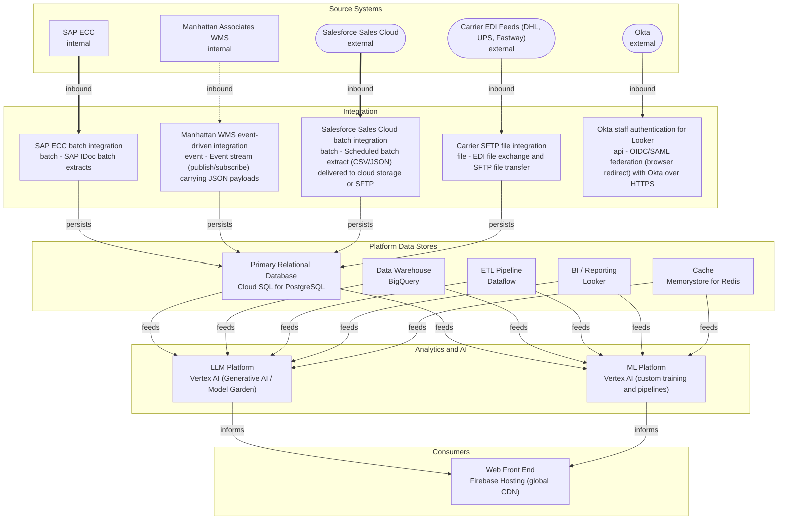

# Unified Supply Chain Analytics Program - Integrated Scoping Package

*Harrow and Vale Distribution Group*

**Generated:** 2026-09-19 00:00 UTC · **AI mode:** Mock AI mode · **Export status:** Review Required

> This document is an AI-assisted internal planning output based on customer requirements and stated assumptions. It requires review and validation by qualified sales, architecture, delivery, security, and commercial stakeholders. It is not a final quote, contractual commitment, or delivery guarantee.

## Table of contents

- [Executive summary](#executive-summary)
- [Customer objectives](#customer-objectives)
- [Requirement summary](#requirement-summary)
- [PRD](#prd)
- [Functional scope](#functional-scope)
- [Solution architecture](#solution-architecture)
- [Architecture diagram](#architecture-diagram)
- [Data strategy](#data-strategy)
- [Integration architecture](#integration-architecture)
- [AI solution approach](#ai-solution-approach)
- [Recommended technologies and frameworks](#recommended-technologies-and-frameworks)
- [Delivery phases and workstreams](#delivery-phases-and-workstreams)
- [Effort and timeline estimate](#effort-and-timeline-estimate)
- [ROM commercials](#rom-commercials)
- [Assumptions](#assumptions)
- [Risks](#risks)
- [Dependencies](#dependencies)
- [Open questions](#open-questions)
- [Requirement coverage](#requirement-coverage)
- [Traceability information](#traceability-information)
- [Quality review](#quality-review)
- [Change log](#change-log)

## Executive summary

This scoping package covers Harrow and Vale Distribution Group's Unified Supply Chain Analytics Program, grounded in 4 business objectives, 10 functional requirements and 6 non-functional requirements reviewed from the customer's own requirements text, alongside 5 integrations and 5 security or compliance requirements that shape the proposed solution.

Cloud platform: Google Cloud Platform (GCP); Requirement coverage: 100%; Effort estimate: 455 to 696 person-days (likely 533); Timeline: 15 to 23 weeks; ROM commercial range: 429,000 USD to 656,000 USD (likely 504,000 USD); Estimate confidence: Medium; Open questions: 3. 3 clarification questions remain open and should be resolved before this package is finalised. This summary and the estimates that follow are an AI-assisted planning output and require review and validation by qualified sales, architecture, delivery, security and commercial stakeholders before being shared with Harrow and Vale Distribution Group.

## Customer objectives

| ID | Business objective | Priority | Source reference |
| --- | --- | --- | --- |
| BR_01 | Trusted available-to-promise inventory view: Give merchandising a single, trusted view of available-to-promise inventory across all 46 depots, refreshed at least hourly. | High | 3. Business Requirements - lines 21-21 |
| BR_02 | Eliminate the weekly manual reconciliation: Eliminate the current weekly manual reconciliation between SAP ECC and Manhattan WMS. | High | 3. Business Requirements - lines 22-22 |
| BR_03 | Two-week-ahead stockout forecasting: Let supply chain planners forecast depot-level stockouts at least two weeks in advance. | Medium | 3. Business Requirements - lines 23-23 |
| BR_04 | Consolidated order, margin and carrier-cost view: Give finance a consolidated view of order value, margin and carrier cost by depot and by trade account. | High | 3. Business Requirements - lines 24-24 |

## Requirement summary

### Counts by requirement type

| Category | Count |
| --- | --- |
| Business objective | 4 |
| Functional requirement | 10 |
| Non-functional requirement | 6 |
| Integration | 5 |
| Data requirement | 6 |
| Security and compliance | 5 |

### Counts by priority

| Category | Count |
| --- | --- |
| High | 33 |
| Medium | 3 |

### Counts by provenance (all in-scope items)

| Category | Count |
| --- | --- |
| Customer-stated | 48 |
| AI-inferred | 13 |
| Assumed | 2 |

### Reviewed requirements

| ID | Type | Priority | Provenance | Source reference | Related IDs |
| --- | --- | --- | --- | --- | --- |
| BR_01 | Business objective | High | Customer-stated | 3. Business Requirements - lines 21-21 | None cited |
| BR_02 | Business objective | High | Customer-stated | 3. Business Requirements - lines 22-22 | None cited |
| BR_03 | Business objective | Medium | Customer-stated | 3. Business Requirements - lines 23-23 | PER_01 |
| BR_04 | Business objective | High | Customer-stated | 3. Business Requirements - lines 24-24 | None cited |
| FR_01 | Functional requirement | High | Customer-stated | 4. Functional Requirements - lines 29-29 | SYS_01 |
| FR_02 | Functional requirement | High | Customer-stated | 4. Functional Requirements - lines 30-30 | SYS_02 |
| FR_03 | Functional requirement | High | Customer-stated | 4. Functional Requirements - lines 31-31 | SYS_03 |
| FR_04 | Functional requirement | High | Customer-stated | 4. Functional Requirements - lines 32-32 | SYS_04 |
| FR_05 | Functional requirement | High | Customer-stated | 4. Functional Requirements - lines 33-33 | None cited |
| FR_06 | Functional requirement | High | Customer-stated | 4. Functional Requirements - lines 35-35 | PER_02 |
| FR_07 | Functional requirement | High | Customer-stated | 4. Functional Requirements - lines 37-37 | DATA_03 |
| FR_08 | Functional requirement | High | Customer-stated | 4. Functional Requirements - lines 34-34 | PER_01, BR_03 |
| FR_09 | Functional requirement | Medium | Customer-stated | 4. Functional Requirements - lines 36-36 | BR_01, TECH_01 |
| FR_10 | Functional requirement | High | Customer-stated | 4. Functional Requirements - lines 38-38 | DATA_01 |
| NFR_01 | Non-functional requirement | High | Customer-stated | 5. Non-Functional Requirements - lines 42-42 | None cited |
| NFR_02 | Non-functional requirement | High | Customer-stated | 5. Non-Functional Requirements - lines 43-43 | None cited |
| NFR_03 | Non-functional requirement | High | Customer-stated | 5. Non-Functional Requirements - lines 44-44 | None cited |
| NFR_04 | Non-functional requirement | High | Customer-stated | 5. Non-Functional Requirements - lines 46-46 | GAP_02 |
| NFR_05 | Non-functional requirement | High | Customer-stated | 5. Non-Functional Requirements - lines 47-47 | None cited |
| NFR_06 | Non-functional requirement | High | Customer-stated | 5. Non-Functional Requirements - lines 45-45 | FR_05, DATA_03 |
| INT_01 | Integration | High | Customer-stated | 6. Integration Requirements - lines 51-51 | SYS_01 |
| INT_02 | Integration | High | Customer-stated | 6. Integration Requirements - lines 52-52 | SYS_03, GAP_01 |
| INT_03 | Integration | Medium | Customer-stated | 6. Integration Requirements - lines 53-53 | SYS_02 |
| INT_04 | Integration | High | Customer-stated | 6. Integration Requirements - lines 54-54 | SYS_04, DEP_01 |
| INT_05 | Integration | High | Customer-stated | 6. Integration Requirements - lines 56-56 | None cited |
| DATA_01 | Data requirement | High | Customer-stated | 7. Data Requirements - lines 60-60 | None cited |
| DATA_02 | Data requirement | High | Customer-stated | 7. Data Requirements - lines 61-61 | None cited |
| DATA_03 | Data requirement | High | Customer-stated | 7. Data Requirements - lines 62-62 | None cited |
| DATA_04 | Data requirement | High | Customer-stated | 7. Data Requirements - lines 63-63 | RSK_01 |
| DATA_05 | Data requirement | High | Customer-stated | 7. Data Requirements - lines 65-65 | SEC_05 |
| DATA_06 | Data requirement | High | Customer-stated | 7. Data Requirements - lines 64-64 | NFR_04, GAP_02 |
| SEC_01 | Security and compliance | High | Customer-stated | 8. Security and Compliance - lines 69-69 | None cited |
| SEC_02 | Security and compliance | High | Customer-stated | 8. Security and Compliance - lines 70-70 | None cited |
| SEC_03 | Security and compliance | High | Customer-stated | 8. Security and Compliance - lines 71-71 | None cited |
| SEC_04 | Security and compliance | High | Customer-stated | 8. Security and Compliance - lines 72-72 | None cited |
| SEC_05 | Security and compliance | High | Customer-stated | 8. Security and Compliance - lines 73-73 | None cited |

### Context and constraints

| ID | Type | Title: description | Provenance | Source reference |
| --- | --- | --- | --- | --- |
| PER_01 | Persona | Supply Chain Planner: Plans depot-level stock and forecasts stockouts using consolidated inventory and order data. | AI-inferred | 3. Business Requirements - lines 23-23 |
| PER_02 | Persona | Finance Analyst: Builds margin and carrier-cost reports blended from order and EDI cost data. | AI-inferred | 4. Functional Requirements - lines 35-35 |
| PER_03 | Persona | Merchandiser: Merchandising staff who need a trusted, hourly view of available-to-promise inventory and build their own Looker dashboards. | AI-inferred | 3. Business Requirements - lines 21-21 |
| PER_04 | Persona | Data Steward: Data stewards who review and correct records that fail data-quality validation before they reach reporting. | AI-inferred | 4. Functional Requirements - lines 37-37 |
| SYS_01 | Existing system | SAP ECC: The order-management and finance system of record, running on-premises, generating roughly 40,000 sales order changes per day. | Customer-stated | 2. Current Systems Landscape - lines 12-12 |
| SYS_02 | Existing system | Salesforce Sales Cloud: Holds wholesale account and opportunity data for the 1,200 trade accounts the field sales team manages. | Customer-stated | 2. Current Systems Landscape - lines 13-13 |
| SYS_03 | Existing system | Manhattan Associates WMS: The warehouse management system deployed across all 46 depots and the source of truth for pick, pack and stock-on-hand events. | Customer-stated | 2. Current Systems Landscape - lines 14-14 |
| SYS_04 | Existing system | Carrier EDI Feeds (DHL, UPS, Fastway): Carrier shipment tracking arrives as EDI 214 and EDI 856 messages over SFTP from the three main carriers. | Customer-stated | 2. Current Systems Landscape - lines 15-15 |
| SYS_05 | Existing system | Legacy Access-Based Reconciliation Spreadsheet: A legacy Access-based spreadsheet process currently reconciles SAP ECC and Manhattan WMS stock counts weekly; the COO wants it eliminated. | Customer-stated | 2. Current Systems Landscape - lines 16-16 |
| TECH_01 | Technology preference | BigQuery warehouse for Looker: The BI team has standardised on Looker for dashboards and wants the underlying warehouse to be BigQuery so Looker's native modelling layer can be used directly. | Customer-stated | 9. Technology Preferences - lines 77-77 |
| TECH_02 | Technology preference | No existing analytics cloud footprint: There is currently no cloud footprint for analytics, so the delivery partner should recommend the supporting pipeline and orchestration services. | Customer-stated | 9. Technology Preferences - lines 78-78 |
| TECH_03 | Technology preference | SQL-first transformation preference: The two in-house data analysts know SQL and Python; a platform that keeps transformation logic in SQL where practical is preferred. | Customer-stated | 9. Technology Preferences - lines 79-79 |
| CON_01 | Delivery constraint | 30-week pre-peak go-live target: Be live and reconciling SAP ECC against Manhattan WMS before the pre-Christmas peak trading period, a target of 30 weeks from contract signature. | Customer-stated | 10. Delivery Constraints and Timeline - lines 83-83 |
| CON_02 | Delivery constraint | Phased depot rollout: Roll out to the five largest depots by order volume before extending to the remaining 41. | Customer-stated | 10. Delivery Constraints and Timeline - lines 84-84 |
| CON_03 | Delivery constraint | Half-time customer data analyst; partner owns data engineering: The customer's data team can allocate one data analyst half-time to this program; the delivery partner is expected to own data engineering and pipeline build. | Customer-stated | 10. Delivery Constraints and Timeline - lines 85-85 |
| CON_04 | Delivery constraint | Retire legacy reconciliation spreadsheet within 90 days: Formally retire the legacy Access-based reconciliation spreadsheet within 90 days of the new platform going live. | Customer-stated | 10. Delivery Constraints and Timeline - lines 86-86 |
| DEP_01 | Dependency | Fastway EDI feed reliability history: Extra validation is needed on the Fastway carrier feed given its history of reliability issues, which may add reconciliation logic before go-live. | AI-inferred | 11. Discovery Call Notes - 2026-08-27 - lines 93-93 |

## PRD

- **Generated by:** Mock AI (deterministic, offline)
- **Mode:** Mock AI (deterministic, offline)
- **Fallback used:** No
- **Generated at:** 2026-09-19 00:00 UTC

Document: Unified Supply Chain Analytics Program - Product Requirements Document

#### Product or solution overview

Harrow and Vale Distribution Group needs order, inventory and shipment data from SAP ECC, Salesforce Sales Cloud, Manhattan WMS and DHL/UPS/Fastway EDI feeds consolidated onto BigQuery and Looker within 30 weeks, replacing a manual weekly reconciliation across 46 depots; WMS real-time coverage and the historical-migration window remain open. (Refs: BR_01, BR_02, BR_03, BR_04; AI interpretation)

Unified Supply Chain Analytics Program serves 4 business objectives set by Harrow and Vale Distribution Group (BR_01, BR_02, BR_03 and BR_04); each is detailed under Business objectives. (Refs: BR_01, BR_02, BR_03, BR_04; Customer-requested)

The solution is organised into 6 capability areas (Application Experience, Platform Foundation, Data Platform, Systems Integration, AI Capabilities and Security and Compliance) and connects to SAP ECC (SYS_01), Salesforce Sales Cloud (SYS_02), Manhattan Associates WMS (SYS_03) and Carrier EDI Feeds (DHL, UPS, Fastway) (SYS_04). (Refs: SYS_01, SYS_02, SYS_03, SYS_04; AI interpretation)

#### Business problem

Today Harrow and Vale Distribution Group relies on Legacy Access-Based Reconciliation Spreadsheet: A legacy Access-based spreadsheet process currently reconciles SAP ECC and Manhattan WMS stock counts weekly; the COO wants it eliminated. (Refs: SYS_05; Customer-requested)

Until this is addressed, Harrow and Vale Distribution Group cannot achieve "Trusted available-to-promise inventory view" (BR_01), "Eliminate the weekly manual reconciliation" (BR_02), "Two-week-ahead stockout forecasting" (BR_03) and "Consolidated order, margin and carrier-cost view" (BR_04). (Refs: BR_01, BR_02, BR_03, BR_04; Customer-requested)

#### Business objectives

BR_01 - Trusted available-to-promise inventory view: Give merchandising a single, trusted view of available-to-promise inventory across all 46 depots, refreshed at least hourly. (Refs: BR_01; Customer-requested)

BR_02 - Eliminate the weekly manual reconciliation: Eliminate the current weekly manual reconciliation between SAP ECC and Manhattan WMS. (Refs: BR_02; Customer-requested)

BR_03 - Two-week-ahead stockout forecasting: Let supply chain planners forecast depot-level stockouts at least two weeks in advance. (Refs: BR_03; Customer-requested)

BR_04 - Consolidated order, margin and carrier-cost view: Give finance a consolidated view of order value, margin and carrier cost by depot and by trade account. (Refs: BR_04; Customer-requested)

#### Target users and personas

PER_01 - Supply Chain Planner: Plans depot-level stock and forecasts stockouts using consolidated inventory and order data. (Refs: PER_01; AI interpretation)

PER_02 - Finance Analyst: Builds margin and carrier-cost reports blended from order and EDI cost data. (Refs: PER_02; AI interpretation)

PER_03 - Merchandiser: Merchandising staff who need a trusted, hourly view of available-to-promise inventory and build their own Looker dashboards. (Refs: PER_03; AI interpretation)

PER_04 - Data Steward: Data stewards who review and correct records that fail data-quality validation before they reach reporting. (Refs: PER_04; AI interpretation)

#### User journeys or key workflows

Supply Chain Planner journey: Step 1: Let supply chain planners build a depot-level stockout forecast using at least twelve months of trailing order history (FR_08; delivered by CAP_17). (Refs: FR_08; AI interpretation)

Finance Analyst journey: Step 1: Finance analysts build margin and carrier-cost reports blended from SAP ECC order data and carrier EDI cost fields (FR_06; delivered by CAP_02). (Refs: FR_06; AI interpretation)

Merchandiser journey: Step 1: Let merchandising build ad hoc dashboards in Looker without needing data-engineering support for every new question (FR_09; delivered by CAP_02). (Refs: FR_09; AI interpretation)

Data Steward journey: Step 1: Data stewards see and correct records that fail data-quality validation before they reach reporting layers (FR_07; delivered by CAP_04). (Refs: FR_07; AI interpretation)

#### Functional requirements

DATA_01 - Conformed dimensional model: Model order, inventory and shipment data into a governed set of conformed dimensions (depot, product, carrier, trade account) usable across all reports. (Refs: DATA_01; Customer-requested)

DATA_02 - Domain-based data ownership: Assign data ownership per domain: supply chain owns inventory and shipment data, finance owns order and margin data. (Refs: DATA_02; Customer-requested)

DATA_03 - Automated data-quality rules: Check for missing SKU mappings, negative stock quantities and orphaned shipment records on every load. (Refs: DATA_03; Customer-requested)

DATA_04 - SAP/WMS product and depot master-data reconciliation: Reconcile master product and depot reference data between SAP ECC and Manhattan WMS, since SKU codes differ slightly between the two systems today. (Refs: DATA_04; Customer-requested)

DATA_05 - Salesforce trade-account contact data: Trade-account data from Salesforce contains personal contact details for account owners and must be handled as confidential business data. (Refs: DATA_05; Customer-requested)

DATA_06 - Six-year transaction retention with indefinite marts: Retain transaction-level detail for six years; aggregated reporting marts may be retained indefinitely. (Refs: DATA_06; Customer-requested)

FR_01 - Near-real-time SAP ECC order ingestion: Ingest sales order and order-line data from SAP ECC, including order status changes, at least every 15 minutes. (Refs: FR_01; Customer-requested)

FR_02 - Daily Salesforce account and opportunity ingestion: Ingest wholesale account and opportunity data from Salesforce Sales Cloud daily. (Refs: FR_02; Customer-requested)

FR_03 - Near-real-time Manhattan WMS event ingestion: Ingest pick, pack and stock-on-hand events from Manhattan WMS in near real time across all 46 depots. (Refs: FR_03; Customer-requested)

FR_04 - Carrier EDI message parsing: Parse and load EDI 214 and EDI 856 carrier messages delivered over SFTP from DHL, UPS and Fastway. (Refs: FR_04; Customer-requested)

FR_05 - Automated inventory reconciliation: Reconcile inventory positions between SAP ECC and Manhattan WMS automatically and surface variances above a configurable threshold. (Refs: FR_05; Customer-requested)

FR_06 - Margin and carrier-cost reporting: Finance analysts build margin and carrier-cost reports blended from SAP ECC order data and carrier EDI cost fields. (Refs: FR_06; Customer-requested)

FR_07 - Data-steward correction workflow: Data stewards see and correct records that fail data-quality validation before they reach reporting layers. (Refs: FR_07; Customer-requested)

FR_08 - Twelve-month trailing stockout forecast: Let supply chain planners build a depot-level stockout forecast using at least twelve months of trailing order history. (Refs: FR_08; Customer-requested)

FR_09 - Ad hoc Looker dashboards without data engineering: Let merchandising build ad hoc dashboards in Looker without needing data-engineering support for every new question. (Refs: FR_09; Customer-requested)

FR_10 - Full data lineage trail: Maintain a full lineage trail showing which source system and load run produced every reported metric. (Refs: FR_10; Customer-requested)

#### Non-functional requirements

NFR_01 - 40,000 SAP order-line changes per day at peak: Support 40,000 SAP ECC order-line changes per day at peak, including the pre-Christmas trading period, without backlog. (Refs: NFR_01; Customer-requested)

NFR_02 - 60-minute inventory dashboard refresh: Depot-level inventory dashboards must refresh within 60 minutes of a source-system change during business hours. (Refs: NFR_02; Customer-requested)

NFR_03 - Approximately 350 named users: Support approximately 350 named users across merchandising, supply chain and finance. (Refs: NFR_03; Customer-requested)

NFR_04 - Six-year transaction-level retention: Retain transaction-level order and shipment data for at least six years to satisfy UK tax and audit requirements. (Refs: NFR_04; Customer-requested)

NFR_05 - Idempotent EDI file processing: EDI file processing must be idempotent so a resent or duplicate carrier file never double-counts a shipment. (Refs: NFR_05; Customer-requested)

NFR_06 - 2% SAP/WMS variance-flagging threshold: Flag any depot with more than a 2% variance between SAP ECC and Manhattan WMS stock counts within the same reporting cycle. (Refs: NFR_06; Customer-requested)

SEC_01 - Encryption in transit: Encrypt all data in transit between depots, carriers and the analytics platform using current TLS standards. (Refs: SEC_01; Customer-requested)

SEC_02 - Role-based access to margin data: Restrict depot-level margin data to finance and senior supply chain roles only via role-based access control. (Refs: SEC_02; Customer-requested)

SEC_03 - Managed SFTP credential rotation: Store SFTP credentials for each carrier in a managed secrets service and rotate them at least every 90 days. (Refs: SEC_03; Customer-requested)

SEC_04 - Audit trail for manual corrections: Record every manual data-quality correction in an audit trail, including who made it and when. (Refs: SEC_04; Customer-requested)

SEC_05 - UK GDPR handling for trade-account contacts: Support UK GDPR requirements for the personal contact data held in the Salesforce trade-account extracts. (Refs: SEC_05; Customer-requested)

#### Integrations

INT_01 - SAP ECC batch integration: Batch integration with SAP ECC for order, order-line and finance postings, using SAP-provided extract tables or IDocs. (Refs: INT_01; Customer-requested)

INT_02 - Manhattan WMS event-driven integration: Event-driven integration with Manhattan WMS for pick, pack and stock-on-hand events, ideally via its published event stream. (Refs: INT_02; Customer-requested)

INT_03 - Salesforce Sales Cloud batch integration: Daily batch integration with Salesforce Sales Cloud for wholesale account and opportunity data. (Refs: INT_03; Customer-requested)

INT_04 - Carrier SFTP file integration: File-based SFTP integration to receive EDI 214 and EDI 856 messages from DHL, UPS and Fastway on a schedule agreed with each carrier. (Refs: INT_04; Customer-requested)

INT_05 - Okta staff authentication for Looker: Integrate with the existing Okta tenant for staff authentication into Looker and any data-steward tooling. (Refs: INT_05; Customer-requested)

#### Dependencies

DEP_01 - Fastway EDI feed reliability history: Extra validation is needed on the Fastway carrier feed given its history of reliability issues, which may add reconciliation logic before go-live. (Refs: DEP_01; AI interpretation)

#### Assumptions

ASM_01 - Delivery partner recommends surrounding GCP services: Assumed the delivery partner can recommend supporting GCP services (pipeline orchestration, ingestion) beyond BigQuery and Looker, given no existing cloud footprint. (Refs: ASM_01; Assumption to confirm)

ASM_02 - Depot ranking derivable from SAP ECC data: Assumed the five largest depots by order volume can be identified from existing SAP ECC sales data without a separate depot-ranking exercise. (Refs: ASM_02; Assumption to confirm)

#### Risks

RSK_01 - SKU mapping mismatch risk: Diverging SKU codes between SAP ECC and Manhattan WMS create a risk of inaccurate reconciliation until master data is aligned. (Refs: RSK_01; AI interpretation)

RSK_02 - Duplicate-shipment risk without idempotent processing: A resent or duplicate carrier EDI file could double-count a shipment if idempotent processing is not implemented as specified. (Refs: RSK_02; AI interpretation)

#### Out-of-scope items

BR_05 - Customer-facing order tracking (future candidate): excluded from this engagement because the customer states "BR5. The platform could support a future customer-facing order-tracking experience, though that is not in scope for this phase." (Refs: BR_05; Out of scope)

INT_06 - Future customer-tracking shipment-status API (candidate): excluded from this engagement because the customer states "INT5. The platform should expose a secure API so a future customer-tracking experience can query shipment status, though that build is out of scope now." (Refs: INT_06; Out of scope)

Detailed visual design, branding and content authoring beyond what is described in the reviewed scope are out of scope for this PRD and are addressed during design execution. (Refs: None cited; Assumption to confirm)

Production data-migration volumes, historical backfill and legacy data cleansing beyond the reviewed data requirements remain out of scope until the customer confirms them. (Refs: DATA_01, DATA_02, DATA_03, DATA_04, DATA_05, DATA_06; Assumption to confirm)

Decommissioning of the existing systems referenced in the scope model is out of scope; this engagement covers integration with those systems, not their retirement. (Refs: SYS_01, SYS_02, SYS_03, SYS_04, SYS_05; Assumption to confirm)

#### Open questions

Q_01 - Can Manhattan WMS publish real-time events at all 46 depots?: Confirm whether Manhattan WMS can publish real-time stock events at all 46 depots or only the 12 depots on the newer WMS version. (Refs: Q_01; AI interpretation)

Q_02 - How far back should historical migration go?: Confirm whether historical data migration should cover three years or the full six-year retention window at initial load. (Refs: Q_02; AI interpretation)

Q_03 - Confirm the target phase for the customer-tracking API: The customer places the customer-tracking API outside this phase; confirm which later phase should deliver it so it can be planned and estimated then. (Refs: Q_03; AI interpretation)

#### Requirement traceability

BR_01 - Trusted available-to-promise inventory view is covered by CAP_01. (Refs: BR_01, CAP_01; Customer-requested)

BR_02 - Eliminate the weekly manual reconciliation is covered by CAP_05. (Refs: BR_02, CAP_05; Customer-requested)

BR_03 - Two-week-ahead stockout forecasting is covered by CAP_17. (Refs: BR_03, CAP_17; Customer-requested)

BR_04 - Consolidated order, margin and carrier-cost view is covered by CAP_05. (Refs: BR_04, CAP_05; Customer-requested)

FR_01 - Near-real-time SAP ECC order ingestion is covered by CAP_03. (Refs: FR_01, CAP_03; Customer-requested)

FR_02 - Daily Salesforce account and opportunity ingestion is covered by CAP_05. (Refs: FR_02, CAP_05; Customer-requested)

FR_03 - Near-real-time Manhattan WMS event ingestion is covered by CAP_05. (Refs: FR_03, CAP_05; Customer-requested)

FR_04 - Carrier EDI message parsing is covered by CAP_05. (Refs: FR_04, CAP_05; Customer-requested)

FR_05 - Automated inventory reconciliation is covered by CAP_01. (Refs: FR_05, CAP_01; Customer-requested)

FR_06 - Margin and carrier-cost reporting is covered by CAP_02. (Refs: FR_06, CAP_02; Customer-requested)

FR_07 - Data-steward correction workflow is covered by CAP_04. (Refs: FR_07, CAP_04; Customer-requested)

FR_08 - Twelve-month trailing stockout forecast is covered by CAP_17. (Refs: FR_08, CAP_17; Customer-requested)

FR_09 - Ad hoc Looker dashboards without data engineering is covered by CAP_02. (Refs: FR_09, CAP_02; Customer-requested)

FR_10 - Full data lineage trail is covered by CAP_02. (Refs: FR_10, CAP_02; Customer-requested)

NFR_01 - 40,000 SAP order-line changes per day at peak is covered by CAP_05. (Refs: NFR_01, CAP_05; Customer-requested)

NFR_02 - 60-minute inventory dashboard refresh is covered by CAP_05. (Refs: NFR_02, CAP_05; Customer-requested)

NFR_03 - Approximately 350 named users is covered by CAP_05. (Refs: NFR_03, CAP_05; Customer-requested)

NFR_04 - Six-year transaction-level retention is covered by CAP_18. (Refs: NFR_04, CAP_18; Customer-requested)

NFR_05 - Idempotent EDI file processing is covered by CAP_05. (Refs: NFR_05, CAP_05; Customer-requested)

NFR_06 - 2% SAP/WMS variance-flagging threshold is covered by CAP_05. (Refs: NFR_06, CAP_05; Customer-requested)

INT_01 - SAP ECC batch integration is covered by CAP_11, CAP_13. (Refs: INT_01, CAP_11, CAP_13; Customer-requested)

INT_02 - Manhattan WMS event-driven integration is covered by CAP_16. (Refs: INT_02, CAP_16; Customer-requested)

INT_03 - Salesforce Sales Cloud batch integration is covered by CAP_11, CAP_12. (Refs: INT_03, CAP_11, CAP_12; Customer-requested)

INT_04 - Carrier SFTP file integration is covered by CAP_14. (Refs: INT_04, CAP_14; Customer-requested)

INT_05 - Okta staff authentication for Looker is covered by CAP_15. (Refs: INT_05, CAP_15; Customer-requested)

DATA_01 - Conformed dimensional model is covered by CAP_10. (Refs: DATA_01, CAP_10; Customer-requested)

DATA_02 - Domain-based data ownership is covered by CAP_05. (Refs: DATA_02, CAP_05; Customer-requested)

DATA_03 - Automated data-quality rules is covered by CAP_06. (Refs: DATA_03, CAP_06; Customer-requested)

DATA_04 - SAP/WMS product and depot master-data reconciliation is covered by CAP_06, CAP_08. (Refs: DATA_04, CAP_06, CAP_08; Customer-requested)

DATA_05 - Salesforce trade-account contact data is covered by CAP_09. (Refs: DATA_05, CAP_09; Customer-requested)

DATA_06 - Six-year transaction retention with indefinite marts is covered by CAP_07, CAP_10. (Refs: DATA_06, CAP_07, CAP_10; Customer-requested)

SEC_01 - Encryption in transit is covered by CAP_19. (Refs: SEC_01, CAP_19; Customer-requested)

SEC_02 - Role-based access to margin data is covered by CAP_20. (Refs: SEC_02, CAP_20; Customer-requested)

SEC_03 - Managed SFTP credential rotation is covered by CAP_21. (Refs: SEC_03, CAP_21; Customer-requested)

SEC_04 - Audit trail for manual corrections is covered by CAP_18. (Refs: SEC_04, CAP_18; Customer-requested)

SEC_05 - UK GDPR handling for trade-account contacts is covered by CAP_05. (Refs: SEC_05, CAP_05; Customer-requested)

## Functional scope

- **Generated by:** Mock AI (deterministic, offline)
- **Mode:** Mock AI (deterministic, offline)
- **Fallback used:** No
- **Generated at:** 2026-09-19 00:00 UTC

### Capabilities

| Capability | Included requirements | Scope | Priority | Dependencies | Label |
| --- | --- | --- | --- | --- | --- |
| Catalog and Inventory Management | BR_01, FR_05 | Provide catalog and inventory management so users can browse, search and maintain the items the platform tracks. It delivers: BR_01 (Trusted available-to-promise inventory view), FR_05 (Automated inventory reconciliation). | High | None | Customer-requested |
| Dashboards and Reporting | FR_06, FR_09, FR_10 | Provide dashboards and reporting so stakeholders can monitor operational and business metrics without manual data extraction. It delivers: FR_06 (Margin and carrier-cost reporting), FR_09 (Ad hoc Looker dashboards without data engineering), FR_10 (Full data lineage trail). | High | None | Customer-requested |
| Orders and Fulfilment | FR_01 | Provide order and fulfilment management covering order capture, status tracking and completion. It delivers: FR_01 (Near-real-time SAP ECC order ingestion). It connects to SAP ECC, Carrier EDI Feeds (DHL, UPS, Fastway). | High | SAP ECC | Customer-requested |
| Workflow and Approvals | FR_07 | Provide workflow and approvals so multi-step processes route to the right approver with a visible status at every stage. It delivers: FR_07 (Data-steward correction workflow). | High | None | Customer-requested |
| Core Platform Services | BR_02, BR_04, FR_02, FR_03, FR_04, NFR_01, NFR_02, NFR_03, NFR_05, NFR_06, DATA_02, SEC_05 | Provide the cross-cutting platform services - configuration, environment setup, logging and shared infrastructure - that every capability in this scope depends on. It delivers: BR_02 (Eliminate the weekly manual reconciliation), BR_04 (Consolidated order, margin and carrier-cost view), FR_02 (Daily Salesforce account and opportunity ingestion), FR_03 (Near-real-time Manhattan WMS event ingestion), FR_04 (Carrier EDI message parsing), NFR_01 (40,000 SAP order-line changes per day at peak), NFR_02 (60-minute inventory dashboard refresh), NFR_03 (Approximately 350 named users), NFR_05 (Idempotent EDI file processing), NFR_06 (2% SAP/WMS variance-flagging threshold), DATA_02 (Domain-based data ownership), SEC_05 (UK GDPR handling for trade-account contacts). | High | Salesforce Sales Cloud, Manhattan Associates WMS, Carrier EDI Feeds (DHL, UPS, Fastway) | Customer-requested |
| Data Quality and Reconciliation | DATA_03, DATA_04 | Implement data-quality checks and reconciliation so discrepancies between systems are caught before they reach reporting. It delivers: DATA_03 (Automated data-quality rules), DATA_04 (SAP/WMS product and depot master-data reconciliation). It connects to Legacy Access-Based Reconciliation Spreadsheet. | High | None | Customer-requested |
| Data Retention and Archival | DATA_06 | Apply retention and archival rules so data is kept only as long as policy and regulation require. It delivers: DATA_06 (Six-year transaction retention with indefinite marts). | High | None | Customer-requested |
| Master and Reference Data Management | DATA_04 | Establish master and reference data ownership so every system reads the same authoritative version of shared entities. It delivers: DATA_04 (SAP/WMS product and depot master-data reconciliation). | High | None | Customer-requested |
| Personal Data Protection | DATA_05 | Classify and protect the personal or sensitive data the solution collects, with access limited to what each role needs. It delivers: DATA_05 (Salesforce trade-account contact data). | High | None | Customer-requested |
| Reporting Data Marts | DATA_01, DATA_06 | Build the reporting data marts that power the dashboards stakeholders rely on. It delivers: DATA_01 (Conformed dimensional model), DATA_06 (Six-year transaction retention with indefinite marts). | High | None | Customer-requested |
| Batch Integration Platform | INT_01, INT_03 | Build a scheduled batch exchange so large or non-urgent data sets are synchronised on a predictable, monitored cadence. It delivers: INT_01 (SAP ECC batch integration), INT_03 (Salesforce Sales Cloud batch integration). | High | SAP ECC, Salesforce Sales Cloud | Customer-requested |
| CRM Integration | INT_03 | Integrate with the customer's CRM platform so account and contact records stay consistent between the two systems. It delivers: INT_03 (Salesforce Sales Cloud batch integration). It connects to Salesforce Sales Cloud. | Medium | Salesforce Sales Cloud | Customer-requested |
| ERP Integration | INT_01 | Integrate with the customer's ERP platform so financial and operational master data stays consistent between the two systems. It delivers: INT_01 (SAP ECC batch integration). It connects to SAP ECC, Legacy Access-Based Reconciliation Spreadsheet. | High | SAP ECC | Customer-requested |
| File-Based Integration Platform | INT_04 | Build a file-based exchange so data moves through the file formats and drop locations the counterpart system already expects. It delivers: INT_04 (Carrier SFTP file integration). It connects to Carrier EDI Feeds (DHL, UPS, Fastway), Legacy Access-Based Reconciliation Spreadsheet. | High | Carrier EDI Feeds (DHL, UPS, Fastway), Fastway EDI feed reliability history | Customer-requested |
| Identity Provider Integration | INT_05 | Integrate with the customer's identity provider so users authenticate with their existing corporate or consumer credentials. It delivers: INT_05 (Okta staff authentication for Looker). | High | None | Customer-requested |
| Real-Time Integration Platform | INT_02 | Build a real-time, event-driven exchange so downstream systems receive updates as they happen rather than on a batch delay. It delivers: INT_02 (Manhattan WMS event-driven integration). | High | Manhattan Associates WMS | Customer-requested |
| AI Forecasting and Prediction | BR_03, FR_08 | Deliver AI-based forecasting so planning decisions are informed by a predictive model rather than manual trend-spotting. It delivers: BR_03 (Two-week-ahead stockout forecasting), FR_08 (Twelve-month trailing stockout forecast). | High | None | Customer-requested |
| Audit Logging and Compliance Monitoring | NFR_04, SEC_04 | Implement audit logging so every access to sensitive data or privileged action can be reconstructed after the fact. It delivers: NFR_04 (Six-year transaction-level retention), SEC_04 (Audit trail for manual corrections). | High | None | Customer-requested |
| Data Encryption | SEC_01 | Implement encryption at rest and in transit for the data classes the reviewed scope identifies as sensitive. It delivers: SEC_01 (Encryption in transit). | High | None | Customer-requested |
| Role-Based Access Control | SEC_02 | Implement role-based access control so each user's permissions match their responsibilities and nothing more. It delivers: SEC_02 (Role-based access to margin data). | High | None | Customer-requested |
| Secrets and Credential Management | SEC_03 | Implement secrets and credential management so API keys and service credentials are never stored in code or configuration files. It delivers: SEC_03 (Managed SFTP credential rotation). | High | None | Customer-requested |

### Recommended enhancements (AI recommendation)

| Capability | Included requirements | Scope | Priority | Dependencies | Label |
| --- | --- | --- | --- | --- | --- |
| Observability and Operations Dashboard | FR_04, NFR_01, INT_04 | Stand up centralised logging, metrics and alerting so the availability, performance and scale targets in FR_04, NFR_01, INT_04 are continuously measurable rather than assumed at go-live. | Medium | None | AI recommendation |
| Security and Compliance Hardening Review | NFR_04, INT_05, DATA_05, SEC_01, SEC_02, SEC_03, SEC_04, SEC_05 | Commission an independent penetration test and compliance review of the controls implemented for NFR_04, INT_05, DATA_05, SEC_01, SEC_02, SEC_03, SEC_04, SEC_05 before production release. | Medium | None | AI recommendation |
| Data Quality and Governance Program | BR_02, BR_04, FR_01, FR_02, FR_03, FR_05, FR_06, FR_07, FR_09, FR_10, NFR_02, NFR_04, NFR_05, NFR_06, INT_02, DATA_01, DATA_03, DATA_04, DATA_05, DATA_06, SEC_01, SEC_04 | Define data-quality rules, named ownership and a reconciliation cadence for the data domains in BR_02, BR_04, FR_01, FR_02, FR_03, FR_05, FR_06, FR_07, FR_09, FR_10, NFR_02, NFR_04, NFR_05, NFR_06, INT_02, DATA_01, DATA_03, DATA_04, DATA_05, DATA_06, SEC_01, SEC_04 so downstream reporting stays trustworthy. | Medium | None | AI recommendation |

### Modules

| Module | Capabilities | Requirements |
| --- | --- | --- |
| AI Capabilities | CAP_17 | BR_03, FR_08 |
| Application Experience | CAP_01, CAP_02, CAP_03, CAP_04 | BR_01, FR_05, FR_06, FR_09, FR_10, FR_01, FR_07 |
| Data Platform | CAP_06, CAP_07, CAP_08, CAP_09, CAP_10 | DATA_03, DATA_04, DATA_06, DATA_05, DATA_01 |
| Platform Foundation | CAP_05 | BR_02, BR_04, FR_02, FR_03, FR_04, NFR_01, NFR_02, NFR_03, NFR_05, NFR_06, DATA_02, SEC_05 |
| Security and Compliance | CAP_18, CAP_19, CAP_20, CAP_21 | NFR_04, SEC_04, SEC_01, SEC_02, SEC_03 |
| Systems Integration | CAP_11, CAP_12, CAP_13, CAP_14, CAP_15, CAP_16 | INT_01, INT_03, INT_04, INT_05, INT_02 |

### Workstreams

| Workstream | Capabilities | Requirements |
| --- | --- | --- |
| AI and Machine Learning | CAP_17 | BR_03, FR_08 |
| Analytics and Data Engineering | CAP_06, CAP_10 | DATA_03, DATA_04, DATA_01, DATA_06 |
| Core Platform Services | CAP_05 | BR_02, BR_04, FR_02, FR_03, FR_04, NFR_01, NFR_02, NFR_03, NFR_05, NFR_06, DATA_02, SEC_05 |
| Core Product Experience | CAP_01, CAP_02, CAP_03, CAP_04 | BR_01, FR_05, FR_06, FR_09, FR_10, FR_01, FR_07 |
| Data Management | CAP_07, CAP_08, CAP_09 | DATA_06, DATA_04, DATA_05 |
| Integration Layer | CAP_11, CAP_12, CAP_13, CAP_14, CAP_15, CAP_16 | INT_01, INT_03, INT_04, INT_05, INT_02 |
| Security Controls | CAP_18, CAP_19, CAP_20, CAP_21 | NFR_04, SEC_04, SEC_01, SEC_02, SEC_03 |

### Delivery packages

| Delivery package | Capabilities | Suggested engagement model | Suggested challenge types |
| --- | --- | --- | --- |
| Package 1 - Foundation | CAP_01, CAP_02, CAP_03, CAP_04, CAP_05 | Topcoder challenge series | Design challenge, Development challenge series, QA / bug hunt |
| Package 2 - Data and Integration | CAP_06, CAP_07, CAP_08, CAP_09, CAP_10, CAP_11, CAP_12, CAP_13, CAP_14, CAP_15, CAP_16 | Topcoder challenge series | Development challenge series, Data science challenge, QA / bug hunt |
| Package 3 - AI Capabilities | CAP_17 | Dedicated delivery team | Data science challenge, QA / bug hunt |
| Package 4 - Security and Compliance | CAP_18, CAP_19, CAP_20, CAP_21 | Topcoder challenge series | Development challenge series, QA / bug hunt |

### Out of scope

| Item | Refs | Label |
| --- | --- | --- |
| BR_05 - Customer-facing order tracking (future candidate): excluded from this engagement because the customer states "BR5. The platform could support a future customer-facing order-tracking experience, though that is not in scope for this phase." | BR_05 | Out of scope |
| INT_06 - Future customer-tracking shipment-status API (candidate): excluded from this engagement because the customer states "INT5. The platform should expose a secure API so a future customer-tracking experience can query shipment status, though that build is out of scope now." | INT_06 | Out of scope |
| Detailed visual design, branding and content authoring beyond what is described in the reviewed scope are out of scope for this PRD and are addressed during design execution. | None cited | Assumption to confirm |
| Production data-migration volumes, historical backfill and legacy data cleansing beyond the reviewed data requirements remain out of scope until the customer confirms them. | DATA_01, DATA_02, DATA_03, DATA_04, DATA_05, DATA_06 | Assumption to confirm |
| Decommissioning of the existing systems referenced in the scope model is out of scope; this engagement covers integration with those systems, not their retirement. | SYS_01, SYS_02, SYS_03, SYS_04, SYS_05 | Assumption to confirm |

## Solution architecture

- **Generated by:** Mock AI (deterministic, offline)
- **Mode:** Mock AI (deterministic, offline)
- **Fallback used:** No
- **Generated at:** 2026-09-19 00:00 UTC

- **Cloud platform:** Google Cloud Platform (GCP)
- **Selection:** User-selected

The proposed solution architecture targets Google Cloud Platform (GCP) and is composed of 27 components covering 21 functional capabilities. It spans the full reviewed scope; see each component’s own rationale below for its specific citations. (Refs: FR_01, FR_02, FR_03, NFR_01, SEC_02, SEC_01; AI interpretation)

### Platform recommendation scores

| Platform | Score | Reasons |
| --- | --- | --- |
| Amazon Web Services (AWS) | 0 | No scoring signals found. |
| Microsoft Azure | 10 | +10 Combined SSO and role-based access needs (INT_05, SEC_02) align with Microsoft Entra ID's enterprise directory integration. (INT_05, SEC_02) |
| Google Cloud Platform (GCP) | 154 | +30 TECH_01 states a direct preference for Google Cloud Platform (GCP), mentions BigQuery, and mentions Looker. (TECH_01); +30 TECH_02 states a direct preference for Google Cloud Platform (GCP). (TECH_02); +30 ASM_01 states a direct preference for Google Cloud Platform (GCP), mentions BigQuery, and mentions Looker. (ASM_01); +18 FR_09 mentions Looker, indicating an affinity for Google Cloud Platform (GCP). (FR_09); +18 INT_05 mentions Looker, indicating an affinity for Google Cloud Platform (GCP). (INT_05); +18 PER_03 mentions Looker, indicating an affinity for Google Cloud Platform (GCP). (PER_03); +10 The scope is analytics/BI heavy (BR_04, FR_01, FR_02, FR_03, FR_06, FR_07, FR_09, FR_10, NFR_02, NFR_06, DATA_01, DATA_06, SEC_01, TECH_01, TECH_02, CON_03, PER_01, PER_02, PER_03, PER_04, ASM_01), an area where BigQuery and Looker are differentiated. (BR_04, FR_01, FR_02, FR_03, FR_06, FR_07, FR_09, FR_10, NFR_02, NFR_06, DATA_01, DATA_06, SEC_01, TECH_01, TECH_02, CON_03, PER_01, PER_02, PER_03, PER_04, ASM_01); +0 Compliance/residency needs (SEC_05) are supported by regional data centres on all three platforms and do not change the recommendation. (SEC_05) |

Google Cloud Platform (GCP) is recommended based on the reviewed scope and configuration. Key factors: TECH_01 states a direct preference for Google Cloud Platform (GCP), mentions BigQuery, and mentions Looker. TECH_02 states a direct preference for Google Cloud Platform (GCP). ASM_01 states a direct preference for Google Cloud Platform (GCP), mentions BigQuery, and mentions Looker. FR_09 mentions Looker, indicating an affinity for Google Cloud Platform (GCP). INT_05 mentions Looker, indicating an affinity for Google Cloud Platform (GCP). PER_03 mentions Looker, indicating an affinity for Google Cloud Platform (GCP). The scope is analytics/BI heavy (BR_04, FR_01, FR_02, FR_03, FR_06, FR_07, FR_09, FR_10, NFR_02, NFR_06, DATA_01, DATA_06, SEC_01, TECH_01, TECH_02, CON_03, PER_01, PER_02, PER_03, PER_04, ASM_01), an area where BigQuery and Looker are differentiated. This is an AI-generated recommendation and should be validated by a solution architect before it is treated as final.

### Architecture components

| Component | Service | Requirements / assumptions | Purpose | Rationale | Trade-offs | Dependencies | Security considerations |
| --- | --- | --- | --- | --- | --- | --- | --- |
| Web Front End | Firebase Hosting (global CDN) | FR_01, FR_02, FR_03 | Serves the internal web experience and delivers static assets close to the staff who use it. | Firebase Hosting (global CDN) serves the web experience with edge caching, TLS termination and low first-byte latency worldwide. It addresses FR_01, FR_02 and FR_03. | Edge caching improves latency but requires explicit cache-invalidation on release. A globally distributed edge adds a small recurring data-transfer cost versus single-region hosting. | API Layer, Customer Identity and Access Management | Enforce HTTPS-only delivery and a strict Content-Security-Policy at the edge. Restrict direct access to origin storage so all traffic is served through the CDN. |
| API Layer | Apigee API Management | NFR_01, SEC_02 | Exposes the solution's functional capabilities as versioned, governed APIs for the front end and integrations. | Apigee API Management centralizes authentication, throttling and request validation ahead of the application compute runtime. It addresses NFR_01 and SEC_02. | A managed gateway adds a small per-request latency and cost overhead versus calling services directly. API versioning policy must be agreed early to avoid breaking existing client integrations. | Application Compute Runtime, Customer Identity and Access Management | Apply request-rate throttling and payload-size limits to reduce abuse and denial-of-service exposure. Validate and authorize every request against the identity provider before it reaches the runtime. |
| Application Compute Runtime | Google Cloud Run | NFR_01 | Hosts the backend business logic that implements the reviewed functional requirements. | Google Cloud Run runs the backend services with managed autoscaling so capacity tracks real traffic without manual intervention. It addresses NFR_01. | Container-based hosting requires a build/release pipeline for every deployable service. Autoscaling limits must be tuned against real traffic before go-live to avoid cost or latency surprises. | Primary Relational Database, Monitoring | Run containers with least-privilege service identities and no long-lived static credentials. Scan container images for known vulnerabilities before each release. |
| Primary Relational Database | Cloud SQL for PostgreSQL | NFR_01, SEC_01 | Stores the core transactional data the application reads and writes. | Cloud SQL for PostgreSQL provides managed relational storage with automated backups, patching and encryption at rest. It addresses NFR_01 and SEC_01. | A managed relational engine caps vertical scale; very high write throughput may need read replicas or partitioning later. Schema migrations must be coordinated with application deployments to avoid downtime. | Backup, Key Management | Encrypt data at rest and in transit, and restrict network access to the application tier only. Apply least-privilege database roles per service rather than a single shared credential. |
| Customer Identity and Access Management | Identity Platform | SEC_02 | Federates sign-in, session management and multi-factor authentication for internal staff against the existing identity provider, rather than a new customer-style registration system. | Identity Platform federates sign-in, session management and MFA for internal staff against the existing identity provider, with no new self-registration flow to build. It addresses SEC_02. | A managed identity provider constrains custom sign-in UX to its supported customization hooks. Federating with an external identity provider (SSO) adds a dependency on that provider’s availability. | Secrets Manager | Enforce MFA for privileged accounts and require strong password/session policies for all users. Log every authentication and authorization decision for audit purposes. |
| Monitoring | Cloud Monitoring | NFR_04, SEC_04, SEC_05 | Tracks infrastructure and application health so incidents are detected before internal staff are blocked by them. | Cloud Monitoring aggregates metrics and dashboards with alerting thresholds tied to the availability and performance targets. It addresses NFR_04, SEC_04 and SEC_05. | Alert thresholds must be tuned to avoid both alert fatigue and missed incidents. Detailed metric retention adds a recurring storage cost proportional to system scale. | Centralized Logging, Application Compute Runtime | Restrict dashboard and alert access to operations and engineering roles only. |
| Centralized Logging | Cloud Logging | NFR_04, SEC_04 | Centralizes application and infrastructure logs for troubleshooting and audit. | Cloud Logging aggregates structured logs from every service with a defined, policy-driven retention period. It addresses NFR_04 and SEC_04. | Centralized log retention has a direct storage cost that scales with request volume. Log content must be scrubbed of personal or sensitive data before it is retained. | Monitoring | Redact personal or sensitive data from log payloads before they are written. Restrict log access to authorized operations staff and retain an access audit trail. |
| CI/CD Pipeline | Cloud Build with Cloud Deploy | TECH_01, TECH_02, TECH_03, CON_01, CON_02, CON_03, CON_04 | Automates build, test and release of every service into each environment. | Cloud Build with Cloud Deploy runs the build/test/release pipeline consistently across development, test and production. It addresses TECH_01, TECH_02, TECH_03, CON_01, CON_02, CON_03 and CON_04. | A fully automated pipeline needs an initial investment in test coverage to be trustworthy for production releases. | Infrastructure as Code | Require code review and passing automated security scans before a release can be promoted. Keep deployment credentials scoped to the pipeline identity, never to individual engineers. |
| Infrastructure as Code | Google Cloud Infrastructure Manager | TECH_01, TECH_02, TECH_03, CON_01, CON_02, CON_03, CON_04 | Defines every environment declaratively so dev/test/prod stay reproducible and auditable. | Google Cloud Infrastructure Manager provisions and updates cloud resources declaratively, so environment drift is detected instead of accumulating silently. It addresses TECH_01, TECH_02, TECH_03, CON_01, CON_02, CON_03 and CON_04. | Declarative provisioning has a learning curve for teams used to manual console changes. | CI/CD Pipeline | Store infrastructure state and variables in a controlled, access-audited location, never in source control in plain text. |
| Secrets Manager | Secret Manager | SEC_03 | Stores and rotates credentials, API keys and connection strings used by every service. | Secret Manager centralizes credential storage with automatic rotation and fine-grained access policies. It addresses SEC_03. | Every service must be updated to fetch secrets at runtime rather than reading them from local configuration. | Key Management | Grant read access to a secret only to the specific service identities that need it. Rotate credentials on a defined schedule and immediately after any suspected exposure. |
| Key Management | Cloud KMS | SEC_01, SEC_03 | Manages the encryption keys that protect data at rest across storage and database services. | Cloud KMS issues and rotates encryption keys with a full audit trail of every key-use event. It addresses SEC_01 and SEC_03. | Customer-managed keys add operational responsibility for key rotation and recovery policy. | None | Rotate keys on a defined schedule and restrict key administration to a small, audited group. |
| Backup | Google Cloud Backup and DR Service | NFR_04, DATA_06 | Protects stored data with policy-driven, regularly tested backups. | Google Cloud Backup and DR Service takes policy-driven, encrypted backups on a defined schedule with a tested restore procedure. It addresses NFR_04 and DATA_06. | Backup retention has a direct storage cost that scales with data volume and retention period. | Primary Relational Database | Encrypt backups at rest and test restores on a regular schedule, not only after an incident. |
| Network Protection | VPC Service Controls with Private Service Connect | NFR_04, INT_05, SEC_01, SEC_02, SEC_03, SEC_04, SEC_05 | Isolates backend services on a private network so they are not directly reachable from the public internet. | VPC Service Controls with Private Service Connect keeps service-to-service traffic off the public internet and restricts inbound access to approved paths only. It addresses NFR_04, INT_05, SEC_01, SEC_02, SEC_03, SEC_04 and SEC_05. | Private networking adds configuration overhead when a new service or integration needs external connectivity. | None | Default to deny-all network rules and open only the specific paths a service requires. Log and periodically review network access-control changes. |
| WAF / DDoS Protection | Google Cloud Armor | NFR_04, INT_05, SEC_01, SEC_02, SEC_03, SEC_04, SEC_05 | Filters malicious inbound traffic and absorbs volumetric attacks at the edge, in front of the public entry point. | Google Cloud Armor inspects inbound requests against managed and custom rule sets and mitigates volumetric attacks before they reach the application. It addresses NFR_04, INT_05, SEC_01, SEC_02, SEC_03, SEC_04 and SEC_05. | Rule tuning is required to avoid false positives blocking legitimate traffic. | None | Enable managed rule sets for common web exploits and review blocked-request logs regularly. Alert on traffic patterns consistent with a volumetric or application-layer attack. |
| Integration API Management | Apigee API Management | INT_01, INT_02, INT_03, INT_04, INT_05 | Publishes governed, versioned endpoints for partner and internal system integrations, separate from the product’s own front-end API. | Apigee API Management exposes integration endpoints with independent throttling, auth and monitoring from the customer-facing API. It addresses INT_01, INT_02, INT_03, INT_04 and INT_05. | Running a second managed API surface adds a small recurring cost versus reusing the front-end API layer. | Integration Service, SAP ECC, Legacy Access-Based Reconciliation Spreadsheet, Salesforce Sales Cloud, Carrier EDI Feeds (DHL, UPS, Fastway) | Require mutual authentication (API key or mTLS) for every partner system calling this surface. |
| Integration Service | Application Integration | INT_01, INT_02, INT_03, INT_04, INT_05 | Coordinates data exchange with the external systems identified in the reviewed scope. | Application Integration provides managed connectors, retry and error-handling policy for each external-system integration. It addresses INT_01, INT_02, INT_03, INT_04 and INT_05. | Each new external system requires its own connector configuration, credential and monitoring setup. | Message Queue, SAP ECC, Legacy Access-Based Reconciliation Spreadsheet, Salesforce Sales Cloud, Carrier EDI Feeds (DHL, UPS, Fastway) | Store integration credentials in the secrets manager and scope them per external system. |
| Message Queue | Pub/Sub (queue-style subscription) | INT_01, INT_02, INT_03, INT_04, INT_05 | Decouples integration producers and consumers so a slow or unavailable external system does not block the application. | Pub/Sub (queue-style subscription) buffers integration messages with dead-letter handling so failed deliveries are retried rather than lost. It addresses INT_01, INT_02, INT_03, INT_04 and INT_05. | Asynchronous delivery means consumers must tolerate eventual, not immediate, consistency. | SAP ECC, Legacy Access-Based Reconciliation Spreadsheet, Salesforce Sales Cloud, Carrier EDI Feeds (DHL, UPS, Fastway) | Encrypt messages in transit and at rest, and restrict queue access to the integration service identity. |
| Event Bus | Eventarc | FR_01, FR_03, INT_02 | Routes near-real-time events between the application and external systems that require immediate synchronization. | Eventarc routes schema-validated events to subscribers with sub-second delivery for real-time synchronization needs. It addresses FR_01, FR_03 and INT_02. | Event-driven synchronization requires each consumer to handle duplicate or out-of-order delivery. | Integration Service, SAP ECC, Carrier EDI Feeds (DHL, UPS, Fastway), Legacy Access-Based Reconciliation Spreadsheet | Restrict event publication to authenticated service identities and validate event schemas at the bus. |
| SFTP / File Transfer | Storage Transfer Service with a self-managed SFTP gateway on Compute Engine | INT_04 | Exchanges files with external systems that only support batch file transfer rather than APIs or events. | Storage Transfer Service with a self-managed SFTP gateway on Compute Engine provides a managed SFTP endpoint backed by object storage for scheduled partner file exchange. It addresses INT_04. | File-based exchange typically has higher latency and weaker delivery guarantees than an API or event integration. | Scheduler, Carrier EDI Feeds (DHL, UPS, Fastway), Legacy Access-Based Reconciliation Spreadsheet | Restrict file transfer accounts to the minimum directories required and rotate their credentials regularly. |
| Scheduler | Cloud Scheduler | INT_01, INT_03 | Triggers recurring batch jobs such as scheduled data synchronization and report generation. | Cloud Scheduler triggers batch jobs on a defined cron schedule with built-in retry on failure. It addresses INT_01 and INT_03. | Scheduled jobs need monitoring of their own to detect a silently skipped or failed run. | Integration Service, SAP ECC, Legacy Access-Based Reconciliation Spreadsheet, Salesforce Sales Cloud | Run scheduled jobs under a dedicated, least-privilege service identity. |
| Data Warehouse | BigQuery | FR_06, FR_07, FR_09, FR_10, NFR_02, NFR_06, DATA_01, DATA_06, SEC_01, TECH_01, TECH_02 | Provides a column-oriented analytical store for cross-domain reporting and analysis. | BigQuery holds curated, query-optimized data separate from transactional load so reporting never competes with production traffic. It addresses FR_06, FR_07, FR_09, FR_10, NFR_02, NFR_06, DATA_01, DATA_06, SEC_01, TECH_01 and TECH_02. | A separate analytical store adds pipeline latency between an event occurring and it being reportable. | ETL Pipeline | Apply row/column-level access controls so analysts see only the data domains they are authorized for. |
| ETL Pipeline | Dataflow | BR_04, FR_01, FR_02, FR_03, TECH_02 | Moves and transforms data from source systems into the analytical store or between domains. | Dataflow runs scheduled extraction and transformation jobs with data-quality checks before data lands downstream. It addresses BR_04, FR_01, FR_02, FR_03 and TECH_02. | Pipeline failures require monitoring and a defined re-run/backfill procedure to avoid silent data gaps. | Scheduler, SAP ECC, Carrier EDI Feeds (DHL, UPS, Fastway), Legacy Access-Based Reconciliation Spreadsheet, Salesforce Sales Cloud | Mask or tokenize sensitive fields during transformation before data reaches lower-trust environments. |
| BI / Reporting | Looker | FR_06, FR_07, FR_09, FR_10, NFR_02, NFR_06, DATA_01, DATA_06, SEC_01, TECH_01, TECH_02 | Delivers self-service dashboards and reports to business stakeholders over the warehouse. | Looker provides governed, self-service dashboards over curated warehouse data. It addresses FR_06, FR_07, FR_09, FR_10, NFR_02, NFR_06, DATA_01, DATA_06, SEC_01, TECH_01 and TECH_02. | Self-service reporting requires a governed semantic layer to prevent conflicting metric definitions. | Data Warehouse | Scope dashboard access by role so stakeholders see only their authorized data domains. |
| LLM Platform | Vertex AI (Generative AI / Model Garden) | BR_03, FR_08 | Provides managed access to foundation models for the AI use cases identified in the reviewed scope. | Vertex AI (Generative AI / Model Garden) gives managed, guardrailed access to foundation models so AI functionality is not built on an unmanaged model endpoint. It addresses BR_03 and FR_08. | Model responses are probabilistic; outputs affecting decisions need a human-review step (see AI solution approach). | Secrets Manager | Apply content-safety guardrails and never send unmasked personal data in a prompt without a documented basis. |
| ML Platform | Vertex AI (custom training and pipelines) | BR_03, FR_08 | Trains, deploys and monitors the predictive models behind forecasting, anomaly detection or recommendation use cases. | Vertex AI (custom training and pipelines) trains and serves predictive models with drift monitoring, distinct from the generative LLM platform. It addresses BR_03 and FR_08. | Predictive models need a labeled training dataset and ongoing retraining as behavior/data patterns shift. | Data Warehouse | Monitor for model drift and bias, and restrict retraining access to the ML engineering team. |
| Cache | Memorystore for Redis | FR_04, NFR_01, INT_04 | Reduces database load and read latency for frequently accessed data under high concurrent usage. | Memorystore for Redis serves hot read paths from memory so the relational database is not the scaling bottleneck under peak load. It addresses FR_04, NFR_01 and INT_04. | Cached data can briefly go stale after a write; time-to-live and invalidation rules must be defined per data type. | Primary Relational Database, Carrier EDI Feeds (DHL, UPS, Fastway), Legacy Access-Based Reconciliation Spreadsheet | Encrypt cache traffic and avoid caching personal data beyond the minimum required time-to-live. |
| Workflow Orchestration | Workflows | FR_07 | Coordinates multi-step approval and workflow processes that span several services. | Workflows tracks each workflow step’s state durably so a partially completed process can resume after a failure. It addresses FR_07. | Orchestrated workflows add operational complexity versus simple synchronous calls and need their own monitoring. | Application Compute Runtime | Enforce the same authorization checks at each workflow step as would apply to a direct API call. |

### Environments

| Environment | Purpose | Sizing |
| --- | --- | --- |
| Development | Feature development and integration testing for engineers before promotion. | Matches the production topology at reduced instance/node counts. |
| Test/QA | Functional, regression and non-functional test execution prior to release. | Matches the production topology at reduced instance/node counts. |
| Production | Live environment serving end users under production SLAs. | Sized for 350 expected users, plus the stated 40,000 SAP order-line changes per day at peak (NFR_01), with autoscaling enabled. |

### Deployment

Releases build and deploy through Cloud Build with Cloud Deploy, with every environment (Development, Test/QA, Production) provisioned declaratively via Google Cloud Infrastructure Manager so drift is detected rather than accumulating. (Refs: TECH_01, TECH_02, TECH_03, CON_01, CON_02, CON_03, CON_04; AI interpretation)

Application services run as containers on Google Cloud Run, promoted unchanged from test into production. (Refs: NFR_01; AI interpretation)

### Availability

Google Cloud Run runs in a single region with the platform's default zone redundancy; a multi-region design is deferred until an explicit availability target is confirmed with the customer. (Refs: NFR_01; Assumption to confirm)

Memorystore for Redis absorbs read load at peak concurrency, reducing pressure on the primary database. (Refs: FR_04, NFR_01, INT_04; AI interpretation)

### Backup and disaster recovery

Google Cloud Backup and DR Service takes policy-driven, encrypted backups of the primary data store with periodic restore testing. (Refs: NFR_04, DATA_06; AI interpretation)

### Security controls

Identity Platform enforces authentication, session management and multi-factor authentication for every internal staff session. (Refs: SEC_02; AI interpretation)

Secret Manager centralizes credential storage and rotation so no service embeds a static secret. (Refs: SEC_03; AI interpretation)

Cloud KMS manages encryption keys and rotation for data at rest across storage and database services. (Refs: SEC_01, SEC_03; AI interpretation)

VPC Service Controls with Private Service Connect isolates backend services on a private network with default-deny inbound access. (Refs: NFR_04, INT_05, SEC_01, SEC_02, SEC_03, SEC_04, SEC_05; AI interpretation)

Google Cloud Armor filters malicious inbound traffic and mitigates volumetric attacks at the edge, in front of the public entry point. (Refs: NFR_04, INT_05, SEC_01, SEC_02, SEC_03, SEC_04, SEC_05; AI interpretation)

## Architecture diagram

**Google Cloud Platform (GCP) Solution Architecture**

```mermaid
flowchart TB
  subgraph tier_users_channels["Users and Channels"]
    ARC_01["Web Front End<br/>Firebase Hosting (global CDN)"]
  end
  subgraph tier_edge_security["Edge and Security"]
    ARC_02["API Layer<br/>Apigee API Management"]
    ARC_05["Customer Identity and Access Management<br/>Identity Platform"]
    ARC_10["Secrets Manager<br/>Secret Manager"]
    ARC_11["Key Management<br/>Cloud KMS"]
    ARC_13["Network Protection<br/>VPC Service Controls with Private Service Connect"]
    ARC_14["WAF / DDoS Protection<br/>Google Cloud Armor"]
    ARC_15["Integration API Management<br/>Apigee API Management"]
  end
  subgraph tier_application["Application"]
    ARC_03["Application Compute Runtime<br/>Google Cloud Run"]
    ARC_20["Scheduler<br/>Cloud Scheduler"]
  end
  subgraph tier_integration_messaging["Integration and Messaging"]
    ARC_16["Integration Service<br/>Application Integration"]
    ARC_17["Message Queue<br/>Pub/Sub (queue-style subscription)"]
    ARC_18["Event Bus<br/>Eventarc"]
    ARC_19["SFTP / File Transfer<br/>Storage Transfer Service with a self-managed SFTP gateway on Compute Engine"]
    ARC_27["Workflow Orchestration<br/>Workflows"]
    ext_INT_01_SAP_ECC(["SAP ECC<br/>External system"])
    ext_INT_02_Manhattan_WMS_event_driven_integration(["Manhattan WMS event-driven integration<br/>External system"])
    ext_INT_03_Salesforce_Sales_Cloud(["Salesforce Sales Cloud<br/>External system"])
    ext_INT_04_Carrier_EDI_Feeds__DHL__UPS__Fastway_(["Carrier EDI Feeds (DHL, UPS, Fastway)<br/>External system"])
    ext_INT_05_Okta_staff_authentication_for_Looker(["Okta staff authentication for Looker<br/>External system"])
  end
  subgraph tier_data["Data"]
    ARC_04["Primary Relational Database<br/>Cloud SQL for PostgreSQL"]
    ARC_21["Data Warehouse<br/>BigQuery"]
    ARC_22["ETL Pipeline<br/>Dataflow"]
    ARC_23["BI / Reporting<br/>Looker"]
    ARC_26["Cache<br/>Memorystore for Redis"]
  end
  subgraph tier_ai_ml["AI and ML"]
    ARC_24["LLM Platform<br/>Vertex AI (Generative AI / Model Garden)"]
    ARC_25["ML Platform<br/>Vertex AI (custom training and pipelines)"]
  end
  subgraph tier_operations["Operations"]
    ARC_06["Monitoring<br/>Cloud Monitoring"]
    ARC_07["Centralized Logging<br/>Cloud Logging"]
    ARC_08["CI/CD Pipeline<br/>Cloud Build with Cloud Deploy"]
    ARC_09["Infrastructure as Code<br/>Google Cloud Infrastructure Manager"]
    ARC_12["Backup<br/>Google Cloud Backup and DR Service"]
  end
  ARC_01 -->|User requests| ARC_02
  ARC_02 -->|Route to business logic| ARC_03
  ARC_02 -->|Authenticate and authorize| ARC_05
  ARC_03 -->|Read/write core data| ARC_04
  ARC_03 -->|Cache reads| ARC_26
  ARC_03 -.->|Coordinate multi-step process| ARC_27
  ARC_03 -->|Model inference| ARC_24
  ARC_03 -->|Score prediction| ARC_25
  ARC_02 -->|Expose integration endpoints| ARC_15
  ARC_15 -->|Route integration calls| ARC_16
  ARC_20 ==>|Trigger batch synchronization| ARC_16
  ARC_16 -.->|Queue outbound messages| ARC_17
  ARC_16 ==>|Exchange files| ARC_19
  ARC_22 ==>|Load curated data| ARC_21
  ARC_21 -->|Reporting queries| ARC_23
  ARC_03 -.->|Emit metrics| ARC_06
  ARC_03 -.->|Emit logs| ARC_07
  ARC_04 ==>|Scheduled backup| ARC_12
  ARC_16 ==>|Synchronize SAP ECC| ext_INT_01_SAP_ECC
  ARC_16 -.->|Synchronize Manhattan WMS event-driven integration| ext_INT_02_Manhattan_WMS_event_driven_integration
  ARC_16 ==>|Synchronize Salesforce Sales Cloud| ext_INT_03_Salesforce_Sales_Cloud
  ARC_16 -->|Synchronize Carrier EDI Feeds (DHL, UPS, Fastway)| ext_INT_04_Carrier_EDI_Feeds__DHL__UPS__Fastway_
  ARC_16 -->|Synchronize Okta staff authentication for Looker| ext_INT_05_Okta_staff_authentication_for_Looker
```

## Data strategy

- **Generated by:** Mock AI (deterministic, offline)
- **Mode:** Mock AI (deterministic, offline)
- **Fallback used:** No
- **Generated at:** 2026-09-19 00:00 UTC

### Data domains

| ID | Domain | Description | Sources | Owner | Classification | Requirements |
| --- | --- | --- | --- | --- | --- | --- |
| DD_01 | Conformed dimensional model | Model order, inventory and shipment data into a governed set of conformed dimensions (depot, product, carrier, trade account) usable across all reports. | No existing system was named for this domain in the reviewed scope; treat it as captured directly by the new solution until the customer confirms an upstream source. | To be confirmed with customer | Internal | DATA_01 |
| DD_02 | Domain-based data ownership | Assign data ownership per domain: supply chain owns inventory and shipment data, finance owns order and margin data. | No existing system was named for this domain in the reviewed scope; treat it as captured directly by the new solution until the customer confirms an upstream source. | To be confirmed with customer | Internal | DATA_02 |
| DD_03 | Automated data-quality rules | Check for missing SKU mappings, negative stock quantities and orphaned shipment records on every load. | Legacy Access-Based Reconciliation Spreadsheet (being retired by this engagement - contributes a one-off migration source only, not an ongoing feed) | To be confirmed with customer | Internal | DATA_03 |
| DD_04 | SAP/WMS product and depot master-data reconciliation | Reconcile master product and depot reference data between SAP ECC and Manhattan WMS, since SKU codes differ slightly between the two systems today. | SAP ECC | To be confirmed with customer | Internal | DATA_04 |
| DD_05 | Salesforce trade-account contact data | Trade-account data from Salesforce contains personal contact details for account owners and must be handled as confidential business data. | No existing system was named for this domain in the reviewed scope; treat it as captured directly by the new solution until the customer confirms an upstream source. | To be confirmed with customer | Regulated | DATA_05 |
| DD_06 | Six-year transaction retention with indefinite marts | Retain transaction-level detail for six years; aggregated reporting marts may be retained indefinitely. | No existing system was named for this domain in the reviewed scope; treat it as captured directly by the new solution until the customer confirms an upstream source. | To be confirmed with customer | Internal | DATA_06 |

### Data topics

#### Data ownership

Ownership of Conformed dimensional model, Domain-based data ownership, Automated data-quality rules, SAP/WMS product and depot master-data reconciliation, Salesforce trade-account contact data and Six-year transaction retention with indefinite marts sits with the Harrow and Vale Distribution Group business function that originates each one; until a data steward is named per domain the assistant records the owner as "To be confirmed with customer" rather than assuming one, and access to each domain is governed through the same identity and access controls as the rest of the platform. Services: Identity Platform, Secret Manager, Cloud KMS, VPC Service Controls with Private Service Connect, Google Cloud Armor. Refs: DATA_01, DATA_02, DATA_03, DATA_04, DATA_05, DATA_06.

#### Ingestion

BR_04 (Consolidated order, margin and carrier-cost view), FR_01 (Near-real-time SAP ECC order ingestion), FR_02 (Daily Salesforce account and opportunity ingestion), FR_03 (Near-real-time Manhattan WMS event ingestion), FR_04 (Carrier EDI message parsing), FR_06 (Margin and carrier-cost reporting), NFR_05 (Idempotent EDI file processing) and SEC_03 (Managed SFTP credential rotation) already state how this data enters the platform, though no data-domain item has been reviewed for it yet; ingestion is built to that requirement. Services: Application Integration, Pub/Sub (queue-style subscription), Eventarc, Storage Transfer Service with a self-managed SFTP gateway on Compute Engine, Workflows. Refs: DATA_01, DATA_02, DATA_03, DATA_04, DATA_05, DATA_06, BR_04, FR_01, FR_02, FR_03, FR_04, FR_06, NFR_05, INT_01, INT_02, INT_03, INT_04, SEC_03, TECH_02, CON_03, CON_04, SYS_04, SYS_05, PER_01, PER_02, DEP_01, RSK_02, GAP_01, GAP_02, ASM_01, Q_01, Q_02.

#### Transactional storage

Operational reads and writes for Conformed dimensional model, Domain-based data ownership, Automated data-quality rules, SAP/WMS product and depot master-data reconciliation, Salesforce trade-account contact data and Six-year transaction retention with indefinite marts are served from Cloud SQL for PostgreSQL on Google Cloud Platform, sized and indexed for the transactional access patterns the reviewed functional requirements describe, separate from the analytical copy used for reporting. Services: Cloud SQL for PostgreSQL. Refs: DATA_01, DATA_02, DATA_03, DATA_04, DATA_05, DATA_06.

#### Analytical storage

A read-optimised analytical copy of Conformed dimensional model and Six-year transaction retention with indefinite marts is maintained in BigQuery on Google Cloud Platform, refreshed from the transactional store on a schedule the reporting requirements drive, so operational queries are never competing with dashboards for the same capacity. Services: BigQuery. Refs: DATA_01, DATA_02, DATA_03, DATA_04, DATA_05, DATA_06, FR_06, FR_07, FR_09, FR_10, NFR_02, NFR_06, SEC_01, TECH_01, TECH_02, PER_02, PER_03, PER_04, ASM_01.

#### Data quality

Records entering Automated data-quality rules and SAP/WMS product and depot master-data reconciliation are checked for completeness, format and duplicate-key conflicts at the ingestion boundary (enforced in Application Integration, Storage Transfer Service with a self-managed SFTP gateway on Compute Engine and Workflows on Google Cloud Platform); failures are routed to a reconciliation queue with the source record and the failed rule instead of being written through silently. Services: Application Integration, Storage Transfer Service with a self-managed SFTP gateway on Compute Engine, Workflows. Refs: DATA_01, DATA_02, DATA_03, DATA_04, DATA_05, DATA_06, BR_02, FR_05, FR_07, FR_10, NFR_05, NFR_06, SEC_04, CON_01, CON_04, SYS_05, PER_04, DEP_01, RSK_01, RSK_02.

#### Metadata and governance

Each of SAP/WMS product and depot master-data reconciliation is catalogued with its owner, classification and retention rule so downstream teams can discover it without re-asking Harrow and Vale Distribution Group; access and schema changes are captured in the platform's audit log (recorded via Cloud Monitoring, Cloud Logging, Secret Manager, Cloud KMS, VPC Service Controls with Private Service Connect and Google Cloud Armor on Google Cloud Platform) for governance review. Services: Cloud Monitoring, Cloud Logging, Secret Manager, Cloud KMS, VPC Service Controls with Private Service Connect, Google Cloud Armor. Refs: DATA_01, DATA_02, DATA_03, DATA_04, DATA_05, DATA_06, NFR_04, SEC_04, RSK_01.

#### Retention

Six-year transaction retention with indefinite marts is retained on the period the customer has stated, or, until confirmed, treated as an open assumption rather than an indefinite default, with expiry enforced through the storage service's own lifecycle rules (configured on Cloud SQL for PostgreSQL, BigQuery, Dataflow and Looker on Google Cloud Platform). Services: Cloud SQL for PostgreSQL, BigQuery, Dataflow, Looker. Refs: DATA_01, DATA_02, DATA_03, DATA_04, DATA_05, DATA_06, NFR_04, GAP_02, Q_02.

#### Privacy and security

Salesforce trade-account contact data carries personal or regulated data and is encrypted at rest and in transit in line with GDPR (SEC_05), with access restricted to the roles that need it (enforced through Secret Manager, Cloud KMS, VPC Service Controls with Private Service Connect and Google Cloud Armor on Google Cloud Platform). Services: Secret Manager, Cloud KMS, VPC Service Controls with Private Service Connect, Google Cloud Armor. Refs: DATA_01, DATA_02, DATA_03, DATA_04, DATA_05, DATA_06, SEC_01, CON_03.

#### Reporting and analytics

Reporting and dashboards over Conformed dimensional model and Six-year transaction retention with indefinite marts read from the analytical copy, not the transactional store, through BigQuery on Google Cloud Platform, so ad-hoc queries cannot degrade the response time of the live application. Services: BigQuery. Refs: DATA_01, DATA_02, DATA_03, DATA_04, DATA_05, DATA_06, FR_06, FR_07, FR_09, FR_10, NFR_02, NFR_06, SEC_01, TECH_01, TECH_02, PER_02, PER_03, PER_04, ASM_01.

#### Backup and recovery

Backup and recovery: no reviewed requirement states an availability or recovery target for this data yet; the platform's default backup schedule still applies until a recovery objective is confirmed. Services: Google Cloud Backup and DR Service. Refs: DATA_01, DATA_02, DATA_03, DATA_04, DATA_05, DATA_06.

## Integration architecture

- **Generated by:** Mock AI (deterministic, offline)
- **Mode:** Mock AI (deterministic, offline)
- **Fallback used:** No
- **Generated at:** 2026-09-19 00:00 UTC

### Integrations

| ID | Integration | System | Direction | Pattern | Authentication | Error handling and retry | Data synchronization | Monitoring | Complexity | Readiness | Requirements |
| --- | --- | --- | --- | --- | --- | --- | --- | --- | --- | --- | --- |
| IF_01 | SAP ECC batch integration | SAP ECC (internal) | inbound | batch - SAP IDoc batch extracts | SFTP key-based authentication (SSH key pair, rotated per the customer's key-management policy) | A run against SAP ECC that fails partway is not partially applied: the whole extract is re-processed from the last confirmed checkpoint on the next attempt, and a run that keeps failing is quarantined for manual review. Retry: A failed run against SAP ECC is retried on the next scheduled window, capped at 3 attempts before it is flagged for manual review rather than retried indefinitely. | SAP ECC is treated as the system of record for the fields it owns; conflicting updates are resolved by last-writer-wins on the record's own timestamp, and a daily reconciliation job compares record counts between SAP ECC and the platform to surface drift instead of assuming the sync is complete. | Run duration, record counts and failure counts for the SAP ECC exchange are tracked in Cloud Monitoring, Cloud Logging, with an alert when a scheduled run does not complete or its record count deviates from the expected range. | High | Not yet confirmed | INT_01, SYS_01 |
| IF_02 | Manhattan WMS event-driven integration | Manhattan Associates WMS (internal) | inbound | event - Event stream (publish/subscribe) carrying JSON payloads | OAuth 2.0 client credentials grant on the event broker connection | Every event published to Manhattan Associates WMS carries an idempotency key so a redelivered or duplicated event is never applied twice, and an event that cannot be processed is moved to a dead-letter queue rather than blocking the stream. Retry: Exponential backoff starting at 1 second and doubling to a 5-attempt ceiling for calls to Manhattan Associates WMS, after which the call is routed to the dead-letter queue instead of retried forever. | Manhattan Associates WMS is treated as the system of record for the fields it owns; conflicting updates are resolved by last-writer-wins on the record's own timestamp, and a daily reconciliation job compares record counts between Manhattan Associates WMS and the platform to surface drift instead of assuming the sync is complete. | Publish/consume lag and dead-letter queue depth for the Manhattan Associates WMS event stream are tracked in Cloud Monitoring, Cloud Logging, with an alert routed to the delivery team when lag or queue depth crosses its threshold. | Medium | Not yet confirmed | INT_02, SYS_03 |
| IF_03 | Salesforce Sales Cloud batch integration | Salesforce Sales Cloud (external) | inbound | batch - Scheduled batch extract (CSV/JSON) delivered to cloud storage or SFTP | SFTP key-based authentication (SSH key pair, rotated per the customer's key-management policy) | A run against Salesforce Sales Cloud that fails partway is not partially applied: the whole extract is re-processed from the last confirmed checkpoint on the next attempt, and a run that keeps failing is quarantined for manual review. Retry: A failed run against Salesforce Sales Cloud is retried on the next scheduled window, capped at 3 attempts before it is flagged for manual review rather than retried indefinitely. | the platform is treated as the system of record for the fields it owns; conflicting updates are resolved by last-writer-wins on the record's own timestamp, and a daily reconciliation job compares record counts between Salesforce Sales Cloud and the platform to surface drift instead of assuming the sync is complete. | Run duration, record counts and failure counts for the Salesforce Sales Cloud exchange are tracked in Cloud Monitoring, Cloud Logging, with an alert when a scheduled run does not complete or its record count deviates from the expected range. | Medium | Not yet confirmed | INT_03, SYS_02 |
| IF_04 | Carrier SFTP file integration | Carrier EDI Feeds (DHL, UPS, Fastway) (external) | inbound | file - EDI file exchange and SFTP file transfer | SFTP key-based authentication (SSH key pair, rotated per the customer's key-management policy) | A run against Carrier EDI Feeds (DHL, UPS, Fastway) that fails partway is not partially applied: the whole extract is re-processed from the last confirmed checkpoint on the next attempt, and a run that keeps failing is quarantined for manual review. Retry: A failed run against Carrier EDI Feeds (DHL, UPS, Fastway) is retried on the next scheduled window, capped at 3 attempts before it is flagged for manual review rather than retried indefinitely. | the platform is treated as the system of record for the fields it owns; conflicting updates are resolved by last-writer-wins on the record's own timestamp, and a daily reconciliation job compares record counts between Carrier EDI Feeds (DHL, UPS, Fastway) and the platform to surface drift instead of assuming the sync is complete. | Run duration, record counts and failure counts for the Carrier EDI Feeds (DHL, UPS, Fastway) exchange are tracked in Cloud Monitoring, Cloud Logging, with an alert when a scheduled run does not complete or its record count deviates from the expected range. | Medium | Not yet confirmed | INT_04, SYS_04 |
| IF_05 | Okta staff authentication for Looker | Okta (external) | inbound | api - OIDC/SAML federation (browser redirect) with Okta over HTTPS | User-delegated OIDC/SAML federation with Okta (authorization-code flow): the signed-in user's own identity is carried through, never a machine-to-machine client-credentials grant. | A federation failure or expired token sends the user back to sign in again rather than granting access; an outage at Okta is surfaced as a sign-in error, never a silent retry. Retry: A failed sign-in is retried by the user through a fresh redirect to Okta; the platform itself never automatically retries a failed authentication. | Okta is the identity source of truth for the signed-in user during federation; the platform stores no password or long-lived credential of its own and persists nothing beyond the session created once Okta confirms the user's identity. | Sign-in success/failure counts and time-to-authenticate for Okta are tracked in Cloud Monitoring, Cloud Logging, with an alert when the failure rate spikes so a broken federation is caught before it locks users out. | High | Not yet confirmed | INT_05 |

### Data flows

| From | To | Payload | Mechanism |
| --- | --- | --- | --- |
| SAP ECC | Primary Relational Database | SAP ECC batch integration | scheduled batch transfer (SAP IDoc batch extracts) |
| Manhattan Associates WMS | Primary Relational Database | Manhattan WMS event-driven integration | asynchronous event (Event stream (publish/subscribe) carrying JSON payloads) |
| Salesforce Sales Cloud | Primary Relational Database | Salesforce Sales Cloud batch integration | scheduled batch transfer (Scheduled batch extract (CSV/JSON) delivered to cloud storage or SFTP) |
| Carrier EDI Feeds (DHL, UPS, Fastway) | Primary Relational Database | Carrier SFTP file integration | file exchange (EDI file exchange and SFTP file transfer) |
| Okta | Customer Identity and Access Management | Federated sign-in and the confirmed user identity | synchronous API call (OIDC/SAML federation (browser redirect) with Okta over HTTPS) |
| Primary Relational Database | LLM Platform | Curated, deduplicated records for reporting and AI use cases | Scheduled extract/transform/load into the analytical store |

### Data and integration flow diagram

**Data and Integration Flow**



## AI solution approach

- **Generated by:** Mock AI (deterministic, offline)
- **Mode:** Mock AI (deterministic, offline)
- **Fallback used:** No
- **Generated at:** 2026-09-19 00:00 UTC

Forecasting model: Twelve-month trailing stockout forecast: Forecasting model delivering FR_08 (Let supply chain planners build a depot-level stockout forecast using at least twelve months of trailing order history.). Also shaped by BR_03, PER_01. (Refs: BR_03, FR_08, PER_01; AI interpretation)

### AI use cases

| ID | Use case | Description | Pattern | Model options | Complexity | Requirements |
| --- | --- | --- | --- | --- | --- | --- |
| AIUC_01 | Forecasting model: Twelve-month trailing stockout forecast | Forecasting model delivering FR_08 (Let supply chain planners build a depot-level stockout forecast using at least twelve months of trailing order history.). Also shaped by BR_03, PER_01. | Forecasting model | Vertex AI Gemini (Gemini 2.0 Pro/Flash) | High | BR_03, FR_08, PER_01 |

#### Forecasting model: Twelve-month trailing stockout forecast

- **Orchestration:** The model produces a point forecast with a confidence interval on a defined cadence; downstream planning consumes the interval, not only the point estimate.
- **Safety controls:** Inputs are validated for range and completeness before scoring; a forecast built on incomplete input data is flagged rather than returned as reliable.
- **Human review:** The forecast informs planning; a human still approves any resourcing or commercial commitment made on top of it.
- **Monitoring:** Request volume, latency, token cost, error rate and the evaluation score trend are tracked in Cloud Monitoring, Cloud Logging, with an alert when the evaluation score or error rate crosses its threshold.

### AI vs deterministic vs human-decision boundaries

| Activity | Type | Reason | Requirements |
| --- | --- | --- | --- |
| Forecasting model: Twelve-month trailing stockout forecast | AI | Forecasting model produces a probabilistic result best suited to unstructured input, so it is implemented as an AI function rather than a fixed rule. | BR_03, FR_08, PER_01 |
| Near-real-time SAP ECC order ingestion | Deterministic rule or calculation | The field mapping and posting rules for this ERP exchange are fixed by the ERP’s own schema and the customer’s accounting rules, leaving nothing for a model to infer. | FR_01 |
| Daily Salesforce account and opportunity ingestion | Deterministic rule or calculation | Records are matched to the CRM by a fixed key (account or contact id), a deterministic lookup rather than a probabilistic match. | FR_02 |
| Near-real-time Manhattan WMS event ingestion | Deterministic rule or calculation | Each event is processed against a fixed schema and idempotency rule the moment it arrives, a deterministic transformation, not a prediction. | FR_03 |
| Carrier EDI message parsing | Deterministic rule or calculation | The file layout (columns, delimiters, encoding) is fixed by the exchange format both sides agreed on, a deterministic parse rather than an inference. | FR_04 |
| Automated inventory reconciliation | Deterministic rule or calculation | Matching a catalogue or inventory record to its master entry is a fixed key lookup, not a probabilistic match. | FR_05 |
| Margin and carrier-cost reporting | Deterministic rule or calculation | The figures a report or dashboard shows are a fixed aggregation of already-recorded data (sums, counts, groupings) that a query engine computes exactly and reproducibly every time, with nothing left to infer. | FR_06 |
| Ad hoc Looker dashboards without data engineering | Deterministic rule or calculation | The figures a report or dashboard shows are a fixed aggregation of already-recorded data (sums, counts, groupings) that a query engine computes exactly and reproducibly every time, with nothing left to infer. | FR_09 |
| Full data lineage trail | Deterministic rule or calculation | "Full data lineage trail" is fully specified by FR_10: the same input must always produce the same result, so it is built as application logic that can be tested and audited rather than as a model. | FR_10 |
| SAP ECC batch integration | Deterministic rule or calculation | The field mapping and posting rules for this ERP exchange are fixed by the ERP’s own schema and the customer’s accounting rules, leaving nothing for a model to infer. | INT_01 |
| Manhattan WMS event-driven integration | Deterministic rule or calculation | Each event is processed against a fixed schema and idempotency rule the moment it arrives, a deterministic transformation, not a prediction. | INT_02 |
| Salesforce Sales Cloud batch integration | Deterministic rule or calculation | Records are matched to the CRM by a fixed key (account or contact id), a deterministic lookup rather than a probabilistic match. | INT_03 |
| Carrier SFTP file integration | Deterministic rule or calculation | The file layout (columns, delimiters, encoding) is fixed by the exchange format both sides agreed on, a deterministic parse rather than an inference. | INT_04 |
| Okta staff authentication for Looker | Deterministic rule or calculation | Authentication decisions must be reproducible and auditable for every sign-in, which only a deterministic protocol - not a probabilistic model - can guarantee. | INT_05 |
| Data-steward correction workflow | Mandatory human decision | FR_07 is the customer's own requirement for a human decision: Data stewards see and correct records that fail data-quality validation before they reach reporting layers. The application routes and records that decision; it does not make it on its own. | FR_07 |
| Sign-off on a commitment made on top of a forecast | Mandatory human decision | The forecast informs planning; a human still approves any resourcing or commercial commitment made on top of it. | BR_03, FR_08, PER_01 |

### Architecture pattern

Forecasting model, orchestrated with Custom orchestration and served behind the platform's managed AI service.

### Prompt management

Each use case's (Forecasting model: Twelve-month trailing stockout forecast) system and user prompts are versioned in source control next to the code that calls them, changed only through code review, and re-run against that use case's golden set in CI before the change ships; the model's JSON output is validated against a versioned JSON schema for that use case, so a malformed response is rejected rather than passed downstream.

### Evaluation approach

Forecasting model: Twelve-month trailing stockout forecast: Forecast accuracy is back-tested against historical actuals before rollout and monitored against actuals as new data arrives; a material accuracy drop triggers retraining rather than silent continued use.

### Responsible AI

- No reviewed requirement or customer document is used to train or fine-tune a third-party model.
- Every AI use case names the mandatory human decision it feeds and does not make alone (see AI vs deterministic vs human-decision boundaries).
- Accuracy/groundedness is measured against a golden set before release and monitored in production, not asserted once and left unchecked.
- Prompt-injection and content-safety filters run on every production request, not only in development.

### Monitoring and feedback

Forecasting model: Twelve-month trailing stockout forecast is monitored for request volume, latency, token cost, error rate and evaluation-score trend as described per use case; a human reviewer's correction or escalation is logged and periodically folded back into the golden set so the evaluation suite improves with production use instead of staying fixed at launch.

### Data privacy

Forecasting model: Twelve-month trailing stockout forecast: Forecasts are computed from aggregated, not individually identifying, data where the source allows it, processed within United Kingdom and Ireland.

## Recommended technologies and frameworks

### Frameworks

- **Generated by:** Mock AI (deterministic, offline)
- **Mode:** Mock AI (deterministic, offline)
- **Fallback used:** No
- **Generated at:** 2026-09-19 00:00 UTC

| Framework | Category | Rationale | Requirements | Alternatives considered |
| --- | --- | --- | --- | --- |
| Custom orchestration | Orchestration | The reviewed AI scope (BR_03, FR_08, PER_01) is a single linear pipeline (parse/score, then a confidence-threshold branch); a lightweight custom orchestrator calling the model SDK directly delivers that without the operational overhead of a graph-based agent framework built for multi-step, looping workflows it does not need. | BR_03, FR_08, PER_01 | LangGraph (unnecessary state-machine and infrastructure overhead for a single linear pipeline with one threshold branch). |
| Vercel AI SDK | SDK | No .NET or Java preference is stated, so the front end streams model output using the same TypeScript stack as the rest of the application (BR_03, FR_08, PER_01); the Vercel AI SDK's streaming hooks remove the need to hand-roll server-sent-event/token-streaming handling in the UI. | BR_03, FR_08, PER_01 | Mastra (a comparable TypeScript agent/streaming SDK; either is suitable, Vercel AI SDK is preferred for its more direct React streaming hooks). |
| Vertex AI managed AI services | Model service | Hosting the model(s) for BR_03, FR_08, PER_01 on Vertex AI (Generative AI / Model Garden), Vertex AI (custom training and pipelines) keeps inference inside the Google Cloud Platform account boundary already used for the rest of the solution, avoiding a separate vendor contract, network egress path and access-control model to operate. | BR_03, FR_08, PER_01 | A self-hosted open-weight model on Kubernetes/GPU nodes (higher operational overhead; only justified by a strict data-residency or cost-at-scale constraint the reviewed scope does not state). |

### Selected cloud services

| Service | Component | Area | Purpose |
| --- | --- | --- | --- |
| Firebase Hosting (global CDN) | Web Front End | User Apps | Serves the internal web experience and delivers static assets close to the staff who use it. |
| Apigee API Management | API Layer | Api | Exposes the solution's functional capabilities as versioned, governed APIs for the front end and integrations. |
| Google Cloud Run | Application Compute Runtime | Backend | Hosts the backend business logic that implements the reviewed functional requirements. |
| Cloud SQL for PostgreSQL | Primary Relational Database | Data Storage | Stores the core transactional data the application reads and writes. |
| Identity Platform | Customer Identity and Access Management | Identity | Federates sign-in, session management and multi-factor authentication for internal staff against the existing identity provider, rather than a new customer-style registration system. |
| Cloud Monitoring | Monitoring | Observability | Tracks infrastructure and application health so incidents are detected before internal staff are blocked by them. |
| Cloud Logging | Centralized Logging | Observability | Centralizes application and infrastructure logs for troubleshooting and audit. |
| Cloud Build with Cloud Deploy | CI/CD Pipeline | Deployment | Automates build, test and release of every service into each environment. |
| Google Cloud Infrastructure Manager | Infrastructure as Code | Environments | Defines every environment declaratively so dev/test/prod stay reproducible and auditable. |
| Secret Manager | Secrets Manager | Security | Stores and rotates credentials, API keys and connection strings used by every service. |
| Cloud KMS | Key Management | Security | Manages the encryption keys that protect data at rest across storage and database services. |
| Google Cloud Backup and DR Service | Backup | Backup Dr | Protects stored data with policy-driven, regularly tested backups. |
| VPC Service Controls with Private Service Connect | Network Protection | Security | Isolates backend services on a private network so they are not directly reachable from the public internet. |
| Google Cloud Armor | WAF / DDoS Protection | Security | Filters malicious inbound traffic and absorbs volumetric attacks at the edge, in front of the public entry point. |
| Apigee API Management | Integration API Management | Api | Publishes governed, versioned endpoints for partner and internal system integrations, separate from the product’s own front-end API. |
| Application Integration | Integration Service | Integration | Coordinates data exchange with the external systems identified in the reviewed scope. |
| Pub/Sub (queue-style subscription) | Message Queue | Messaging | Decouples integration producers and consumers so a slow or unavailable external system does not block the application. |
| Eventarc | Event Bus | Messaging | Routes near-real-time events between the application and external systems that require immediate synchronization. |
| Storage Transfer Service with a self-managed SFTP gateway on Compute Engine | SFTP / File Transfer | Integration | Exchanges files with external systems that only support batch file transfer rather than APIs or events. |
| Cloud Scheduler | Scheduler | Backend | Triggers recurring batch jobs such as scheduled data synchronization and report generation. |
| BigQuery | Data Warehouse | Data Storage | Provides a column-oriented analytical store for cross-domain reporting and analysis. |
| Dataflow | ETL Pipeline | Data Storage | Moves and transforms data from source systems into the analytical store or between domains. |
| Looker | BI / Reporting | Data Storage | Delivers self-service dashboards and reports to business stakeholders over the warehouse. |
| Vertex AI (Generative AI / Model Garden) | LLM Platform | Ai Ml | Provides managed access to foundation models for the AI use cases identified in the reviewed scope. |
| Vertex AI (custom training and pipelines) | ML Platform | Ai Ml | Trains, deploys and monitors the predictive models behind forecasting, anomaly detection or recommendation use cases. |
| Memorystore for Redis | Cache | Data Storage | Reduces database load and read latency for frequently accessed data under high concurrent usage. |
| Workflows | Workflow Orchestration | Integration | Coordinates multi-step approval and workflow processes that span several services. |

## Delivery phases and workstreams

### Delivery packages

| Delivery package | Capabilities | Suggested engagement model | Suggested challenge types |
| --- | --- | --- | --- |
| Package 1 - Foundation | CAP_01, CAP_02, CAP_03, CAP_04, CAP_05 | Topcoder challenge series | Design challenge, Development challenge series, QA / bug hunt |
| Package 2 - Data and Integration | CAP_06, CAP_07, CAP_08, CAP_09, CAP_10, CAP_11, CAP_12, CAP_13, CAP_14, CAP_15, CAP_16 | Topcoder challenge series | Development challenge series, Data science challenge, QA / bug hunt |
| Package 3 - AI Capabilities | CAP_17 | Dedicated delivery team | Data science challenge, QA / bug hunt |
| Package 4 - Security and Compliance | CAP_18, CAP_19, CAP_20, CAP_21 | Topcoder challenge series | Development challenge series, QA / bug hunt |

### Phases and workstreams

| Phase | Workstreams | Milestone |
| --- | --- | --- |
| Discovery and Architecture | Discovery and Architecture | Solution blueprint, prioritised backlog and delivery plan approved (end of week 2) |
| Experience and Core Platform | Core Product Experience, Core Platform Services, Security Controls, Cloud Infrastructure and Hardening | Core platform and user experience feature-complete (end of week 15) - runs concurrently with the other build-phase workstreams inside the shared build window, not as a separate schedule |
| Data and Integration | System Integration, Data Platform and Migration | Integrations and data pipelines verified end to end (end of week 15) - runs concurrently with the other build-phase workstreams inside the shared build window, not as a separate schedule |
| AI Capabilities | AI Capabilities | AI capabilities meet the agreed evaluation thresholds (end of week 15) - runs concurrently with the other build-phase workstreams inside the shared build window, not as a separate schedule |
| Testing and Hardening | Testing and Hardening | Test exit: acceptance, security and performance criteria met (end of week 16) |
| Deployment and Handover | Deployment and Handover | Production go-live and handover to operations complete (end of week 17) |

## Effort and timeline estimate

- **Generated by:** Mock AI (deterministic, offline)
- **Mode:** Mock AI (deterministic, offline)
- **Fallback used:** No
- **Generated at:** 2026-09-19 00:00 UTC

- **Overall confidence:** Medium
- **Total effort:** 455 to 696 person-days (likely 533)
- **Total timeline:** 15 to 23 weeks (likely 17)

The 30-week deadline is achievable: even the high end of the timeline range (23 weeks) fits, against a likely 17 weeks. The configured team of 6 is sufficient; the smallest average team that still meets the deadline at the likely effort is 4.

### Workstreams

| ID | Workstream | Requirements | Drivers | Complexity | Effort range | Cost (likely) | Confidence | Confidence limitations |
| --- | --- | --- | --- | --- | --- | --- | --- | --- |
| WS_PH_1 | Discovery and Architecture | None cited | Sized at 12% of build days (CR_05) | High | 38 to 59 person-days (likely 45) | 39,370 USD | Medium | Sized as a percentage of build effort, so it inherits the Medium overall confidence of the build workstreams. |
| WS_01 | Core Product Experience | BR_01, FR_05, FR_06, FR_09, FR_10, FR_01, FR_07 | Catalog and Inventory Management (Medium), Dashboards and Reporting (High), Orders and Fulfilment (Medium), Workflow and Approvals (Medium) | Medium | 63 to 81 person-days (likely 70) | 51,835 USD | High | None noted |
| WS_02 | Core Platform Services | BR_02, BR_04, FR_02, FR_03, FR_04, NFR_01, NFR_02, NFR_03, NFR_05, NFR_06, DATA_02, SEC_05 | Core Platform Services (Very High) | Very High | 34 to 52 person-days (likely 40) | 29,620 USD | Medium | Core Platform Services (DRV_05) is rated Very High complexity, which carries inherent delivery uncertainty. |
| WS_03 | Security Controls | NFR_04, SEC_04, SEC_01, SEC_02, SEC_03 | Audit Logging and Compliance Monitoring (High), Data Encryption (Medium), Role-Based Access Control (Medium), Secrets and Credential Management (Medium) | Medium | 32 to 49 person-days (likely 38) | 33,288 USD | Medium | Historical migration window undecided (GAP_02) is still open and relates to the requirements of this workstream. |
| WS_04 | Cloud Infrastructure and Hardening | FR_04, NFR_01, NFR_02, NFR_03, NFR_04, NFR_05, NFR_06, FR_01, FR_02, FR_03, SEC_02, SEC_01, SEC_03, DATA_06, INT_05, SEC_04, SEC_05, INT_01, INT_02, INT_03, INT_04, FR_06, FR_07, FR_09, FR_10, DATA_01, BR_04, BR_03, FR_08, SYS_01, CON_01, TECH_01, TECH_02, TECH_03, CON_02, CON_03, CON_04 | Cloud platform foundation and environments (Very High), Delivery pipeline and observability (Medium), Performance and scalability hardening (High), General non-functional hardening (High) | High | 47 to 72 person-days (likely 55) | 45,474 USD | Medium | Cloud platform foundation and environments (DRV_10) is rated Very High complexity, which carries inherent delivery uncertainty. Manhattan WMS real-time coverage unconfirmed (GAP_01) is still open and relates to the requirements of this workstream. Historical migration window undecided (GAP_02) is still open and relates to the requirements of this workstream. Fastway EDI feed reliability history (DEP_01) is an outstanding delivery dependency of this workstream; the estimate assumes it is met on schedule, and a delay would push out the dependent work. |
| WS_05 | System Integration | INT_01, INT_02, INT_03, INT_04, INT_05, FR_07, FR_01, FR_03, SEC_02, NFR_01, SYS_01, SYS_03, SYS_02, SYS_04 | SAP ECC batch integration (High), Manhattan WMS event-driven integration (Medium), Salesforce Sales Cloud batch integration (Medium), Carrier SFTP file integration (Medium), Okta staff authentication for Looker (High) | High | 64 to 120 person-days (likely 80) | 62,320 USD | Low | External API readiness has not been confirmed. Critical and unresolved: GAP_01 "Manhattan WMS real-time coverage unconfirmed". Fastway EDI feed reliability history (DEP_01) is an outstanding delivery dependency of this workstream; the estimate assumes it is met on schedule, and a delay would push out the dependent work. |
| WS_06 | Data Platform and Migration | DATA_01, DATA_02, DATA_03, DATA_04, DATA_05, DATA_06 | Conformed dimensional model (Low), Domain-based data ownership (Low), Automated data-quality rules (Medium), SAP/WMS product and depot master-data reconciliation (High), Salesforce trade-account contact data (Medium), Six-year transaction retention with indefinite marts (Low) | Medium | 53 to 81 person-days (likely 62) | 50,158 USD | Medium | Data volumes and migration scope have not been confirmed. Still open: GAP_02 "Historical migration window undecided". |
| WS_07 | AI Capabilities | BR_03, FR_08, PER_01 | Forecasting model: Twelve-month trailing stockout forecast (High) | High | 27 to 35 person-days (likely 30) | 27,090 USD | High | None noted |
| WS_PH_5 | Testing and Hardening | None cited | Sized at 22% of build days (CR_05) | High | 71 to 108 person-days (likely 83) | 72,601 USD | Medium | Sized as a percentage of build effort, so it inherits the Medium overall confidence of the build workstreams. |
| WS_PH_6 | Deployment and Handover | None cited | Sized at 8% of build days (CR_05) | High | 26 to 39 person-days (likely 30) | 26,235 USD | Medium | Sized as a percentage of build effort, so it inherits the Medium overall confidence of the build workstreams. |

### Driver basis

| Driver ID | Workstream | Type | Complexity | Basis | Refs |
| --- | --- | --- | --- | --- | --- |
| DRV_01 | Core Product Experience | Capability | Medium | Medium complexity: covers 2 requirements (BR_01 and FR_05) at High priority. | CAP_01, BR_01, FR_05 |
| DRV_02 | Core Product Experience | Capability | High | High complexity: covers 3 requirements (FR_06, FR_09 and FR_10) at High priority, and involves demanding features (Dashboards and reporting). | CAP_02, FR_06, FR_09, FR_10 |
| DRV_03 | Core Product Experience | Capability | Medium | Medium complexity: covers 1 requirement (FR_01) at High priority, and involves demanding features (Orders and fulfilment; Real-time or event-driven exchange). | CAP_03, FR_01 |
| DRV_04 | Core Product Experience | Capability | Medium | Medium complexity: covers 1 requirement (FR_07) at High priority, and involves demanding features (Dashboards and reporting; Workflow and approvals). | CAP_04, FR_07 |
| DRV_05 | Core Platform Services | Capability | Very High | Very High complexity: covers 12 requirements (BR_02, BR_04, FR_02, FR_03, FR_04, NFR_01, NFR_02, NFR_03, NFR_05, NFR_06, DATA_02 and SEC_05) at High priority, and involves demanding features (Real-time or event-driven exchange; Dashboards and reporting; Orders and fulfilment). | CAP_05, BR_02, BR_04, FR_02, FR_03, FR_04, NFR_01, NFR_02, NFR_03, NFR_05, NFR_06, DATA_02, SEC_05 |
| DRV_06 | Security Controls | Security control | High | High complexity: covers 2 requirements (NFR_04 and SEC_04) at High priority, and involves demanding features (Orders and fulfilment). | CAP_18, NFR_04, SEC_04 |
| DRV_07 | Security Controls | Security control | Medium | Medium complexity: covers 1 requirement (SEC_01) at High priority, and involves demanding features (Dashboards and reporting). | CAP_19, SEC_01 |
| DRV_08 | Security Controls | Security control | Medium | Medium complexity: covers 1 requirement (SEC_02) at High priority. | CAP_20, SEC_02 |
| DRV_09 | Security Controls | Security control | Medium | Medium complexity: covers 1 requirement (SEC_03) at High priority. | CAP_21, SEC_03 |
| DRV_10 | Cloud Infrastructure and Hardening | Infrastructure | Very High | Very High complexity: 24 architecture components on Google Cloud, availability and disaster-recovery needs, 350 expected users, 2 target regions (United Kingdom and Ireland) and hybrid or on-premises connectivity (SYS_01). | ARC_01, ARC_02, ARC_03, ARC_04, ARC_05, ARC_09, ARC_10, ARC_11, ARC_12, ARC_13, ARC_14, ARC_15, ARC_16, ARC_17, ARC_18, ARC_19, ARC_20, ARC_21, ARC_22, ARC_23, ARC_24, ARC_25, ARC_26, ARC_27, SYS_01 |
| DRV_11 | Cloud Infrastructure and Hardening | Infrastructure | Medium | Medium complexity: 3 deployment and observability components (Monitoring, Centralized Logging and CI/CD Pipeline) to automate and operate on Google Cloud. | ARC_06, ARC_07, ARC_08 |
| DRV_12 | Cloud Infrastructure and Hardening | Non-functional hardening | High | High complexity: 2 quality attributes (Performance; Scalability) required by FR_04, NFR_01 and CON_01; raised one level because FR_04, NFR_01 and CON_01 are High priority. | FR_04, NFR_01, CON_01 |
| DRV_13 | Cloud Infrastructure and Hardening | Non-functional hardening | High | High complexity: 5 requirements (NFR_02, NFR_03, NFR_04, NFR_05 and NFR_06) outside the standard quality attribute groups. | NFR_02, NFR_03, NFR_04, NFR_05, NFR_06 |
| DRV_14 | System Integration | Integration | High | High complexity (from the integration strategy): inbound batch exchange with SAP ECC (internal system) over SAP IDoc batch extracts; interface readiness is not yet confirmed. Requirements: INT_01 and SYS_01. | IF_01, INT_01, SYS_01, ARC_16, ARC_19, ARC_27 |
| DRV_15 | System Integration | Integration | Medium | Medium complexity (from the integration strategy): inbound event exchange with Manhattan Associates WMS (internal system) over Event stream (publish/subscribe) carrying JSON payloads; interface readiness is not yet confirmed. Requirements: INT_02 and SYS_03. | IF_02, INT_02, SYS_03, ARC_17, ARC_18 |
| DRV_16 | System Integration | Integration | Medium | Medium complexity (from the integration strategy): inbound batch exchange with Salesforce Sales Cloud (external system) over Scheduled batch extract (CSV/JSON) delivered to cloud storage or SFTP; interface readiness is not yet confirmed. Requirements: INT_03 and SYS_02. | IF_03, INT_03, SYS_02, ARC_16, ARC_19, ARC_27 |
| DRV_17 | System Integration | Integration | Medium | Medium complexity (from the integration strategy): inbound file exchange with Carrier EDI Feeds (DHL, UPS, Fastway) (external system) over EDI file exchange and SFTP file transfer; interface readiness is not yet confirmed. Requirements: INT_04 and SYS_04. | IF_04, INT_04, SYS_04, ARC_16, ARC_19, ARC_27 |
| DRV_18 | System Integration | Integration | High | High complexity (from the integration strategy): inbound api exchange with Okta (external system) over OIDC/SAML federation (browser redirect) with Okta over HTTPS; interface readiness is not yet confirmed. Requirements: INT_05. | IF_05, INT_05, ARC_05, ARC_02, ARC_15 |
| DRV_19 | Data Platform and Migration | Data | Low | Low complexity: DATA_01 is limited to modelling and storing the data. | DATA_01 |
| DRV_20 | Data Platform and Migration | Data | Low | Low complexity: DATA_02 is limited to modelling and storing the data. | DATA_02 |
| DRV_21 | Data Platform and Migration | Data | Medium | Medium complexity: DATA_03 involves Data quality and reconciliation. | DATA_03 |
| DRV_22 | Data Platform and Migration | Data | High | High complexity: DATA_04 involves Master and reference data; Data quality and reconciliation. | DATA_04 |
| DRV_23 | Data Platform and Migration | Data | Medium | Medium complexity: DATA_05 is limited to modelling and storing the data; raised one level because personal or sensitive data needs privacy controls. | DATA_05 |
| DRV_24 | Data Platform and Migration | Data | Low | Low complexity: DATA_06 is limited to modelling and storing the data. | DATA_06 |
| DRV_25 | AI Capabilities | AI use case | High | High complexity (from the AI solution approach): Forecasting model, including a human review step, evaluation and safety guardrails. Requirements: BR_03, FR_08 and PER_01. | AIUC_01, BR_03, FR_08, PER_01 |

### Phases

| Phase | Duration | Start | Milestone |
| --- | --- | --- | --- |
| Discovery and Architecture | 2 to 3 weeks (likely 2) | Week 1 | Solution blueprint, prioritised backlog and delivery plan approved (end of week 2) |
| Experience and Core Platform | 12 to 17 weeks (likely 13) | Week 3 | Core platform and user experience feature-complete (end of week 15) - runs concurrently with the other build-phase workstreams inside the shared build window, not as a separate schedule |
| Data and Integration | 12 to 17 weeks (likely 13) | Week 3 | Integrations and data pipelines verified end to end (end of week 15) - runs concurrently with the other build-phase workstreams inside the shared build window, not as a separate schedule |
| AI Capabilities | 12 to 17 weeks (likely 13) | Week 3 | AI capabilities meet the agreed evaluation thresholds (end of week 15) - runs concurrently with the other build-phase workstreams inside the shared build window, not as a separate schedule |
| Testing and Hardening | 3 to 4 weeks (likely 3) | Week 14 | Test exit: acceptance, security and performance criteria met (end of week 16) |
| Deployment and Handover | 1 to 2 weeks (likely 1) | Week 17 | Production go-live and handover to operations complete (end of week 17) |

### Totals calculation

- Total effort = sum of workstream ranges = 455 to 696 days (likely 533) = 106.6 person-weeks at 5 days per week
- Subtotal (likely) = sum of workstream costs 437,991 USD -> rounded to 1,000 = 438,000 USD
- Contingency (likely) = 438,000 USD x 15% -> rounded = 66,000 USD
- ROM (likely) = subtotal + contingency = 504,000 USD
- ROM range = 429,000 USD to 656,000 USD (likely 504,000 USD); low and high are calculated the same way from the workstream low and high costs

### Timeline calculation

- Team capacity = 6 people x 5 working days per week = 30 person-days per week; every phase below divides its effort by this shared capacity (rule CR_12).
- Discovery and Architecture (PH_1) = Effort = WS_PH_1 = 45 days likely (range 38 to 59); Duration = 45 days / 30 person-days per week = 1.5 -> 2 weeks (rounded up); Runs from week 1 to week 2; Duration range (Medium timeline confidence -15% / +30%, rounded up) = 2 to 3 weeks
- Experience and Core Platform (PH_2) = Effort = WS_01, WS_02, WS_03 and WS_04 = 203 days likely (range 176 to 254); Build window = combined build effort 375 days / 30 person-days per week = 12.5 -> 13 weeks (rounded up); the build phases run concurrently and share the team; Runs from week 3 to week 15; Duration range (Medium timeline confidence -15% / +30%, rounded up) = 12 to 17 weeks
- Data and Integration (PH_3) = Effort = WS_05 and WS_06 = 142 days likely (range 117 to 201); Build window = combined build effort 375 days / 30 person-days per week = 12.5 -> 13 weeks (rounded up); the build phases run concurrently and share the team; Runs from week 3 to week 15; Duration range (Medium timeline confidence -15% / +30%, rounded up) = 12 to 17 weeks
- AI Capabilities (PH_4) = Effort = WS_07 = 30 days likely (range 27 to 35); Build window = combined build effort 375 days / 30 person-days per week = 12.5 -> 13 weeks (rounded up); the build phases run concurrently and share the team; Runs from week 3 to week 15; Duration range (Medium timeline confidence -15% / +30%, rounded up) = 12 to 17 weeks
- Testing and Hardening (PH_5) = Effort = WS_PH_5 = 83 days likely (range 71 to 108); Duration = 83 days / 30 person-days per week = 2.77 -> 3 weeks (rounded up); it may overlap up to 25% of the build window and always finishes with at least one week after build; Runs from week 14 to week 16; Duration range (Medium timeline confidence -15% / +30%, rounded up) = 3 to 4 weeks
- Deployment and Handover (PH_6) = Effort = WS_PH_6 = 30 days likely (range 26 to 39); Duration = 30 days / 30 person-days per week = 1 -> 1 week (rounded up); Runs from week 17 to week 17; Duration range (Medium timeline confidence -15% / +30%, rounded up) = 1 to 2 weeks
- Total timeline = the last phase's end week on that shared calendar = 15 to 23 weeks (likely 17), every phase duration rounded up to a whole week.

### Per-workstream calculation steps

#### Discovery and Architecture calculation

- Discovery and Architecture = 12% of 375 build days = 45 days (likely effort, rounded to whole days)
- Range (Medium confidence -15% / +30%) = 38 to 59 days
- Roles: Engagement Manager 13.5 d x 950 = 12,825 USD
- Roles: Solution Architect 11.3 d x 1,100 = 12,430 USD
- Roles: Business Analyst 6.7 d x 750 = 5,025 USD
- Roles: Cloud/DevOps Engineer 4.5 d x 820 = 3,690 USD
- Roles: QA Engineer 9.0 d x 600 = 5,400 USD
- Cost = sum of role costs = 39,370 USD; range -15% / +30% = 33,465 USD to 51,181 USD

#### Core Product Experience calculation

- DRV_01 Catalog and Inventory Management: Medium capability = 15 days
- DRV_02 Dashboards and Reporting: High capability = 25 days
- DRV_03 Orders and Fulfilment: Medium capability = 15 days
- DRV_04 Workflow and Approvals: Medium capability = 15 days
- Base effort = 15 + 25 + 15 + 15 = 70 days
- Base 70 days x productivity 1.00 = 70 days (likely effort, rounded to whole days)
- Range (High confidence -10% / +15%) = 63 to 81 days
- Roles: Solution Architect 3.5 d x 1,100 = 3,850 USD
- Roles: Business Analyst 3.5 d x 750 = 2,625 USD
- Roles: UX/UI Designer 7.0 d x 700 = 4,900 USD
- Roles: Frontend Engineer 24.5 d x 720 = 17,640 USD
- Roles: Backend Engineer 24.5 d x 760 = 18,620 USD
- Roles: QA Engineer 7.0 d x 600 = 4,200 USD
- Cost = sum of role costs = 51,835 USD; range -10% / +15% = 46,652 USD to 59,610 USD

#### Core Platform Services calculation

- DRV_05 Core Platform Services: Very High capability = 40 days
- Base effort = 40 days
- Base 40 days x productivity 1.00 = 40 days (likely effort, rounded to whole days)
- Range (Medium confidence -15% / +30%) = 34 to 52 days
- Roles: Solution Architect 2.0 d x 1,100 = 2,200 USD
- Roles: Business Analyst 2.0 d x 750 = 1,500 USD
- Roles: UX/UI Designer 4.0 d x 700 = 2,800 USD
- Roles: Frontend Engineer 14.0 d x 720 = 10,080 USD
- Roles: Backend Engineer 14.0 d x 760 = 10,640 USD
- Roles: QA Engineer 4.0 d x 600 = 2,400 USD
- Cost = sum of role costs = 29,620 USD; range -15% / +30% = 25,177 USD to 38,506 USD

#### Security Controls calculation

- DRV_06 Audit Logging and Compliance Monitoring: High security control = 14 days
- DRV_07 Data Encryption: Medium security control = 8 days
- DRV_08 Role-Based Access Control: Medium security control = 8 days
- DRV_09 Secrets and Credential Management: Medium security control = 8 days
- Base effort = 14 + 8 + 8 + 8 = 38 days
- Base 38 days x productivity 1.00 = 38 days (likely effort, rounded to whole days)
- Range (Medium confidence -15% / +30%) = 32 to 49 days
- Roles: Solution Architect 3.8 d x 1,100 = 4,180 USD
- Roles: Backend Engineer 7.6 d x 760 = 5,776 USD
- Roles: Cloud/DevOps Engineer 7.6 d x 820 = 6,232 USD
- Roles: Security Engineer 19.0 d x 900 = 17,100 USD
- Cost = sum of role costs = 33,288 USD; range -15% / +30% = 28,295 USD to 43,274 USD

#### Cloud Infrastructure and Hardening calculation

- DRV_10 Cloud platform foundation and environments: Very High infrastructure = 25 days
- DRV_11 Delivery pipeline and observability: Medium infrastructure = 10 days
- DRV_12 Performance and scalability hardening: High non-functional hardening = 10 days
- DRV_13 General non-functional hardening: High non-functional hardening = 10 days
- Base effort = 25 + 10 + 10 + 10 = 55 days
- Environment uplift: 35 infrastructure days x 1.00 (0 environments above the baseline of 3 x 5%) = 35 days
- Adjusted 55 days x productivity 1.00 = 55 days (likely effort, rounded to whole days)
- Range (Medium confidence -15% / +30%) = 47 to 72 days
- Roles: Solution Architect 7.3 d x 1,100 = 8,030 USD
- Roles: Backend Engineer 10.5 d x 760 = 7,980 USD
- Roles: Cloud/DevOps Engineer 27.7 d x 820 = 22,714 USD
- Roles: Security Engineer 3.5 d x 900 = 3,150 USD
- Roles: QA Engineer 6.0 d x 600 = 3,600 USD
- Cost = sum of role costs = 45,474 USD; range -15% / +30% = 38,653 USD to 59,116 USD

#### System Integration calculation

- DRV_14 SAP ECC batch integration: High integration = 22 days
- DRV_15 Manhattan WMS event-driven integration: Medium integration = 12 days
- DRV_16 Salesforce Sales Cloud batch integration: Medium integration = 12 days
- DRV_17 Carrier SFTP file integration: Medium integration = 12 days
- DRV_18 Okta staff authentication for Looker: High integration = 22 days
- Base effort = 22 + 12 + 12 + 12 + 22 = 80 days
- Base 80 days x productivity 1.00 = 80 days (likely effort, rounded to whole days)
- Range (Low confidence -20% / +50%) = 64 to 120 days
- Roles: Solution Architect 8.0 d x 1,100 = 8,800 USD
- Roles: Backend Engineer 44.0 d x 760 = 33,440 USD
- Roles: Data Engineer 12.0 d x 800 = 9,600 USD
- Roles: Cloud/DevOps Engineer 4.0 d x 820 = 3,280 USD
- Roles: QA Engineer 12.0 d x 600 = 7,200 USD
- Cost = sum of role costs = 62,320 USD; range -20% / +50% = 49,856 USD to 93,480 USD

#### Data Platform and Migration calculation

- DRV_19 Conformed dimensional model: Low data = 6 days
- DRV_20 Domain-based data ownership: Low data = 6 days
- DRV_21 Automated data-quality rules: Medium data = 12 days
- DRV_22 SAP/WMS product and depot master-data reconciliation: High data = 20 days
- DRV_23 Salesforce trade-account contact data: Medium data = 12 days
- DRV_24 Six-year transaction retention with indefinite marts: Low data = 6 days
- Base effort = 6 + 6 + 12 + 20 + 12 + 6 = 62 days
- Base 62 days x productivity 1.00 = 62 days (likely effort, rounded to whole days)
- Range (Medium confidence -15% / +30%) = 53 to 81 days
- Roles: Solution Architect 6.2 d x 1,100 = 6,820 USD
- Roles: Backend Engineer 9.3 d x 760 = 7,068 USD
- Roles: Data Engineer 37.2 d x 800 = 29,760 USD
- Roles: Security Engineer 3.1 d x 900 = 2,790 USD
- Roles: QA Engineer 6.2 d x 600 = 3,720 USD
- Cost = sum of role costs = 50,158 USD; range -15% / +30% = 42,634 USD to 65,205 USD

#### AI Capabilities calculation

- DRV_25 Forecasting model: Twelve-month trailing stockout forecast: High AI use case = 30 days
- Base effort = 30 days
- Base 30 days x productivity 1.00 = 30 days (likely effort, rounded to whole days)
- Range (High confidence -10% / +15%) = 27 to 35 days
- Roles: Solution Architect 3.0 d x 1,100 = 3,300 USD
- Roles: Backend Engineer 4.5 d x 760 = 3,420 USD
- Roles: Data Engineer 3.0 d x 800 = 2,400 USD
- Roles: AI/ML Engineer 16.5 d x 980 = 16,170 USD
- Roles: QA Engineer 3.0 d x 600 = 1,800 USD
- Cost = sum of role costs = 27,090 USD; range -10% / +15% = 24,381 USD to 31,154 USD

#### Testing and Hardening calculation

- Testing and Hardening = 22% of 375 build days = 83 days (likely effort, rounded to whole days)
- Range (Medium confidence -15% / +30%) = 71 to 108 days
- Roles: Engagement Manager 24.9 d x 950 = 23,655 USD
- Roles: Solution Architect 20.8 d x 1,100 = 22,880 USD
- Roles: Business Analyst 12.4 d x 750 = 9,300 USD
- Roles: Cloud/DevOps Engineer 8.3 d x 820 = 6,806 USD
- Roles: QA Engineer 16.6 d x 600 = 9,960 USD
- Cost = sum of role costs = 72,601 USD; range -15% / +30% = 61,711 USD to 94,381 USD

#### Deployment and Handover calculation

- Deployment and Handover = 8% of 375 build days = 30 days (likely effort, rounded to whole days)
- Range (Medium confidence -15% / +30%) = 26 to 39 days
- Roles: Engagement Manager 9.0 d x 950 = 8,550 USD
- Roles: Solution Architect 7.5 d x 1,100 = 8,250 USD
- Roles: Business Analyst 4.5 d x 750 = 3,375 USD
- Roles: Cloud/DevOps Engineer 3.0 d x 820 = 2,460 USD
- Roles: QA Engineer 6.0 d x 600 = 3,600 USD
- Cost = sum of role costs = 26,235 USD; range -15% / +30% = 22,300 USD to 34,106 USD

### Calculation rules

| Rule | Name | Formula | Description |
| --- | --- | --- | --- |
| CR_01 | Driver effort | driver days = baseEffort[driver type][complexity]; complexity = reviewer override ?? AI suggestion | Each scope driver is sized from the editable base-effort table. The AI only suggests the complexity level; a reviewer override replaces it and is marked user-set. A driver without a base-effort value contributes no days, is reported as a blocked scope driver and blocks the cost of its workstream and the ROM. |
| CR_02 | Workstream base effort and complexity | base days = sum(driver days); complexity = round(sum(level x driver days) / sum(driver days)), Low = 1 ... Very High = 4 | A workstream is the sum of its drivers. Its complexity is the effort-weighted average of the driver complexity levels. |
| CR_03 | Environment uplift | infrastructure days x (1 + max(0, environments - baselineEnvironments) x extraEnvironmentPct / 100) | Environments beyond the baseline add effort to infrastructure drivers only. When the number of environments is unknown, no uplift is applied, the input is listed as missing and confidence is reduced. |
| CR_04 | Productivity factor | likely days = round((non-infrastructure days + uplifted infrastructure days) x productivityFactor) | The productivity assumption scales all build effort (below 1 is faster than baseline). Likely effort is rounded to whole days. |
| CR_05 | Overhead phases | phase days = round(total likely build days x pctOfBuild / 100) | Discovery and Architecture, Testing and Hardening, and Deployment and Handover are sized as configurable percentages of the adjusted build effort and staffed with the overhead role mix. |
| CR_06 | Workstream confidence | High -> Medium (Very High driver, related open gap or question, outstanding delivery dependency, missing planning input) -> Low (critical unresolved gap or question on an affected input, or a blocked calculation) | Inputs map to workstreams by driver type: integration readiness -> integration, data volume -> data, AI data availability -> AI, expected users / environments / target regions -> infrastructure, compliance scope -> security, delivery deadline -> timeline. Every reduction is listed as a confidence limitation. Overhead phases inherit the overall confidence. |
| CR_07 | Overall confidence | Low if any calculation is blocked, Low-confidence workstreams hold >= 30% of build effort, or 4 or more distinct estimation inputs are missing; Medium if any workstream is below High or any input is missing; else High | The overall level is weighted by effort so that one small uncertain workstream does not dominate, while blocked calculations and a largely unspecified engagement always do. |
| CR_08 | Effort range | low = round(likely x (1 - lowPct / 100)); high = round(likely x (1 + highPct / 100)) | The range width comes from the confidence-spread table, so lower confidence widens the range instead of presenting unsupported precision. Totals are the sums of the workstream ranges. |
| CR_09 | Role allocation | role days = likely days x sum(driver-type days x role mix share) / sum(driver-type days), in tenths of a day (largest remainder) | Likely effort is split across roles with the role mix of each driver type, weighted by that type's days. Role days always add up exactly to the likely effort. |
| CR_10 | Workstream cost | cost = sum(role days x role day rate); range = cost x (1 - lowPct / 100) .. cost x (1 + highPct / 100) | A role with allocated days but no day rate, effort without a role mix, or a driver without base effort blocks the workstream cost and the ROM totals. No default rate is ever substituted. |
| CR_11 | ROM commercials | subtotal = roundToUnit(sum(workstream cost)); contingency = roundToUnit(subtotal x contingencyPct / 100); ROM = subtotal + contingency | Low, likely and high values are each rounded to the configured rounding unit and reported in the configured currency. |
| CR_12 | Timeline | capacity = teamSize x workingDaysPerWeek; weeks = ceil(effort / capacity); build window = ceil(sum(build phase effort) / capacity) | Discovery runs first; the build phases run concurrently and share the team; Testing and Hardening may overlap the last 25% of the build window but always keeps at least one week after it; Deployment and Handover runs last. The range applies the timeline confidence spread, rounded up to whole weeks. |
| CR_13 | Deadline assessment | compare likely and high timeline weeks with deliveryDeadlineWeeks; required team = smallest team size whose likely timeline <= deadline | When no deadline is configured the assessment says so, the deadline is listed as a missing input and timeline confidence is reduced. |
| CR_14 | Missing inputs | missing planning input -> confidence reduced; missing day rate, role mix or base effort -> calculation blocked | Each missing input names the affected workstreams or estimate components, the related scope items and how to resolve it. An input held open by a gap or question is never dropped: without a workstream of its driver type it affects the workstreams that share requirements with the open item, otherwise the overall estimate. |
| CR_15 | Historical references | not used | Illustrative historical delivery references (sample data, not actual Topcoder records) are displayed for context only and are never an input to any rule above. |

### Estimation configuration used

- **Currency:** USD
- **Contingency:** 15%
- **Productivity factor:** 1.00
- **Team size:** 6
- **Working days per week:** 5
- **Rounding unit:** 1000
- **Baseline environments:** 3
- **Extra-environment uplift:** 5%

| Driver type | Role split |
| --- | --- |
| Capability | Frontend Engineer 35%, Backend Engineer 35%, UX/UI Designer 10%, QA Engineer 10%, Business Analyst 5%, Solution Architect 5% |
| Integration | Backend Engineer 55%, Data Engineer 15%, QA Engineer 15%, Solution Architect 10%, Cloud/DevOps Engineer 5% |
| Data | Data Engineer 60%, Backend Engineer 15%, QA Engineer 10%, Solution Architect 10%, Security Engineer 5% |
| AI use case | AI/ML Engineer 55%, Backend Engineer 15%, Data Engineer 10%, QA Engineer 10%, Solution Architect 10% |
| Security control | Security Engineer 50%, Cloud/DevOps Engineer 20%, Backend Engineer 20%, Solution Architect 10% |
| Infrastructure | Cloud/DevOps Engineer 65%, Solution Architect 15%, Security Engineer 10%, Backend Engineer 10% |
| Non-functional hardening | Backend Engineer 35%, QA Engineer 30%, Cloud/DevOps Engineer 25%, Solution Architect 10% |
| Overhead phases | Engagement Manager 30%, Solution Architect 25%, QA Engineer 20%, Business Analyst 15%, Cloud/DevOps Engineer 10% |

| Driver type | Low | Medium | High | Very High |
| --- | --- | --- | --- | --- |
| Capability | 8 d | 15 d | 25 d | 40 d |
| Integration | 6 d | 12 d | 22 d | 35 d |
| Data | 6 d | 12 d | 20 d | 32 d |
| AI use case | 10 d | 18 d | 30 d | 45 d |
| Security control | 4 d | 8 d | 14 d | 22 d |
| Infrastructure | 5 d | 10 d | 16 d | 25 d |
| Non-functional hardening | 3 d | 6 d | 10 d | 16 d |

| Phase | Overhead % of build |
| --- | --- |
| Discovery and Architecture | 12% |
| Testing and Hardening | 22% |
| Deployment and Handover | 8% |

| Confidence | Variance around likely |
| --- | --- |
| High | -10% / +15% |
| Medium | -15% / +30% |
| Low | -20% / +50% |

## ROM commercials

- **Generated by:** Mock AI (deterministic, offline)
- **Mode:** Mock AI (deterministic, offline)
- **Fallback used:** No
- **Generated at:** 2026-09-19 00:00 UTC

- **Currency:** USD
- **Commercial basis:** Effort x role day rates (USD) + 15% contingency, rounded to 1,000

### Rate card

| Role | Day rate |
| --- | --- |
| Engagement Manager | 950 USD |
| Solution Architect | 1,100 USD |
| Business Analyst | 750 USD |
| UX/UI Designer | 700 USD |
| Frontend Engineer | 720 USD |
| Backend Engineer | 760 USD |
| Data Engineer | 800 USD |
| AI/ML Engineer | 980 USD |
| Cloud/DevOps Engineer | 820 USD |
| Security Engineer | 900 USD |
| QA Engineer | 600 USD |

### Role allocation

| Role | Days | Day rate | Cost |
| --- | --- | --- | --- |
| Engagement Manager | 47.4 | 950 USD | 45,030 USD |
| Solution Architect | 73.4 | 1,100 USD | 80,740 USD |
| Business Analyst | 29.1 | 750 USD | 21,825 USD |
| UX/UI Designer | 11.0 | 700 USD | 7,700 USD |
| Frontend Engineer | 38.5 | 720 USD | 27,720 USD |
| Backend Engineer | 114.4 | 760 USD | 86,944 USD |
| Data Engineer | 52.2 | 800 USD | 41,760 USD |
| AI/ML Engineer | 16.5 | 980 USD | 16,170 USD |
| Cloud/DevOps Engineer | 55.1 | 820 USD | 45,182 USD |
| Security Engineer | 25.6 | 900 USD | 23,040 USD |
| QA Engineer | 69.8 | 600 USD | 41,880 USD |

### Totals

- **Subtotal:** 373,000 USD to 570,000 USD (likely 438,000 USD)
- **Contingency:** 56,000 USD to 86,000 USD (likely 66,000 USD)
- **ROM range:** 429,000 USD to 656,000 USD (likely 504,000 USD)

## Assumptions

| ID | Text | Status | Related IDs |
| --- | --- | --- | --- |
| ASM_01 | Delivery partner recommends surrounding GCP services: Assumed the delivery partner can recommend supporting GCP services (pipeline orchestration, ingestion) beyond BigQuery and Looker, given no existing cloud footprint. | Needs validation | TECH_01, TECH_02 |
| ASM_02 | Depot ranking derivable from SAP ECC data: Assumed the five largest depots by order volume can be identified from existing SAP ECC sales data without a separate depot-ranking exercise. | Needs validation | None |
| EA_01 | The estimate is built as if ASM_01 holds as stated (still to be validated with the customer); if that turns out to be wrong, the driver(s) it affects must be re-scored on the next calculation. It is scoped against TECH_01 and TECH_02. | Estimation note | ASM_01, TECH_01, TECH_02 |
| EA_02 | The estimate is built as if ASM_02 holds as stated (still to be validated with the customer); if that turns out to be wrong, the driver(s) it affects must be re-scored on the next calculation. | Estimation note | ASM_02 |
| EA_03 | 3 environments are provisioned, as entered in the solution configuration. | Estimation note | None |
| EA_04 | The customer provides timely access to subject-matter experts, environments and test data, and reviews deliverables within the agreed turnaround. | Estimation note | None |
| EA_05 | One blended delivery team works across the build phases concurrently; the role mix per driver type is the configured one. | Estimation note | None |
| EA_06 | The timeline assumes an average team of 6 people working 5 days per week, with the build phases running concurrently. | Estimation note | None |
| EA_07 | Costs use the configured role day rates in USD; a contingency of 15% is added to the subtotal and ROM values are rounded to the nearest 1,000. | Estimation note | None |
| EA_08 | A productivity factor of 1.00 is applied to all build effort, and up to 3 environments are covered before the 5% per-environment uplift applies. | Estimation note | None |

## Risks

| ID | Text | Status | Related IDs |
| --- | --- | --- | --- |
| RSK_01 | SKU mapping mismatch risk: Diverging SKU codes between SAP ECC and Manhattan WMS create a risk of inaccurate reconciliation until master data is aligned. | Open | DATA_04 |
| RSK_02 | Duplicate-shipment risk without idempotent processing: A resent or duplicate carrier EDI file could double-count a shipment if idempotent processing is not implemented as specified. | Open | NFR_05 |
| ER_01 | RSK_01 is not priced as its own effort line; the estimate carries it through the workstream confidence rating instead of a dedicated cost, and the affected driver(s) must be revisited if it materialises. It is scoped against DATA_04. | Estimation note | RSK_01, DATA_04 |
| ER_02 | RSK_02 is not priced as its own effort line; the estimate carries it through the workstream confidence rating instead of a dedicated cost, and the affected driver(s) must be revisited if it materialises. It is scoped against NFR_05. | Estimation note | RSK_02, NFR_05 |
| ER_03 | Interface readiness of SAP ECC (IF_01 SAP ECC batch integration) is not confirmed; late sandbox access or interface changes would extend the integration workstream. | Estimation note | IF_01, INT_01, SYS_01 |
| ER_04 | Interface readiness of Manhattan Associates WMS (IF_02 Manhattan WMS event-driven integration) is not confirmed; late sandbox access or interface changes would extend the integration workstream. | Estimation note | IF_02, INT_02, SYS_03 |
| ER_05 | Interface readiness of Salesforce Sales Cloud (IF_03 Salesforce Sales Cloud batch integration) is not confirmed; late sandbox access or interface changes would extend the integration workstream. | Estimation note | IF_03, INT_03, SYS_02 |
| ER_06 | Interface readiness of Carrier EDI Feeds (DHL, UPS, Fastway) (IF_04 Carrier SFTP file integration) is not confirmed; late sandbox access or interface changes would extend the integration workstream. | Estimation note | IF_04, INT_04, SYS_04 |
| ER_07 | Interface readiness of Okta (IF_05 Okta staff authentication for Looker) is not confirmed; late sandbox access or interface changes would extend the integration workstream. | Estimation note | IF_05, INT_05 |
| ER_08 | Critical open item Manhattan WMS real-time coverage unconfirmed (GAP_01) is unresolved; the estimate components it affects stay at Low confidence until it is closed. | Estimation note | GAP_01 |
| ER_09 | AI output quality for Forecasting model: Twelve-month trailing stockout forecast depends on representative customer data being available for evaluation; acceptance thresholds must be agreed before the AI build starts. | Estimation note | AIUC_01 |
| ER_10 | Requirement detail that emerges during Discovery and Architecture may change driver complexity; the estimate must be recalculated after each reviewed scope change so the ROM stays aligned. | Estimation note | None |

## Dependencies

| ID | Text | Status | Related IDs |
| --- | --- | --- | --- |
| DEP_01 | Fastway EDI feed reliability history: Extra validation is needed on the Fastway carrier feed given its history of reliability issues, which may add reconciliation logic before go-live. | Outstanding | INT_04 |
| ED_01 | DEP_01 is treated as a precondition the estimate assumes will be met on schedule, not as a costed activity; a delay pushes out the dependent work rather than adding effort, so while it is outstanding the workstreams whose requirements it relates to are held at Medium confidence at most. It is scoped against INT_04. | Estimation note | DEP_01, INT_04 |
| ED_02 | Access to a test instance of SAP ECC (SYS_01) and a named subject-matter expert while the related integration and data work is delivered. | Estimation note | SYS_01 |
| ED_03 | Access to a test instance of Salesforce Sales Cloud (SYS_02) and a named subject-matter expert while the related integration and data work is delivered. | Estimation note | SYS_02 |
| ED_04 | Access to a test instance of Manhattan Associates WMS (SYS_03) and a named subject-matter expert while the related integration and data work is delivered. | Estimation note | SYS_03 |
| ED_05 | Access to a test instance of Carrier EDI Feeds (DHL, UPS, Fastway) (SYS_04) and a named subject-matter expert while the related integration and data work is delivered. | Estimation note | SYS_04 |
| ED_06 | Access to a test instance of Legacy Access-Based Reconciliation Spreadsheet (SYS_05) and a named subject-matter expert while the related integration and data work is delivered. | Estimation note | SYS_05 |
| ED_07 | Customer answers to the open questions (Q_01, Q_02 and Q_03) before Discovery and Architecture completes. | Estimation note | Q_01, Q_02, Q_03 |
| ED_08 | Accounts, subscriptions and delivery-team access on Google Cloud are provisioned by the customer before the build phases start. | Estimation note | None |

## Open questions

### Clarification questions for the customer

| ID | Text | Status | Related IDs |
| --- | --- | --- | --- |
| Q_01 | Can Manhattan WMS publish real-time events at all 46 depots?: Confirm whether Manhattan WMS can publish real-time stock events at all 46 depots or only the 12 depots on the newer WMS version. | Open | GAP_01 |
| Q_02 | How far back should historical migration go?: Confirm whether historical data migration should cover three years or the full six-year retention window at initial load. | Open | GAP_02 |
| Q_03 | Confirm the target phase for the customer-tracking API: The customer places the customer-tracking API outside this phase; confirm which later phase should deliver it so it can be planned and estimated then. | Open | GAP_03 |

### Missing information

| ID | Missing information | Critical | Estimation inputs affected | Status | Related IDs |
| --- | --- | --- | --- | --- | --- |
| GAP_01 | Manhattan WMS real-time coverage unconfirmed: It is unconfirmed whether Manhattan WMS can publish real-time stock events at all 46 depots or only the 12 depots on the newer WMS version. | Yes | Integration readiness | Open | INT_02, Q_01 |
| GAP_02 | Historical migration window undecided: No decision has been made on whether historical data migration should go back three years or the full six-year retention window at initial load. | No | Data volume | Open | NFR_04, Q_02 |
| GAP_03 | Target phase for the customer-tracking API not set: The customer defers the shipment-status API for a future customer-tracking experience past this phase but has not said which later phase should deliver it. | No | None | Open | Q_03 |

## Requirement coverage

- **Overall coverage:** 100%
- **High-priority coverage:** 100%
- **Covered requirements:** 36 of 36

> **Warning - Read coverage together with the open items**
>
> Coverage is measured against the reviewed scope model. That scope still has 3 open clarification question(s) and 3 missing-information item(s) (see "Open questions"), so full coverage means every captured requirement is addressed - not that the customer need is fully defined.

### Coverage by requirement

| ID | Title | Type | Priority | Capabilities | Components | Strategy elements | Workstreams | Covered |
| --- | --- | --- | --- | --- | --- | --- | --- | --- |
| BR_01 | Trusted available-to-promise inventory view | Business objective | High | CAP_01 | None cited | None cited | WS_01 | Yes |
| BR_02 | Eliminate the weekly manual reconciliation | Business objective | High | CAP_05, ENH_03 | None cited | Data quality | WS_02 | Yes |
| BR_03 | Two-week-ahead stockout forecasting | Business objective | Medium | CAP_17 | ARC_24, ARC_25 | AIUC_01, Custom orchestration, Vercel AI SDK, Vertex AI managed AI services | WS_04, WS_07 | Yes |
| BR_04 | Consolidated order, margin and carrier-cost view | Business objective | High | CAP_05, ENH_03 | ARC_22 | Data ingestion | WS_02, WS_04 | Yes |
| FR_01 | Near-real-time SAP ECC order ingestion | Functional requirement | High | CAP_03, ENH_03 | ARC_01, ARC_18, ARC_22 | Data ingestion | WS_01, WS_04, WS_05 | Yes |
| FR_02 | Daily Salesforce account and opportunity ingestion | Functional requirement | High | CAP_05, ENH_03 | ARC_01, ARC_22 | Data ingestion | WS_02, WS_04 | Yes |
| FR_03 | Near-real-time Manhattan WMS event ingestion | Functional requirement | High | CAP_05, ENH_03 | ARC_01, ARC_18, ARC_22 | Data ingestion | WS_02, WS_04, WS_05 | Yes |
| FR_04 | Carrier EDI message parsing | Functional requirement | High | CAP_05, ENH_01 | ARC_26 | Data ingestion | WS_02, WS_04 | Yes |
| FR_05 | Automated inventory reconciliation | Functional requirement | High | CAP_01, ENH_03 | None cited | Data quality | WS_01 | Yes |
| FR_06 | Margin and carrier-cost reporting | Functional requirement | High | CAP_02, ENH_03 | ARC_21, ARC_23 | Data ingestion, Analytical storage, Reporting and analytics | WS_01, WS_04 | Yes |
| FR_07 | Data-steward correction workflow | Functional requirement | High | CAP_04, ENH_03 | ARC_21, ARC_23, ARC_27 | Analytical storage, Data quality, Reporting and analytics | WS_01, WS_04, WS_05 | Yes |
| FR_08 | Twelve-month trailing stockout forecast | Functional requirement | High | CAP_17 | ARC_24, ARC_25 | AIUC_01, Custom orchestration, Vercel AI SDK, Vertex AI managed AI services | WS_04, WS_07 | Yes |
| FR_09 | Ad hoc Looker dashboards without data engineering | Functional requirement | Medium | CAP_02, ENH_03 | ARC_21, ARC_23 | Analytical storage, Reporting and analytics | WS_01, WS_04 | Yes |
| FR_10 | Full data lineage trail | Functional requirement | High | CAP_02, ENH_03 | ARC_21, ARC_23 | Analytical storage, Data quality, Reporting and analytics | WS_01, WS_04 | Yes |
| NFR_01 | 40,000 SAP order-line changes per day at peak | Non-functional requirement | High | CAP_05, ENH_01 | ARC_02, ARC_03, ARC_04, ARC_26 | None cited | WS_02, WS_04, WS_05 | Yes |
| NFR_02 | 60-minute inventory dashboard refresh | Non-functional requirement | High | CAP_05, ENH_03 | ARC_21, ARC_23 | Analytical storage, Reporting and analytics | WS_02, WS_04 | Yes |
| NFR_03 | Approximately 350 named users | Non-functional requirement | High | CAP_05 | None cited | None cited | WS_02, WS_04 | Yes |
| NFR_04 | Six-year transaction-level retention | Non-functional requirement | High | CAP_18, ENH_02, ENH_03 | ARC_06, ARC_07, ARC_12, ARC_13, ARC_14 | Metadata and governance, Data retention | WS_03, WS_04 | Yes |
| NFR_05 | Idempotent EDI file processing | Non-functional requirement | High | CAP_05, ENH_03 | None cited | Data ingestion, Data quality | WS_02, WS_04 | Yes |
| NFR_06 | 2% SAP/WMS variance-flagging threshold | Non-functional requirement | High | CAP_05, ENH_03 | ARC_21, ARC_23 | Analytical storage, Data quality, Reporting and analytics | WS_02, WS_04 | Yes |
| INT_01 | SAP ECC batch integration | Integration | High | CAP_11, CAP_13 | ARC_15, ARC_16, ARC_17, ARC_20 | Data ingestion, IF_01 | WS_04, WS_05 | Yes |
| INT_02 | Manhattan WMS event-driven integration | Integration | High | CAP_16, ENH_03 | ARC_15, ARC_16, ARC_17, ARC_18 | Data ingestion, IF_02 | WS_04, WS_05 | Yes |
| INT_03 | Salesforce Sales Cloud batch integration | Integration | Medium | CAP_11, CAP_12 | ARC_15, ARC_16, ARC_17, ARC_20 | Data ingestion, IF_03 | WS_04, WS_05 | Yes |
| INT_04 | Carrier SFTP file integration | Integration | High | CAP_14, ENH_01 | ARC_15, ARC_16, ARC_17, ARC_19, ARC_26 | Data ingestion, IF_04 | WS_04, WS_05 | Yes |
| INT_05 | Okta staff authentication for Looker | Integration | High | CAP_15, ENH_02 | ARC_13, ARC_14, ARC_15, ARC_16, ARC_17 | IF_05 | WS_04, WS_05 | Yes |
| DATA_01 | Conformed dimensional model | Data requirement | High | CAP_10, ENH_03 | ARC_21, ARC_23 | DD_01, Data ownership, Data ingestion, Transactional storage, Analytical storage, Data quality, Metadata and governance, Data retention, Privacy and security, Reporting and analytics, Backup and recovery | WS_04, WS_06 | Yes |
| DATA_02 | Domain-based data ownership | Data requirement | High | CAP_05 | None cited | DD_02, Data ownership, Data ingestion, Transactional storage, Analytical storage, Data quality, Metadata and governance, Data retention, Privacy and security, Reporting and analytics, Backup and recovery | WS_02, WS_06 | Yes |
| DATA_03 | Automated data-quality rules | Data requirement | High | CAP_06, ENH_03 | None cited | DD_03, Data ownership, Data ingestion, Transactional storage, Analytical storage, Data quality, Metadata and governance, Data retention, Privacy and security, Reporting and analytics, Backup and recovery | WS_06 | Yes |
| DATA_04 | SAP/WMS product and depot master-data reconciliation | Data requirement | High | CAP_06, CAP_08, ENH_03 | None cited | DD_04, Data ownership, Data ingestion, Transactional storage, Analytical storage, Data quality, Metadata and governance, Data retention, Privacy and security, Reporting and analytics, Backup and recovery | WS_06 | Yes |
| DATA_05 | Salesforce trade-account contact data | Data requirement | High | CAP_09, ENH_02, ENH_03 | None cited | DD_05, Data ownership, Data ingestion, Transactional storage, Analytical storage, Data quality, Metadata and governance, Data retention, Privacy and security, Reporting and analytics, Backup and recovery | WS_06 | Yes |
| DATA_06 | Six-year transaction retention with indefinite marts | Data requirement | High | CAP_07, CAP_10, ENH_03 | ARC_12, ARC_21, ARC_23 | DD_06, Data ownership, Data ingestion, Transactional storage, Analytical storage, Data quality, Metadata and governance, Data retention, Privacy and security, Reporting and analytics, Backup and recovery | WS_04, WS_06 | Yes |
| SEC_01 | Encryption in transit | Security and compliance | High | CAP_19, ENH_02, ENH_03 | ARC_04, ARC_11, ARC_13, ARC_14, ARC_21, ARC_23 | Analytical storage, Privacy and security, Reporting and analytics | WS_03, WS_04 | Yes |
| SEC_02 | Role-based access to margin data | Security and compliance | High | CAP_20, ENH_02 | ARC_02, ARC_05, ARC_13, ARC_14 | None cited | WS_03, WS_04, WS_05 | Yes |
| SEC_03 | Managed SFTP credential rotation | Security and compliance | High | CAP_21, ENH_02 | ARC_10, ARC_11, ARC_13, ARC_14 | Data ingestion | WS_03, WS_04 | Yes |
| SEC_04 | Audit trail for manual corrections | Security and compliance | High | CAP_18, ENH_02, ENH_03 | ARC_06, ARC_07, ARC_13, ARC_14 | Data quality, Metadata and governance | WS_03, WS_04 | Yes |
| SEC_05 | UK GDPR handling for trade-account contacts | Security and compliance | High | CAP_05, ENH_02 | ARC_06, ARC_13, ARC_14 | None cited | WS_02, WS_04 | Yes |

### Uncovered requirements

- Every reviewed requirement is covered by at least one capability or architecture/strategy element.

### Unsupported scope additions

No generated element cites a missing or unapproved requirement.

## Traceability information

### Source reference per requirement

| ID | Type | Title | Source reference | Customer wording |
| --- | --- | --- | --- | --- |
| BR_01 | Business objective | Trusted available-to-promise inventory view | 3. Business Requirements - lines 21-21 | "BR1. The platform must give merchandising a single, trusted view of available-to-promise inventory across all 46 depots, refreshed at least..." |
| BR_02 | Business objective | Eliminate the weekly manual reconciliation | 3. Business Requirements - lines 22-22 | "BR2. The platform must eliminate the current weekly manual reconciliation between SAP ECC and Manhattan WMS." |
| BR_03 | Business objective | Two-week-ahead stockout forecasting | 3. Business Requirements - lines 23-23 | "BR3. The platform should let supply chain planners forecast depot-level stockouts at least two weeks in advance." |
| BR_04 | Business objective | Consolidated order, margin and carrier-cost view | 3. Business Requirements - lines 24-24 | "BR4. The platform must give finance a consolidated view of order value, margin and carrier cost by depot and by trade account." |
| FR_01 | Functional requirement | Near-real-time SAP ECC order ingestion | 4. Functional Requirements - lines 29-29 | "FR1. The platform must ingest sales order and order-line data from SAP ECC, including order status changes, at least every 15 minutes." |
| FR_02 | Functional requirement | Daily Salesforce account and opportunity ingestion | 4. Functional Requirements - lines 30-30 | "FR2. The platform must ingest wholesale account and opportunity data from Salesforce Sales Cloud daily." |
| FR_03 | Functional requirement | Near-real-time Manhattan WMS event ingestion | 4. Functional Requirements - lines 31-31 | "FR3. The platform must ingest pick, pack and stock-on-hand events from Manhattan WMS in near real time across all 46 depots." |
| FR_04 | Functional requirement | Carrier EDI message parsing | 4. Functional Requirements - lines 32-32 | "FR4. The platform must parse and load EDI 214 and EDI 856 carrier messages delivered over SFTP from DHL, UPS and Fastway." |
| FR_05 | Functional requirement | Automated inventory reconciliation | 4. Functional Requirements - lines 33-33 | "FR5. The platform must reconcile inventory positions between SAP ECC and Manhattan WMS automatically and surface variances above a..." |
| FR_06 | Functional requirement | Margin and carrier-cost reporting | 4. Functional Requirements - lines 35-35 | "FR7. Finance analysts must be able to build margin and carrier-cost reports blended from SAP ECC order data and carrier EDI cost fields." |
| FR_07 | Functional requirement | Data-steward correction workflow | 4. Functional Requirements - lines 37-37 | "FR9. Data stewards must be able to see and correct records that fail data-quality validation before they reach reporting layers." |
| FR_08 | Functional requirement | Twelve-month trailing stockout forecast | 4. Functional Requirements - lines 34-34 | "FR6. Supply chain planners must be able to build a depot-level stockout forecast using at least twelve months of trailing order history." |
| FR_09 | Functional requirement | Ad hoc Looker dashboards without data engineering | 4. Functional Requirements - lines 36-36 | "FR8. The platform should let merchandising build ad hoc dashboards in Looker without needing data-engineering support for every new..." |
| FR_10 | Functional requirement | Full data lineage trail | 4. Functional Requirements - lines 38-38 | "FR10. The platform must maintain a full lineage trail showing which source system and load run produced every reported metric." |
| NFR_01 | Non-functional requirement | 40,000 SAP order-line changes per day at peak | 5. Non-Functional Requirements - lines 42-42 | "NFR1. The platform must support 40,000 SAP ECC order-line changes per day at peak, including the pre-Christmas trading period, without..." |
| NFR_02 | Non-functional requirement | 60-minute inventory dashboard refresh | 5. Non-Functional Requirements - lines 43-43 | "NFR2. Depot-level inventory dashboards must refresh within 60 minutes of a source-system change during business hours." |
| NFR_03 | Non-functional requirement | Approximately 350 named users | 5. Non-Functional Requirements - lines 44-44 | "NFR3. The platform must support approximately 350 named users across merchandising, supply chain and finance." |
| NFR_04 | Non-functional requirement | Six-year transaction-level retention | 5. Non-Functional Requirements - lines 46-46 | "NFR5. The platform must retain transaction-level order and shipment data for at least six years to satisfy UK tax and audit requirements." |
| NFR_05 | Non-functional requirement | Idempotent EDI file processing | 5. Non-Functional Requirements - lines 47-47 | "NFR6. EDI file processing must be idempotent so a resent or duplicate carrier file never double-counts a shipment." |
| NFR_06 | Non-functional requirement | 2% SAP/WMS variance-flagging threshold | 5. Non-Functional Requirements - lines 45-45 | "NFR4. Data-quality checks must flag any depot with more than a 2% variance between SAP ECC and Manhattan WMS stock counts within the same..." |
| INT_01 | Integration | SAP ECC batch integration | 6. Integration Requirements - lines 51-51 | "INT1. Batch integration with SAP ECC for order, order-line and finance postings, using SAP-provided extract tables or IDocs." |
| INT_02 | Integration | Manhattan WMS event-driven integration | 6. Integration Requirements - lines 52-52 | "INT2. Event-driven integration with Manhattan WMS for pick, pack and stock-on-hand events, ideally via the WMS's published event stream." |
| INT_03 | Integration | Salesforce Sales Cloud batch integration | 6. Integration Requirements - lines 53-53 | "INT3. Daily batch integration with Salesforce Sales Cloud for wholesale account and opportunity data." |
| INT_04 | Integration | Carrier SFTP file integration | 6. Integration Requirements - lines 54-54 | "INT4. File-based SFTP integration to receive EDI 214 and EDI 856 messages from DHL, UPS and Fastway on a schedule agreed with each carrier." |
| INT_05 | Integration | Okta staff authentication for Looker | 6. Integration Requirements - lines 56-56 | "INT6. The platform must integrate with our existing Okta tenant for staff authentication into Looker and any data-steward tooling." |
| DATA_01 | Data requirement | Conformed dimensional model | 7. Data Requirements - lines 60-60 | "DATA1. Order, inventory and shipment data must be modelled into a governed set of conformed dimensions (depot, product, carrier, trade..." |
| DATA_02 | Data requirement | Domain-based data ownership | 7. Data Requirements - lines 61-61 | "DATA2. Data ownership must be assigned per domain: supply chain owns inventory and shipment data, finance owns order and margin data." |
| DATA_03 | Data requirement | Automated data-quality rules | 7. Data Requirements - lines 62-62 | "DATA3. Data quality rules must check for missing SKU mappings, negative stock quantities and orphaned shipment records on every load." |
| DATA_04 | Data requirement | SAP/WMS product and depot master-data reconciliation | 7. Data Requirements - lines 63-63 | "DATA4. Master product and depot reference data must be reconciled between SAP ECC and Manhattan WMS, since SKU codes differ slightly..." |
| DATA_05 | Data requirement | Salesforce trade-account contact data | 7. Data Requirements - lines 65-65 | "DATA6. Trade-account data from Salesforce contains personal contact details for account owners and must be handled as confidential business..." |
| DATA_06 | Data requirement | Six-year transaction retention with indefinite marts | 7. Data Requirements - lines 64-64 | "DATA5. Transaction-level detail must be retained for six years; aggregated reporting marts may be retained indefinitely." |
| SEC_01 | Security and compliance | Encryption in transit | 8. Security and Compliance - lines 69-69 | "SEC1. All data in transit between depots, carriers and the analytics platform must be encrypted using current TLS standards." |
| SEC_02 | Security and compliance | Role-based access to margin data | 8. Security and Compliance - lines 70-70 | "SEC2. Role-based access control must restrict depot-level margin data to finance and senior supply chain roles only." |
| SEC_03 | Security and compliance | Managed SFTP credential rotation | 8. Security and Compliance - lines 71-71 | "SEC3. SFTP credentials for each carrier must be stored in a managed secrets service and rotated at least every 90 days." |
| SEC_04 | Security and compliance | Audit trail for manual corrections | 8. Security and Compliance - lines 72-72 | "SEC4. An audit trail must record every manual data-quality correction, including who made it and when." |
| SEC_05 | Security and compliance | UK GDPR handling for trade-account contacts | 8. Security and Compliance - lines 73-73 | "SEC5. The platform must support UK GDPR requirements for the personal contact data held in the Salesforce trade-account extracts." |

### Generated outputs and the requirements they cite

| Output type | Output ID | Output | Requirements cited |
| --- | --- | --- | --- |
| Capability | CAP_01 | Catalog and Inventory Management | BR_01, FR_05 |
| Capability | CAP_02 | Dashboards and Reporting | FR_06, FR_09, FR_10 |
| Capability | CAP_03 | Orders and Fulfilment | FR_01 |
| Capability | CAP_04 | Workflow and Approvals | FR_07 |
| Capability | CAP_05 | Core Platform Services | BR_02, BR_04, FR_02, FR_03, FR_04, NFR_01, NFR_02, NFR_03, NFR_05, NFR_06, DATA_02, SEC_05 |
| Capability | CAP_06 | Data Quality and Reconciliation | DATA_03, DATA_04 |
| Capability | CAP_07 | Data Retention and Archival | DATA_06 |
| Capability | CAP_08 | Master and Reference Data Management | DATA_04 |
| Capability | CAP_09 | Personal Data Protection | DATA_05 |
| Capability | CAP_10 | Reporting Data Marts | DATA_01, DATA_06 |
| Capability | CAP_11 | Batch Integration Platform | INT_01, INT_03 |
| Capability | CAP_12 | CRM Integration | INT_03 |
| Capability | CAP_13 | ERP Integration | INT_01 |
| Capability | CAP_14 | File-Based Integration Platform | INT_04 |
| Capability | CAP_15 | Identity Provider Integration | INT_05 |
| Capability | CAP_16 | Real-Time Integration Platform | INT_02 |
| Capability | CAP_17 | AI Forecasting and Prediction | BR_03, FR_08 |
| Capability | CAP_18 | Audit Logging and Compliance Monitoring | NFR_04, SEC_04 |
| Capability | CAP_19 | Data Encryption | SEC_01 |
| Capability | CAP_20 | Role-Based Access Control | SEC_02 |
| Capability | CAP_21 | Secrets and Credential Management | SEC_03 |
| Capability | ENH_01 | Observability and Operations Dashboard | FR_04, NFR_01, INT_04 |
| Capability | ENH_02 | Security and Compliance Hardening Review | NFR_04, INT_05, DATA_05, SEC_01, SEC_02, SEC_03, SEC_04, SEC_05 |
| Capability | ENH_03 | Data Quality and Governance Program | BR_02, BR_04, FR_01, FR_02, FR_03, FR_05, FR_06, FR_07, FR_09, FR_10, NFR_02, NFR_04, NFR_05, NFR_06, INT_02, DATA_01, DATA_03, DATA_04, DATA_05, DATA_06, SEC_01, SEC_04 |
| User journey | JNY_01 | Supply Chain Planner journey | FR_08 |
| User journey | JNY_02 | Finance Analyst journey | FR_06 |
| User journey | JNY_03 | Merchandiser journey | FR_09 |
| User journey | JNY_04 | Data Steward journey | FR_07 |
| Architecture component | ARC_01 | Web Front End | FR_01, FR_02, FR_03 |
| Architecture component | ARC_02 | API Layer | NFR_01, SEC_02 |
| Architecture component | ARC_03 | Application Compute Runtime | NFR_01 |
| Architecture component | ARC_04 | Primary Relational Database | NFR_01, SEC_01 |
| Architecture component | ARC_05 | Customer Identity and Access Management | SEC_02 |
| Architecture component | ARC_06 | Monitoring | NFR_04, SEC_04, SEC_05 |
| Architecture component | ARC_07 | Centralized Logging | NFR_04, SEC_04 |
| Architecture component | ARC_08 | CI/CD Pipeline | TECH_01, TECH_02, TECH_03, CON_01, CON_02, CON_03, CON_04 |
| Architecture component | ARC_09 | Infrastructure as Code | TECH_01, TECH_02, TECH_03, CON_01, CON_02, CON_03, CON_04 |
| Architecture component | ARC_10 | Secrets Manager | SEC_03 |
| Architecture component | ARC_11 | Key Management | SEC_01, SEC_03 |
| Architecture component | ARC_12 | Backup | NFR_04, DATA_06 |
| Architecture component | ARC_13 | Network Protection | NFR_04, INT_05, SEC_01, SEC_02, SEC_03, SEC_04, SEC_05 |
| Architecture component | ARC_14 | WAF / DDoS Protection | NFR_04, INT_05, SEC_01, SEC_02, SEC_03, SEC_04, SEC_05 |
| Architecture component | ARC_15 | Integration API Management | INT_01, INT_02, INT_03, INT_04, INT_05 |
| Architecture component | ARC_16 | Integration Service | INT_01, INT_02, INT_03, INT_04, INT_05 |
| Architecture component | ARC_17 | Message Queue | INT_01, INT_02, INT_03, INT_04, INT_05 |
| Architecture component | ARC_18 | Event Bus | FR_01, FR_03, INT_02 |
| Architecture component | ARC_19 | SFTP / File Transfer | INT_04 |
| Architecture component | ARC_20 | Scheduler | INT_01, INT_03 |
| Architecture component | ARC_21 | Data Warehouse | FR_06, FR_07, FR_09, FR_10, NFR_02, NFR_06, DATA_01, DATA_06, SEC_01, TECH_01, TECH_02 |
| Architecture component | ARC_22 | ETL Pipeline | BR_04, FR_01, FR_02, FR_03, TECH_02 |
| Architecture component | ARC_23 | BI / Reporting | FR_06, FR_07, FR_09, FR_10, NFR_02, NFR_06, DATA_01, DATA_06, SEC_01, TECH_01, TECH_02 |
| Architecture component | ARC_24 | LLM Platform | BR_03, FR_08 |
| Architecture component | ARC_25 | ML Platform | BR_03, FR_08 |
| Architecture component | ARC_26 | Cache | FR_04, NFR_01, INT_04 |
| Architecture component | ARC_27 | Workflow Orchestration | FR_07 |
| Data domain | DD_01 | Conformed dimensional model | DATA_01 |
| Data domain | DD_02 | Domain-based data ownership | DATA_02 |
| Data domain | DD_03 | Automated data-quality rules | DATA_03 |
| Data domain | DD_04 | SAP/WMS product and depot master-data reconciliation | DATA_04 |
| Data domain | DD_05 | Salesforce trade-account contact data | DATA_05 |
| Data domain | DD_06 | Six-year transaction retention with indefinite marts | DATA_06 |
| Data topic | Identified by name | Data ownership | DATA_01, DATA_02, DATA_03, DATA_04, DATA_05, DATA_06 |
| Data topic | Identified by name | Data ingestion | DATA_01, DATA_02, DATA_03, DATA_04, DATA_05, DATA_06, BR_04, FR_01, FR_02, FR_03, FR_04, FR_06, NFR_05, INT_01, INT_02, INT_03, INT_04, SEC_03, TECH_02, CON_03, CON_04, SYS_04, SYS_05, PER_01, PER_02, DEP_01, RSK_02, GAP_01, GAP_02, ASM_01, Q_01, Q_02 |
| Data topic | Identified by name | Transactional storage | DATA_01, DATA_02, DATA_03, DATA_04, DATA_05, DATA_06 |
| Data topic | Identified by name | Analytical storage | DATA_01, DATA_02, DATA_03, DATA_04, DATA_05, DATA_06, FR_06, FR_07, FR_09, FR_10, NFR_02, NFR_06, SEC_01, TECH_01, TECH_02, PER_02, PER_03, PER_04, ASM_01 |
| Data topic | Identified by name | Data quality | DATA_01, DATA_02, DATA_03, DATA_04, DATA_05, DATA_06, BR_02, FR_05, FR_07, FR_10, NFR_05, NFR_06, SEC_04, CON_01, CON_04, SYS_05, PER_04, DEP_01, RSK_01, RSK_02 |
| Data topic | Identified by name | Metadata and governance | DATA_01, DATA_02, DATA_03, DATA_04, DATA_05, DATA_06, NFR_04, SEC_04, RSK_01 |
| Data topic | Identified by name | Data retention | DATA_01, DATA_02, DATA_03, DATA_04, DATA_05, DATA_06, NFR_04, GAP_02, Q_02 |
| Data topic | Identified by name | Privacy and security | DATA_01, DATA_02, DATA_03, DATA_04, DATA_05, DATA_06, SEC_01, CON_03 |
| Data topic | Identified by name | Reporting and analytics | DATA_01, DATA_02, DATA_03, DATA_04, DATA_05, DATA_06, FR_06, FR_07, FR_09, FR_10, NFR_02, NFR_06, SEC_01, TECH_01, TECH_02, PER_02, PER_03, PER_04, ASM_01 |
| Data topic | Identified by name | Backup and recovery | DATA_01, DATA_02, DATA_03, DATA_04, DATA_05, DATA_06 |
| Integration | IF_01 | SAP ECC batch integration | INT_01, SYS_01 |
| Integration | IF_02 | Manhattan WMS event-driven integration | INT_02, SYS_03 |
| Integration | IF_03 | Salesforce Sales Cloud batch integration | INT_03, SYS_02 |
| Integration | IF_04 | Carrier SFTP file integration | INT_04, SYS_04 |
| Integration | IF_05 | Okta staff authentication for Looker | INT_05 |
| AI use case | AIUC_01 | Forecasting model: Twelve-month trailing stockout forecast | BR_03, FR_08, PER_01 |
| Framework | Identified by name | Custom orchestration | BR_03, FR_08, PER_01 |
| Framework | Identified by name | Vercel AI SDK | BR_03, FR_08, PER_01 |
| Framework | Identified by name | Vertex AI managed AI services | BR_03, FR_08, PER_01 |
| Workstream | WS_01 | Core Product Experience | BR_01, FR_05, FR_06, FR_09, FR_10, FR_01, FR_07 |
| Workstream | WS_02 | Core Platform Services | BR_02, BR_04, FR_02, FR_03, FR_04, NFR_01, NFR_02, NFR_03, NFR_05, NFR_06, DATA_02, SEC_05 |
| Workstream | WS_03 | Security Controls | NFR_04, SEC_04, SEC_01, SEC_02, SEC_03 |
| Workstream | WS_04 | Cloud Infrastructure and Hardening | FR_04, NFR_01, NFR_02, NFR_03, NFR_04, NFR_05, NFR_06, FR_01, FR_02, FR_03, SEC_02, SEC_01, SEC_03, DATA_06, INT_05, SEC_04, SEC_05, INT_01, INT_02, INT_03, INT_04, FR_06, FR_07, FR_09, FR_10, DATA_01, BR_04, BR_03, FR_08, SYS_01, CON_01, TECH_01, TECH_02, TECH_03, CON_02, CON_03, CON_04 |
| Workstream | WS_05 | System Integration | INT_01, INT_02, INT_03, INT_04, INT_05, FR_07, FR_01, FR_03, SEC_02, NFR_01, SYS_01, SYS_03, SYS_02, SYS_04 |
| Workstream | WS_06 | Data Platform and Migration | DATA_01, DATA_02, DATA_03, DATA_04, DATA_05, DATA_06 |
| Workstream | WS_07 | AI Capabilities | BR_03, FR_08, PER_01 |

## Quality review

- **Requirement coverage:** 100%
- **Uncovered requirements:** 0
- **Unresolved questions:** 3
- **Unsupported recommendations:** 0
- **Estimation gaps:** 2
- **Inconsistencies:** 0
- **Items needing human validation:** 2
- **Estimate confidence:** Medium
- **Export status:** Review Required

| Check | Status | Count | Findings |
| --- | --- | --- | --- |
| Coverage of high-priority requirements | Pass | 0 | No findings. |
| Uncovered requirements | Pass | 0 | No findings. |
| Unsupported scope additions | Pass | 0 | No findings. |
| Architecture components without requirement justification | Pass | 0 | No findings. |
| Integrations missing from the delivery plan | Pass | 0 | No findings. |
| AI use cases missing evaluation, privacy, safety, or human-review considerations | Pass | 0 | No findings. |
| Missing estimation inputs | Warning | 2 | Integration readiness is missing and reduces estimate confidence for WS_05. Confirm the integration readiness with the customer and resolve GAP_01 "Manhattan WMS real-time coverage unconfirmed" in the scope model; confidence is restored on the next calculation. (GAP_01), Data volume and migration scope is missing and reduces estimate confidence for WS_06. Confirm the data volume and migration scope with the customer and resolve GAP_02 "Historical migration window undecided" in the scope model; confidence is restored on the next calculation. (GAP_02) |
| Unresolved clarification questions | Warning | 3 | Clarification question Q_01 is unanswered: Can Manhattan WMS publish real-time events at all 46 depots? (Q_01, GAP_01), Clarification question Q_02 is unanswered: How far back should historical migration go? (Q_02, GAP_02), Clarification question Q_03 is unanswered: Confirm the target phase for the customer-tracking API (Q_03, GAP_03) |
| Conflicting cloud selections or technologies | Pass | 0 | No findings. |
| Estimate or commercial inconsistencies | Pass | 0 | No findings. |
| Assumptions requiring human validation | Warning | 2 | Assumption ASM_01 "Delivery partner recommends surrounding GCP services" has not been validated by a qualified stakeholder. (ASM_01, TECH_01, TECH_02), Assumption ASM_02 "Depot ranking derivable from SAP ECC data" has not been validated by a qualified stakeholder. (ASM_02) |
| Stale or missing sections | Pass | 0 | No findings. |

## Change log

> **Note - No changes recorded**
>
> This session still reflects the initial reviewed scope and configuration; no change has been made and re-analysed yet.

> This document is an AI-assisted internal planning output based on customer requirements and stated assumptions. It requires review and validation by qualified sales, architecture, delivery, security, and commercial stakeholders. It is not a final quote, contractual commitment, or delivery guarantee.