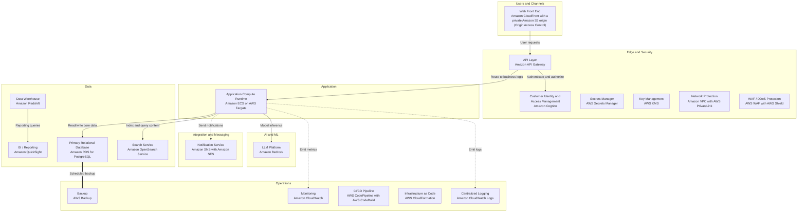
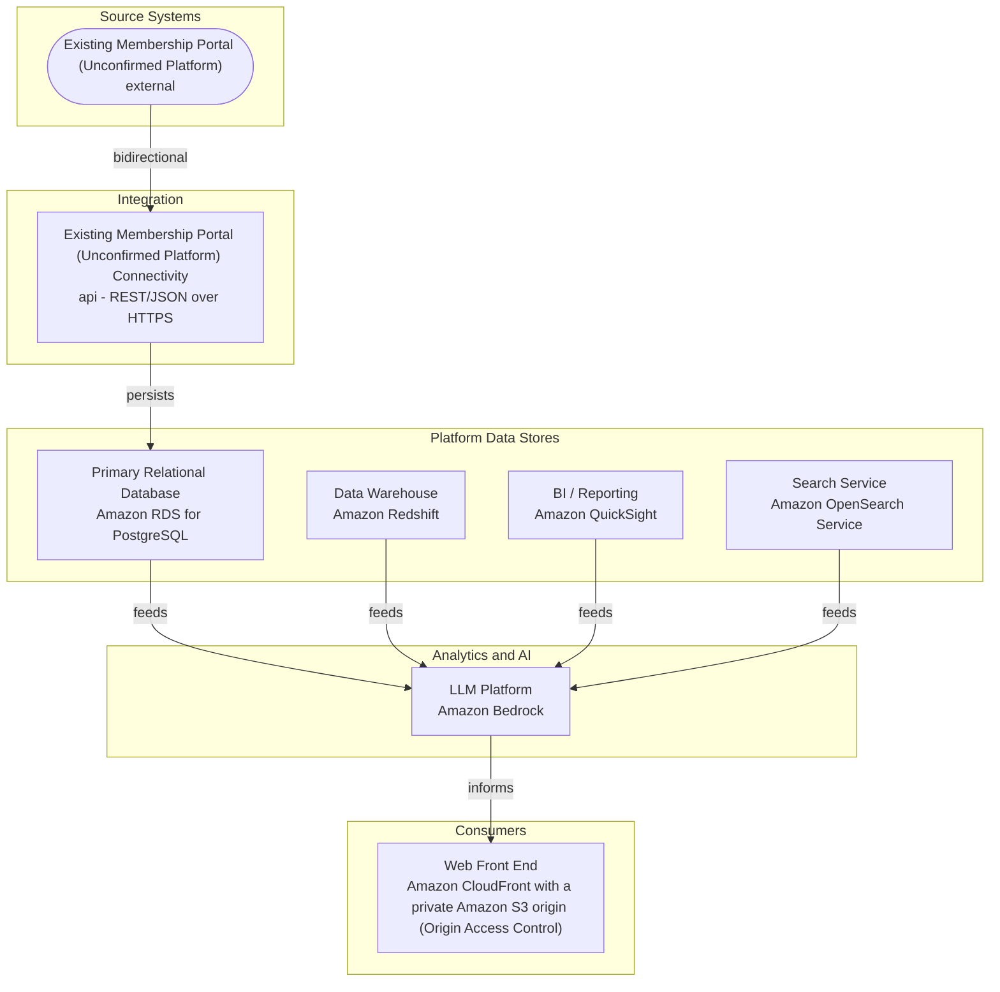

# Member Experience Modernisation - Integrated Scoping Package

*National Horticultural Traders Association*

**Generated:** 2026-09-19 00:00 UTC · **AI mode:** Mock AI mode · **Export status:** Review Required

> This document is an AI-assisted internal planning output based on customer requirements and stated assumptions. It requires review and validation by qualified sales, architecture, delivery, security, and commercial stakeholders. It is not a final quote, contractual commitment, or delivery guarantee.

## Table of contents

- [Executive summary](#executive-summary)
- [Customer objectives](#customer-objectives)
- [Requirement summary](#requirement-summary)
- [PRD](#prd)
- [Functional scope](#functional-scope)
- [Solution architecture](#solution-architecture)
- [Architecture diagram](#architecture-diagram)
- [Data strategy](#data-strategy)
- [Integration architecture](#integration-architecture)
- [AI solution approach](#ai-solution-approach)
- [Recommended technologies and frameworks](#recommended-technologies-and-frameworks)
- [Delivery phases and workstreams](#delivery-phases-and-workstreams)
- [Effort and timeline estimate](#effort-and-timeline-estimate)
- [ROM commercials](#rom-commercials)
- [Assumptions](#assumptions)
- [Risks](#risks)
- [Dependencies](#dependencies)
- [Open questions](#open-questions)
- [Requirement coverage](#requirement-coverage)
- [Traceability information](#traceability-information)
- [Quality review](#quality-review)
- [Change log](#change-log)

## Executive summary

This scoping package covers National Horticultural Traders Association's Member Experience Modernisation, grounded in 3 business objectives, 9 functional requirements and 0 non-functional requirements reviewed from the customer's own requirements text, alongside 0 integrations and 0 security or compliance requirements that shape the proposed solution.

Cloud platform: Amazon Web Services (AWS); Requirement coverage: 100%; Effort estimate: 220 to 384 person-days (likely 267); Timeline: 8 to 15 weeks; ROM commercial range: 206,000 USD to 359,000 USD (likely 251,000 USD); Estimate confidence: Low; Open questions: 13. 13 clarification questions remain open and should be resolved before this package is finalised. This summary and the estimates that follow are an AI-assisted planning output and require review and validation by qualified sales, architecture, delivery, security and commercial stakeholders before being shared with National Horticultural Traders Association.

## Customer objectives

| ID | Business objective | Priority | Source reference |
| --- | --- | --- | --- |
| BR_01 | Modernise a dated member experience: The association wants a modern member experience with some AI capability, replacing a portal staff describe as dated. | Medium | Call details - lines 8-8 |
| BR_02 | Member self-service demand signal: Members have emailed asking to update their own contact details directly, evidencing demand for self-service. | Medium | Additional colour from the call - lines 49-49 |
| BR_03 | Automate renewal reminders: The association wants renewal reminders to go out automatically instead of being tracked manually by the Membership Coordinator. | Medium | What they are looking for - lines 24-24 |

## Requirement summary

### Counts by requirement type

| Category | Count |
| --- | --- |
| Business objective | 3 |
| Functional requirement | 9 |
| Data requirement | 2 |

### Counts by priority

| Category | Count |
| --- | --- |
| High | 2 |
| Medium | 7 |
| Low | 5 |

### Counts by provenance (all in-scope items)

| Category | Count |
| --- | --- |
| Customer-stated | 17 |
| AI-inferred | 28 |
| Assumed | 2 |

### Reviewed requirements

| ID | Type | Priority | Provenance | Source reference | Related IDs |
| --- | --- | --- | --- | --- | --- |
| BR_01 | Business objective | Medium | Customer-stated | Call details - lines 8-8 | None cited |
| BR_02 | Business objective | Medium | Customer-stated | Additional colour from the call - lines 49-49 | None cited |
| BR_03 | Business objective | Medium | Customer-stated | What they are looking for - lines 24-24 | FR_05 |
| FR_01 | Functional requirement | High | Customer-stated | What they are looking for - lines 20-20 | PER_01 |
| FR_02 | Functional requirement | Low | Customer-stated | What they are looking for - lines 21-21 | FR_07 |
| FR_03 | Functional requirement | Medium | Customer-stated | What they are looking for - lines 22-22 | Q_12, FR_09 |
| FR_04 | Functional requirement | Low | Customer-stated | What they are looking for - lines 23-23 | Q_02 |
| FR_05 | Functional requirement | Medium | Customer-stated | What they are looking for - lines 24-24 | PER_02 |
| FR_06 | Functional requirement | High | Customer-stated | Loosely stated requirements - lines 40-40 | GAP_05, Q_03 |
| FR_07 | Functional requirement | Low | Customer-stated | Loosely stated requirements - lines 42-42 | FR_02, Q_13 |
| FR_08 | Functional requirement | Low | Customer-stated | Loosely stated requirements - lines 44-44 | None cited |
| FR_09 | Functional requirement | Low | Customer-stated | Loosely stated requirements - lines 41-41 | FR_03 |
| DATA_01 | Data requirement | Medium | Customer-stated | Organisation context - lines 14-14 | None cited |
| DATA_02 | Data requirement | Medium | AI-inferred | What they are looking for - lines 20-20 | None cited |

### Context and constraints

| ID | Type | Title: description | Provenance | Source reference |
| --- | --- | --- | --- | --- |
| PER_01 | Persona | Member: A representative of a member business (a wholesale nursery, garden retailer or landscape supplier) who logs in, updates the business profile and renews membership. | AI-inferred | What they are looking for - lines 20-20 |
| PER_02 | Persona | Association Staff (Non-Technical): The association's roughly six staff, none technical, who will need to operate and support the app after launch. | AI-inferred | Additional colour from the call - lines 51-51 |
| SYS_01 | Existing system | Existing Membership Portal (Unconfirmed Platform): An old membership portal is in use today; even its product name is uncertain, possibly "MemberSuite," set up years ago by an office manager. | Customer-stated | Organisation context - lines 13-13 |
| CON_01 | Delivery constraint | No in-house technical staff: The association has about six staff in total and none are technical, so post-launch support will likely need to sit with the delivery partner. | Customer-stated | Additional colour from the call - lines 51-51 |
| DEP_01 | Dependency | Office manager input required: The office manager who originally set up the existing portal needs to join a future call before key platform questions can be answered. | Customer-stated | What happens next - lines 58-58 |
| DEP_02 | Dependency | Finance confirmation of member count pending: The Membership Coordinator agreed to check whether finance can produce an approximate current member count before the next call. | Customer-stated | What happens next - lines 59-59 |

## PRD

- **Generated by:** Mock AI (deterministic, offline)
- **Mode:** Mock AI (deterministic, offline)
- **Fallback used:** No
- **Generated at:** 2026-09-19 00:00 UTC

Document: Member Experience Modernisation - Product Requirements Document

#### Product or solution overview

The National Horticultural Traders Association wants a modern member app with an unspecified AI feature, but this first exploratory call left member count, launch date, environments, integration details, compliance scope, cloud preference and budget all unconfirmed; confidence is low until these gaps are closed with the customer. (Refs: BR_01, BR_02, BR_03; AI interpretation)

Member Experience Modernisation serves 3 business objectives set by National Horticultural Traders Association (BR_01, BR_02 and BR_03); each is detailed under Business objectives. (Refs: BR_01, BR_02, BR_03; Customer-requested)

The solution is organised into 3 capability areas (Application Experience, Platform Foundation and AI Capabilities) and names no existing system to connect to. (Refs: None cited; AI interpretation)

#### Business problem

Today National Horticultural Traders Association relies on Existing Membership Portal (Unconfirmed Platform): An old membership portal is in use today; even its product name is uncertain, possibly "MemberSuite," set up years ago by an office manager. (Refs: SYS_01; Customer-requested)

Until this is addressed, National Horticultural Traders Association cannot achieve "Modernise a dated member experience" (BR_01), "Member self-service demand signal" (BR_02) and "Automate renewal reminders" (BR_03). (Refs: BR_01, BR_02, BR_03; Customer-requested)

#### Business objectives

BR_01 - Modernise a dated member experience: The association wants a modern member experience with some AI capability, replacing a portal staff describe as dated. (Refs: BR_01; Customer-requested)

BR_02 - Member self-service demand signal: Members have emailed asking to update their own contact details directly, evidencing demand for self-service. (Refs: BR_02; Customer-requested)

BR_03 - Automate renewal reminders: The association wants renewal reminders to go out automatically instead of being tracked manually by the Membership Coordinator. (Refs: BR_03; Customer-requested)

#### Target users and personas

PER_01 - Member: A representative of a member business (a wholesale nursery, garden retailer or landscape supplier) who logs in, updates the business profile and renews membership. (Refs: PER_01; AI interpretation)

PER_02 - Association Staff (Non-Technical): The association's roughly six staff, none technical, who will need to operate and support the app after launch. (Refs: PER_02; AI interpretation)

#### User journeys or key workflows

Member journey: Step 1: Members log in, update their profile and renew their membership online (FR_01; delivered by CAP_08). Step 2: Members should be able to search the directory of other members more easily than the current experience allows (FR_03; delivered by CAP_05). Step 3: Members should be able to pay their dues online without calling the office (FR_06; delivered by CAP_04). Step 4: Board members may need some kind of special access to reports, but the report content was not described (FR_08; delivered by CAP_02). Step 5: Let members see other members in their region or trade category; stated as a nice-to-have (FR_09; delivered by CAP_05). (Refs: FR_01, FR_03, FR_06, FR_08, FR_09; AI interpretation)

Association Staff (Non-Technical) journey: Step 1: Renewal reminders should go out automatically instead of the Membership Coordinator tracking them manually (FR_05; delivered by CAP_03). (Refs: FR_05; AI interpretation)

#### Functional requirements

DATA_01 - Renewal Tracking Data (Spreadsheet-Based): Renewals are currently tracked mostly by email and a shared spreadsheet rather than a system of record. (Refs: DATA_01; Customer-requested)

DATA_02 - Member Profile and Contact Data: Member profile and contact data is implied by the requested login, profile-update and renewal capabilities, though its current structure is unknown. (Refs: DATA_02; AI interpretation)

FR_01 - Member login, profile and online renewal: Members log in, update their profile and renew their membership online. (Refs: FR_01; Customer-requested)

FR_02 - AI feature - concept only: An AI feature is wanted, described only loosely as possibly a member-question chatbot or a newsletter-writing aid. (Refs: FR_02; Customer-requested)

FR_03 - Improved member directory search: Members should be able to search the directory of other members more easily than the current experience allows. (Refs: FR_03; Customer-requested)

FR_04 - Event registration for annual trade show (scope undecided): Event registration for the annual trade show is wanted but not yet confirmed as part of this engagement. (Refs: FR_04; Customer-requested)

FR_05 - Automated renewal reminders: Renewal reminders should go out automatically instead of the Membership Coordinator tracking them manually. (Refs: FR_05; Customer-requested)

FR_06 - Online dues payment: Members should be able to pay their dues online without calling the office. (Refs: FR_06; Customer-requested)

FR_07 - Chatbot scoped to basic, sourced answers: A chatbot, if built, should only answer basic questions and not fabricate information, though "basic" was not defined. (Refs: FR_07; Customer-requested)

FR_08 - Board member reporting access (scope not described): Board members may need some kind of special access to reports, but the report content was not described. (Refs: FR_08; Customer-requested)

FR_09 - Browse members by region or trade category: Let members see other members in their region or trade category; stated as a nice-to-have. (Refs: FR_09; Customer-requested)

#### Non-functional requirements

The customer's requirements text did not state a non-functional or security requirement. This is left open and tracked by GAP_05, GAP_09, Q_03, Q_09, Q_11 until the customer confirms it. (Refs: GAP_05, GAP_09, Q_03, Q_09, Q_11; Assumption to confirm)

#### Integrations

The customer's requirements text did not state an integration with an external system. This is left open and tracked by GAP_10, Q_06, Q_11 until the customer confirms it. (Refs: GAP_10, Q_06, Q_11; Assumption to confirm)

#### Dependencies

DEP_01 - Office manager input required: The office manager who originally set up the existing portal needs to join a future call before key platform questions can be answered. (Refs: DEP_01; Customer-requested)

DEP_02 - Finance confirmation of member count pending: The Membership Coordinator agreed to check whether finance can produce an approximate current member count before the next call. (Refs: DEP_02; Customer-requested)

#### Assumptions

ASM_01 - A technical/business point of contact will be identified: Assumed the association will be able to name a technical or business point of contact once scoping resumes, despite having no technical staff today. (Refs: ASM_01; Assumption to confirm)

ASM_02 - Renewal process will be replaced, not just integrated: Assumed the current email-and-spreadsheet renewal process will be replaced by the new app rather than kept alongside it, pending confirmation. (Refs: ASM_02; Assumption to confirm)

#### Risks

RSK_01 - Estimate reliability risk from unknown member count: Without a confirmed member count, any effort, timeline or cost estimate carries significant uncertainty until finance validates a figure. (Refs: RSK_01; AI interpretation)

RSK_02 - Renewal-lapse pattern suggests a process gap: Members routinely let renewals lapse and are chased later, suggesting the problem may be process as much as technology. (Refs: RSK_02; AI interpretation)

#### Out-of-scope items

Detailed visual design, branding and content authoring beyond what is described in the reviewed scope are out of scope for this PRD and are addressed during design execution. (Refs: None cited; Assumption to confirm)

Production data-migration volumes, historical backfill and legacy data cleansing beyond the reviewed data requirements remain out of scope until the customer confirms them. (Refs: DATA_01, DATA_02; Assumption to confirm)

Decommissioning of the existing systems referenced in the scope model is out of scope; this engagement covers integration with those systems, not their retirement. (Refs: SYS_01; Assumption to confirm)

#### Open questions

Q_01 - What is the current member count and portal platform?: Confirm the actual current member count and the platform name and vendor for the existing membership system. (Refs: Q_01; AI interpretation)

Q_02 - Is trade-show event registration in scope?: Confirm whether event registration for the annual trade show is in scope for this engagement or a separate future project. (Refs: Q_02; AI interpretation)

Q_03 - Who handles payment card data today?: Confirm whether the association directly handles payment card data or whether an existing payment vendor is fully responsible for that. (Refs: Q_03; AI interpretation)

Q_04 - Is there any target date or budget range?: Confirm whether there is any target date, even an approximate one, and any budget range the association has in mind. (Refs: Q_04; AI interpretation)

Q_05 - Who is the technical or business point of contact?: Confirm who on the association's side, if anyone, can act as a technical or business point of contact once the project starts. (Refs: Q_05; AI interpretation)

Q_06 - Does the existing portal expose an API or export?: Confirm whether the existing membership portal exposes any API or export mechanism that a new app could build on. (Refs: Q_06; AI interpretation)

Q_07 - Which systems must the new app connect to?: Confirm which systems the app must exchange data with, starting with the dues-payment service in use today. (Refs: Q_07; AI interpretation)

Q_08 - Which environments are expected?: Confirm whether separate development, test and production environments are expected, and whether any exist today. (Refs: Q_08; AI interpretation)

Q_09 - Is any hosting or cloud constraint in place?: Confirm that no existing hosting contract, vendor or data-residency rule limits the cloud platform choice. (Refs: Q_09; AI interpretation)

Q_10 - Mobile app, responsive website, or both?: Confirm whether members expect an installable mobile app, a responsive website, or both. (Refs: Q_10; AI interpretation)

Q_11 - How should members sign in?: Confirm whether members sign in with credentials held by the new app or through an identity provider the association already pays for. (Refs: Q_11; AI interpretation)

Q_12 - What makes the current directory search hard to use?: Ask members and staff which searches fail today (by name, region, trade category) so the improved search can be specified. (Refs: Q_12; AI interpretation)

Q_13 - What should the chatbot count as a basic question?: Agree example questions the chatbot may answer and the sources it may answer from, so "basic" can be tested. (Refs: Q_13; AI interpretation)

#### Requirement traceability

BR_01 - Modernise a dated member experience is covered by CAP_07. (Refs: BR_01, CAP_07; Customer-requested)

BR_02 - Member self-service demand signal is covered by CAP_06. (Refs: BR_02, CAP_06; Customer-requested)

BR_03 - Automate renewal reminders is covered by CAP_03. (Refs: BR_03, CAP_03; Customer-requested)

FR_01 - Member login, profile and online renewal is covered by CAP_08. (Refs: FR_01, CAP_08; Customer-requested)

FR_02 - AI feature - concept only is covered by CAP_01, CAP_09. (Refs: FR_02, CAP_01, CAP_09; Customer-requested)

FR_03 - Improved member directory search is covered by CAP_05. (Refs: FR_03, CAP_05; Customer-requested)

FR_04 - Event registration for annual trade show (scope undecided) is covered by CAP_08. (Refs: FR_04, CAP_08; Customer-requested)

FR_05 - Automated renewal reminders is covered by CAP_03. (Refs: FR_05, CAP_03; Customer-requested)

FR_06 - Online dues payment is covered by CAP_04. (Refs: FR_06, CAP_04; Customer-requested)

FR_07 - Chatbot scoped to basic, sourced answers is covered by CAP_09. (Refs: FR_07, CAP_09; Customer-requested)

FR_08 - Board member reporting access (scope not described) is covered by CAP_02. (Refs: FR_08, CAP_02; Customer-requested)

FR_09 - Browse members by region or trade category is covered by CAP_05. (Refs: FR_09, CAP_05; Customer-requested)

DATA_01 - Renewal Tracking Data (Spreadsheet-Based) is covered by CAP_07. (Refs: DATA_01, CAP_07; Customer-requested)

DATA_02 - Member Profile and Contact Data is covered by CAP_07. (Refs: DATA_02, CAP_07; AI interpretation)

## Functional scope

- **Generated by:** Mock AI (deterministic, offline)
- **Mode:** Mock AI (deterministic, offline)
- **Fallback used:** No
- **Generated at:** 2026-09-19 00:00 UTC

### Capabilities

| Capability | Included requirements | Scope | Priority | Dependencies | Label |
| --- | --- | --- | --- | --- | --- |
| Content Management | FR_02 | Provide content management so editors can author, review and publish content without a code deployment. It delivers: FR_02 (AI feature - concept only). | Low | None | Customer-requested |
| Dashboards and Reporting | FR_08 | Provide dashboards and reporting so stakeholders can monitor operational and business metrics without manual data extraction. It delivers: FR_08 (Board member reporting access (scope not described)). | Low | None | Customer-requested |
| Notifications and Alerts | BR_03, FR_05 | Provide notifications and alerts so users and administrators are informed of relevant events across the channels they use. It delivers: BR_03 (Automate renewal reminders), FR_05 (Automated renewal reminders). | Medium | None | Customer-requested |
| Payments and Billing | FR_06 | Provide payments and billing so users can pay, be invoiced or reconcile charges through the platform. It delivers: FR_06 (Online dues payment). | High | None | Customer-requested |
| Search and Discovery | FR_03, FR_09 | Provide search and discovery so users can find the records, documents or catalog entries relevant to their task. It delivers: FR_03 (Improved member directory search), FR_09 (Browse members by region or trade category). It connects to Existing Membership Portal (Unconfirmed Platform). | Medium | None | Customer-requested |
| Self-Service Portal | BR_02 | Provide a self-service portal that gives users a single place to manage their account, requests and records. It delivers: BR_02 (Member self-service demand signal). | Medium | None | Customer-requested |
| Core Platform Services | BR_01, DATA_01, DATA_02 | Provide the cross-cutting platform services - configuration, environment setup, logging and shared infrastructure - that every capability in this scope depends on. It delivers: BR_01 (Modernise a dated member experience), DATA_01 (Renewal Tracking Data (Spreadsheet-Based)), DATA_02 (Member Profile and Contact Data). | Medium | None | AI interpretation |
| Identity, Sign-In and Profile Management | FR_01, FR_04 | Provide self-service registration, authentication and profile management so users can create and maintain their own account without support intervention. It delivers: FR_01 (Member login, profile and online renewal), FR_04 (Event registration for annual trade show (scope undecided)). It connects to Existing Membership Portal (Unconfirmed Platform). | High | None | Customer-requested |
| AI Conversational Assistant | FR_02, FR_07 | Deliver a conversational AI assistant that answers user questions in natural language, grounded in the platform's own content. It delivers: FR_02 (AI feature - concept only), FR_07 (Chatbot scoped to basic, sourced answers). | Low | None | Customer-requested |

### Recommended enhancements (AI recommendation)

| Capability | Included requirements | Scope | Priority | Dependencies | Label |
| --- | --- | --- | --- | --- | --- |
| AI Answer Quality Feedback Loop | FR_02, FR_07 | Capture a thumbs-up/down and free-text rating on every AI-generated answer and route low-confidence responses to human review, closing the loop for the AI use cases in FR_02, FR_07. | Medium | None | AI recommendation |
| Data Quality and Governance Program | FR_08 | Define data-quality rules, named ownership and a reconciliation cadence for the data domains in FR_08 so downstream reporting stays trustworthy. | Medium | None | AI recommendation |

### Modules

| Module | Capabilities | Requirements |
| --- | --- | --- |
| AI Capabilities | CAP_09 | FR_02, FR_07 |
| Application Experience | CAP_01, CAP_02, CAP_03, CAP_04, CAP_05, CAP_06 | FR_02, FR_08, BR_03, FR_05, FR_06, FR_03, FR_09, BR_02 |
| Platform Foundation | CAP_07, CAP_08 | BR_01, DATA_01, DATA_02, FR_01, FR_04 |

### Workstreams

| Workstream | Capabilities | Requirements |
| --- | --- | --- |
| AI and Machine Learning | CAP_09 | FR_02, FR_07 |
| Core Platform Services | CAP_07 | BR_01, DATA_01, DATA_02 |
| Core Product Experience | CAP_01, CAP_02, CAP_03, CAP_04, CAP_05, CAP_06 | FR_02, FR_08, BR_03, FR_05, FR_06, FR_03, FR_09, BR_02 |
| Identity and Access | CAP_08 | FR_01, FR_04 |

### Delivery packages

| Delivery package | Capabilities | Suggested engagement model | Suggested challenge types |
| --- | --- | --- | --- |
| Package 1 - Foundation | CAP_01, CAP_02, CAP_03, CAP_04, CAP_05, CAP_06, CAP_07, CAP_08 | Topcoder challenge series | Design challenge, Development challenge series, QA / bug hunt |
| Package 3 - AI Capabilities | CAP_09 | Dedicated delivery team | Data science challenge, QA / bug hunt |

### Out of scope

| Item | Refs | Label |
| --- | --- | --- |
| Detailed visual design, branding and content authoring beyond what is described in the reviewed scope are out of scope for this PRD and are addressed during design execution. | None cited | Assumption to confirm |
| Production data-migration volumes, historical backfill and legacy data cleansing beyond the reviewed data requirements remain out of scope until the customer confirms them. | DATA_01, DATA_02 | Assumption to confirm |
| Decommissioning of the existing systems referenced in the scope model is out of scope; this engagement covers integration with those systems, not their retirement. | SYS_01 | Assumption to confirm |

## Solution architecture

- **Generated by:** Mock AI (deterministic, offline)
- **Mode:** Mock AI (deterministic, offline)
- **Fallback used:** No
- **Generated at:** 2026-09-19 00:00 UTC

- **Cloud platform:** Amazon Web Services (AWS)
- **Selection:** AI-recommended (accepted as proposed)

The proposed solution architecture targets Amazon Web Services (AWS) and is composed of 19 components covering 9 functional capabilities. It spans the full reviewed scope; see each component’s own rationale below for its specific citations. (Refs: BR_02, BR_03, FR_01, FR_02, FR_03, FR_04; AI interpretation)

Mobile Backend is not proposed yet because GAP_08 (Mobile app vs. website undecided) is unresolved; add it once that gap is closed. (Refs: GAP_08; Assumption to confirm)

### Platform recommendation scores

| Platform | Score | Reasons |
| --- | --- | --- |
| Amazon Web Services (AWS) | 0 | +0 Compliance/residency needs (GAP_05, Q_03, Q_09) are supported by regional data centres on all three platforms and do not change the recommendation. (GAP_05, Q_03, Q_09) |
| Microsoft Azure | 0 | No scoring signals found. |
| Google Cloud Platform (GCP) | 0 | No scoring signals found. |

No functional, non-functional, security or technology signal in the reviewed scope favors one cloud platform over another, so Amazon Web Services (AWS) is proposed as a default pending more information, chosen by the standard evaluation order (AWS, then Azure, then GCP). Amazon Web Services (AWS), Microsoft Azure, Google Cloud Platform (GCP) were evaluated identically. This is an AI-generated recommendation and should be validated by a solution architect before it is treated as final.

### Architecture components

| Component | Service | Requirements / assumptions | Purpose | Rationale | Trade-offs | Dependencies | Security considerations |
| --- | --- | --- | --- | --- | --- | --- | --- |
| Web Front End | Amazon CloudFront with a private Amazon S3 origin (Origin Access Control) | BR_02 | Serves the customer-facing web experience and delivers static assets close to users. | Amazon CloudFront with a private Amazon S3 origin (Origin Access Control) serves the web experience with edge caching, TLS termination and low first-byte latency worldwide. It addresses BR_02. | Edge caching improves latency but requires explicit cache-invalidation on release. A globally distributed edge adds a small recurring data-transfer cost versus single-region hosting. | API Layer, Customer Identity and Access Management | Enforce HTTPS-only delivery and a strict Content-Security-Policy at the edge. Restrict direct access to origin storage so all traffic is served through the CDN. |
| API Layer | Amazon API Gateway | BR_02, BR_03, FR_01, FR_02, FR_03, FR_04, FR_05, FR_06, FR_08, FR_09, DATA_01, DATA_02 | Exposes the solution's functional capabilities as versioned, governed APIs for the front end and integrations. | Amazon API Gateway centralizes authentication, throttling and request validation ahead of the application compute runtime. It addresses BR_02, BR_03, FR_01, FR_02, FR_03, FR_04, FR_05, FR_06, FR_08, FR_09, DATA_01 and DATA_02. | A managed gateway adds a small per-request latency and cost overhead versus calling services directly. API versioning policy must be agreed early to avoid breaking existing client integrations. | Application Compute Runtime, Customer Identity and Access Management | Apply request-rate throttling and payload-size limits to reduce abuse and denial-of-service exposure. Validate and authorize every request against the identity provider before it reaches the runtime. |
| Application Compute Runtime | Amazon ECS on AWS Fargate | FR_01, FR_06, FR_03 | Hosts the backend business logic that implements the reviewed functional requirements. | Amazon ECS on AWS Fargate runs the backend services with managed autoscaling so capacity tracks real traffic without manual intervention. It addresses FR_01, FR_06 and FR_03. | Container-based hosting requires a build/release pipeline for every deployable service. Autoscaling limits must be tuned against real traffic before go-live to avoid cost or latency surprises. | Primary Relational Database, Monitoring | Run containers with least-privilege service identities and no long-lived static credentials. Scan container images for known vulnerabilities before each release. |
| Primary Relational Database | Amazon RDS for PostgreSQL | DATA_01, DATA_02 | Stores the core transactional data the application reads and writes. | Amazon RDS for PostgreSQL provides managed relational storage with automated backups, patching and encryption at rest. It addresses DATA_01 and DATA_02. | A managed relational engine caps vertical scale; very high write throughput may need read replicas or partitioning later. Schema migrations must be coordinated with application deployments to avoid downtime. | Backup, Key Management | Encrypt data at rest and in transit, and restrict network access to the application tier only. Apply least-privilege database roles per service rather than a single shared credential. |
| Customer Identity and Access Management | Amazon Cognito | FR_01, FR_06, FR_03 | Handles registration, sign-in, session management and multi-factor authentication for end users. | Amazon Cognito provides managed sign-up, sign-in, SSO federation and MFA so authentication is never implemented by hand. It addresses FR_01, FR_06 and FR_03. | A managed identity provider constrains custom sign-in UX to its supported customization hooks. Federating with an external identity provider (SSO) adds a dependency on that provider’s availability. | Secrets Manager | Enforce MFA for privileged accounts and require strong password/session policies for all users. Log every authentication and authorization decision for audit purposes. |
| Monitoring | Amazon CloudWatch | FR_01, FR_06, FR_03 | Tracks infrastructure and application health so incidents are detected before customers report them. | Amazon CloudWatch aggregates metrics and dashboards with alerting thresholds tied to the availability and performance targets. It addresses FR_01, FR_06 and FR_03. | Alert thresholds must be tuned to avoid both alert fatigue and missed incidents. Detailed metric retention adds a recurring storage cost proportional to system scale. | Centralized Logging, Application Compute Runtime | Restrict dashboard and alert access to operations and engineering roles only. |
| Centralized Logging | Amazon CloudWatch Logs | FR_01, FR_06, FR_03 | Centralizes application and infrastructure logs for troubleshooting and audit. | Amazon CloudWatch Logs aggregates structured logs from every service with a defined, policy-driven retention period. It addresses FR_01, FR_06 and FR_03. | Centralized log retention has a direct storage cost that scales with request volume. Log content must be scrubbed of personal or sensitive data before it is retained. | Monitoring | Redact personal or sensitive data from log payloads before they are written. Restrict log access to authorized operations staff and retain an access audit trail. |
| CI/CD Pipeline | AWS CodePipeline with AWS CodeBuild | CON_01 | Automates build, test and release of every service into each environment. | AWS CodePipeline with AWS CodeBuild runs the build/test/release pipeline consistently across development, test and production. It addresses CON_01. | A fully automated pipeline needs an initial investment in test coverage to be trustworthy for production releases. | Infrastructure as Code | Require code review and passing automated security scans before a release can be promoted. Keep deployment credentials scoped to the pipeline identity, never to individual engineers. |
| Infrastructure as Code | AWS CloudFormation | CON_01 | Defines every environment declaratively so dev/test/prod stay reproducible and auditable. | AWS CloudFormation provisions and updates cloud resources declaratively, so environment drift is detected instead of accumulating silently. It addresses CON_01. | Declarative provisioning has a learning curve for teams used to manual console changes. | CI/CD Pipeline | Store infrastructure state and variables in a controlled, access-audited location, never in source control in plain text. |
| Secrets Manager | AWS Secrets Manager | FR_01, FR_06, FR_03 | Stores and rotates credentials, API keys and connection strings used by every service. | AWS Secrets Manager centralizes credential storage with automatic rotation and fine-grained access policies. It addresses FR_01, FR_06 and FR_03. | Every service must be updated to fetch secrets at runtime rather than reading them from local configuration. | Key Management | Grant read access to a secret only to the specific service identities that need it. Rotate credentials on a defined schedule and immediately after any suspected exposure. |
| Key Management | AWS KMS | FR_01, FR_06, FR_03 | Manages the encryption keys that protect data at rest across storage and database services. | AWS KMS issues and rotates encryption keys with a full audit trail of every key-use event. It addresses FR_01, FR_06 and FR_03. | Customer-managed keys add operational responsibility for key rotation and recovery policy. | None | Rotate keys on a defined schedule and restrict key administration to a small, audited group. |
| Backup | AWS Backup | FR_01, FR_06, FR_03 | Protects stored data with policy-driven, regularly tested backups. | AWS Backup takes policy-driven, encrypted backups on a defined schedule with a tested restore procedure. It addresses FR_01, FR_06 and FR_03. | Backup retention has a direct storage cost that scales with data volume and retention period. | Primary Relational Database | Encrypt backups at rest and test restores on a regular schedule, not only after an incident. |
| Network Protection | Amazon VPC with AWS PrivateLink | FR_01, FR_06, FR_03 | Isolates backend services on a private network so they are not directly reachable from the public internet. | Amazon VPC with AWS PrivateLink keeps service-to-service traffic off the public internet and restricts inbound access to approved paths only. It addresses FR_01, FR_06 and FR_03. | Private networking adds configuration overhead when a new service or integration needs external connectivity. | None | Default to deny-all network rules and open only the specific paths a service requires. Log and periodically review network access-control changes. |
| WAF / DDoS Protection | AWS WAF with AWS Shield | FR_01, FR_06, FR_03 | Filters malicious inbound traffic and absorbs volumetric attacks at the edge, in front of the public entry point. | AWS WAF with AWS Shield inspects inbound requests against managed and custom rule sets and mitigates volumetric attacks before they reach the application. It addresses FR_01, FR_06 and FR_03. | Rule tuning is required to avoid false positives blocking legitimate traffic. | None | Enable managed rule sets for common web exploits and review blocked-request logs regularly. Alert on traffic patterns consistent with a volumetric or application-layer attack. |
| Data Warehouse | Amazon Redshift | FR_08 | Provides a column-oriented analytical store for cross-domain reporting and analysis. | Amazon Redshift holds curated, query-optimized data separate from transactional load so reporting never competes with production traffic. It addresses FR_08. | A separate analytical store adds pipeline latency between an event occurring and it being reportable. The driving requirement is Low-priority and not yet fully defined; a small set of reporting views directly in the primary relational database would be sufficient until it is confirmed, rather than committing to this component now. | None | Apply row/column-level access controls so analysts see only the data domains they are authorized for. |
| BI / Reporting | Amazon QuickSight | FR_08 | Delivers self-service dashboards and reports to business stakeholders over the warehouse. | Amazon QuickSight provides governed, self-service dashboards over curated warehouse data. It addresses FR_08. | Self-service reporting requires a governed semantic layer to prevent conflicting metric definitions. The driving requirement is Low-priority and not yet fully defined; scheduled exports or database-backed reporting views instead of a dedicated BI platform would be sufficient until it is confirmed, rather than committing to this component now. | Data Warehouse | Scope dashboard access by role so stakeholders see only their authorized data domains. |
| LLM Platform | Amazon Bedrock | FR_02, FR_07 | Provides managed access to foundation models for the AI use cases identified in the reviewed scope. | Amazon Bedrock gives managed, guardrailed access to foundation models so AI functionality is not built on an unmanaged model endpoint. It addresses FR_02 and FR_07. | Model responses are probabilistic; outputs affecting decisions need a human-review step (see AI solution approach). | Secrets Manager | Apply content-safety guardrails and never send unmasked personal data in a prompt without a documented basis. |
| Search Service | Amazon OpenSearch Service | FR_03, FR_09 | Provides fast, relevant search and discovery over application content. | Amazon OpenSearch Service indexes application content for fast, relevance-ranked search rather than relying on database queries. It addresses FR_03 and FR_09. | A dedicated search index must be kept synchronized with the source of truth, adding a small propagation delay. The driving requirement is Low-priority and not yet fully defined; database-backed filtering and sorting instead of a dedicated search index would be sufficient until it is confirmed, rather than committing to this component now. | Application Compute Runtime | Apply the same authorization filters to search results as to direct data access, so search cannot leak restricted content. |
| Notification Service | Amazon SNS with Amazon SES | BR_03, FR_05 | Delivers email, SMS and push notifications and alerts to end users. | Amazon SNS with Amazon SES delivers multi-channel notifications with delivery tracking, separate from the transactional data path. It addresses BR_03 and FR_05. | Delivery across third-party email/SMS/push channels is subject to those channels’ own rate and deliverability limits. | None | Honor user opt-out/consent preferences and avoid placing sensitive personal data in notification payloads. |

### Environments

| Environment | Purpose | Sizing |
| --- | --- | --- |
| Development | Feature development and integration testing for engineers before promotion. | Matches the production topology at reduced instance/node counts. Environment count is not configured, so this is an assumption pending confirmation. |
| Test/QA | Functional, regression and non-functional test execution prior to release. | Matches the production topology at reduced instance/node counts. Environment count is not configured, so this is an assumption pending confirmation. |
| Production | Live environment serving end users under production SLAs. | Sized for the expected user volume once confirmed, with autoscaling enabled. Environment count is not configured, so this is an assumption pending confirmation. |

### Deployment

Releases build and deploy through AWS CodePipeline with AWS CodeBuild, with every environment (Development, Test/QA, Production) provisioned declaratively via AWS CloudFormation so drift is detected rather than accumulating. (Refs: CON_01; AI interpretation)

Application services run as containers on Amazon ECS on AWS Fargate, promoted unchanged from test into production. (Refs: FR_01, FR_06, FR_03; AI interpretation)

### Availability

Amazon ECS on AWS Fargate runs in a single region with the platform's default zone redundancy; a multi-region design is deferred until an explicit availability target is confirmed with the customer. (Refs: FR_01, FR_06, FR_03; Assumption to confirm)

### Backup and disaster recovery

AWS Backup takes policy-driven, encrypted backups of the primary data store with periodic restore testing. (Refs: FR_01, FR_06, FR_03; AI interpretation)

### Security controls

Amazon Cognito enforces authentication, session management and multi-factor authentication for every end-user session. (Refs: FR_01, FR_06, FR_03; AI interpretation)

AWS Secrets Manager centralizes credential storage and rotation so no service embeds a static secret. (Refs: FR_01, FR_06, FR_03; AI interpretation)

AWS KMS manages encryption keys and rotation for data at rest across storage and database services. (Refs: FR_01, FR_06, FR_03; AI interpretation)

Amazon VPC with AWS PrivateLink isolates backend services on a private network with default-deny inbound access. (Refs: FR_01, FR_06, FR_03; AI interpretation)

AWS WAF with AWS Shield filters malicious inbound traffic and mitigates volumetric attacks at the edge, in front of the public entry point. (Refs: FR_01, FR_06, FR_03; AI interpretation)

## Architecture diagram

**Amazon Web Services (AWS) Solution Architecture**

## Data strategy

- **Generated by:** Mock AI (deterministic, offline)
- **Mode:** Mock AI (deterministic, offline)
- **Fallback used:** No
- **Generated at:** 2026-09-19 00:00 UTC

### Data domains

| ID | Domain | Description | Sources | Owner | Classification | Requirements |
| --- | --- | --- | --- | --- | --- | --- |
| DD_01 | Renewal Tracking Data | Renewals are currently tracked mostly by email and a shared spreadsheet rather than a system of record. | No existing system was named for this domain in the reviewed scope; treat it as captured directly by the new solution until the customer confirms an upstream source. | To be confirmed with customer | Internal | DATA_01 |
| DD_02 | Member Profile and Contact Data | Member profile and contact data is implied by the requested login, profile-update and renewal capabilities, though its current structure is unknown. | No existing system was named for this domain in the reviewed scope; treat it as captured directly by the new solution until the customer confirms an upstream source. | To be confirmed with customer | Internal | DATA_02 |

### Data topics

#### Data ownership

Ownership of Renewal Tracking Data and Member Profile and Contact Data sits with the National Horticultural Traders Association business function that originates each one; until a data steward is named per domain the assistant records the owner as "To be confirmed with customer" rather than assuming one, and access to each domain is governed through the same identity and access controls as the rest of the platform. Services: Amazon Cognito, AWS Secrets Manager, AWS KMS, Amazon VPC with AWS PrivateLink, AWS WAF with AWS Shield. Refs: DATA_01, DATA_02.

#### Ingestion

Renewal Tracking Data enters the platform through the integration layer rather than manual re-entry: inbound records are no dedicated service is selected in the current AWS architecture yet; add one during detailed design, validated against the target schema, and rejected records are quarantined for review instead of silently dropped. Services: No specific services identified yet. Refs: DATA_01, DATA_02, ASM_02.

#### Transactional storage

Operational reads and writes for Renewal Tracking Data and Member Profile and Contact Data are served from Amazon RDS for PostgreSQL on AWS, sized and indexed for the transactional access patterns the reviewed functional requirements describe, separate from the analytical copy used for reporting. Services: Amazon RDS for PostgreSQL. Refs: DATA_01, DATA_02.

#### Analytical storage

FR_08 (Board member reporting access (scope not described)) already asks for analytical or reporting access to this data, though no data-domain item has been reviewed for it yet; a read-optimised analytical copy is scoped to that requirement. Services: Amazon Redshift. Refs: DATA_01, DATA_02, FR_08.

#### Data quality

Data quality: no reviewed requirement states a data-quality or reconciliation rule for this scope yet; records are still validated against their basic schema on the way in. Services: No specific services identified yet. Refs: DATA_01, DATA_02.

#### Metadata and governance

Metadata and governance: no reviewed requirement asks for a catalogued audit trail on this data yet; standard platform audit logging still records access to every domain regardless. Services: Amazon CloudWatch, Amazon CloudWatch Logs, AWS Secrets Manager, AWS KMS, Amazon VPC with AWS PrivateLink, AWS WAF with AWS Shield. Refs: DATA_01, DATA_02.

#### Retention

Data retention: no reviewed requirement states a retention period for this scope; National Horticultural Traders Association needs to confirm one before a lifecycle rule is configured. Services: Amazon RDS for PostgreSQL, Amazon Redshift, Amazon QuickSight, Amazon OpenSearch Service. Refs: DATA_01, DATA_02.

#### Privacy and security

Privacy and security: Q_09 (Is any hosting or cloud constraint in place?) is the open open question tracking this; a baseline of encryption at rest and in transit still applies to every domain regardless. Services: AWS Secrets Manager, AWS KMS, Amazon VPC with AWS PrivateLink, AWS WAF with AWS Shield. Refs: DATA_01, DATA_02, Q_09.

#### Reporting and analytics

FR_08 (Board member reporting access (scope not described)) already asks for a report or dashboard over this data, though no data-domain item has been reviewed for it yet; reporting is scoped to that requirement. Services: Amazon Redshift. Refs: DATA_01, DATA_02, FR_08.

#### Backup and recovery

Backup and recovery: no reviewed requirement states an availability or recovery target for this data yet; the platform's default backup schedule still applies until a recovery objective is confirmed. Services: AWS Backup. Refs: DATA_01, DATA_02.

## Integration architecture

- **Generated by:** Mock AI (deterministic, offline)
- **Mode:** Mock AI (deterministic, offline)
- **Fallback used:** No
- **Generated at:** 2026-09-19 00:00 UTC

### Integrations

| ID | Integration | System | Direction | Pattern | Authentication | Error handling and retry | Data synchronization | Monitoring | Complexity | Readiness | Requirements |
| --- | --- | --- | --- | --- | --- | --- | --- | --- | --- | --- | --- |
| IF_01 | Existing Membership Portal (Unconfirmed Platform) Connectivity | Existing Membership Portal (Unconfirmed Platform) (external) | bidirectional | api - REST/JSON over HTTPS | OAuth 2.0 client credentials grant | Every call to Existing Membership Portal (Unconfirmed Platform) carries an idempotency key so a retried or duplicated request is never applied twice, and a failure that exhausts its retry budget is written to a dead-letter queue rather than left half-committed. Retry: Exponential backoff starting at 1 second and doubling to a 5-attempt ceiling for calls to Existing Membership Portal (Unconfirmed Platform), after which the call is routed to the dead-letter queue instead of retried forever. | the platform is treated as the system of record for the fields it owns; conflicting updates are resolved by last-writer-wins on the record's own timestamp, and a daily reconciliation job compares record counts between Existing Membership Portal (Unconfirmed Platform) and the platform to surface drift instead of assuming the sync is complete. | Success/failure counts and latency for calls to Existing Membership Portal (Unconfirmed Platform) are tracked in Amazon CloudWatch, Amazon CloudWatch Logs, with an alert routed to the delivery team when the failure rate or latency crosses its threshold. | High | Not yet confirmed | SYS_01 |

### Data flows

| From | To | Payload | Mechanism |
| --- | --- | --- | --- |
| Existing Membership Portal (Unconfirmed Platform) | Primary Relational Database | Existing Membership Portal (Unconfirmed Platform) Connectivity | synchronous API call (REST/JSON over HTTPS) |
| Primary Relational Database | LLM Platform | Curated, deduplicated records for reporting and AI use cases | Scheduled extract/transform/load into the analytical store |

### Data and integration flow diagram

**Data and Integration Flow**

## AI solution approach

- **Generated by:** Mock AI (deterministic, offline)
- **Mode:** Mock AI (deterministic, offline)
- **Fallback used:** No
- **Generated at:** 2026-09-19 00:00 UTC

Retrieval-augmented generation (RAG) assistant: AI feature - concept only and 1 related function: Retrieval-augmented generation (RAG) assistant delivering FR_02 (An AI feature is wanted, described only loosely as possibly a member-question chatbot or a newsletter-writing aid.); FR_07 (A chatbot, if built, should only answer basic questions and not fabricate information, though "basic" was not defined.). Also shaped by Q_13. (Refs: FR_02, FR_07, Q_13; AI interpretation)

### AI use cases

| ID | Use case | Description | Pattern | Model options | Complexity | Requirements |
| --- | --- | --- | --- | --- | --- | --- |
| AIUC_01 | Retrieval-augmented generation (RAG) assistant: AI feature - concept only and 1 related function | Retrieval-augmented generation (RAG) assistant delivering FR_02 (An AI feature is wanted, described only loosely as possibly a member-question chatbot or a newsletter-writing aid.); FR_07 (A chatbot, if built, should only answer basic questions and not fabricate information, though "basic" was not defined.). Also shaped by Q_13. | Retrieval-augmented generation (RAG) assistant | Amazon Bedrock (Anthropic Claude and Amazon Titan model families) | High | FR_02, FR_07, Q_13 |

#### Retrieval-augmented generation (RAG) assistant: AI feature - concept only and 1 related function

- **Retrieval:** Answers are grounded in National Horticultural Traders Association's own indexed content: the assistant retrieves the top-matching passages before generating a response and cites the source passage instead of answering from the model's general training data. Retrieval runs against Amazon Bedrock.
- **Orchestration:** A stateful workflow retrieves context, drafts an answer, checks the draft against the retrieved passages for groundedness, and only then returns it to the "Retrieval-augmented generation (RAG) assistant: AI feature - concept only and 1 related function" user, so an ungrounded draft never reaches them.
- **Safety controls:** Prompt-injection defences separate retrieved content from the system prompt, content filters run on every response, and abnormal request volume or repeated jailbreak attempts are flagged for abuse review.
- **Human review:** The assistant answers informational questions only; any answer touching a binding decision is withheld and routed to a human, and every answer links back to its source document for verification.
- **Monitoring:** Request volume, latency, token cost, error rate and the evaluation score trend are tracked in Amazon CloudWatch, Amazon CloudWatch Logs, with an alert when the evaluation score or error rate crosses its threshold.

### AI vs deterministic vs human-decision boundaries

| Activity | Type | Reason | Requirements |
| --- | --- | --- | --- |
| Retrieval-augmented generation (RAG) assistant: AI feature - concept only and 1 related function | AI | Retrieval-augmented generation (RAG) assistant produces a probabilistic result best suited to unstructured input, so it is implemented as an AI function rather than a fixed rule. | FR_02, FR_07, Q_13 |
| Member login, profile and online renewal | Deterministic rule or calculation | Authenticating a user and validating their profile fields are checked against fixed identity rules (credentials, required fields), a deterministic check with no ambiguity for a model to resolve. | FR_01 |
| Improved member directory search | Deterministic rule or calculation | A directory or record search is an exact or fixed-fuzzy match against indexed fields; the same query must return the same ranked results every time, which a deterministic search index guarantees and a probabilistic model does not. | FR_03 |
| Event registration for annual trade show (scope undecided) | Deterministic rule or calculation | Authenticating a user and validating their profile fields are checked against fixed identity rules (credentials, required fields), a deterministic check with no ambiguity for a model to resolve. | FR_04 |
| Automated renewal reminders | Deterministic rule or calculation | Whether a notification fires follows a fixed trigger condition (a status change, a schedule) with exactly one correct answer, so it is deterministic rule evaluation, not a prediction. | FR_05 |
| Online dues payment | Deterministic rule or calculation | The amounts, GL codes and approval thresholds it posts are fixed accounting rules with exactly one correct value per transaction, so the posting logic is deterministic, auditable and reconcilable to the cent rather than a probabilistic judgement. | FR_06 |
| Board member reporting access (scope not described) | Deterministic rule or calculation | The figures a report or dashboard shows are a fixed aggregation of already-recorded data (sums, counts, groupings) that a query engine computes exactly and reproducibly every time, with nothing left to infer. | FR_08 |
| Browse members by region or trade category | Deterministic rule or calculation | A directory or record search is an exact or fixed-fuzzy match against indexed fields; the same query must return the same ranked results every time, which a deterministic search index guarantees and a probabilistic model does not. | FR_09 |
| Sign-off on a binding decision that an assistant conversation surfaces | Mandatory human decision | The assistant answers informational questions only; any answer touching a binding decision is withheld and routed to a human, and every answer links back to its source document for verification. | FR_02, FR_07, Q_13 |

### Architecture pattern

Retrieval-augmented generation (RAG) assistant, orchestrated with LangGraph and served behind the platform's managed AI service.

### Prompt management

Each use case's (Retrieval-augmented generation (RAG) assistant: AI feature - concept only and 1 related function) system and user prompts are versioned in source control next to the code that calls them, changed only through code review, and re-run against that use case's golden set in CI before the change ships; the model's JSON output is validated against a versioned JSON schema for that use case, so a malformed response is rejected rather than passed downstream.

### Evaluation approach

Retrieval-augmented generation (RAG) assistant: AI feature - concept only and 1 related function: A golden set of representative questions with expected answers runs on every prompt or model change; groundedness (does the answer match the retrieved passage) and answer relevance are scored automatically, and the regression suite blocks release on a drop.

### Responsible AI

- No reviewed requirement or customer document is used to train or fine-tune a third-party model.
- Every AI use case names the mandatory human decision it feeds and does not make alone (see AI vs deterministic vs human-decision boundaries).
- Accuracy/groundedness is measured against a golden set before release and monitored in production, not asserted once and left unchecked.
- Prompt-injection and content-safety filters run on every production request, not only in development.

### Monitoring and feedback

Retrieval-augmented generation (RAG) assistant: AI feature - concept only and 1 related function is monitored for request volume, latency, token cost, error rate and evaluation-score trend as described per use case; a human reviewer's correction or escalation is logged and periodically folded back into the golden set so the evaluation suite improves with production use instead of staying fixed at launch.

### Data privacy

Retrieval-augmented generation (RAG) assistant: AI feature - concept only and 1 related function: Only the minimum personal data needed to answer is included in the prompt context, requests are processed within United States (unspecified), and the provider's terms exclude request content from model training.

## Recommended technologies and frameworks

### Frameworks

- **Generated by:** Mock AI (deterministic, offline)
- **Mode:** Mock AI (deterministic, offline)
- **Fallback used:** No
- **Generated at:** 2026-09-19 00:00 UTC

| Framework | Category | Rationale | Requirements | Alternatives considered |
| --- | --- | --- | --- | --- |
| LangGraph | Orchestration | The reviewed AI scope (FR_02, FR_07, Q_13) needs a stateful, multi-step workflow - retrieval/generation with a groundedness check, or several coordinated use cases - with an explicit human-in-the-loop checkpoint before a result is acted on; LangGraph models that as a graph of steps with durable state, which a single prompt call cannot provide. | FR_02, FR_07, Q_13 | A single prompt call per request (insufficient: it cannot hold state across the retrieve/draft/check steps or pause for human review). LangChain agents without a graph (workable, but its implicit control flow is harder to audit for the required human-checkpoint than an explicit LangGraph state machine). |
| Vercel AI SDK | SDK | No .NET or Java preference is stated, so the front end streams model output using the same TypeScript stack as the rest of the application (FR_02, FR_07, Q_13); the Vercel AI SDK's streaming hooks remove the need to hand-roll server-sent-event/token-streaming handling in the UI. | FR_02, FR_07, Q_13 | Mastra (a comparable TypeScript agent/streaming SDK; either is suitable, Vercel AI SDK is preferred for its more direct React streaming hooks). |
| Amazon Bedrock | Model service | Hosting the model(s) for FR_02, FR_07, Q_13 on Amazon Bedrock keeps inference inside the AWS account boundary already used for the rest of the solution, avoiding a separate vendor contract, network egress path and access-control model to operate. | FR_02, FR_07, Q_13 | A self-hosted open-weight model on Kubernetes/GPU nodes (higher operational overhead; only justified by a strict data-residency or cost-at-scale constraint the reviewed scope does not state). |

### Selected cloud services

| Service | Component | Area | Purpose |
| --- | --- | --- | --- |
| Amazon CloudFront with a private Amazon S3 origin (Origin Access Control) | Web Front End | User Apps | Serves the customer-facing web experience and delivers static assets close to users. |
| Amazon API Gateway | API Layer | Api | Exposes the solution's functional capabilities as versioned, governed APIs for the front end and integrations. |
| Amazon ECS on AWS Fargate | Application Compute Runtime | Backend | Hosts the backend business logic that implements the reviewed functional requirements. |
| Amazon RDS for PostgreSQL | Primary Relational Database | Data Storage | Stores the core transactional data the application reads and writes. |
| Amazon Cognito | Customer Identity and Access Management | Identity | Handles registration, sign-in, session management and multi-factor authentication for end users. |
| Amazon CloudWatch | Monitoring | Observability | Tracks infrastructure and application health so incidents are detected before customers report them. |
| Amazon CloudWatch Logs | Centralized Logging | Observability | Centralizes application and infrastructure logs for troubleshooting and audit. |
| AWS CodePipeline with AWS CodeBuild | CI/CD Pipeline | Deployment | Automates build, test and release of every service into each environment. |
| AWS CloudFormation | Infrastructure as Code | Environments | Defines every environment declaratively so dev/test/prod stay reproducible and auditable. |
| AWS Secrets Manager | Secrets Manager | Security | Stores and rotates credentials, API keys and connection strings used by every service. |
| AWS KMS | Key Management | Security | Manages the encryption keys that protect data at rest across storage and database services. |
| AWS Backup | Backup | Backup Dr | Protects stored data with policy-driven, regularly tested backups. |
| Amazon VPC with AWS PrivateLink | Network Protection | Security | Isolates backend services on a private network so they are not directly reachable from the public internet. |
| AWS WAF with AWS Shield | WAF / DDoS Protection | Security | Filters malicious inbound traffic and absorbs volumetric attacks at the edge, in front of the public entry point. |
| Amazon Redshift | Data Warehouse | Data Storage | Provides a column-oriented analytical store for cross-domain reporting and analysis. |
| Amazon QuickSight | BI / Reporting | Data Storage | Delivers self-service dashboards and reports to business stakeholders over the warehouse. |
| Amazon Bedrock | LLM Platform | Ai Ml | Provides managed access to foundation models for the AI use cases identified in the reviewed scope. |
| Amazon OpenSearch Service | Search Service | Data Storage | Provides fast, relevant search and discovery over application content. |
| Amazon SNS with Amazon SES | Notification Service | Messaging | Delivers email, SMS and push notifications and alerts to end users. |

## Delivery phases and workstreams

### Delivery packages

| Delivery package | Capabilities | Suggested engagement model | Suggested challenge types |
| --- | --- | --- | --- |
| Package 1 - Foundation | CAP_01, CAP_02, CAP_03, CAP_04, CAP_05, CAP_06, CAP_07, CAP_08 | Topcoder challenge series | Design challenge, Development challenge series, QA / bug hunt |
| Package 3 - AI Capabilities | CAP_09 | Dedicated delivery team | Data science challenge, QA / bug hunt |

### Phases and workstreams

| Phase | Workstreams | Milestone |
| --- | --- | --- |
| Discovery and Architecture | Discovery and Architecture | Solution blueprint, prioritised backlog and delivery plan approved (end of week 1) |
| Experience and Core Platform | Core Product Experience, Core Platform Services, Identity and Access, Cloud Infrastructure and Hardening | Core platform and user experience feature-complete (end of week 8) - runs concurrently with the other build-phase workstreams inside the shared build window, not as a separate schedule |
| Data and Integration | System Integration, Data Platform and Migration | Integrations and data pipelines verified end to end (end of week 8) - runs concurrently with the other build-phase workstreams inside the shared build window, not as a separate schedule |
| AI Capabilities | AI Capabilities | AI capabilities meet the agreed evaluation thresholds (end of week 8) - runs concurrently with the other build-phase workstreams inside the shared build window, not as a separate schedule |
| Testing and Hardening | Testing and Hardening | Test exit: acceptance, security and performance criteria met (end of week 9) |
| Deployment and Handover | Deployment and Handover | Production go-live and handover to operations complete (end of week 10) |

## Effort and timeline estimate

- **Generated by:** Mock AI (deterministic, offline)
- **Mode:** Mock AI (deterministic, offline)
- **Fallback used:** No
- **Generated at:** 2026-09-19 00:00 UTC

- **Overall confidence:** Low
- **Total effort:** 220 to 384 person-days (likely 267)
- **Total timeline:** 8 to 15 weeks (likely 10)

No delivery deadline was provided (open: GAP_02, Q_04), so the likely timeline of 10 weeks (range 8 to 15 weeks) has not been tested against a target date. Enter the deadline in the solution configuration to check whether a team of 6 is sufficient.

### Workstreams

| ID | Workstream | Requirements | Drivers | Complexity | Effort range | Cost (likely) | Confidence | Confidence limitations |
| --- | --- | --- | --- | --- | --- | --- | --- | --- |
| WS_PH_1 | Discovery and Architecture | None cited | Sized at 12% of build days (CR_05) | Medium | 18 to 35 person-days (likely 23) | 20,131 USD | Low | Sized as a percentage of build effort, so it inherits the Low overall confidence of the build workstreams. |
| WS_01 | Core Product Experience | FR_08, BR_03, FR_05, FR_06, FR_03, FR_09, BR_02 | Dashboards and Reporting (Medium), Notifications and Alerts (Medium), Payments and Billing (Medium), Search and Discovery (Medium), Self-Service Portal (Low) | Medium | 54 to 102 person-days (likely 68) | 50,354 USD | Low | The compliance scope has not been confirmed. Critical and unresolved: GAP_05 "Payment-card handling responsibility unclear" (tracked together with Q_03). What makes the current directory search hard to use (Q_12) is still open and relates to the requirements of this workstream. |
| WS_02 | Core Platform Services | BR_01, DATA_01, DATA_02 | Core Platform Services (Medium) | Medium | 14 to 17 person-days (likely 15) | 11,126 USD | High | None noted |
| WS_03 | Identity and Access | FR_01, FR_04 | Identity, Sign-In and Profile Management (Medium) | Medium | 13 to 20 person-days (likely 15) | 11,126 USD | Medium | Is trade-show event registration in scope (Q_02) is still open and relates to the requirements of this workstream. |
| WS_04 | Cloud Infrastructure and Hardening | BR_02, BR_03, FR_01, FR_02, FR_03, FR_04, FR_05, FR_06, FR_08, FR_09, DATA_01, DATA_02, FR_07, CON_01 | Cloud platform foundation and environments (High), Delivery pipeline and observability (Medium) | High | 21 to 39 person-days (likely 26) | 22,464 USD | Low | The expected number of users has not been confirmed, so infrastructure sizing is provisional. Critical and unresolved: GAP_01 "Active member count unknown" (tracked together with Q_01). The compliance scope has not been confirmed. Critical and unresolved: GAP_05 "Payment-card handling responsibility unclear" (tracked together with Q_03). The number of required environments has not been confirmed, so no environment uplift is applied. Still open: GAP_04 "Environment expectations not discussed". Target deployment regions have not been confirmed. Is trade-show event registration in scope (Q_02) is still open and relates to the requirements of this workstream. What makes the current directory search hard to use (Q_12) is still open and relates to the requirements of this workstream. What should the chatbot count as a basic question (Q_13) is still open and relates to the requirements of this workstream. |
| WS_05 | System Integration | BR_02, BR_03, FR_01, FR_02, FR_03, FR_04, FR_05, FR_06, FR_08, FR_09, DATA_01, DATA_02, SYS_01 | Existing Membership Portal (Unconfirmed Platform) Connectivity (High) | High | 18 to 33 person-days (likely 22) | 17,138 USD | Low | External API readiness has not been confirmed. Critical and unresolved: GAP_03 "Systems to integrate with are unnamed" and GAP_10 "Existing portal API/export capability unknown" (tracked together with Q_06). The compliance scope has not been confirmed. Critical and unresolved: GAP_05 "Payment-card handling responsibility unclear" (tracked together with Q_03). What is the current member count and portal platform (Q_01) is still open and relates to the requirements of this workstream. Is trade-show event registration in scope (Q_02) is still open and relates to the requirements of this workstream. What makes the current directory search hard to use (Q_12) is still open and relates to the requirements of this workstream. |
| WS_06 | Data Platform and Migration | DATA_01, DATA_02 | Renewal Tracking Data (Spreadsheet-Based) (Low), Member Profile and Contact Data (Low) | Low | 11 to 14 person-days (likely 12) | 9,708 USD | High | None noted |
| WS_07 | AI Capabilities | FR_02, FR_07, Q_13 | Retrieval-augmented generation (RAG) assistant: AI feature - concept only and 1 related function (High) | High | 26 to 39 person-days (likely 30) | 27,090 USD | Medium | What should the chatbot count as a basic question (Q_13) is still open and relates to the requirements of this workstream. |
| WS_PH_5 | Testing and Hardening | None cited | Sized at 22% of build days (CR_05) | Medium | 33 to 62 person-days (likely 41) | 35,872 USD | Low | Sized as a percentage of build effort, so it inherits the Low overall confidence of the build workstreams. |
| WS_PH_6 | Deployment and Handover | None cited | Sized at 8% of build days (CR_05) | Medium | 12 to 23 person-days (likely 15) | 13,135 USD | Low | Sized as a percentage of build effort, so it inherits the Low overall confidence of the build workstreams. |

### Driver basis

| Driver ID | Workstream | Type | Complexity | Basis | Refs |
| --- | --- | --- | --- | --- | --- |
| DRV_01 | Core Product Experience | Capability | Medium | Medium complexity: covers 1 requirement (FR_08) at Low priority, and involves demanding features (Dashboards and reporting). | CAP_02, FR_08 |
| DRV_02 | Core Product Experience | Capability | Medium | Medium complexity: covers 2 requirements (BR_03 and FR_05) at Medium priority. | CAP_03, BR_03, FR_05 |
| DRV_03 | Core Product Experience | Capability | Medium | Medium complexity: covers 1 requirement (FR_06) at High priority, and involves demanding features (Payments and billing). | CAP_04, FR_06 |
| DRV_04 | Core Product Experience | Capability | Medium | Medium complexity: covers 2 requirements (FR_03 and FR_09) at Medium priority, and involves demanding features (Search and discovery). | CAP_05, FR_03, FR_09 |
| DRV_05 | Core Product Experience | Capability | Low | Low complexity: covers 1 requirement (BR_02) at Medium priority. | CAP_06, BR_02 |
| DRV_06 | Core Platform Services | Capability | Medium | Medium complexity: covers 3 requirements (BR_01, DATA_01 and DATA_02) at Medium priority. | CAP_07, BR_01, DATA_01, DATA_02 |
| DRV_07 | Identity and Access | Capability | Medium | Medium complexity: covers 2 requirements (FR_01 and FR_04) at High priority. | CAP_08, FR_01, FR_04 |
| DRV_08 | Cloud Infrastructure and Hardening | Infrastructure | High | High complexity: 16 architecture components on AWS and availability and disaster-recovery needs. The expected number of users has not been provided, so user load is not reflected in this rating and confidence is reduced. Target regions have not been provided. | ARC_01, ARC_02, ARC_03, ARC_04, ARC_05, ARC_09, ARC_10, ARC_11, ARC_12, ARC_13, ARC_14, ARC_15, ARC_16, ARC_17, ARC_18, ARC_19 |
| DRV_09 | Cloud Infrastructure and Hardening | Infrastructure | Medium | Medium complexity: 3 deployment and observability components (Monitoring, Centralized Logging and CI/CD Pipeline) to automate and operate on AWS. | ARC_06, ARC_07, ARC_08 |
| DRV_10 | System Integration | Integration | High | High complexity (from the integration strategy): bidirectional api exchange with Existing Membership Portal (Unconfirmed Platform) (external system) over REST/JSON over HTTPS; interface readiness is not yet confirmed. Requirements: SYS_01. | IF_01, SYS_01, ARC_02 |
| DRV_11 | Data Platform and Migration | Data | Low | Low complexity: DATA_01 is limited to modelling and storing the data. | DATA_01 |
| DRV_12 | Data Platform and Migration | Data | Low | Low complexity: DATA_02 is limited to modelling and storing the data. | DATA_02 |
| DRV_13 | AI Capabilities | AI use case | High | High complexity (from the AI solution approach): Retrieval-augmented generation (RAG) assistant, including retrieval over customer content, a human review step, evaluation and safety guardrails. Requirements: FR_02, FR_07 and Q_13. | AIUC_01, FR_02, FR_07, Q_13 |

### Phases

| Phase | Duration | Start | Milestone |
| --- | --- | --- | --- |
| Discovery and Architecture | 1 to 2 weeks (likely 1) | Week 1 | Solution blueprint, prioritised backlog and delivery plan approved (end of week 1) |
| Experience and Core Platform | 6 to 11 weeks (likely 7) | Week 2 | Core platform and user experience feature-complete (end of week 8) - runs concurrently with the other build-phase workstreams inside the shared build window, not as a separate schedule |
| Data and Integration | 6 to 11 weeks (likely 7) | Week 2 | Integrations and data pipelines verified end to end (end of week 8) - runs concurrently with the other build-phase workstreams inside the shared build window, not as a separate schedule |
| AI Capabilities | 6 to 11 weeks (likely 7) | Week 2 | AI capabilities meet the agreed evaluation thresholds (end of week 8) - runs concurrently with the other build-phase workstreams inside the shared build window, not as a separate schedule |
| Testing and Hardening | 2 to 3 weeks (likely 2) | Week 8 | Test exit: acceptance, security and performance criteria met (end of week 9) |
| Deployment and Handover | 1 to 2 weeks (likely 1) | Week 10 | Production go-live and handover to operations complete (end of week 10) |

### Totals calculation

- Total effort = sum of workstream ranges = 220 to 384 days (likely 267) = 53.4 person-weeks at 5 days per week
- Subtotal (likely) = sum of workstream costs 218,144 USD -> rounded to 1,000 = 218,000 USD
- Contingency (likely) = 218,000 USD x 15% -> rounded = 33,000 USD
- ROM (likely) = subtotal + contingency = 251,000 USD
- ROM range = 206,000 USD to 359,000 USD (likely 251,000 USD); low and high are calculated the same way from the workstream low and high costs

### Timeline calculation

- Team capacity = 6 people x 5 working days per week = 30 person-days per week; every phase below divides its effort by this shared capacity (rule CR_12).
- Discovery and Architecture (PH_1) = Effort = WS_PH_1 = 23 days likely (range 18 to 35); Duration = 23 days / 30 person-days per week = 0.77 -> 1 week (rounded up); Runs from week 1 to week 1; Duration range (Low timeline confidence -20% / +50%, rounded up) = 1 to 2 weeks
- Experience and Core Platform (PH_2) = Effort = WS_01, WS_02, WS_03 and WS_04 = 124 days likely (range 102 to 178); Build window = combined build effort 188 days / 30 person-days per week = 6.27 -> 7 weeks (rounded up); the build phases run concurrently and share the team; Runs from week 2 to week 8; Duration range (Low timeline confidence -20% / +50%, rounded up) = 6 to 11 weeks
- Data and Integration (PH_3) = Effort = WS_05 and WS_06 = 34 days likely (range 29 to 47); Build window = combined build effort 188 days / 30 person-days per week = 6.27 -> 7 weeks (rounded up); the build phases run concurrently and share the team; Runs from week 2 to week 8; Duration range (Low timeline confidence -20% / +50%, rounded up) = 6 to 11 weeks
- AI Capabilities (PH_4) = Effort = WS_07 = 30 days likely (range 26 to 39); Build window = combined build effort 188 days / 30 person-days per week = 6.27 -> 7 weeks (rounded up); the build phases run concurrently and share the team; Runs from week 2 to week 8; Duration range (Low timeline confidence -20% / +50%, rounded up) = 6 to 11 weeks
- Testing and Hardening (PH_5) = Effort = WS_PH_5 = 41 days likely (range 33 to 62); Duration = 41 days / 30 person-days per week = 1.37 -> 2 weeks (rounded up); it may overlap up to 25% of the build window and always finishes with at least one week after build; Runs from week 8 to week 9; Duration range (Low timeline confidence -20% / +50%, rounded up) = 2 to 3 weeks
- Deployment and Handover (PH_6) = Effort = WS_PH_6 = 15 days likely (range 12 to 23); Duration = 15 days / 30 person-days per week = 0.5 -> 1 week (rounded up); Runs from week 10 to week 10; Duration range (Low timeline confidence -20% / +50%, rounded up) = 1 to 2 weeks
- Total timeline = the last phase's end week on that shared calendar = 8 to 15 weeks (likely 10), every phase duration rounded up to a whole week.

### Per-workstream calculation steps

#### Discovery and Architecture calculation

- Discovery and Architecture = 12% of 188 build days = 23 days (likely effort, rounded to whole days)
- Range (Low confidence -20% / +50%) = 18 to 35 days
- Roles: Engagement Manager 6.9 d x 950 = 6,555 USD
- Roles: Solution Architect 5.8 d x 1,100 = 6,380 USD
- Roles: Business Analyst 3.4 d x 750 = 2,550 USD
- Roles: Cloud/DevOps Engineer 2.3 d x 820 = 1,886 USD
- Roles: QA Engineer 4.6 d x 600 = 2,760 USD
- Cost = sum of role costs = 20,131 USD; range -20% / +50% = 16,105 USD to 30,197 USD

#### Core Product Experience calculation

- DRV_01 Dashboards and Reporting: Medium capability = 15 days
- DRV_02 Notifications and Alerts: Medium capability = 15 days
- DRV_03 Payments and Billing: Medium capability = 15 days
- DRV_04 Search and Discovery: Medium capability = 15 days
- DRV_05 Self-Service Portal: Low capability = 8 days
- Base effort = 15 + 15 + 15 + 15 + 8 = 68 days
- Base 68 days x productivity 1.00 = 68 days (likely effort, rounded to whole days)
- Range (Low confidence -20% / +50%) = 54 to 102 days
- Roles: Solution Architect 3.4 d x 1,100 = 3,740 USD
- Roles: Business Analyst 3.4 d x 750 = 2,550 USD
- Roles: UX/UI Designer 6.8 d x 700 = 4,760 USD
- Roles: Frontend Engineer 23.8 d x 720 = 17,136 USD
- Roles: Backend Engineer 23.8 d x 760 = 18,088 USD
- Roles: QA Engineer 6.8 d x 600 = 4,080 USD
- Cost = sum of role costs = 50,354 USD; range -20% / +50% = 40,283 USD to 75,531 USD

#### Core Platform Services calculation

- DRV_06 Core Platform Services: Medium capability = 15 days
- Base effort = 15 days
- Base 15 days x productivity 1.00 = 15 days (likely effort, rounded to whole days)
- Range (High confidence -10% / +15%) = 14 to 17 days
- Roles: Solution Architect 0.8 d x 1,100 = 880 USD
- Roles: Business Analyst 0.8 d x 750 = 600 USD
- Roles: UX/UI Designer 1.5 d x 700 = 1,050 USD
- Roles: Frontend Engineer 5.2 d x 720 = 3,744 USD
- Roles: Backend Engineer 5.2 d x 760 = 3,952 USD
- Roles: QA Engineer 1.5 d x 600 = 900 USD
- Cost = sum of role costs = 11,126 USD; range -10% / +15% = 10,013 USD to 12,795 USD

#### Identity and Access calculation

- DRV_07 Identity, Sign-In and Profile Management: Medium capability = 15 days
- Base effort = 15 days
- Base 15 days x productivity 1.00 = 15 days (likely effort, rounded to whole days)
- Range (Medium confidence -15% / +30%) = 13 to 20 days
- Roles: Solution Architect 0.8 d x 1,100 = 880 USD
- Roles: Business Analyst 0.8 d x 750 = 600 USD
- Roles: UX/UI Designer 1.5 d x 700 = 1,050 USD
- Roles: Frontend Engineer 5.2 d x 720 = 3,744 USD
- Roles: Backend Engineer 5.2 d x 760 = 3,952 USD
- Roles: QA Engineer 1.5 d x 600 = 900 USD
- Cost = sum of role costs = 11,126 USD; range -15% / +30% = 9,457 USD to 14,464 USD

#### Cloud Infrastructure and Hardening calculation

- DRV_08 Cloud platform foundation and environments: High infrastructure = 16 days
- DRV_09 Delivery pipeline and observability: Medium infrastructure = 10 days
- Base effort = 16 + 10 = 26 days
- Environment uplift not applied: the number of environments has not been provided (see missing inputs)
- Base 26 days x productivity 1.00 = 26 days (likely effort, rounded to whole days)
- Range (Low confidence -20% / +50%) = 21 to 39 days
- Roles: Solution Architect 3.9 d x 1,100 = 4,290 USD
- Roles: Backend Engineer 2.6 d x 760 = 1,976 USD
- Roles: Cloud/DevOps Engineer 16.9 d x 820 = 13,858 USD
- Roles: Security Engineer 2.6 d x 900 = 2,340 USD
- Cost = sum of role costs = 22,464 USD; range -20% / +50% = 17,971 USD to 33,696 USD

#### System Integration calculation

- DRV_10 Existing Membership Portal (Unconfirmed Platform) Connectivity: High integration = 22 days
- Base effort = 22 days
- Base 22 days x productivity 1.00 = 22 days (likely effort, rounded to whole days)
- Range (Low confidence -20% / +50%) = 18 to 33 days
- Roles: Solution Architect 2.2 d x 1,100 = 2,420 USD
- Roles: Backend Engineer 12.1 d x 760 = 9,196 USD
- Roles: Data Engineer 3.3 d x 800 = 2,640 USD
- Roles: Cloud/DevOps Engineer 1.1 d x 820 = 902 USD
- Roles: QA Engineer 3.3 d x 600 = 1,980 USD
- Cost = sum of role costs = 17,138 USD; range -20% / +50% = 13,710 USD to 25,707 USD

#### Data Platform and Migration calculation

- DRV_11 Renewal Tracking Data (Spreadsheet-Based): Low data = 6 days
- DRV_12 Member Profile and Contact Data: Low data = 6 days
- Base effort = 6 + 6 = 12 days
- Base 12 days x productivity 1.00 = 12 days (likely effort, rounded to whole days)
- Range (High confidence -10% / +15%) = 11 to 14 days
- Roles: Solution Architect 1.2 d x 1,100 = 1,320 USD
- Roles: Backend Engineer 1.8 d x 760 = 1,368 USD
- Roles: Data Engineer 7.2 d x 800 = 5,760 USD
- Roles: Security Engineer 0.6 d x 900 = 540 USD
- Roles: QA Engineer 1.2 d x 600 = 720 USD
- Cost = sum of role costs = 9,708 USD; range -10% / +15% = 8,737 USD to 11,164 USD

#### AI Capabilities calculation

- DRV_13 Retrieval-augmented generation (RAG) assistant: AI feature - concept only and 1 related function: High AI use case = 30 days
- Base effort = 30 days
- Base 30 days x productivity 1.00 = 30 days (likely effort, rounded to whole days)
- Range (Medium confidence -15% / +30%) = 26 to 39 days
- Roles: Solution Architect 3.0 d x 1,100 = 3,300 USD
- Roles: Backend Engineer 4.5 d x 760 = 3,420 USD
- Roles: Data Engineer 3.0 d x 800 = 2,400 USD
- Roles: AI/ML Engineer 16.5 d x 980 = 16,170 USD
- Roles: QA Engineer 3.0 d x 600 = 1,800 USD
- Cost = sum of role costs = 27,090 USD; range -15% / +30% = 23,027 USD to 35,217 USD

#### Testing and Hardening calculation

- Testing and Hardening = 22% of 188 build days = 41 days (likely effort, rounded to whole days)
- Range (Low confidence -20% / +50%) = 33 to 62 days
- Roles: Engagement Manager 12.3 d x 950 = 11,685 USD
- Roles: Solution Architect 10.3 d x 1,100 = 11,330 USD
- Roles: Business Analyst 6.1 d x 750 = 4,575 USD
- Roles: Cloud/DevOps Engineer 4.1 d x 820 = 3,362 USD
- Roles: QA Engineer 8.2 d x 600 = 4,920 USD
- Cost = sum of role costs = 35,872 USD; range -20% / +50% = 28,698 USD to 53,808 USD

#### Deployment and Handover calculation

- Deployment and Handover = 8% of 188 build days = 15 days (likely effort, rounded to whole days)
- Range (Low confidence -20% / +50%) = 12 to 23 days
- Roles: Engagement Manager 4.5 d x 950 = 4,275 USD
- Roles: Solution Architect 3.8 d x 1,100 = 4,180 USD
- Roles: Business Analyst 2.2 d x 750 = 1,650 USD
- Roles: Cloud/DevOps Engineer 1.5 d x 820 = 1,230 USD
- Roles: QA Engineer 3.0 d x 600 = 1,800 USD
- Cost = sum of role costs = 13,135 USD; range -20% / +50% = 10,508 USD to 19,703 USD

### Calculation rules

| Rule | Name | Formula | Description |
| --- | --- | --- | --- |
| CR_01 | Driver effort | driver days = baseEffort[driver type][complexity]; complexity = reviewer override ?? AI suggestion | Each scope driver is sized from the editable base-effort table. The AI only suggests the complexity level; a reviewer override replaces it and is marked user-set. A driver without a base-effort value contributes no days, is reported as a blocked scope driver and blocks the cost of its workstream and the ROM. |
| CR_02 | Workstream base effort and complexity | base days = sum(driver days); complexity = round(sum(level x driver days) / sum(driver days)), Low = 1 ... Very High = 4 | A workstream is the sum of its drivers. Its complexity is the effort-weighted average of the driver complexity levels. |
| CR_03 | Environment uplift | infrastructure days x (1 + max(0, environments - baselineEnvironments) x extraEnvironmentPct / 100) | Environments beyond the baseline add effort to infrastructure drivers only. When the number of environments is unknown, no uplift is applied, the input is listed as missing and confidence is reduced. |
| CR_04 | Productivity factor | likely days = round((non-infrastructure days + uplifted infrastructure days) x productivityFactor) | The productivity assumption scales all build effort (below 1 is faster than baseline). Likely effort is rounded to whole days. |
| CR_05 | Overhead phases | phase days = round(total likely build days x pctOfBuild / 100) | Discovery and Architecture, Testing and Hardening, and Deployment and Handover are sized as configurable percentages of the adjusted build effort and staffed with the overhead role mix. |
| CR_06 | Workstream confidence | High -> Medium (Very High driver, related open gap or question, outstanding delivery dependency, missing planning input) -> Low (critical unresolved gap or question on an affected input, or a blocked calculation) | Inputs map to workstreams by driver type: integration readiness -> integration, data volume -> data, AI data availability -> AI, expected users / environments / target regions -> infrastructure, compliance scope -> security, delivery deadline -> timeline. Every reduction is listed as a confidence limitation. Overhead phases inherit the overall confidence. |
| CR_07 | Overall confidence | Low if any calculation is blocked, Low-confidence workstreams hold >= 30% of build effort, or 4 or more distinct estimation inputs are missing; Medium if any workstream is below High or any input is missing; else High | The overall level is weighted by effort so that one small uncertain workstream does not dominate, while blocked calculations and a largely unspecified engagement always do. |
| CR_08 | Effort range | low = round(likely x (1 - lowPct / 100)); high = round(likely x (1 + highPct / 100)) | The range width comes from the confidence-spread table, so lower confidence widens the range instead of presenting unsupported precision. Totals are the sums of the workstream ranges. |
| CR_09 | Role allocation | role days = likely days x sum(driver-type days x role mix share) / sum(driver-type days), in tenths of a day (largest remainder) | Likely effort is split across roles with the role mix of each driver type, weighted by that type's days. Role days always add up exactly to the likely effort. |
| CR_10 | Workstream cost | cost = sum(role days x role day rate); range = cost x (1 - lowPct / 100) .. cost x (1 + highPct / 100) | A role with allocated days but no day rate, effort without a role mix, or a driver without base effort blocks the workstream cost and the ROM totals. No default rate is ever substituted. |
| CR_11 | ROM commercials | subtotal = roundToUnit(sum(workstream cost)); contingency = roundToUnit(subtotal x contingencyPct / 100); ROM = subtotal + contingency | Low, likely and high values are each rounded to the configured rounding unit and reported in the configured currency. |
| CR_12 | Timeline | capacity = teamSize x workingDaysPerWeek; weeks = ceil(effort / capacity); build window = ceil(sum(build phase effort) / capacity) | Discovery runs first; the build phases run concurrently and share the team; Testing and Hardening may overlap the last 25% of the build window but always keeps at least one week after it; Deployment and Handover runs last. The range applies the timeline confidence spread, rounded up to whole weeks. |
| CR_13 | Deadline assessment | compare likely and high timeline weeks with deliveryDeadlineWeeks; required team = smallest team size whose likely timeline <= deadline | When no deadline is configured the assessment says so, the deadline is listed as a missing input and timeline confidence is reduced. |
| CR_14 | Missing inputs | missing planning input -> confidence reduced; missing day rate, role mix or base effort -> calculation blocked | Each missing input names the affected workstreams or estimate components, the related scope items and how to resolve it. An input held open by a gap or question is never dropped: without a workstream of its driver type it affects the workstreams that share requirements with the open item, otherwise the overall estimate. |
| CR_15 | Historical references | not used | Illustrative historical delivery references (sample data, not actual Topcoder records) are displayed for context only and are never an input to any rule above. |

### Estimation configuration used

- **Currency:** USD
- **Contingency:** 15%
- **Productivity factor:** 1.00
- **Team size:** 6
- **Working days per week:** 5
- **Rounding unit:** 1000
- **Baseline environments:** 3
- **Extra-environment uplift:** 5%

| Driver type | Role split |
| --- | --- |
| Capability | Frontend Engineer 35%, Backend Engineer 35%, UX/UI Designer 10%, QA Engineer 10%, Business Analyst 5%, Solution Architect 5% |
| Integration | Backend Engineer 55%, Data Engineer 15%, QA Engineer 15%, Solution Architect 10%, Cloud/DevOps Engineer 5% |
| Data | Data Engineer 60%, Backend Engineer 15%, QA Engineer 10%, Solution Architect 10%, Security Engineer 5% |
| AI use case | AI/ML Engineer 55%, Backend Engineer 15%, Data Engineer 10%, QA Engineer 10%, Solution Architect 10% |
| Security control | Security Engineer 50%, Cloud/DevOps Engineer 20%, Backend Engineer 20%, Solution Architect 10% |
| Infrastructure | Cloud/DevOps Engineer 65%, Solution Architect 15%, Security Engineer 10%, Backend Engineer 10% |
| Non-functional hardening | Backend Engineer 35%, QA Engineer 30%, Cloud/DevOps Engineer 25%, Solution Architect 10% |
| Overhead phases | Engagement Manager 30%, Solution Architect 25%, QA Engineer 20%, Business Analyst 15%, Cloud/DevOps Engineer 10% |

| Driver type | Low | Medium | High | Very High |
| --- | --- | --- | --- | --- |
| Capability | 8 d | 15 d | 25 d | 40 d |
| Integration | 6 d | 12 d | 22 d | 35 d |
| Data | 6 d | 12 d | 20 d | 32 d |
| AI use case | 10 d | 18 d | 30 d | 45 d |
| Security control | 4 d | 8 d | 14 d | 22 d |
| Infrastructure | 5 d | 10 d | 16 d | 25 d |
| Non-functional hardening | 3 d | 6 d | 10 d | 16 d |

| Phase | Overhead % of build |
| --- | --- |
| Discovery and Architecture | 12% |
| Testing and Hardening | 22% |
| Deployment and Handover | 8% |

| Confidence | Variance around likely |
| --- | --- |
| High | -10% / +15% |
| Medium | -15% / +30% |
| Low | -20% / +50% |

## ROM commercials

- **Generated by:** Mock AI (deterministic, offline)
- **Mode:** Mock AI (deterministic, offline)
- **Fallback used:** No
- **Generated at:** 2026-09-19 00:00 UTC

- **Currency:** USD
- **Commercial basis:** Effort x role day rates (USD) + 15% contingency, rounded to 1,000

### Rate card

| Role | Day rate |
| --- | --- |
| Engagement Manager | 950 USD |
| Solution Architect | 1,100 USD |
| Business Analyst | 750 USD |
| UX/UI Designer | 700 USD |
| Frontend Engineer | 720 USD |
| Backend Engineer | 760 USD |
| Data Engineer | 800 USD |
| AI/ML Engineer | 980 USD |
| Cloud/DevOps Engineer | 820 USD |
| Security Engineer | 900 USD |
| QA Engineer | 600 USD |

### Role allocation

| Role | Days | Day rate | Cost |
| --- | --- | --- | --- |
| Engagement Manager | 23.7 | 950 USD | 22,515 USD |
| Solution Architect | 35.2 | 1,100 USD | 38,720 USD |
| Business Analyst | 16.7 | 750 USD | 12,525 USD |
| UX/UI Designer | 9.8 | 700 USD | 6,860 USD |
| Frontend Engineer | 34.2 | 720 USD | 24,624 USD |
| Backend Engineer | 55.2 | 760 USD | 41,952 USD |
| Data Engineer | 13.5 | 800 USD | 10,800 USD |
| AI/ML Engineer | 16.5 | 980 USD | 16,170 USD |
| Cloud/DevOps Engineer | 25.9 | 820 USD | 21,238 USD |
| Security Engineer | 3.2 | 900 USD | 2,880 USD |
| QA Engineer | 33.1 | 600 USD | 19,860 USD |

### Totals

- **Subtotal:** 179,000 USD to 312,000 USD (likely 218,000 USD)
- **Contingency:** 27,000 USD to 47,000 USD (likely 33,000 USD)
- **ROM range:** 206,000 USD to 359,000 USD (likely 251,000 USD)

## Assumptions

| ID | Text | Status | Related IDs |
| --- | --- | --- | --- |
| ASM_01 | A technical/business point of contact will be identified: Assumed the association will be able to name a technical or business point of contact once scoping resumes, despite having no technical staff today. | Needs validation | CON_01 |
| ASM_02 | Renewal process will be replaced, not just integrated: Assumed the current email-and-spreadsheet renewal process will be replaced by the new app rather than kept alongside it, pending confirmation. | Needs validation | DATA_01 |
| EA_01 | The estimate is built as if ASM_01 holds as stated (still to be validated with the customer); if that turns out to be wrong, the driver(s) it affects must be re-scored on the next calculation. It is scoped against CON_01. | Estimation note | ASM_01, CON_01 |
| EA_02 | The estimate is built as if ASM_02 holds as stated (still to be validated with the customer); if that turns out to be wrong, the driver(s) it affects must be re-scored on the next calculation. It is scoped against DATA_01. | Estimation note | ASM_02, DATA_01 |
| EA_03 | The number of environments is not confirmed; no environment uplift is applied until it is provided. | Estimation note | None |
| EA_04 | The customer provides timely access to subject-matter experts, environments and test data, and reviews deliverables within the agreed turnaround. | Estimation note | None |
| EA_05 | One blended delivery team works across the build phases concurrently; the role mix per driver type is the configured one. | Estimation note | None |
| EA_06 | The timeline assumes an average team of 6 people working 5 days per week, with the build phases running concurrently. | Estimation note | None |
| EA_07 | Costs use the configured role day rates in USD; a contingency of 15% is added to the subtotal and ROM values are rounded to the nearest 1,000. | Estimation note | None |
| EA_08 | A productivity factor of 1.00 is applied to all build effort, and up to 3 environments are covered before the 5% per-environment uplift applies. | Estimation note | None |

## Risks

| ID | Text | Status | Related IDs |
| --- | --- | --- | --- |
| RSK_01 | Estimate reliability risk from unknown member count: Without a confirmed member count, any effort, timeline or cost estimate carries significant uncertainty until finance validates a figure. | Open | GAP_01 |
| RSK_02 | Renewal-lapse pattern suggests a process gap: Members routinely let renewals lapse and are chased later, suggesting the problem may be process as much as technology. | Open | None |
| ER_01 | RSK_01 is not priced as its own effort line; the estimate carries it through the workstream confidence rating instead of a dedicated cost, and the affected driver(s) must be revisited if it materialises. It is scoped against GAP_01. | Estimation note | RSK_01, GAP_01 |
| ER_02 | RSK_02 is not priced as its own effort line; the estimate carries it through the workstream confidence rating instead of a dedicated cost, and the affected driver(s) must be revisited if it materialises. | Estimation note | RSK_02 |
| ER_03 | Interface readiness of Existing Membership Portal (Unconfirmed Platform) (IF_01 Existing Membership Portal (Unconfirmed Platform) Connectivity) is not confirmed; late sandbox access or interface changes would extend the integration workstream. | Estimation note | IF_01, SYS_01 |
| ER_04 | Critical open item Active member count unknown (GAP_01) is unresolved; the estimate components it affects stay at Low confidence until it is closed. | Estimation note | GAP_01 |
| ER_05 | Critical open item No target launch date (GAP_02) is unresolved; the estimate components it affects stay at Low confidence until it is closed. | Estimation note | GAP_02 |
| ER_06 | Critical open item Systems to integrate with are unnamed (GAP_03) is unresolved; the estimate components it affects stay at Low confidence until it is closed. | Estimation note | GAP_03 |
| ER_07 | Critical open item Payment-card handling responsibility unclear (GAP_05) is unresolved; the estimate components it affects stay at Low confidence until it is closed. | Estimation note | GAP_05 |
| ER_08 | Critical open item Existing portal API/export capability unknown (GAP_10) is unresolved; the estimate components it affects stay at Low confidence until it is closed. | Estimation note | GAP_10 |
| ER_09 | Critical open item What is the current member count and portal platform (Q_01) is unresolved; the estimate components it affects stay at Low confidence until it is closed. | Estimation note | Q_01 |
| ER_10 | Critical open item Who handles payment card data today (Q_03) is unresolved; the estimate components it affects stay at Low confidence until it is closed. | Estimation note | Q_03 |
| ER_11 | Critical open item Is there any target date or budget range (Q_04) is unresolved; the estimate components it affects stay at Low confidence until it is closed. | Estimation note | Q_04 |
| ER_12 | Critical open item Does the existing portal expose an API or export (Q_06) is unresolved; the estimate components it affects stay at Low confidence until it is closed. | Estimation note | Q_06 |
| ER_13 | AI output quality for Retrieval-augmented generation (RAG) assistant: AI feature - concept only and 1 related function depends on representative customer data being available for evaluation; acceptance thresholds must be agreed before the AI build starts. | Estimation note | AIUC_01 |
| ER_14 | Requirement detail that emerges during Discovery and Architecture may change driver complexity; the estimate must be recalculated after each reviewed scope change so the ROM stays aligned. | Estimation note | None |

## Dependencies

| ID | Text | Status | Related IDs |
| --- | --- | --- | --- |
| DEP_01 | Office manager input required: The office manager who originally set up the existing portal needs to join a future call before key platform questions can be answered. | Outstanding | None |
| DEP_02 | Finance confirmation of member count pending: The Membership Coordinator agreed to check whether finance can produce an approximate current member count before the next call. | Outstanding | GAP_01 |
| ED_01 | DEP_01 is treated as a precondition the estimate assumes will be met on schedule, not as a costed activity; a delay pushes out the dependent work rather than adding effort, so while it is outstanding the workstreams whose requirements it relates to are held at Medium confidence at most. | Estimation note | DEP_01 |
| ED_02 | DEP_02 is treated as a precondition the estimate assumes will be met on schedule, not as a costed activity; a delay pushes out the dependent work rather than adding effort, so while it is outstanding the workstreams whose requirements it relates to are held at Medium confidence at most. It is scoped against GAP_01. | Estimation note | DEP_02, GAP_01 |
| ED_03 | Access to a test instance of Existing Membership Portal (Unconfirmed Platform) (SYS_01) and a named subject-matter expert while the related integration and data work is delivered. | Estimation note | SYS_01 |
| ED_04 | Customer answers to the open questions (Q_01, Q_02, Q_03, Q_04, Q_05, Q_06, Q_07, Q_08, Q_09, Q_10, Q_11, Q_12 and Q_13) before Discovery and Architecture completes. | Estimation note | Q_01, Q_02, Q_03, Q_04, Q_05, Q_06, Q_07, Q_08, Q_09, Q_10, Q_11, Q_12, Q_13 |
| ED_05 | Accounts, subscriptions and delivery-team access on AWS are provisioned by the customer before the build phases start. | Estimation note | None |

## Open questions

### Clarification questions for the customer

| ID | Text | Status | Related IDs |
| --- | --- | --- | --- |
| Q_01 | What is the current member count and portal platform?: Confirm the actual current member count and the platform name and vendor for the existing membership system. | Open | GAP_01, SYS_01 |
| Q_02 | Is trade-show event registration in scope?: Confirm whether event registration for the annual trade show is in scope for this engagement or a separate future project. | Open | FR_04 |
| Q_03 | Who handles payment card data today?: Confirm whether the association directly handles payment card data or whether an existing payment vendor is fully responsible for that. | Open | GAP_05, FR_06 |
| Q_04 | Is there any target date or budget range?: Confirm whether there is any target date, even an approximate one, and any budget range the association has in mind. | Open | GAP_02, GAP_07 |
| Q_05 | Who is the technical or business point of contact?: Confirm who on the association's side, if anyone, can act as a technical or business point of contact once the project starts. | Open | DEP_01 |
| Q_06 | Does the existing portal expose an API or export?: Confirm whether the existing membership portal exposes any API or export mechanism that a new app could build on. | Open | GAP_10 |
| Q_07 | Which systems must the new app connect to?: Confirm which systems the app must exchange data with, starting with the dues-payment service in use today. | Open | GAP_03 |
| Q_08 | Which environments are expected?: Confirm whether separate development, test and production environments are expected, and whether any exist today. | Open | GAP_04 |
| Q_09 | Is any hosting or cloud constraint in place?: Confirm that no existing hosting contract, vendor or data-residency rule limits the cloud platform choice. | Open | GAP_06 |
| Q_10 | Mobile app, responsive website, or both?: Confirm whether members expect an installable mobile app, a responsive website, or both. | Open | GAP_08 |
| Q_11 | How should members sign in?: Confirm whether members sign in with credentials held by the new app or through an identity provider the association already pays for. | Open | GAP_09 |
| Q_12 | What makes the current directory search hard to use?: Ask members and staff which searches fail today (by name, region, trade category) so the improved search can be specified. | Open | FR_03 |
| Q_13 | What should the chatbot count as a basic question?: Agree example questions the chatbot may answer and the sources it may answer from, so "basic" can be tested. | Open | FR_07 |

### Missing information

| ID | Missing information | Critical | Estimation inputs affected | Status | Related IDs |
| --- | --- | --- | --- | --- | --- |
| GAP_01 | Active member count unknown: Nobody on the call could confirm the current active member count, only a rough guess of two to five thousand. | Yes | Expected user volume | Open | RSK_01 |
| GAP_02 | No target launch date: No target launch date was given beyond an informal "sometime next year," with no hard deadline identified. | Yes | Delivery deadline | Open | None |
| GAP_03 | Systems to integrate with are unnamed: It is unclear which systems, if any, the new app needs to connect to beyond an unnamed dues-payment system. | Yes | Integration readiness | Open | Q_07 |
| GAP_04 | Environment expectations not discussed: How many environments (development, testing, production) are expected was not mentioned and was not asked about on the call. | No | Number of environments | Open | Q_08 |
| GAP_05 | Payment-card handling responsibility unclear: No compliance or data-protection requirements were mentioned, and it is unclear whether the association or a vendor handles payment card data. | Yes | Compliance scope | Open | Q_03, FR_06 |
| GAP_06 | No cloud platform preference: No cloud platform preference was expressed; the association has no technical staff to hold one. | No | None | Open | Q_09 |
| GAP_07 | No budget range discussed: No budget range was discussed on this call; pricing was deferred to a later conversation. | No | None | Open | None |
| GAP_08 | Mobile app vs. website undecided: Whether the association wants a mobile app, a responsive website, or both was left undecided. | No | None | Open | Q_10 |
| GAP_09 | No existing single sign-on to reuse: Nobody could say whether an existing single sign-on or shared login system should be reused, and none appears to exist today. | No | None | Open | Q_11 |
| GAP_10 | Existing portal API/export capability unknown: Neither attendee could confirm whether the existing membership portal has an API or any way to export its data. | Yes | Integration readiness | Open | SYS_01 |

## Requirement coverage

- **Overall coverage:** 100%
- **High-priority coverage:** 100%
- **Covered requirements:** 14 of 14

> **Warning - Read coverage together with the open items**
>
> Coverage is measured against the reviewed scope model. That scope still has 13 open clarification question(s) and 10 missing-information item(s) (see "Open questions"), so full coverage means every captured requirement is addressed - not that the customer need is fully defined.

### Coverage by requirement

| ID | Title | Type | Priority | Capabilities | Components | Strategy elements | Workstreams | Covered |
| --- | --- | --- | --- | --- | --- | --- | --- | --- |
| BR_01 | Modernise a dated member experience | Business objective | Medium | CAP_07 | None cited | None cited | WS_02 | Yes |
| BR_02 | Member self-service demand signal | Business objective | Medium | CAP_06 | ARC_01, ARC_02 | None cited | WS_01, WS_04, WS_05 | Yes |
| BR_03 | Automate renewal reminders | Business objective | Medium | CAP_03 | ARC_02, ARC_19 | None cited | WS_01, WS_04, WS_05 | Yes |
| FR_01 | Member login, profile and online renewal | Functional requirement | High | CAP_08 | ARC_02, ARC_03, ARC_05, ARC_06, ARC_07, ARC_10, ARC_11, ARC_12, ARC_13, ARC_14 | None cited | WS_03, WS_04, WS_05 | Yes |
| FR_02 | AI feature - concept only | Functional requirement | Low | CAP_01, CAP_09, ENH_01 | ARC_02, ARC_17 | AIUC_01, LangGraph, Vercel AI SDK, Amazon Bedrock | WS_04, WS_05, WS_07 | Yes |
| FR_03 | Improved member directory search | Functional requirement | Medium | CAP_05 | ARC_02, ARC_03, ARC_05, ARC_06, ARC_07, ARC_10, ARC_11, ARC_12, ARC_13, ARC_14, ARC_18 | None cited | WS_01, WS_04, WS_05 | Yes |
| FR_04 | Event registration for annual trade show (scope undecided) | Functional requirement | Low | CAP_08 | ARC_02 | None cited | WS_03, WS_04, WS_05 | Yes |
| FR_05 | Automated renewal reminders | Functional requirement | Medium | CAP_03 | ARC_02, ARC_19 | None cited | WS_01, WS_04, WS_05 | Yes |
| FR_06 | Online dues payment | Functional requirement | High | CAP_04 | ARC_02, ARC_03, ARC_05, ARC_06, ARC_07, ARC_10, ARC_11, ARC_12, ARC_13, ARC_14 | None cited | WS_01, WS_04, WS_05 | Yes |
| FR_07 | Chatbot scoped to basic, sourced answers | Functional requirement | Low | CAP_09, ENH_01 | ARC_17 | AIUC_01, LangGraph, Vercel AI SDK, Amazon Bedrock | WS_04, WS_07 | Yes |
| FR_08 | Board member reporting access (scope not described) | Functional requirement | Low | CAP_02, ENH_02 | ARC_02, ARC_15, ARC_16 | Analytical storage, Reporting and analytics | WS_01, WS_04, WS_05 | Yes |
| FR_09 | Browse members by region or trade category | Functional requirement | Low | CAP_05 | ARC_02, ARC_18 | None cited | WS_01, WS_04, WS_05 | Yes |
| DATA_01 | Renewal Tracking Data (Spreadsheet-Based) | Data requirement | Medium | CAP_07 | ARC_02, ARC_04 | DD_01, Data ownership, Data ingestion, Transactional storage, Analytical storage, Data quality, Metadata and governance, Data retention, Privacy and security, Reporting and analytics, Backup and recovery | WS_02, WS_04, WS_05, WS_06 | Yes |
| DATA_02 | Member Profile and Contact Data | Data requirement | Medium | CAP_07 | ARC_02, ARC_04 | DD_02, Data ownership, Data ingestion, Transactional storage, Analytical storage, Data quality, Metadata and governance, Data retention, Privacy and security, Reporting and analytics, Backup and recovery | WS_02, WS_04, WS_05, WS_06 | Yes |

### Uncovered requirements

- Every reviewed requirement is covered by at least one capability or architecture/strategy element.

### Unsupported scope additions

No generated element cites a missing or unapproved requirement.

## Traceability information

### Source reference per requirement

| ID | Type | Title | Source reference | Customer wording |
| --- | --- | --- | --- | --- |
| BR_01 | Business objective | Modernise a dated member experience | Call details - lines 8-8 | "The Executive Director opened by saying "we just know our current member experience feels dated and we want something modern with some AI..." |
| BR_02 | Business objective | Member self-service demand signal | Additional colour from the call - lines 49-49 | "The Membership Coordinator said a handful of members have emailed asking "why can't I just update my address myself" which is part of why..." |
| BR_03 | Business objective | Automate renewal reminders | What they are looking for - lines 24-24 | "They would like renewal reminders to go out automatically instead of the Membership Coordinator tracking them manually." |
| FR_01 | Functional requirement | Member login, profile and online renewal | What they are looking for - lines 20-20 | "They want a modern member app that lets members log in, update their profile and renew their membership online." |
| FR_02 | Functional requirement | AI feature - concept only | What they are looking for - lines 21-21 | "They want some kind of AI feature but were not specific; the Executive Director said "maybe a chatbot that can answer member questions, or..." |
| FR_03 | Functional requirement | Improved member directory search | What they are looking for - lines 22-22 | "The Membership Coordinator would like members to be able to search the directory of other members more easily than today." |
| FR_04 | Functional requirement | Event registration for annual trade show (scope undecided) | What they are looking for - lines 23-23 | "They mentioned wanting event registration for their annual trade show but were not sure if that should be part of this project or handled..." |
| FR_05 | Functional requirement | Automated renewal reminders | What they are looking for - lines 24-24 | "They would like renewal reminders to go out automatically instead of the Membership Coordinator tracking them manually." |
| FR_06 | Functional requirement | Online dues payment | Loosely stated requirements - lines 40-40 | "The Executive Director said the new experience "should probably let members pay their dues online without calling the office."" |
| FR_07 | Functional requirement | Chatbot scoped to basic, sourced answers | Loosely stated requirements - lines 42-42 | "The Executive Director said the chatbot idea "should only answer basic questions and not make anything up," but did not describe what a..." |
| FR_08 | Functional requirement | Board member reporting access (scope not described) | Loosely stated requirements - lines 44-44 | "The Executive Director mentioned they might want board members to have some kind of special access to reports, but was not able to describe..." |
| FR_09 | Functional requirement | Browse members by region or trade category | Loosely stated requirements - lines 41-41 | "The Membership Coordinator said it "would be nice" if members could see other members in their region or trade category." |
| DATA_01 | Data requirement | Renewal Tracking Data (Spreadsheet-Based) | Organisation context - lines 14-14 | "The Membership Coordinator said renewals are currently tracked "mostly by email and a shared spreadsheet, if I am honest."" |
| DATA_02 | Data requirement | Member Profile and Contact Data | What they are looking for - lines 20-20 | "They want a modern member app that lets members log in, update their profile and renew their membership online." |

### Generated outputs and the requirements they cite

| Output type | Output ID | Output | Requirements cited |
| --- | --- | --- | --- |
| Capability | CAP_01 | Content Management | FR_02 |
| Capability | CAP_02 | Dashboards and Reporting | FR_08 |
| Capability | CAP_03 | Notifications and Alerts | BR_03, FR_05 |
| Capability | CAP_04 | Payments and Billing | FR_06 |
| Capability | CAP_05 | Search and Discovery | FR_03, FR_09 |
| Capability | CAP_06 | Self-Service Portal | BR_02 |
| Capability | CAP_07 | Core Platform Services | BR_01, DATA_01, DATA_02 |
| Capability | CAP_08 | Identity, Sign-In and Profile Management | FR_01, FR_04 |
| Capability | CAP_09 | AI Conversational Assistant | FR_02, FR_07 |
| Capability | ENH_01 | AI Answer Quality Feedback Loop | FR_02, FR_07 |
| Capability | ENH_02 | Data Quality and Governance Program | FR_08 |
| User journey | JNY_01 | Member journey | FR_01, FR_03, FR_06, FR_08, FR_09 |
| User journey | JNY_02 | Association Staff (Non-Technical) journey | FR_05 |
| Architecture component | ARC_01 | Web Front End | BR_02 |
| Architecture component | ARC_02 | API Layer | BR_02, BR_03, FR_01, FR_02, FR_03, FR_04, FR_05, FR_06, FR_08, FR_09, DATA_01, DATA_02 |
| Architecture component | ARC_03 | Application Compute Runtime | FR_01, FR_06, FR_03 |
| Architecture component | ARC_04 | Primary Relational Database | DATA_01, DATA_02 |
| Architecture component | ARC_05 | Customer Identity and Access Management | FR_01, FR_06, FR_03 |
| Architecture component | ARC_06 | Monitoring | FR_01, FR_06, FR_03 |
| Architecture component | ARC_07 | Centralized Logging | FR_01, FR_06, FR_03 |
| Architecture component | ARC_08 | CI/CD Pipeline | CON_01 |
| Architecture component | ARC_09 | Infrastructure as Code | CON_01 |
| Architecture component | ARC_10 | Secrets Manager | FR_01, FR_06, FR_03 |
| Architecture component | ARC_11 | Key Management | FR_01, FR_06, FR_03 |
| Architecture component | ARC_12 | Backup | FR_01, FR_06, FR_03 |
| Architecture component | ARC_13 | Network Protection | FR_01, FR_06, FR_03 |
| Architecture component | ARC_14 | WAF / DDoS Protection | FR_01, FR_06, FR_03 |
| Architecture component | ARC_15 | Data Warehouse | FR_08 |
| Architecture component | ARC_16 | BI / Reporting | FR_08 |
| Architecture component | ARC_17 | LLM Platform | FR_02, FR_07 |
| Architecture component | ARC_18 | Search Service | FR_03, FR_09 |
| Architecture component | ARC_19 | Notification Service | BR_03, FR_05 |
| Data domain | DD_01 | Renewal Tracking Data | DATA_01 |
| Data domain | DD_02 | Member Profile and Contact Data | DATA_02 |
| Data topic | Identified by name | Data ownership | DATA_01, DATA_02 |
| Data topic | Identified by name | Data ingestion | DATA_01, DATA_02, ASM_02 |
| Data topic | Identified by name | Transactional storage | DATA_01, DATA_02 |
| Data topic | Identified by name | Analytical storage | DATA_01, DATA_02, FR_08 |
| Data topic | Identified by name | Data quality | DATA_01, DATA_02 |
| Data topic | Identified by name | Metadata and governance | DATA_01, DATA_02 |
| Data topic | Identified by name | Data retention | DATA_01, DATA_02 |
| Data topic | Identified by name | Privacy and security | DATA_01, DATA_02, Q_09 |
| Data topic | Identified by name | Reporting and analytics | DATA_01, DATA_02, FR_08 |
| Data topic | Identified by name | Backup and recovery | DATA_01, DATA_02 |
| Integration | IF_01 | Existing Membership Portal (Unconfirmed Platform) Connectivity | SYS_01 |
| AI use case | AIUC_01 | Retrieval-augmented generation (RAG) assistant: AI feature - concept only and 1 related function | FR_02, FR_07, Q_13 |
| Framework | Identified by name | LangGraph | FR_02, FR_07, Q_13 |
| Framework | Identified by name | Vercel AI SDK | FR_02, FR_07, Q_13 |
| Framework | Identified by name | Amazon Bedrock | FR_02, FR_07, Q_13 |
| Workstream | WS_01 | Core Product Experience | FR_08, BR_03, FR_05, FR_06, FR_03, FR_09, BR_02 |
| Workstream | WS_02 | Core Platform Services | BR_01, DATA_01, DATA_02 |
| Workstream | WS_03 | Identity and Access | FR_01, FR_04 |
| Workstream | WS_04 | Cloud Infrastructure and Hardening | BR_02, BR_03, FR_01, FR_02, FR_03, FR_04, FR_05, FR_06, FR_08, FR_09, DATA_01, DATA_02, FR_07, CON_01 |
| Workstream | WS_05 | System Integration | BR_02, BR_03, FR_01, FR_02, FR_03, FR_04, FR_05, FR_06, FR_08, FR_09, DATA_01, DATA_02, SYS_01 |
| Workstream | WS_06 | Data Platform and Migration | DATA_01, DATA_02 |
| Workstream | WS_07 | AI Capabilities | FR_02, FR_07, Q_13 |

## Quality review

- **Requirement coverage:** 100%
- **Uncovered requirements:** 0
- **Unresolved questions:** 13
- **Unsupported recommendations:** 0
- **Estimation gaps:** 6
- **Inconsistencies:** 0
- **Items needing human validation:** 2
- **Estimate confidence:** Low
- **Export status:** Review Required

| Check | Status | Count | Findings |
| --- | --- | --- | --- |
| Coverage of high-priority requirements | Pass | 0 | No findings. |
| Uncovered requirements | Pass | 0 | No findings. |
| Unsupported scope additions | Pass | 0 | No findings. |
| Architecture components without requirement justification | Pass | 0 | No findings. |
| Integrations missing from the delivery plan | Pass | 0 | No findings. |
| AI use cases missing evaluation, privacy, safety, or human-review considerations | Pass | 0 | No findings. |
| Missing estimation inputs | Warning | 6 | Expected number of users is missing and reduces estimate confidence for WS_04. Enter the expected number of users in the solution configuration and close the related open item (GAP_01 "Active member count unknown" and Q_01 "What is the current member count and portal platform"); the estimate is recalculated immediately. (GAP_01, Q_01), Number of environments is missing and reduces estimate confidence for WS_04. Enter the number of environments in the solution configuration and close the related open item (GAP_04 "Environment expectations not discussed"); the estimate is recalculated immediately. (GAP_04), Target deployment regions is missing and reduces estimate confidence for WS_04. Enter the target deployment regions in the solution configuration; the estimate is recalculated immediately. (None cited), Delivery deadline is missing and reduces estimate confidence for Timeline. Enter the delivery deadline in the solution configuration and close the related open item (GAP_02 "No target launch date" and Q_04 "Is there any target date or budget range"); the estimate is recalculated immediately. (GAP_02, Q_04), Integration readiness is missing and reduces estimate confidence for WS_05. Confirm the integration readiness with the customer and resolve GAP_03 "Systems to integrate with are unnamed", GAP_10 "Existing portal API/export capability unknown" and Q_06 "Does the existing portal expose an API or export" in the scope model; confidence is restored on the next calculation. (GAP_03, GAP_10, Q_06), Compliance scope is missing and reduces estimate confidence for WS_01, WS_04, WS_05. Confirm the compliance scope with the customer and resolve GAP_05 "Payment-card handling responsibility unclear" and Q_03 "Who handles payment card data today" in the scope model; confidence is restored on the next calculation. (GAP_05, Q_03) |
| Unresolved clarification questions | Warning | 13 | Critical clarification question Q_01 is unanswered: What is the current member count and portal platform? (Q_01, GAP_01, SYS_01), Critical clarification question Q_03 is unanswered: Who handles payment card data today? (Q_03, GAP_05, FR_06), Critical clarification question Q_04 is unanswered: Is there any target date or budget range? (Q_04, GAP_02, GAP_07), Critical clarification question Q_06 is unanswered: Does the existing portal expose an API or export? (Q_06, GAP_10), Clarification question Q_02 is unanswered: Is trade-show event registration in scope? (Q_02, FR_04), Clarification question Q_05 is unanswered: Who is the technical or business point of contact? (Q_05, DEP_01), Clarification question Q_07 is unanswered: Which systems must the new app connect to? (Q_07, GAP_03), Clarification question Q_08 is unanswered: Which environments are expected? (Q_08, GAP_04), Clarification question Q_09 is unanswered: Is any hosting or cloud constraint in place? (Q_09, GAP_06), Clarification question Q_10 is unanswered: Mobile app, responsive website, or both? (Q_10, GAP_08), Clarification question Q_11 is unanswered: How should members sign in? (Q_11, GAP_09), Clarification question Q_12 is unanswered: What makes the current directory search hard to use? (Q_12, FR_03), Clarification question Q_13 is unanswered: What should the chatbot count as a basic question? (Q_13, FR_07) |
| Conflicting cloud selections or technologies | Pass | 0 | No findings. |
| Estimate or commercial inconsistencies | Pass | 0 | No findings. |
| Assumptions requiring human validation | Warning | 2 | Assumption ASM_01 "A technical/business point of contact will be identified" has not been validated by a qualified stakeholder. (ASM_01, CON_01), Assumption ASM_02 "Renewal process will be replaced, not just integrated" has not been validated by a qualified stakeholder. (ASM_02, DATA_01) |
| Stale or missing sections | Pass | 0 | No findings. |

## Change log

> **Note - No changes recorded**
>
> This session still reflects the initial reviewed scope and configuration; no change has been made and re-analysed yet.

> This document is an AI-assisted internal planning output based on customer requirements and stated assumptions. It requires review and validation by qualified sales, architecture, delivery, security, and commercial stakeholders. It is not a final quote, contractual commitment, or delivery guarantee.