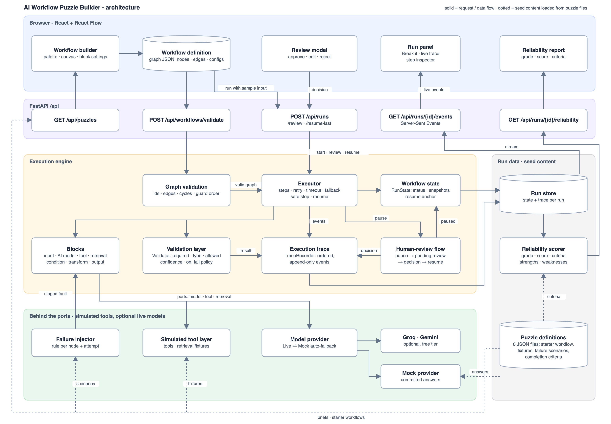
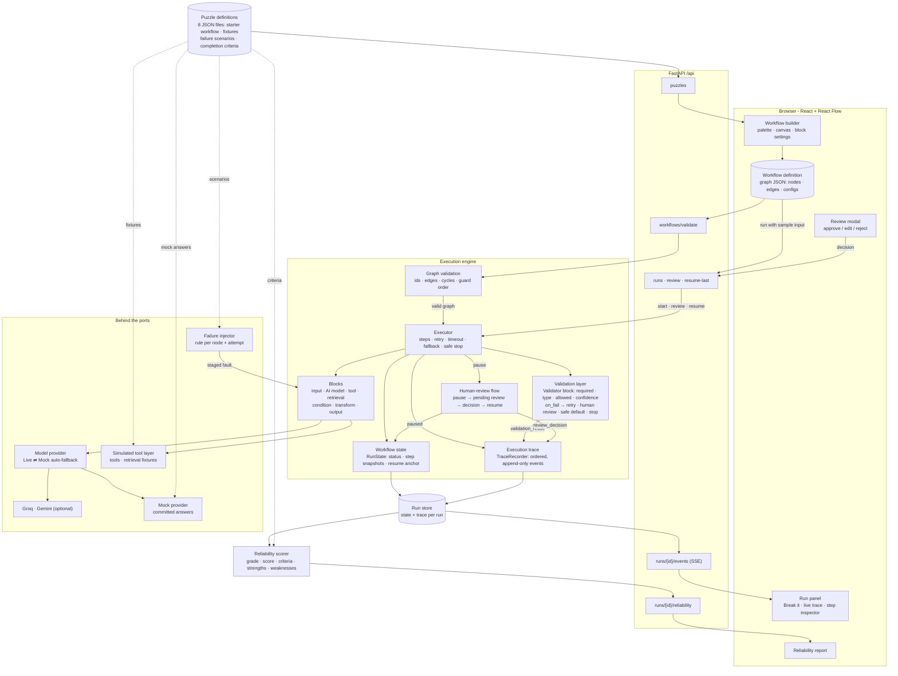

# AI Workflow Puzzle Builder

A browser game that teaches you how to build AI workflows that don't fall apart.
Each of the 8 puzzles gives you a workflow that breaks - a timeout, broken JSON, an empty
search, a model outage. You fix it on a drag-and-drop canvas using retries, timeouts,
fallbacks, validators and human review, run it, watch the live trace, and get a
reliability score.

**No API key needed.** The built-in mock AI provider runs everything the same way on every
machine. A Groq or Gemini key is optional.

Demo video: <https://youtu.be/Q8jejNiOvL8>

---

## How to run

Follow the steps in order. Steps 1, 2 and 4 are all you need: the app runs in **mock
mode** with no API key. Step 3 is only for the optional live AI provider.

### 1. Prerequisites

Pick one path and install what it needs.

| Path | Install | Check it |
|---|---|---|
| **Docker (recommended)** | Docker Desktop (Mac/Windows) or Docker Engine with the Compose v2 plugin (Linux) | `docker --version` and `docker compose version` |
| **Without Docker** | Python 3.11 or newer, Node.js 20.19+ or 22.12+ (with npm) | `python3 --version` and `node --version` |

Both paths also need:

- The submission zip.
- Ports **5173** (web app) and **8000** (API) free on your machine.
- No API key, no paid service, no internet access after the dependencies are installed.

### 2. Get the code

Unzip the submission (or clone the repository) and open a terminal in the folder that
contains `docker-compose.yml`. Every command below is run from that folder.

### 3. Environment file (optional, live AI only)

Skip this step to run in mock mode. The mock provider is the default, needs no setup, and
gives identical results on every machine.

To use a real model, create the environment file from the committed example and put **one**
key in it:

```bash
cp backend/.env.example backend/.env
```

Then open `backend/.env` in an editor and fill in either line:

```ini
GROQ_API_KEY=gsk_...        # Groq, free tier
# GEMINI_API_KEY=AIza...    # or Google Gemini, free tier
```

**How to generate a Groq key (free):**

1. Go to <https://console.groq.com> and sign in with Google or GitHub.
2. Open **API Keys** in the left menu.
3. Click **Create API Key**, give it any name, and click **Submit**.
4. Copy the key right away. It starts with `gsk_` and is shown only once.
5. Paste it after `GROQ_API_KEY=` in `backend/.env`.

**How to generate a Google Gemini key (free):**

1. Go to <https://aistudio.google.com/apikey> and sign in with a Google account.
2. Click **Create API key** (choose or create a Google Cloud project if asked).
3. Copy the key. It starts with `AIza`.
4. Paste it after `GEMINI_API_KEY=` in `backend/.env` and remove the leading `#`.

Notes:

- `backend/.env` is ignored by git, so your key is never committed.
- The same file is used by both paths: Docker loads it through `env_file` in
  `docker-compose.yml`, the bare backend reads it at startup.
- If the key is wrong or the provider is down, the app falls back to the mock and labels
  the answer as mocked. It never crashes.
- More optional settings (model override, provider choice, forcing mock mode) are listed
  under [AI providers](#ai-providers).

### 4. Run

**With Docker (recommended)**

```bash
docker compose up --build
```

The first start builds both images and installs dependencies (a few minutes). Later starts
can use `docker compose up`. Stop with `Ctrl-C`, or `docker compose down` from another
terminal. Both containers run as a non-root user.

After pulling changes that add dependencies, rebuild and refresh the containers'
dependency volumes: `docker compose up --build -V`.

**Without Docker**

Two terminals, both opened in the project folder:

```bash
# terminal 1 - backend on :8000
python3 -m venv backend/.venv
backend/.venv/bin/pip install -r backend/requirements.txt
cd backend && .venv/bin/python -m uvicorn app.main:app --port 8000
```

```bash
# terminal 2 - frontend on :5173
npm install --prefix frontend
npm run dev --prefix frontend
```

The two install lines are one-time. After that, `./scripts/dev.sh` starts both servers in
one terminal and `Ctrl-C` stops both.

### 5. Check it works

1. Open **<http://localhost:5173>**. You should see the puzzle gallery with eight cards.
2. The header badge tells you the AI mode: amber **Mock AI** (no key) or green
   **Live AI · groq** / **Live AI · gemini** (key found).
3. Optional: <http://localhost:8000/api/health> returns JSON that includes
   `"status":"ok"` and `"mode":"mock"` (or `"mode":"live"`).

Then follow [How to use it](#how-to-use-it) below.

### Troubleshooting

| Symptom | Fix |
|---|---|
| `port is already allocated` or `address already in use` | Something else is on 5173 or 8000. Stop it, or change the published port in `docker-compose.yml`. |
| Gallery shows **Could not reach the puzzle server** | The backend is not running. Check terminal 1 (or `docker compose logs backend`). |
| Badge still says **Mock AI** after adding a key | Restart the backend (or `docker compose restart backend`). Make sure the key line has no leading `#` and that `PUZZLE_FORCE_MOCK` is not set. |
| `npm install` fails with an engine error | Node is too old. Use 20.19+ or 22.12+ (check with `node --version`). |
| Want mock mode even though a key is present | Add `PUZZLE_FORCE_MOCK=1` to `backend/.env` and restart the backend. |

---

## How to use it

1. **Pick a puzzle** on the home screen.
2. **Read the brief** on the right: the goal, the sample input, what success looks like,
   and which blocks you can use.
3. **Build the workflow**: drag blocks from the left panel onto the canvas, connect them
   top-to-bottom by dragging between the dots, press Delete to remove things.
4. **Click a block** to change its settings (prompt, schema, retry attempts, ...).
5. **Check workflow** finds structural mistakes before you run.
6. **Break it** turns the puzzle's failure on or off.
7. **Run workflow** - the trace at the bottom fills in live. Click any line to see that
   step's input, output and errors.
8. **Read the report** at the end: grade, score, and which goals you met.

The starter workflow of each puzzle is fragile on purpose. The loop is: run it, watch it
break, fix it, run again, aim for the **resilient** grade.

---

## The 8 puzzles

| # | Puzzle | Level | What breaks |
|---|---|---|---|
| 1 | Fix the Meeting Summarizer | Beginner | The AI drops a required field - a validator must catch it and send it back for repair. |
| 2 | Approve Before Sending | Beginner | A message must not go out until a human approves, edits or rejects it. |
| 3 | Ground the Knowledge Assistant | Intermediate | The search returns nothing - the workflow must refuse to answer instead of guessing. |
| 4 | Repair the Ticket Router | Intermediate | The AI classifies with only 30% confidence - below the bar, so a human decides. |
| 5 | Survive the Research Timeout | Intermediate | A source hangs twice - retry with a timeout wins on the third try. |
| 6 | Validate the Data Extractor | Advanced | The AI returns broken JSON or a half-filled record - schema validation repairs the record, a retry survives the broken JSON. |
| 7 | Activate the Fallback | Advanced | The main model is down - a fallback provider must take over. |
| 8 | Resume the Interrupted Mission | Advanced | A tool dies mid-run - resume from the last successful step. |

Everything each puzzle needs (sample input, mock AI answers, the failure, the pass/fail
criteria) is committed in `backend/app/puzzles/data/*.json`. No setup.

---

## How failure simulation works

Failures are simulated and always happen the same way - no randomness, no real network.
Every reviewer sees the same break in the same place.

The **Break it** button arms the puzzle's failure. A failure is a small rule stored in the
puzzle file:

```json
{ "node_id": "fetch_archive", "kind": "timeout", "first_n": 2 }
```

This means: the `fetch_archive` step fails on its first two attempts, then works. Attempts
are counted across retries and fallbacks, so `first_n: 2` plus a Retry set to 3 attempts
means fail, fail, succeed - the whole retry lesson in one rule.

Failure kinds: `timeout`, `invalid_json`, `tool_error`, `model_error` (these stop the step),
and `missing_field`, `empty_retrieval`, `low_confidence` (these let the step run but spoil
its output - so a validator or condition has to catch them).

---

## How retry, timeout and fallback work

These three are **guard blocks**. A guard sits directly *before* the block it protects:

| Guard | Settings | What it does |
|---|---|---|
| Retry | `max_attempts`, `delay_ms` | Tries the next block again when it fails. `max_attempts: 2` means one retry. |
| Timeout | `timeout_ms` | Cancels one attempt if it takes too long. A Retry in front gives it another try. |
| Fallback | `mode`, `safe_default`, `provider` | Rescues the block after all attempts failed - with a safe default value, or by asking a different provider. |

Order matters: `Retry → Timeout → step` means several tries, each with a time limit, and a
Fallback behind them fires only when the retries are spent. Every recovery shows up in the
trace and in the report - a run saved by a fallback is graded `recovered`, not `resilient`.

---

## How validation and human review work

**Validator block.** Checks the data against a small schema and lists every problem it finds:

```json
{
  "schema": {
    "record.total":    { "type": "number", "min": 0 },
    "record.category": { "allowed": ["billing", "bug", "feature"] }
  },
  "confidence_threshold": 0.7,
  "on_fail": "human_review"
}
```

`on_fail` decides what happens when the check fails: `fail` (stop the run),
`retry_upstream` (run the previous step again), `repair` (send the answer back to the AI
step with every problem listed, up to `max_repairs` times, then check again),
`human_review` (ask a person), or `safe_default` (use a safe value and continue).

Retry and repair are different lessons. A retry asks the model the same question again
and hopes for a better answer. A repair tells the model what was wrong with its last
answer ("the owner is missing") and asks it to fix exactly that. The trace shows a repair
as its own line, and the report counts repairs separately from retries.

**Human Review block.** Pauses the run and shows a person the data. They can:

- **Approve** - continue as is.
- **Edit** - continue with their corrected data.
- **Reject** - stop the run safely. That's a good outcome, not a crash.

Every decision is recorded in the run's trace - the action, the note, the data before and
after. **Resume** (puzzle 8) uses the same saved state: it clones a failed run and continues
right after the last step that worked, showing the reused steps as "skipped".

---

## The reliability report

When a run ends, it gets scored from its trace:

| Grade | Meaning |
|---|---|
| `resilient` | Finished, handled the failure, output valid, nothing left broken. |
| `recovered` | Finished, but only because something rescued it. |
| `fragile` | Finished for the wrong reasons - the failure was never handled, or nothing protects the AI at all. |
| `broken` | Failed, or ended with an unhandled error. |

The report also shows a 0–100 score, retries used, whether a fallback or human was involved,
the puzzle's pass/fail criteria checked one by one, and plain sentences about what went well
and what is still weak. `puzzle_solved` is true when every criterion is met.

---

## AI providers

### Mock mode (default - no setup)

Without an API key, a built-in mock provider answers all AI steps using responses committed
with each puzzle. Same input, same answer, on every machine. The header shows an amber
**Mock AI** badge, and every AI step's trace says `mocked: true`. A repair round is answered
from the puzzle's `<prompt_id>#repair` entry, so the corrected answer is committed too. Mock and live use the
exact same code path - the engine can't tell the difference.

### Live mode (optional)

| Provider | Key variable | Default model | Get a key at |
|---|---|---|---|
| Groq (free) | `GROQ_API_KEY` | `openai/gpt-oss-120b` | <https://console.groq.com> |
| Google Gemini (free) | `GEMINI_API_KEY` | `gemini-2.5-flash` | <https://aistudio.google.com/apikey> |

Step-by-step key generation and the `backend/.env` setup are in
[How to run, step 3](#3-environment-file-optional-live-ai-only). In short:

```bash
cp backend/.env.example backend/.env
# put your key in backend/.env:
#   GROQ_API_KEY=gsk_...      or      GEMINI_API_KEY=AIza...
```

Restart the backend. The badge turns green: **Live AI · groq** (or gemini).

Extra settings (all optional, in `backend/.env`):

```ini
LLM_PROVIDER=gemini    # groq | gemini - pick which one answers (default: first with a key)
GROQ_MODEL=...         # override either provider's model
GEMINI_MODEL=...
GROQ_TIMEOUT_S=30      # per-call time limit for live calls
PUZZLE_FORCE_MOCK=1    # stay in mock mode even with a key
```

The same `.env` file works under Docker too. If a live provider is down or the key is bad,
the app automatically falls back to the mock and labels the answer as mocked - it never
crashes. The Fallback block's `provider` setting can also name the other live provider.

---

## Architecture

The FastAPI backend runs everything; the React canvas is a client. The engine only
orchestrates - all real capability (models, tools, search, failures) sits behind four small
interfaces ("ports"), which is why mock and live behave identically and failures can be
injected cleanly.



The same diagram as Mermaid:



How the diagram maps to the parts a reviewer looks for:

| Component | Where it lives |
|---|---|
| Workflow builder | `frontend/src/builder`, `frontend/src/canvas` |
| Workflow definition / store | Starter graphs in `backend/app/puzzles/data/*.json`; the edited graph lives in the canvas state and is sent as JSON with every run |
| Execution engine | `backend/app/engine/executor.py` (+ `graph.py` for structural checks) |
| AI / model provider | `backend/app/providers` - Groq, Gemini, mock, auto-fallback |
| Simulated tool layer | `backend/app/tools` - tool simulator + fixture retrieval |
| Validation layer | `backend/app/blocks/validator.py`; `on_fail` policy is applied by the executor |
| Workflow state handling | `backend/app/engine/run.py` (`RunState`), `store.py` (run store, resume anchor) |
| Human-review flow | `backend/app/blocks/human_review.py` + pause/resume in the executor + `POST /api/runs/{id}/review` |
| Execution trace | `backend/app/engine/trace.py` (`TraceRecorder`), streamed by `GET /api/runs/{id}/events` |
| Reliability feedback | `backend/app/reliability/scorer.py`, shown by `frontend/src/run/ReliabilityPanel.tsx` |

### Folders

```
tc-100/
├── docker-compose.yml         # docker compose up → :5173 + :8000
├── docs/                      # architecture diagram (png)
├── scripts/dev.sh             # start both servers locally
├── backend/
│   ├── requirements.txt       # runtime deps (lock file used in Docker; -dev adds pytest)
│   ├── .env.example           # optional live-provider keys
│   └── app/
│       ├── api/               # routes: puzzles, validate, runs, SSE, review, resume
│       ├── engine/            # executor, graph checks, run state, trace, ports
│       ├── blocks/            # one module per block type (validator included)
│       ├── providers/         # Groq / Gemini / mock / auto-fallback
│       ├── tools/             # simulated tools + retrieval
│       ├── failures/          # failure injector
│       ├── reliability/       # scorer
│       └── puzzles/           # the 8 puzzle files + loader
└── frontend/src/
    ├── api/                   # typed client (+ in-browser mock client)
    ├── blocks/                # block catalog: labels, icons, settings
    ├── canvas/                # React Flow nodes and edges
    ├── builder/               # palette, settings panel, puzzle brief
    ├── run/                   # live trace, inspector, review modal, report
    ├── components/ theme/     # shared UI + light/dark theming
    └── pages/                 # puzzle list, builder
```

Design in one paragraph: the trace is the source of truth (the UI renders it, the scorer
reads it, resume replays it); failures are declarative rules, not randomness, so every run
is reproducible; guards declare policy while the executor does the recovering; and the API
contract (`backend/app/api/schemas.py`, mirrored by `frontend/src/api/types.ts`) was frozen before either side was built.

---

## Tests and scans

**Backend - 432 tests**, including end-to-end proof that every puzzle breaks as designed
and is solvable:

```bash
cd backend
.venv/bin/pip install -r requirements-dev.txt   # once
.venv/bin/python -m pytest -q
```

**Frontend:**

```bash
npm run build --prefix frontend   # type-check + build
npm run lint  --prefix frontend   # oxlint - clean
npm audit --prefix frontend       # 0 vulnerabilities
```

**Backend lint and dependency audit** (tools come with `requirements-dev.txt`):

```bash
cd backend
.venv/bin/ruff check app tests            # clean
.venv/bin/pip-audit -r requirements.lock.txt --no-deps   # no known vulnerabilities
```

**Security scans** (both clean - no vulnerabilities, secrets, or misconfigurations; what
remains is informational only):

```bash
opengrep --config=r/all --exclude-rule=bbp-pattern-inject .
trivy fs --scanners vuln,secret,misconfig,license .
```

Where a scanner rule fires on something safe by construction (like a lookup with a typed
key), the line has an inline `nosemgrep` comment naming the rule and why it's safe.
Everything real was fixed, not annotated.

---

## Known limitations

- Runs are stored in memory only - a restart loses them. Fine for a demo; production would
  need a database.
- Single process: don't run uvicorn with multiple workers.
- Resume turns the failure off on purpose - the point of puzzle 8 is finishing the mission
  once the outage has passed.
- The layout is responsive down to phone widths (the side panels become slide-over drawers below 1024px), but building by drag-and-drop is best on a desktop; on touch screens, use tap-to-add from the Blocks drawer.
- Tools and search are simulated from committed fixtures - no workflow calls a real
  external API.
- With a live key, model wording varies run to run. Use mock mode for an exact,
  reproducible walkthrough.
- No login - anyone who can reach the port can use it.
