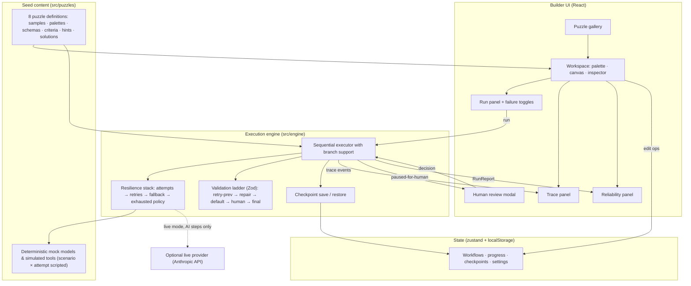

# 🧩 Workflow Puzzle Lab — AI Workflow Puzzle Builder

A browser-based **visual puzzle and learning lab** for resilient AI workflow design. Pick a
pre-seeded puzzle, assemble or modify a multi-step AI workflow, run it against a committed
sample input, flip on a deterministic failure scenario, watch it break, and repair it with
retries, fallbacks, validators, safe stops, and human review — then read the execution trace
and a reliability report that tells you exactly what survived and what is still fragile.

Everything runs **locally, offline, without paid AI access**: model, tool, and retrieval
calls are deterministic local mocks committed with the puzzles (clearly labeled **🧪 MOCK AI**
in the UI). An optional live Anthropic provider can be plugged in from Settings.

> **▶ Live demo:** https://workflow-puzzle-lab.vercel.app — nothing to install; the whole
> lab, including every failure scenario, runs in your browser.
>
> **▶ Demo video (3:11):** https://drive.google.com/file/d/19Iznyl-GEV4Q8YSsTeXDoo9XnZdHLJ-u/view?usp=sharing
>
> Prefer to run it locally? See **Quick start** below — two commands, no keys, no backend.

---

## Quick start

Prerequisites: **Node.js ≥ 20** and npm.

```bash
npm install
npm run dev
```

Open **http://localhost:5173** in your browser. That's it — no environment variables,
no API keys, no backend, no database.

Other commands (run `npm install` first in a fresh checkout):

```bash
npm test            # 90 Vitest tests: engine, puzzles, workflow ops, reliability
npm run typecheck   # strict TypeScript
npm run lint        # ESLint
npm run build       # production build into dist/
npm run preview     # serve the production build
npm run verify      # typecheck + tests + build, in one go
```

---

## For reviewers: where to see each requirement

**Short on time?** [`docs/REVIEW.md`](docs/REVIEW.md) is a linear 12-minute walkthrough
that exercises every scored requirement in order, with the exact result to expect at each
step. The table below is the reference version of the same material.

The app ships a **🧭 Reviewer guide** (button on the home screen, 🧭 in the puzzle header).
It lists every capability below with a **one-click jump** that opens the right puzzle,
arms the right failure scenario, and loads a known-good workflow where one is needed — so
you can press **▶ Run workflow** immediately. Nothing here needs a key or a network.

| Requirement | Where to see it | Code |
|---|---|---|
| Visual builder, arrange/configure multiple steps | Any puzzle: drag from the shelf, `+` quick-add, ↑↓ reorder, click a step to configure | [`src/ui/Canvas.tsx`](src/ui/Canvas.tsx), [`src/state/workflowOps.ts`](src/state/workflowOps.ts) |
| A "successful" run that ships invalid data | Guide → *A run that "succeeds" but ships invalid data* | [`src/reliability/report.ts`](src/reliability/report.ts) |
| Structured-output validation | Guide → *Structured-output validation* (Puzzle 1) | [`src/engine/validation.ts`](src/engine/validation.ts) |
| Repair invalid output | Guide → *Automatic repair* (Puzzle 1, Missing owner) | `repair()` in each puzzle's schema preset |
| Retry with a bounded budget | Guide → *Retry with a bounded attempt budget* (Puzzle 4) | `runResilient()` in [`src/engine/engine.ts`](src/engine/engine.ts) |
| Fallback tool / fallback model | Guide → *Fallback to a different tool* (P4), *…model* (P7) | `runResilient()` fallback branch |
| Safe stop with a clear reason | Guide → *Refusing safely instead of hallucinating* (P2) | `safeStop()` in the engine |
| Conditional branching | Guide → *Conditional branching* (P2) | `runCondition()` in the engine |
| Confidence threshold → human routing | Guide → *Confidence threshold* (P3) | `conditions` preset in [`ticket-router.ts`](src/puzzles/ticket-router.ts) |
| Human review: approve / edit / reject | Guide → *Human approval* (P5) | [`src/ui/HumanReviewModal.tsx`](src/ui/HumanReviewModal.tsx), `runHuman()` |
| Full escalation ladder in one puzzle | Guide → *The full escalation ladder* (P6) | `runValidator()` in the engine |
| Checkpoint + resume from last successful step | Guide → *Checkpoint and resume* (P8) | `handleInterrupt()` / restore in the engine |
| Execution trace of every step | **🧾 Trace** tab on any run; click a step for its last input/output | [`src/ui/TracePanel.tsx`](src/ui/TracePanel.tsx) |
| Reliability feedback + unresolved weaknesses | **📊 Reliability** tab after any run | [`src/reliability/report.ts`](src/reliability/report.ts) |
| Mock AI mode | 🧪 MOCK AI badge, always on by default | [`src/puzzles/*.ts`](src/puzzles) mock handlers |
| Optional live provider | ⚙️ Settings → enable live AI | [`src/providers/live.ts`](src/providers/live.ts) |

Two independent checks a reviewer can run without touching the UI:

```bash
npm test
```

127 tests, including a determinism suite that replays every puzzle against every scenario
combination twice and compares the whole run byte-for-byte — so "deterministic" is a
tested property here, not a promise in a README.

Beyond engine behaviour, the suite proves that **every puzzle's naive workflow
fails the way it teaches**, **every committed solution survives every one of its failure
scenarios**, and **every completion goal is actually reachable** — so no seeded puzzle can
be unsolvable.

## How to use the workflow builder

1. **Pick a puzzle** on the home screen (grouped Beginner → Intermediate → Advanced).
2. Read the **🎯 Mission** tab: objective, expected result, completion goals, what the
   puzzle teaches, and progressive hints. The **phase strip** under the header tracks the
   intended loop — Understand → Run baseline → Break it → Repair → Prove resilience — and
   advances on real milestones (you have run it, you have seen it break, your repair held).
3. The canvas shows the puzzle's starting workflow — a vertical pipeline from **Input**
   to **Output**. Some puzzles start naive on purpose.
4. Build and configure:
   - **Drag** blocks from the *Block shelf* into any drop zone between steps, or press
     the **+** button to quick-add (inserted just before Output).
   - **Drag upgrade chips** (🔁 Retry, 🪂 Fallback) onto AI/Tool step cards — or set the
     same options in the step inspector.
   - **Click a step** to open its settings: model choice, retry budget, fallback target,
     what happens when everything is exhausted, and the validator's escalation ladder.
   - **Reorder** by dragging cards, or with the ↑ ↓ buttons on each card. Remove with ✕.
   - **Condition** blocks render two lanes (✓ yes / ✗ no); drag blocks into either lane.
5. **▶ Run workflow**. Steps animate through their statuses; the **🧾 Trace** tab streams
   every event live. Toggle **⚡ instant pace** to skip the animation.
6. Flip on a **💥 failure scenario** and run again. Repair. Repeat.
7. Read the **📊 Reliability** tab after each run, and watch the completion goals fill in.
   From your second run onward it also shows the **before → after delta** (e.g.
   `41 → 100 (+59) since your last run`), so a repair's effect is visible immediately.
   Solve all goals and the puzzle is marked ⭐ Solved.

On narrow screens the three-column workspace becomes a **single pane with a bottom tab
bar** — Mission · Build · Run · Trace · Score — with the run button always within thumb
reach. Every feature, including the human-review modal and the full block inspector, is
usable at phone width.

Workflows, progress, and settings persist in `localStorage`. **↺ Reset** restores a
puzzle's starting workflow. After revealing all hints, **🗝️ Apply a known-good setup**
loads a verified solution workflow.

## The 8 seeded puzzles

| # | Puzzle | Difficulty | Teaches | Failure scenarios |
|---|--------|-----------|---------|-------------------|
| 1 | 📝 Fix the Meeting Summarizer | Beginner | Validation, retry vs repair | Sloppy JSON, Missing owner |
| 2 | 📚 Ground the Knowledge Assistant | Beginner | Retrieval grounding, refusing without evidence | Empty library, Lazy citer |
| 3 | 🎫 Repair the Ticket Router | Intermediate | Validate before tools, confidence gates, human routing | Category drift, Confidence overflow, Wobbly classifier |
| 4 | ⏱️ Survive the Research Timeout | Intermediate | Retry for flakes, fallback for outages | Flaky network, Journal outage |
| 5 | ✉️ Approve Before Sending | Intermediate | Human approval gates, honoring rejection | The over-promiser, Send hiccup |
| 6 | 🔬 Validate the Data Extractor | Advanced | The full escalation ladder: retry → repair → human | Fence glitch, Word numbers, Field amnesia |
| 7 | 🪂 Activate the Fallback | Advanced | Retry budgets, model fallbacks | Atlas brownout, Atlas outage |
| 8 | 🛰️ Resume the Interrupted Mission | Advanced | Checkpoints, resuming from the last successful step | Solar flare, Relay static |

Every puzzle commits its sample inputs, block palette, schemas, mock responses, failure
configurations, completion criteria, hints, and a verified solution in
`src/puzzles/<puzzle-name>.ts`.

## How failure simulation works

Failure scenarios are **deterministic scripts, not randomness**. Each puzzle's mock model
and tool handlers receive the set of enabled scenario ids plus the current **attempt
number**, and return a scripted outcome:

- *"fails on attempts 1–2, succeeds on attempt 3"* → teaches retries (Flaky network,
  Atlas brownout, Fence glitch)
- *"fails on every attempt"* → teaches fallbacks (Journal outage, Atlas outage)
- *"returns bad data on every attempt"* → teaches repair and human escalation, because
  retrying provably doesn't help (Missing owner, Word numbers, Field amnesia)
- *"interrupts the run once"* → teaches checkpoint resume (Solar flare)

Because outcomes are keyed to `(scenario, attempt, provider/tool)`, every run reproduces
identically — reviewers can trigger the same failure as many times as they like.

Two failure planes are modeled deliberately:

- **Hard failures** (timeouts, tool errors, provider outages) *throw* and are handled by
  the step's resilience stack: retries → fallback → exhausted policy.
- **Soft failures** (unparseable JSON, wrong types, missing fields, missing citations,
  low confidence, empty retrieval) *flow onward as data*. Nothing crashes — which is
  exactly the danger. Without a Validator the run "succeeds" and the reliability report
  calls out that invalid data shipped silently.

## How retry and fallback work


Retry, fallback and safe-stop are placed from the same block shelf as every other block, with the same drag (or `+`) gesture, and they render on the canvas as their own cards — connected by a rail to the step they protect. Attaching them to a specific step rather than leaving them free-floating is deliberate: it is what tells the engine *which* call to retry, which a standalone node would have to infer.
AI and Tool steps carry a resilience stack, configured via upgrade chips or the inspector:

1. **Attempts** — 1 by default, plus a 🔁 Retry budget (up to 3 extra). Only *retryable*
   failures (timeouts, 5xx-style tool errors) are retried; every attempt is traced.
2. **🪂 Fallback** — once attempts are exhausted: switch to a fallback **model**
   (Puzzle 7), a fallback **tool** such as a stale cache (Puzzle 4), or a schema-valid
   **safe default** value (marked *degraded* in the trace).
3. **Exhausted policy** — if even the fallback fails: **fail the run** (unhandled error)
   or **stop safely** with a clear explanation. Safe stops are a first-class outcome,
   scored as controlled behaviour by the reliability report.

## How validation and human review work

**Validator blocks** check the previous step's output against a Zod schema (required
fields, types, allowed values, ranges, citation presence, output format). On failure they
walk a configurable **escalation ladder**, in this order:

1. 🔁 **Retry the previous step** (re-runs it against its original input) — fixes flukes
2. 🔧 **Repair automatically** — deterministic fixes for predictable quirks (strip
   markdown fences, map alias categories, normalize confidence scales, convert
   word-amounts), always with an explanatory note in the trace. A repair that fixes
   only *part* of the problem is **kept, not discarded**: the remaining rungs work on
   the improved payload, so a human is never handed back a defect a machine already
   corrected. The trace labels it *Partial repair* and lists only what is still wrong
3. 📦 **Use a safe default** — a schema-valid placeholder, marked degraded
4. 🙋 **Escalate to a human** — opens the review modal with the issues listed
5. **Final action** — safe stop (with the issues in the message) or hard fail

**Human Review blocks** (and validator escalations) pause the run and open a modal where
the reviewer can **Approve**, **Edit** (JSON editor, validated live against the step's
schema before submission is allowed), or **Reject** (stops the workflow safely — later
steps such as "send email" provably never run). Every decision, note, and edited payload
is recorded in the execution trace and counted in the reliability report.

## Execution trace and reliability feedback

The **🧾 Trace** tab records everything with timestamps: step inputs/outputs, every
attempt and which provider/tool served it, retries, fallback activations, validation
results with issues, repairs (before/after), branch decisions with reasons, pauses,
human decisions, checkpoints, safe stops, and the final result. Click any step card to
see its last input/output in the inspector.

The **📊 Reliability** tab scores each run out of 100 across four axes — run outcome,
output integrity, chaos handling, design hygiene — and lists **recovery behaviour that
actually happened** (retries survived, fallbacks activated, repairs applied, human
decisions recorded, checkpoint restores) next to **unresolved design weaknesses**
(enabled scenarios with no countermeasure, unvalidated AI output, validators with no
recovery strategy).

## Mock AI mode and the optional live provider

**Mock mode is the default and the canonical puzzle experience.** The 🧪 MOCK AI badge is
always visible; mock responses live beside each puzzle definition and preserve the same
execution, validation, failure, and recovery flow as live responses.

To try a **live provider**: ⚙️ Settings → enable live AI → paste an Anthropic API key →
pick a model. AI steps then call the Anthropic Messages API directly from the browser;
their raw text flows through the same JSON parsing and validators. Notes:

- Tools, retrieval, and failure injection stay local, so puzzles remain reproducible.
- Scripted *model* failure scenarios apply to mock mode only; live calls can of course
  fail for real (network, auth), and those failures flow through the same retry/fallback
  machinery. Fallback *models* stay mocked, so Puzzle 7's drill works in either mode.
- The key is stored in your browser's localStorage and sent only to `api.anthropic.com`.
  Never commit a key to the repository.

## Security notes

The app has **no backend, no database, no authentication, and no user data**. It makes no
network requests at all in its default mock mode, and the production bundle contains no
secrets. `npm audit` reports **0 vulnerabilities** across 4 runtime and 9 dev dependencies.

One deliberate design point worth stating plainly, since it is the only place a key exists:

- **Optional live mode stores an Anthropic API key in `localStorage` and calls the
  Anthropic API directly from the browser.** This is off by default and no puzzle, test,
  or completion goal depends on it. Because there is no server to hold a key, the two
  honest options were "browser-direct, clearly disclosed" or "no live mode at all"; the
  spec asks the README to explain optional-provider configuration, so live mode ships with
  an explicit in-app disclosure (⚙️ Settings) and a one-click **Clear stored key**. The key
  is never logged, never bundled, and never sent anywhere but `api.anthropic.com`.
  A reviewer never needs to enter one.

See [`docs/security-review.md`](docs/security-review.md) for the scan-triage notes,
including the patterns most likely to raise automated findings and why each is safe.

## Deploying it (optional)

The app is a **static single-page bundle with no backend**, so `npm run build` produces a
`dist/` folder that any static host will serve. Config for the three common free hosts is
committed, each including a strict Content-Security-Policy and the usual hardening headers.

**Netlify** — connect the repo; [`netlify.toml`](netlify.toml) supplies the build command,
publish directory, Node version, and headers. No dashboard settings needed. To deploy
without connecting a repo: `npm run build`, then drag `dist/` onto Netlify.

**Vercel** — import the repo; [`vercel.json`](vercel.json) supplies the same. Vercel also
auto-detects Vite, so an import with no config works too.

**GitHub Pages** — enable Pages with *Source: GitHub Actions* (repo Settings → Pages).
[`.github/workflows/deploy-pages.yml`](.github/workflows/deploy-pages.yml) then builds and
publishes on every push to `main`/`master`, gating the deploy on typecheck, tests, and lint.

**Any other static host** (S3, Cloudflare Pages, nginx, `python3 -m http.server`):

```bash
npm run build
# serve the contents of dist/
```

### Base path

Hosts that serve from a domain root need nothing. GitHub Pages serves from `/<repo>/`, so
the bundle needs a matching base path — the workflow sets this automatically, and manually
it is:

```bash
BASE_PATH="/your-repo-name/" npm run build
```

### Notes

- There is **no client-side router**, so no rewrite rules are strictly required. The
  configs include a catch-all to `index.html` anyway (and the Pages workflow copies
  `index.html` to `404.html`) so a stray deep link lands on the app rather than a 404.
- The CSP allows `connect-src https://api.anthropic.com` solely for the opt-in live AI
  provider. In default mock mode the deployed app makes **no network requests at all**
  after load, so it works offline and behind restrictive corporate proxies.
- Nothing about the deployment changes puzzle behaviour: the same deterministic mocks,
  failure scenarios, and tests apply.

## Architecture



A more detailed walkthrough (module responsibilities, execution semantics, data flow,
and an SVG diagram) lives in [docs/architecture.md](docs/architecture.md).

### Source layout

```
src/
  engine/        # workflow model, executor, resilience + validation ladders, trace events
    types.ts        # step/trace/report types — the shared vocabulary
    engine.ts       # the executor (attempts, retries, fallbacks, humans, checkpoints)
    validation.ts   # Zod validation + failure-kind classification
    util.ts         # ids, workflow hashing, flattening
    engine.test.ts  # engine behaviour tests
  puzzles/       # committed seed content — one file per puzzle
    types.ts        # puzzle/preset/scenario/criterion contracts
    blocks.ts       # step + mock-outcome factory helpers
    *.ts            # 8 puzzle definitions (samples, mocks, schemas, criteria, solutions)
    puzzles.test.ts # every puzzle: naive failure demos + solution solvability + criteria coverage
  providers/     # optional live Anthropic call (mock mode needs nothing)
  reliability/   # run scoring + workflow weakness lint
  state/         # zustand store, workflow edit operations, persistence
  ui/            # React components: home, workspace (desktop 3-column + mobile
                 # single-pane/tab-bar), canvas, palette, inspector, phase strip,
                 # run panel, trace, report, goals, human-review modal, settings
```

## Assumptions

- **Linear workflows with conditional branching** are sufficient (confirmed in the
  challenge forum). Condition blocks hold two nested linear branches; conditions are not
  nested inside branches to keep the puzzle canvas readable.
- Retry/fallback are modeled as **upgrades attached to AI/Tool steps** (drag chips onto a
  step) rather than free-standing blocks — same semantics, clearer visual reading of
  "this step has this protection".
- Retrieval returning zero documents is a **soft** outcome by design; Condition and
  Validator blocks decide what it means.
- The recommended block list mentions **Timeout** and **Error Handler**. Both are modeled
  as *properties of a step* rather than separate blocks, because that is where they
  actually apply: a timeout is one of the injected failure kinds a step can suffer
  (`FailureInfo.kind === 'timeout'`), and error handling is the step's `onExhausted`
  policy plus the validator's `finalAction` — each rendered on the card as a 🛑 badge.
  The spec prefers "a smaller set of well-designed blocks" over a large library.
- Dev tooling is current on Vite 8 / Vitest 4 / React 19. TypeScript is deliberately held
  at 5.9 and ESLint at 9: their next majors (TS 7's native port, ESLint 10) are large
  breaking changes whose risk to a reviewer's `npm install` outweighs the freshness, and
  neither carries a known CVE. Runtime dependencies are 4 packages, all on current majors.
- Human review pauses are in-memory (promise-based) — deliberately, since this is a
  learning lab, not a durable orchestration platform (see limitations).
- Reliability scoring is intentionally opinionated and generous to *deliberate safe
  stops*: refusing to answer is presented as a success mode, not a failure.

## Known limitations

- **No backend**: state lives in the browser (localStorage). Clearing site data resets
  progress. Multi-user/collaborative editing is out of scope. Saved workflows are
  validated on load — any whose block presets have gone stale is discarded in favour of
  the puzzle's starting workflow, and a React error boundary catches anything else.
- **Checkpoints survive reloads, but a paused human review does not** — an in-flight run
  waiting on the modal is lost on refresh (the completed-steps checkpoint model covers
  the "resume" learning objective instead).
- Checkpoints are invalidated when the workflow is edited (structural hash), by design.
- The live provider supports Anthropic only, and live mode does not script *model*
  failures (mock mode is the canonical failure-drill experience).
- Conditions cannot nest inside condition branches (one level of branching).
- HTML5 drag-and-drop is used for dragging; every drag action also has a click/button
  equivalent (+ quick-add, ↑ ↓ reorder, inspector-based upgrades), which is also the
  accessible path. On touch devices the click/button path is the primary one, since HTML5
  DnD does not fire for touch gestures.
- The reliability score delta compares against your **previous run of that puzzle**, in
  this browser session only; it is not persisted across reloads.

## Demo video

**▶ Watch the demo (3 min 11 s):** https://drive.google.com/file/d/19Iznyl-GEV4Q8YSsTeXDoo9XnZdHLJ-u/view?usp=sharing

The video is a captioned screen recording of this exact build — no narration audio; the
on-screen captions carry the walkthrough. Every score shown in it is asserted against the
app during recording, so the figures below are the app's real output, not annotations.

| Beat (in order) | Result on screen |
|---|---|
| Home — 8 puzzles, mock-AI mode, reviewer guide | 0/8 solved |
| Puzzle 1 run, no failures | **80** · Resilient |
| Sloppy JSON injected, naive workflow | **41** · Fragile · integrity **0/20** |
| Validator added | **100** · delta `41 → 100` |
| Missing owner — retrying cannot fix it | **87** · safe stop |
| Repair enabled | **100** · solved |
| Puzzle 5 — human review: edit, then reject | **87**, send step never runs |
| Puzzle 7 — brownout, retry, outage, fallback | 6 → 93 → 6 → **93** |
| Puzzle 8 — interrupt, resume from checkpoint | 21 → **93**, 3 steps restored |
| Reliability report, then Settings (mock mode) | — |

Coverage of the required beats is tracked in
[docs/demo-captions.md](docs/demo-captions.md); the recording script it follows is
[docs/demo-script.md](docs/demo-script.md).
