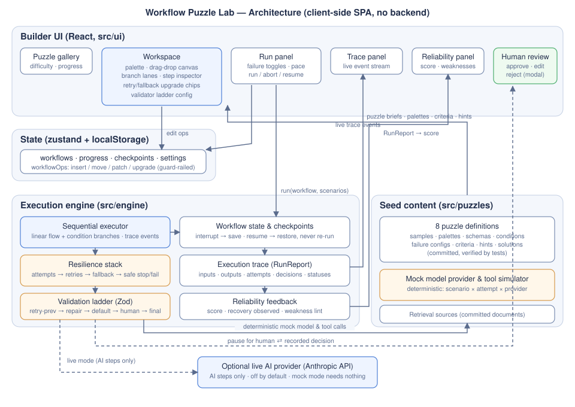

# Architecture

Workflow Puzzle Lab is a **fully client-side single-page application** (Vite + React +
TypeScript). There is deliberately no backend: every requirement — deterministic mock AI,
simulated tools, failure injection, validation, human review, tracing, reliability
feedback, persistence — is satisfiable in the browser, which makes the review experience
one command (`npm run dev`) with zero external dependencies.

> Looking to verify behaviour rather than read structure? See
> [`REVIEW.md`](REVIEW.md) for a step-by-step walkthrough with expected results.

## Layers and responsibilities

### 1. Workflow model (`src/engine/types.ts`)

The shared vocabulary. A workflow is a **linear sequence of steps**; a `condition` step
holds two nested linear branches (`then` / `else`). This matches the challenge forum
clarification that a linear workflow with conditional branching is sufficient, and keeps
the canvas readable.

Step kinds: `input`, `ai`, `tool`, `retrieval`, `condition`, `transform`, `validator`,
`human`, `safestop`, `output`. AI/Tool steps carry a **resilience stack**
(`upgrades.retry`, `upgrades.fallback`, `onExhausted`). Steps are plain serializable
data — every configurable value is a **preset id** resolved against the puzzle
definition, which is what makes workflows persistable and checkpoints replayable.

### 2. Execution engine (`src/engine/engine.ts`)

A sequential async executor with:

- **Resilience stack** for AI/Tool steps: attempts (1 + retry budget) → fallback
  (provider / tool / safe default) → exhausted policy (safe stop or hard fail). Only
  failures flagged `retryable` are retried.
- **Two failure planes.** Hard failures (timeout, tool error) throw and hit the
  resilience stack. Soft failures (unparseable JSON, wrong types, missing fields) flow
  onward *as data* — the engine parses AI JSON output and wraps parse failures as
  `{malformed, raw}` instead of crashing, so an unguarded workflow demonstrably ships
  garbage. Validators exist to catch exactly this.
- **Validation ladder** for validator steps (Zod-based): re-validate → retry the
  previous step **against its original input** → deterministic repair (with notes) →
  safe default (degraded) → human escalation → final action. Repairs are cumulative:
  a partial repair is committed and the ladder continues on the improved payload,
  with the `repair-applied` event carrying `resolved: false` so the trace stays honest
  about it not being the whole fix.
- **Human-in-the-loop**: the engine awaits a `human(prompt)` callback. The UI implements
  it as a modal returning a promise; tests implement it as scripted deciders. Approve /
  edit (schema-checked) / reject are all recorded as trace events; reject triggers a
  safe stop so downstream side-effect steps provably never run.
- **Checkpoints**: a scripted interruption saves `{workflowHash, completed step ids,
  outputs, context}`. A resume run restores those steps (status `restored`, never
  re-executed) and continues; scripts receive a `resumed` flag so the interruption is
  one-shot and deterministic. Editing the workflow invalidates the checkpoint via the
  structural hash.
- **Trace events**: every meaningful transition emits a typed `TraceEvent` (19 kinds),
  streamed to the UI via `onEvent` and returned in the final `RunReport` together with
  per-step statuses, counters (retries, fallbacks, repairs, defaults, validations,
  human decisions), the final output, and its validity against the puzzle's expected
  schema.

### 3. Seed content (`src/puzzles/`)

One TypeScript module per puzzle, exporting a typed `Puzzle` object: metadata, committed
sample inputs, provider/task/tool/source/schema/condition/transform/default presets,
the block palette (with per-puzzle instance limits), the starting workflow, failure
scenarios, completion criteria, hints, and a **verified solution workflow**.

Mock behaviour is scripted per `(scenario set, attempt, provider/tool id, resumed)` —
**deterministic chaos**. Scenarios that retries can fix succeed on a later attempt;
scenarios that retries cannot fix return the same defect on every attempt, so the
puzzle *proves* why repair or human review is needed.

### 4. Validation layer (`src/engine/validation.ts` + per-puzzle Zod schemas)

Zod schemas power validator blocks, human-edit gating, and final-output checking. Issues
are formatted into human-readable strings and classified into failure kinds
(invalid-json / missing-field / schema / low-confidence) for the run report.

### 5. State & persistence (`src/state/`)

A zustand store holds per-puzzle workflows, enabled scenarios, criteria progress,
checkpoints, reports, and settings; it persists to localStorage on every mutation.
On load, every saved workflow is checked so that each preset id it references still
resolves (`workflowIsLoadable`); stale entries are dropped back to the puzzle's starting
workflow rather than throwing mid-render. An `ErrorBoundary` wraps the app as a last
resort, showing the actual error plus a "clear saved progress" recovery.
`workflowOps.ts` contains pure workflow edit operations (insert/move/nudge/remove/patch/
upgrade) with guardrails (locked Input/Output, no nested conditions, upgrade
compatibility), each returning either a new tree or a user-facing error message.

### 6. Reliability feedback (`src/reliability/report.ts`)

`assessRun(puzzle, workflow, report)` produces a 0–100 score across four axes (run
outcome, output integrity, chaos handling, design hygiene), a list of **observed
recovery behaviour** from the actual run, and **unresolved weaknesses** from a static
lint: enabled scenarios whose countermeasures are absent, structured AI output with no
validator/human guard downstream, validators with detection but no recovery strategy.
Deliberate safe stops score as controlled behaviour, not failure.

The assessment is computed **once, in the store, against the workflow that actually ran**
and cached as `scored[puzzleId]`. That keeps a finished run's score stable while the
player edits the workflow for the next attempt, and it retains the prior run's score so
the report can show a before → after delta.

### 7. Builder UI (`src/ui/`)

React components composing the workspace: puzzle gallery, phase strip, palette (drag +
click-to-add), canvas (drop zones, branch lanes, live status chips, upgrade badges),
inspector (per-kind config forms incl. the validator ladder), run panel (sample input,
failure toggles, run/abort/resume, pace, mock/live badge), trace panel, reliability panel,
mission/goals panel (criteria, hints, known-good setup), human review modal, and
settings. Drag-and-drop is standard HTML5 DnD; every drag gesture has a click/button
equivalent as the accessible fallback.

`PuzzleScreen` picks one of two layouts from a `matchMedia` hook (`useIsMobile`, 860px):
the desktop three-column workspace, or a mobile single-pane shell with a bottom tab bar
(Mission · Build · Run · Trace · Score). Both render the same panel components, so there
is no duplicated feature surface — the Build pane simply stacks the run panel, canvas,
palette, and (when a step is selected) the inspector. Running a workflow switches the
active pane to Trace, and finishing switches it to Score, mirroring the desktop tabs.

### 8. Optional live provider (`src/providers/live.ts`)

A single fetch to the Anthropic Messages API (browser-direct). Only AI steps use it and
only in live mode; tools, retrieval, and failure injection stay local so seeded puzzles
remain reproducible. Live failures (network/auth) flow through the same retry/fallback
machinery as mock failures.

## A run, end to end

1. UI clones the current workflow, snapshots pending statuses, and calls `runWorkflow`
   with the puzzle kit, sample id, enabled scenarios, pace, human callback, and an
   `AbortSignal`.
2. The engine walks the sequence. Each step emits `step-started` (with its input),
   executes per its kind, and emits `step-completed` (with output, duration,
   recovered/degraded flags) — or the failure/pause/stop events described above.
3. The store reduces events into live per-step statuses (cards animate through
   pending → running → retrying → completed/recovered/failed/paused/safe-stopped/
   restored) and appends them to the trace.
4. On finish, the engine returns a `RunReport`. The store evaluates the puzzle's
   completion criteria against it, persists progress (criteria are cumulative across
   runs — e.g. "survive the outage" and "ride out the flake" are two different runs),
   saves/clears the checkpoint, and switches the panel to the reliability report.
   Meeting all criteria marks the puzzle solved (confetti included).

## Testing strategy (`npm test`)

- `engine.test.ts` drives a synthetic puzzle through every engine behaviour: retry
  recovery and exhaustion, both fallback shapes, safe-stop policies, the malformed-JSON
  soft path, the full validator ladder, branch-taking and branch safe stops, human
  approve/edit/reject.
- `puzzles.test.ts` proves the seed content: every puzzle's **naive workflow fails the
  way it teaches** (silent garbage, crashes, hallucinations), every puzzle's **solution
  survives each of its scenario sets** with valid output or a deliberate safe stop, and
  every **completion criterion is achievable** via a scripted playbook of runs
  (including the interrupt → resume flow and all three human decisions).
